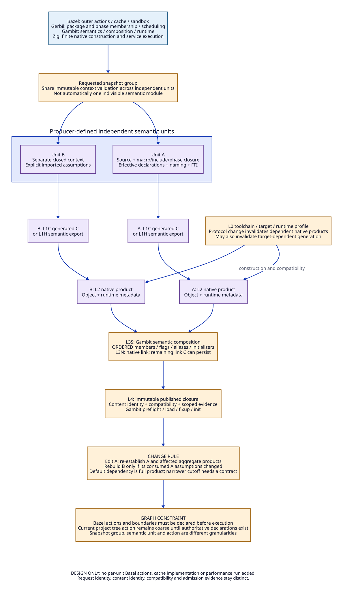

# Correct Compilation Units, Artifact Contracts and Invalidation

Date: 2026-10-19. Status: selected architecture, design only.

This refines the [cost/AOT study](compilation-cost-and-aot-design.md),
[native contract](zig-native-contract-design.md) and
[semantic coverage](primitive-ffi-coverage.md). No executable schema, build rule,
compiler change, cache, model or performance experiment is introduced.

**Scope correction:** the user's parent-repository reference primarily identifies
the Darwin patch evidence and pre-first-compile execution cost, not a Bazel
scheduler problem. The [Darwin boundary study](darwin-first-compile-boundary.md)
is the entry point for that cost. The action/compilation-unit design below governs
later generation/construction reuse and must not be sold as removing earlier
live import/expansion/instantiation work.

## 1. Decision: Three Units, Not One File Equals One Action

Define the **smallest correct semantic compilation unit** as a producer-defined
region of source/elaboration whose meaning and outputs can be reproduced from
a closed context, without mutable compiler state borrowed from another request.
Every external dependency is either an explicit immutable input with a sufficient
contract, or part of the same indivisible unit. Minimality is relative to a
declared semantic profile and producer, not a universal property of a filename.

Use three different units:

| Unit | Purpose | Boundary owner | Selected rule |
| --- | --- | --- | --- |
| Semantic unit | Defines what can be generated independently with correct bindings, state and runtime meaning | Gambit; Gerbil supplies package/phase membership | Split only where imports, declarations, compiler-time effects and shared state are explicit |
| Snapshot/request group | Shares authenticated inputs/tool resolution across several units | Gambit supplies membership/context; Zig may carry one finite native/service request | Batching does not permit sharing mutable unit context or changing output/module order |
| Bazel action | Declared execution/cache/sandbox boundary | Bazel rule | May contain one or many semantic units; its outputs/inputs are known before execution |

Select the existing module-oriented producer boundary as the starting semantic
unit. Include its actual include/macro/phase/declaration closure, ordered local
forms, module/linker identity and foreign side records. This reuses a boundary
the compiler already emits; it does not prove every source file independently
cacheable or every procedure separately code-generatable.

Where mutually dependent elaboration or shared compile-time state cannot be
expressed through existing immutable contracts, widen the unit to that group.
Cycles in ordinary runtime calls do **not** alone require merging modules;
they can remain separate when the runtime/link contract supports them. Strongly
connected components are useful for coupled analysis, but are not a complete
partition algorithm for macros, ordered initialization or foreign code.

Do not select function-level native caching now. Shared closure constants,
return-label/root/frame metadata, foreign text, generated naming and cross-unit
specialization would require additional producer boundaries. MLIR may optimize
functions inside a unit without making every function a standalone artifact.

## 2. What the Source and Retained Evidence Require

Baseline Gambit is vendor commit
`7c490c3ab5b5a4238b26f4a59d8cd9fd4b085882`. Parent repository observations use
HEAD `1fbe651e0e7c28a460b09ccd974c3798b9408c48`; research HEAD is
`b67da6262a973a0ae898002d5c7f5be2d8b5a90d`. Concurrent working-tree changes
are not adopted as implementation of this design.

| ID | Source/evidence read | Consequence for this design |
| --- | --- | --- |
| U1 | `vendor/gambit/gsc/_front.scm:225-250,352-445` | Parse/context and compilation pipeline belong to Gambit; pre-normalization export is a new producer interface |
| U2 | `_gsclib.scm:308-390` | Output/module/linker names and options affect generation; file content alone is an incomplete identity |
| U3 | `_t-c-1.scm:880-1015,1208-1298` | Link input checks compiler/target; composition merges symbols/globals/modules, ordered flags and metadata before emitting a linkfile |
| U4 | `_ptree2.scm:2093-2112,2171-2182,3227-3338` | Typed FFI information must be preserved during parsing; generated C alone is not a sufficient semantic export |
| U5 | `_t-c-1.scm:1178-1205,1426-1448`; `_t-c-2.scm:870-912` | Module-specific generated metadata and root/frame protocol constrain native splitting |
| U6 | Parent [`gerbil/project.bzl:83-120,180-208`](../../../../../gerbil/project.bzl) | Current action stages a source closure and dependency roots, producing a project tree, log and receipt; it is not a per-module native DAG |
| U7 | Parent [RFC 0006](../../../../../docs/rfc/0006-build-scenario-receipt-v1.org) | Identical rerun, dependency delta and configuration delta are different obligations; proposed scenarios are not new observed passes |
| U8 | [55-module closed-generation evidence](../../../../../patches/gerbil-v19-darwin/receipts/d1510-compiled-closed-generation-boundary.md) | Common snapshot/batched checking can preserve individual C outputs and complete semantic-link parity; singleton/overlay routes remain denied |
| U9 | [Request-cost regression](../../../../../patches/gerbil-v19-darwin/receipts/d1510-object-request-cost.md) | Extra preparation/coordinator loses even on all-HIT waves; validation acquisition and startup are part of cost |
| U10 | [Pure-loader experiment](../../../../../patches/gerbil-v19-darwin/receipts/d1510-source-loader-cold-build-extension.md) | Skipping unnecessary native loader construction is a real alternative to faster caching, but its historical test gates still fail |

External mechanisms: [Bazel rules](https://bazel.build/extending/rules), analysis
and action sections, require action boundaries before execution. [Bazel caching](https://bazel.build/remote/caching)
separates action identity and content-addressed outputs. The author paper
[Build Systems a la Carte](https://simon.peytonjones.org/assets/pdfs/build-systems-original.pdf),
sections 2 and 5, distinguishes dependency discovery, scheduling and rebuilding.
These support ownership/mechanism decisions, not proof of Scheme equivalence.
Detailed historical hashes/limits remain in the [cost evidence snapshot](compilation-cost-evidence.md).

## 3. Semantic Unit Admission Record

Each proposed unit must have a Gambit/phase-producer declaration containing:

- Logical unit identity and role: runtime module, compile-time/expander product,
  loader, foreign island or native companion; source/module/linker names and
  generated naming context remain explicit.
- Ordered roots/forms, imported products, include resolution, macro/expander
  phase dependencies, prelude/postlude and effective declaration/dialect profile.
- Compiler and semantic schema identity; target-sensitive primitive and constant
  rules; the native/runtime profile required at each lowering level.
- Compile-time effect policy and all observed/declared external reads. Unknown
  filesystem, environment, time, randomness, network or foreign compiler-time
  behavior is not made deterministic by hashing source text.
- Foreign declarations, converters, initialization actions, exports/address-taken
  entries and symbol references, with the parse-time side record from U4.
- Imported assumptions: interface, inline body, constant value, effect/escape
  summary, macro implementation, runtime layout or whole-link membership.
- Partition justification: external state is represented by those inputs, and
  independent unit execution does not depend on prior request order.

If this record is incomplete, keep a broader existing action/unit or make the
generation step noncacheable under its proper behavior. Do not claim that a
fresh process alone makes side-effectful expansion safely reusable: skipping the
process can skip required effects. Changes to invocation count or order need a
language/build contract. Compile-time diagnostics and auxiliary outputs also
belong to the declared product contract, rather than being silently lost on HIT.

The selected default is conservative content dependence on imported producer
products. Narrow interface-only invalidation is an explicit later capability,
not an assumption inherited from Scheme's dynamic dispatch.

For the Darwin startup problem, also distinguish a compiled interface-construction
program from its live instance. A possible immutable construction product must
create fresh correct contexts, bindings and phase values under the current
imports. Native phase code reuse alone does not eliminate that work; caching an
initialized context is not selected. The focused Darwin study binds this research
category to the existing Gerbil interface evidence and its unresolved cost scope.

## 4. Common Artifact Envelope: Four Different Identities

Each product below carries a versioned conceptual envelope. Exact wire spelling
and serialization are future design work; these required meanings are selected.

| Identity | Meaning | Must not be used as |
| --- | --- | --- |
| Request identity `K` | Hash of stage/schema, producer implementation, effective semantic configuration and complete labeled/ordered inputs/tool closure | A claim that the resulting artifact is compatible with a running VM |
| Content identity `D` | Digest of product bytes and defined member manifest | A proof that those bytes were generated under authorized assumptions |
| Compatibility descriptor `P` | Artifact role, target/ABI/deployment and Gambit protocol/layout/call/GC generation requirements | Permission to run/load or replace provenance |
| Admission evidence `E` | Scoped validation with exact candidate/input identities and declared missing gates | A reusable unconditional PASS across profiles, machines or release generations |

Also record producer/version, stage/domain, input dependency kinds and digests,
output role/member names/order/digests, symbol/initialization metadata, source/debug
map references, assumptions, and publication status. Request ID, temporary output
paths and log timestamps are operational metadata, unless the producer actually
observes them in semantics; observed names/paths are inputs until safely normalized.

Canonical serialization must preserve ordered lists, distinguish absent from empty
fields and frame strings/bytes unambiguously. Do not concatenate digest strings
without a schema. Hash algorithm/encoding belong to the envelope version. This
is a contract requirement, not a cryptographic implementation introduced here.

Budget/deadline/resource limits describe execution admission. A timeout or killed
process cannot publish a successful product. Whether a changed limit affects
code generation must be specified: output-affecting tuning enters `K`; other
limits remain in the attempt receipt and do not pretend to change Scheme meaning.
Operational failure reuse, if any, is diagnostic only, not a successful cache hit.

## 5. Per-Layer Producer and Consumer Contracts

| Product | Required inputs | Required outputs | Consumer/reuse rule |
| --- | --- | --- | --- |
| L0 effective toolchain/runtime profile | Pinned source/patches, configuration producer, build tools, SDK/platform/VM/SMP/GC selection | Configured binaries/libraries/headers, effective flags, profile/protocol descriptors and provenance | Bazel provider/standalone resolver materializes it; all consumers check exact required facets; no Zig-inferred substitute profile |
| L1C generated-C unit | Semantic unit record, complete source/phase closure, Gambit compiler/options/target/naming context | C bytes, semantic-link metadata, foreign declarations/objects/inits, source/diagnostic outputs and input manifest | Native C action consumes immutable C/header/profile inputs; unchanged output bytes can be reused only with current request/assumption validity |
| L1H semantic export unit | Same unit semantics plus export schema, primitive/declaration rules and typed FFI producer records | Immutable resolved IR, binding/site IDs, FFI side records, import/summary dependencies, explicit evaluation/effect contract | MLIR service checks coverage before optimization; no pointers into Gambit's mutable parse tree |
| L2C C native unit | L1C, full headers/config, compiler/subtools/options, target ABI, foreign dependencies | Object(s), debug/auxiliary outputs, construction provenance and runtime compatibility descriptor | No whole-source preprocessing on HIT unless its lookup algorithm explicitly requires it; C mode flags preserved |
| L2H semantic native unit | L1H, accepted pipeline/service version, guarded assumptions, runtime lowering/target profile | Native code plus complete Gambit module/frame/root/label metadata, or explicitly separate C-ABI companion | Full coverage/legalization required; foreign/link C may remain; not every native object is a Scheme module |
| L3S semantic composition | Ordered member metadata/roles/flags, base linkfile, supply/demand/global/symbol information | Gambit-authoritative composition descriptor and link C or qualified equivalent | Must preserve U3 metadata/order; no native-link-only replacement or arbitrary sorting of members |
| L3N platform-linked product | L2 members, constructed L3S native inputs, runtime/dependency libraries, linker/options/SDK/deployment | Executable/module, external dependencies, debug products and preflight descriptor | Link changes rebuild affected product, not automatically every independently valid member |
| L4 published closure | Matched L0–L3 identities and complete deployment dependencies, publication policy | Immutable distribution manifest/content and scoped admission references | Fetch/verify then Gambit preflight, map/fixup/init; no arbitrary live VM snapshot or initialized process state is cached |

L1C and L1H are alternatives at the generation frontier, not mandatory successive
conversions. L2C and L2H are likewise distinct backend branches. L3S and L3N split
the previous coarse L3 **conceptually**; current rules are not changed. Generating
a link C file still requires compiling it unless an equivalent native composition
producer is designed and qualified. The C/MLIR bypass claim excludes that work
until then.

No publication of one module implies a complete group/link product. Atomicity
is per declared product: generate into owned temporary storage, validate all
required members and bind their digests, then publish the manifest with them.
Cancellation or mismatch retains an attempt/failure receipt without exposing a
partial product as success. Independently completed units may remain reusable
only under their own valid envelopes; the incomplete group never receives PASS.
This describes the required future publication behavior, not an existing new API.

## 6. Dependency Types and Propagation Rules

Declare dependencies by what a consumer actually uses:

| Edge kind | Consumer depends on | Selected invalidation rule |
| --- | --- | --- |
| Expansion/phase | Macro implementation, include/import/phase resolution and compile-time input state | Change dirties every affected unit's L1 product even if its root source text is unchanged |
| Ordinary imported product | Full producer product by default | Conservative change propagates; no interface-only cutoff until sufficiency is specified |
| Narrow interface | Complete exported contract including value/arity/effects/representation assumptions used by consumer | Future opt-in: unchanged sufficient contract can stop semantic regeneration; byte comparison of symbol names alone cannot |
| Inline/specialization | Imported body/constant/summary and guard validity actually used | Rebuild dependent optimized unit when any assumption changes; stable public API is insufficient |
| Runtime protocol | Header/layout/GC/frame/call/poll generation and relevant target configuration | Invalidate dependent native products and any generation that encoded those details |
| Construction | Compiler, assembler, selected options, SDK/headers, FFI libraries and codegen pipeline | Rebuild affected native products; rebuild L1 too if its semantics/target facts depend on the changed tool facet |
| Composition | Ordered members/aliases/init/link metadata and base module | Recompute L3S; affected link product follows; unchanged member code need not regenerate without a reverse semantic edge |
| Distribution/admission | Bundle dependencies, platform constraints and evidence policy | Recheck/repackage the deployment product; does not by itself prove code bytes must change or that old admission transfers |

Dirty means **must re-establish validity**, not necessarily invoke every compiler.
Evaluate the changed producer request, then compare the exact consumer-facing
product/facet used on each edge. If it is byte-identical and its current
assumptions/compatibility remain valid, a specified edge can stop propagation.
If no sufficient facet exists, propagate using the full product. Never reuse an
old request association merely because another producer emitted similar bytes.

Current implementation selection is the full-product default. Narrow semantic
interfaces and facet projections are proposed refinements with their own producer
schemas, not a completed minimal rebuild algorithm. To obtain a Bazel-level cutoff,
consumers must receive the actual declared projection artifact instead of a broad
tree whose unrelated content changed. Metadata inside a tree does not automatically
change Bazel's action key granularity.

### 6.1 Change Matrix

| Change | Must re-establish | May remain valid under the stated contract |
| --- | --- | --- |
| Local source edit | That unit's L1 and native outputs; dependent body/summary users; affected L3/L4 | Unrelated units; current outer project action may still rerun because its input tree changed |
| Expander/include/declaration edit | Every tracked phase consumer and downstream products | Units without that dependency; unknown compile-time reads prevent selective guarantee |
| Imported implementation edit with unchanged API | Provider native/composition products and all full-product/inline users | Only consumers with an explicitly sufficient unchanged interface facet can avoid regeneration |
| Same membership, different order/alias/init flags | L3S and L3N/L4; L1 where naming/context depends on the changed field | Independent members with unchanged unit request identities |
| Add/remove a member | Closed-group manifest and affected composition; phase/optimization users of changed membership | Unchanged members with independent context; not automatically the entire 55-member set's code |
| GC/root/frame layout or VM/SMP profile change | All dependent native products; L1C/target-specialized L1H as required | Only products proved independent of changed facets; pre-normalization does not mean target-independent |
| Native compiler/linker change | Stage consumers of that tool; potentially composed deployment | Earlier semantic products only if their producer/tool/target assumptions remain unchanged |
| MLIR pass/service change | L2H and derived L3/L4; summary consumers if summaries change | Independent L1C/L2C branch and L1H where export semantics did not change |
| Pure link option change | Affected L3N/L4, plus any object or semantic stage actually influenced | Member objects when the option truly has no compilation effect |
| Required product missing/corrupt | Materialize a verified matching immutable product or rebuild it | Other intact products; missing storage is not permission to relabel an old receipt |
| Diagnostic/release policy change | Corresponding diagnostics/evidence/distribution validation | Code reuse only if codegen and semantic contracts were unaffected; old PASS never substitutes for new required checks |

## 7. Bazel, Gambit/Gerbil and Zig Responsibilities

| Responsibility | Bazel | Gambit / Gerbil | Zig |
| --- | --- | --- | --- |
| Package identity and compile membership | Consume declared package/source closure | Gerbil package tools and `build.ss`/`std/make` remain authoritative | Does not infer another package graph |
| Unit semantics and partition legality | Carry declarations | Gambit/phase producer defines context, FFI/effects and allowed partitions | Carries requests; does not discover Scheme meaning from file names |
| Outer action graph and cache | Own graph, declared inputs/outputs, sandbox and action reuse | Supply adequate static membership/closure contract | No launch on an outer HIT; native/service executor on a MISS |
| Generation/semantic composition | Schedule declared producer action | Gambit generates L1 and L3S and their valid identities | May host transport/process work, not replace semantic merge |
| Native construction/service | Select declared tools/artifacts and scheduling budget | Supply effective configuration/runtime requirements | Execute explicit finite construction/service plans and report complete results |
| Runtime loading/GC/control | No execution authority inferred from build success | Gambit preflight/load/fixup/init, GC, continuations and scheduler | No independent module loader, root stack or callback authority |
| Reuse validation | Verify selected action/artifact identities | Supply semantic assumptions and compatibility rules | Check worker inputs/results once at its owned boundary; preserve required mutation detection |

Standalone builds may place graph execution under Zig while retaining these
semantic contracts. Under Bazel, avoid nested unconstrained build invocations
and duplicate worker pools. One outer budget must govern subprocesses. Existing
Gerbil parallelism is not newly created by a Zig queue (U9).

### 7.1 Static Graph Constraint and Selected Integration Shape

Current `GerbilProjectCompile` is a coarse action. Retain it until an upstream
membership/partition description is available as analysis-time declarations.
A compiler-generated manifest can be an execution input to a predeclared action;
ordinary Starlark analysis cannot read that execution output to invent per-module
targets/actions in the same invocation. Bazel's [rules contract](https://bazel.build/extending/rules)
states this phase separation. No dynamic action-discovery extension is selected.

For a later refined graph, select **predeclared immutable unit products and
composition actions**, supplied from the authoritative package/phase description.
Generation/native requests can batch independent declared units under one snapshot
when exact outputs and isolation are preserved. If grouping units into one action,
accept that action's broader invalidation frontier; batch timing is not per-unit
Bazel caching. Grouping and splitting are explicit tradeoffs.

If membership can only be discovered while executing arbitrary `build.ss`, keep
the tree action and publish an immutable aggregate. Inner reuse must use declared
upstream products or an independently specified cache transport; a prior mutable
output tree is not an automatic input to the next sandbox. Do not smuggle private
home-directory state into a supposedly reproducible action.

## 8. Architecture That Reduces Actual Work

Select these mechanisms, with limits anchored in prior evidence:

| Mechanism | Work removed | Evidence/limit |
| --- | --- | --- |
| Whole action reuse first | All generation/native worker invocations inside that action | U6/U7; no double credit for inner hits |
| Immutable module-generation product | Repeated Scheme-to-C generation when complete inputs match | U8 v5: 3.595630 s ordinary midpoint versus 0.077661 s HIT component; package deployment unadmitted |
| Shared snapshot for a bounded requested set | Duplicate context/tool validation and launches where safely amortizable | U8 preserves 55 module C outputs plus link parity; does not prove arbitrary partition/state isolation |
| Preserve independent native products on delta | C preprocessing/analysis/codegen for members whose inputs are unchanged | Requires declared products, full header/config identities and correct invalidation; a preprocessed-content lookup still preprocesses |
| Avoid unnecessary native loader product | Native compilation for a producer-proved pure loader shape | U10 cold improvement in old profile, but changes artifact classification/startup path and full test gates fail; no automatic adoption |
| Direct semantic MLIR branch | Generated-body C emission/frontend for covered code | New semantic/runtime lowering, FFI/link C and native backend costs remain; no speedup measured |

Reject the unchanged preparation/coordinator performance route: U9's 0.88 versus
1.59 s all-HIT request means show that more proof acquisition can lose. Sharing
an authenticated immutable snapshot must remove duplicated work without erasing
context/source/options/tool binding or weakening mutation rejection. Replacing
that mechanism with unchecked hashes would not satisfy this design.

A workload with frequent runtime-profile changes, broad macro dependencies or
whole-program specialization may correctly rebuild much of the graph. Smaller
actions cannot erase those semantic dependencies. The purpose of the architecture
is to expose them and avoid **unrelated** work, while the direct path can reduce
the cost of genuinely required compilation.

## 9. Required Producer and Integration Changes

| Surface | Existing capability to preserve | Required change selected by this design |
| --- | --- | --- |
| Gerbil package/phase producer and `build.ss` boundary | Existing membership, ordering, runtime/phi/loader distinction | Supply authoritative unit/phase roles and static graph declarations where possible; otherwise retain aggregate action rather than duplicate package discovery |
| Gambit `_front.scm` / `_gsclib.scm` | Parse/normalize/compile and naming/options context (U1/U2) | Export immutable unit input/output records, generation products and assumption dependencies; separate semantic request from process/environment transport |
| Gambit `_ptree2.scm` FFI producers | Existing converters, C text/wrappers and initializer ordering (U4) | Preserve typed FFI side records before registry teardown and bind generated names to unit identity |
| Gambit `_t-c-1.scm` composition producer | Compiler/target checks, module/resource merge, ordered metadata (U3) | Expose immutable composition input/output contract, independently identified from platform linking |
| Runtime/native configuration producer | Effective definitions, header/layout/call/GC protocol | Produce one authoritative profile with facet dependencies; add no independent Zig feature interpreter |
| Bazel `gerbil/project.bzl` / providers | Existing coarse source/dependency closure and sandbox outputs (U6) | Only after producer declarations exist, project immutable unit/projection/composition artifacts into predeclared actions; otherwise keep tree output and honest coarse invalidation |
| Zig native/service executor | Explicit construction/service process boundary from the native design | Consume the unit/group plan, preserve context isolation and bounded resources, publish complete results; avoid duplicate package graph/proof acquisition |
| Qualification and loader admission | Historical receipts, current compatibility preflight and missing gates | Bind reuse/partition claims to exact outputs and semantic-link behavior; keep construction, runtime acceptance and publication distinct |

These are design assignments, not changes made to these source files. A first
implementation that cannot express independent products must not advertise a
fine-grained rebuild guarantee; retaining the coarse action is correct even if
less efficient. The dependency inventory and exact schema work refine this
architecture rather than postponing its ownership decisions.

## 10. Design Scenarios and Remaining Qualification

The following are expected future contract outcomes, not tests run here:

- Identical request: outer action HIT; zero Zig/Gambit native construction calls.
- One independent member edit: regenerate that member and semantic users of its
  changed assumptions; compose/link affected aggregates; retain independent units.
  With today's coarse action, only the specified inner/declared-product design
  can deliver that fine-grained outcome; Bazel does not provide it automatically.
- Macro/foreign initialization change: propagate to actual phase/ordered-init
  consumers, including consumers whose own source is unchanged.
- Reorder identical members: recompute semantic composition; do not sort them to
  recover an old hash. Preserve module/flag/alias and initialization semantics.
- Interrupted group: completed independent products retain their envelopes;
  incomplete group/link product is unpublished and no successful receipt is minted.
- Runtime generation change: reject incompatible retained objects before loading;
  rebuild required producers, without reusing another candidate's admission.

This closes the architectural choices about unit definitions, product meanings,
default invalidation, graph ownership and reduction mechanisms. Exact wire
schemas, phase/dependency inventory, unit isolation, projection sufficiency,
atomic publication mechanics and runtime-native lowering remain design/qualification
work before implementation admission. No measured minimality, speedup or native
correctness follows from this proposal.

The upstream Gerbil interface layer has a separate refinement:
[AOT interface construction](interface-construction-aot-design.md). Its code
artifact is reusable; its current context, import records and phase evaluation
state are not content-addressed native outputs. The constructor's effect and
dependency contract must be part of its producer envelope, while live instance
selection remains the loader's responsibility.

## 11. Evidence Snapshot and Documentation Checks

New targeted reads in this refinement covered U1–U6; historical U8–U10 reports
were reread within their stated scope. Their parent/source hashes are retained
in the [cost evidence snapshot](compilation-cost-evidence.md); the additional
compiler input hashes below identify the baseline bytes used here.
The complete collection had 137 local file/heading references checked, including
parent-repository links, with no missing targets. Markdown table widths were
checked. D2 rendering/visual inspection is recorded with the source hashes below.
No implementation or language/native/performance validation was performed.

| File under `vendor/gambit/` | SHA-256 |
| --- | --- |
| `gsc/_front.scm` | `e05dd9b2370da0e1a7baa3c8b7ea1d212fc3efe23e0e90e8fce3db69119c63de` |
| `gsc/_gsclib.scm` | `c4068e8d8c34135354d26c8a6e79adcac73bf34f432b857961bdb4932da94dd0` |
| `gsc/_ptree2.scm` | `8dbf9c446430752ce106bc1c650e2eaab5d2f399170ba81677fda76f568b7905` |
| `gsc/_t-c-1.scm` | `cd9030133390377167b2b29ad5f06f3854606e762a8a7cb44d932b62127d6b0a` |
| `gsc/_t-c-2.scm` | `27d9cc50c6331a0e526c09e029f68153b7fb4bf0e8ce62ed75ec1ba9224a52a0` |
