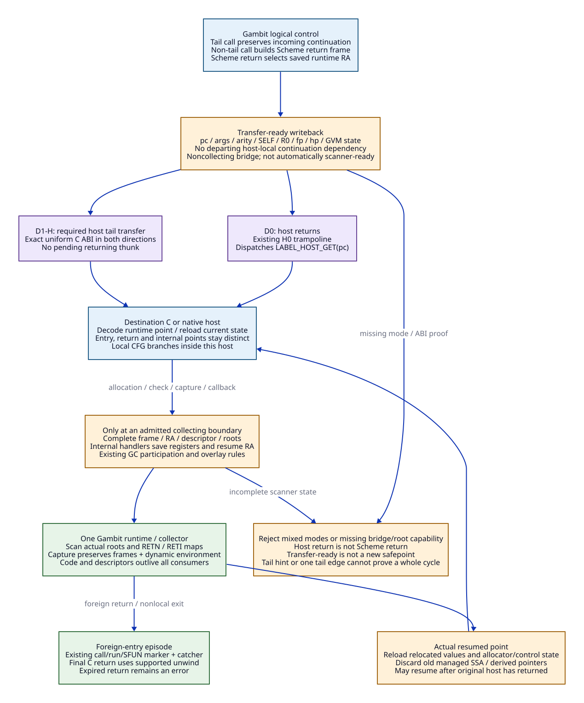

# D0/D1 Cross-Backend Transfer and Tail-Call Protocol

Date: 2026-10-20. Design only: source/configuration/paper inspection, no
implementation, preprocessing experiment, compilation or performance validation.
Refines the [shared runtime contract](gvm-shared-runtime-contract.md).
[Evidence ledger](d0-d1-cross-backend-evidence.md) binds K01-K12 below.

The concrete proposal keeps Scheme control references and frames compatible
with Gambit. **D0 selects centralized host-return dispatch. D1 initially selects
uniform C-ABI host tail transfers, named D1-H.** A private register-rich native
ABI, D1-R, needs additional bridges and is deferred. D0 is a useful semantic
reference; the retained Darwin/GCC defaults point toward D1-H structurally,
without establishing its native compatibility or tail-space guarantee.

The selected next architecture is the [D1-H C/runtime refactor](d1h-c-runtime-refactor.md),
with [independent edge admission](d1h-edge-admission.md) and
[source evidence](d1h-refactor-evidence.md). It introduces a new rebuilt-cohort
host/module contract, shared C/native product planning and explicit per-host
setup. The native-only/module-flag workaround below is historical incremental
design; it is superseded for that new cohort. Preserved Scheme semantics do not
require preserving old C macro paths or C0 binary interoperability.

## 1. What the Retained Darwin Configuration Actually Selects

There are three identities, not one currently qualified executable:

| Identity | Inspected fact | Limit |
| --- | --- | --- |
| Research vendor | Gambit `7c490c3ab5b5a4238b26f4a59d8cd9fd4b085882` | Baseline source, separate from cumulative repairs |
| Retained configured source | Gerbil `1cfb032c7a1612637da6205f5f8a15683eba3ba0`, Gambit `ea114fc3d2f120abbe20393c1f9aeafdd3f8c89f`, generated files separately hashed | Useful Darwin/GCC configuration evidence, not the vendor cohort or installed runtime |
| Future mixed-backend cohort | One repaired source/configuration plus native producer/provider identity | Entirely proposed; all affected runtime, libraries, adapters and extensions must agree |

K01-K03 establish the retained configuration: `aarch64-apple-darwin25.6.0`,
recorded Homebrew GCC 16.2.0, ordinary objects at `-O1`, runtime at `-O3`,
`-foptimize-sibling-calls`, `-fomit-frame-pointer`, `-fno-strict-aliasing`,
`-fwrapv` and existing `-ftrack-macro-expansion=0`. Object/executable definitions
include `___SINGLE_HOST`, `___INLINE_JUMPS`, `___TRUST_C_TCO`; dynamic mode adds
`___DYNAMIC` and uses `-bundle`. `include/config.h` independently enables trust
and inline jumps and leaves `___SUPPORT_LOWLEVEL_EXEC` undefined.

None of those flags is a Scheme ABI specification. In particular, GCC aliasing
and wrap flags do not authorize LLVM `noalias`, `inbounds`, `nsw` or `nuw`.
Single-host is a module grouping policy, not a promise of no external calls.
The configured limit is zero: the header's positive-limit downgrade condition
does not trigger by that limit alone. Cross-module and dynamic calls remain.

### Derive host-exit policy separately from instruction selection

For the inspected inputs, with no separately injected PROPER_TAIL_CALL macro,
K04's header gives these Boolean decisions (notation only):

```text
T = defined(___TRUST_C_TCO)     J = defined(___USE_SETJMP)
C = defined(___CENTRALIZED_TRAMPOLINE)
M = defined(___SUPPORT_MULTIPLE_C_COMPILERS)
P = defined(___PROPER_TAIL_CALL) = T
H = !C && J && (P || !defined(__llvm__))
X = P && H && !M
```

| Exit regime | Condition | Existing mechanism | Proposed profile |
| --- | --- | --- | --- |
| H0 ordinary host return | `H = false` | END_COD writes pc/state; EXIT_HOST falls through; `___call` runs trampoline | D0 selects this regime explicitly |
| H1 exclusive proper tail | `X = true` | EXIT_HOST tail-calls destination host; `___call` directly enters host; ordinary trampoline is excluded from setup.c | D1-H targets this regime, subject to every edge's proof |
| H2 trip/unwind hybrid | `H = true`, `X = false` | Host chaining has a C-stack trip check; unwind returns to the trampoline loop | Deferred as a separate combination; neither D0 nor D1-H silently inherits it |

The retained C defaults give `T=J=true`. With neither centralized nor
multiple-C-compiler override, they imply H1. This is a **static conditional
deduction**, not an observed macro dump or machine-code result. The exact
compiler's `__has_attribute(musttail)` result is unresolved: the header chooses
either an enforced return-call attribute or plain `return call`, but defines
P in either case. An optimization flag is not evidence that all plain returns
actually become tail transfers. GCC documents required tail-call behavior and
rejection constraints; its public manual does not identify local GCC bytes.
[GCC attribute specification](https://gcc.gnu.org/onlinedocs/gcc-16.1.0/gcc/Common-Attributes.html).

Request/source macros can change those deductions. Runtime `-DHAVE_CONFIG_H`
and application driver definitions are separate input paths; both must resolve
to the same admitted profile. The word “multiple compilers” in M is not a
magic compatibility switch for Zig/LLVM: setting it changes the exit regime.
No configuration or flag is changed in this research.

Extend the proposed product manifest with `hostExitRegime`, `hostConvention`,
`cTailCapability`, `nativeTailCapability`, `lowlevelRepresentation`,
`labelSetupKind`, and the existing cohort/frame-protocol identity. These are
declarations bound to source/configuration and qualification evidence, not
self-authenticating Boolean assertions. The managed loader owner must reject
incompatible products before setup/entry effects. Existing module version and
structure-size checks do not carry these new facts; adding this admission
boundary is explicit B07 work, not a present loader feature.


[D2 source](d0-d1-host-exit-profiles.d2).

## 2. Separate Three Kinds of Return and Two Readiness Conditions

| Concept | Required meaning |
| --- | --- |
| Scheme return point | Tagged runtime label with correct descriptor; selected by Scheme RA/control protocol |
| Host return | End of an OS/C-ABI activation. Under D0 it resumes a dispatcher, not the Scheme caller |
| Return to a foreign C invocation | Existing `___call`/SFUN stack-marker and exception/unwind boundary; can be invalid after nonlocal exit |
| Transfer-ready state | Destination pc, arguments/arity, SELF, R0, fp/hp and configured cached state are correctly marshalled for the next host; no unaccounted caller native locals |
| Scanner-ready state | At a permitted collecting/reentrant boundary, full RA/frame/map/root publication and runtime participation let the actual scanner interpret every live movable value |

**Transfer-ready does not automatically imply scanner-ready.** END_COD's pc
and W_ALL sequence is a host-transfer mechanism. Stack/heap handlers and direct
collecting helpers have additional frame/RA/save/reload duties (K05-K09).
A noncollecting bridge must not accidentally allocate, callback, trace through
a collecting helper or poll between the two readiness conditions. Adding a
bridge does not add a legal safepoint by itself.

The logical transfer tuple below is a specification view of existing state and
emitted metadata, **not** a new heap object or a new pstate queue:

```text
Transfer {
  profile, destination_runtime_label, destination_host_abi,
  kind: procedure | return | internal_resume | runtime_handler,
  arguments_and_arity, SELF, R0, fp, hp, configured_GVM_state,
  caller_frame_if_non_tail, root_and_effect_obligations
}
```

No tail target may depend on the departing host's stack locals or temporary
addresses. Values needed after a non-tail Scheme call live in Gambit frames
with correct liveness/interpretation, or are recomputed at the return point.
Initial P0 lowering boxes/materializes semantic values at such boundaries;
retaining unboxed state requires its own supported slot/interpretation proof.

## 3. D0: Centralized Host-Return Dispatch

Select H0 for a rebuilt cohort, for example by the existing centralized policy
input. Reconcile the exact per-unit effective configuration; merely removing
`___TRUST_C_TCO` can still select H2 on GCC and is not the D0 design.

1. C or native host executes its local CFG. An in-host branch reuses that host
   activation. A logical non-tail call first creates the Scheme return frame;
   a tail call preserves the incoming continuation without adding such a frame.
2. On an external transfer, marshal transfer-ready state including destination
   pc; drop all pending native-local continuation dependencies; return to the
   existing trampoline. The bridge itself is noncollecting.
3. Trampoline fetches `LABEL_HOST_GET(ps->pc)` and invokes its `void(ps)` entry.
   Native entry decodes the runtime label, loads the selected GVM state and
   enters the appropriate block. The dispatcher does not decode Scheme frames.
4. Scheme return uses the saved Scheme RA and the same transfer path. It does
   not return through the native call that originally executed the procedure.

The bound sought is independent of the number of Scheme tail transfers: within
one active foreign-entry episode, each external step finishes a host before
the next one starts. Non-tail Scheme depth occupies Scheme frames. Supported
nested foreign callbacks can add C-entry episodes and are accounted separately.

D0 requires rebuilding H1 hosts/runtime into H0 and adding native module/entry
support. An H1 `___call` with an inserted host-return native entry could mistake
that return for completion/error-handling progress; it has no ordinary
trampoline to dispatch the next pc. Such a mixture rejects before loading.
D0 cannot claim current Darwin/GCC compatibility from its C signature alone.

## 4. D1-H: Direct Host Tail Transfers With a Uniform C ABI

The initial direct profile retains the ordinary configured label/closure
representation with lowlevel-exec disabled. Each externally reachable native
entry/return point resolves to a real `___host`-compatible function, logically
`void(processor_state *)`, using the target C convention. pc selects the exact
Scheme control point within that host. Native-to-native local CFG edges remain
direct branches; inter-host edges use a required bounded tail transfer.

| Edge | D0 H0 | D1-H H1 | Common Scheme obligation |
| --- | --- | --- | --- |
| X01 C -> C, same host | Existing local goto/switch | Existing local goto/switch | Correct frame adjustment, args and point kind |
| X02 C -> C, different host | Writeback, return, trampoline | Existing required host tail exit | C-side guarantee must cover the actual compiled units |
| X03 C -> native | Same dispatcher host ABI | C host tail-exits to native host ABI | Native label host field valid; incoming pc/SELF/RA preserved |
| X04 Native -> C | Writeback, return, trampoline | Required C-convention host tail call after writeback | No guessed machine-register assignment for the GCC host |
| X05 Native -> native, same host | Direct local CFG | Direct local CFG | Local lifetime/effect rules and polls still apply |
| X06 Native -> native, different host | Writeback, return, trampoline | Required uniform host tail call | No native stack continuation on the transfer edge |
| X07 Any non-tail Scheme call | Scheme return frame then selected transfer | Same | Successor is a Scheme return point, not a pending host call; D1-H host exit is tail |
| X08 Scheme return to other backend | Dispatch saved RA | Tail transfer via saved RA's host | Do not interpret a return descriptor as a procedure entry |
| X09 Internal resume / runtime handler | Dispatch exact handler or internal return label | Tail transfer to its host | RETI saved registers and original resume point preserved |
| X10 Leaf ordinary foreign function | Normal call under admitted F0 effects | Same | Native return is valid here; no GC/reentry/control escape assumed without evidence |
| X11 Allocating/reentrant/blocking foreign path | Existing rooted adapter/entry protocol | Same | Publish scanner-ready state and preserve callback/nonlocal-exit rules |
| X12 Foreign entry/final return | Existing call/run/marker boundary | Same, but initial host entry is direct | End via the existing foreign-return unwind/marker semantics, not a normal Scheme transfer |

At LLVM boundaries use the selected C convention, exact compatible prototype
and required tail-transfer form. LLVM `tailcc` or `fastcc` cannot simply replace
the convention of a GCC-produced host. A required tail call must satisfy the
signature/attribute/return-position rules; an ordinary `tail` hint is
insufficient. Failure to express the edge rejects D1-H, rather than inserting a
normal recursive call. [LLVM call specification](https://llvm.org/docs/LangRef.html#call-instruction).

C -> native and native -> C need independent evidence: LLVM's guarantee cannot
prove GCC's outgoing edges. The native emitter must finish ABI epilogue/state
writeback **before** the transfer; no result delivery, resource cleanup or
reload runs afterwards in the departing host. A non-tail Scheme successor is
instead a separately addressable control point that reloads current state.
As in D0, the tail-space bound is per foreign-entry episode; supported nested
foreign callbacks have separate native activation/lifetime obligations.

D1-H is a proposed way to bypass generated C while retaining the C-host protocol.
It may still spill/write back frequently. It earns no automatic register-bridge
performance benefit. Static compatibility is plausible; target-specific tail
lowering, GCC attribute selection, native product setup and complete SR gates
remain unresolved.

### Why a returning thunk is not a tail bridge

`C tail-transfers -> thunk -> ordinary native call -> C tail-transfers -> thunk`
can accumulate a pending thunk activation on each cycle. Same-sized signatures
and a tail edge on one side do not bound that cycle. Either every accumulating
edge is an admitted tail transfer, or a dispatcher/unwind boundary must actually
cut the pending activation chain under a separately selected profile. D1-H
chooses the former; it does not borrow H2's trip mechanism implicitly.

## 5. D1-R: Private Register ABI Is a Separate Deferred Extension

If a native body later caches GVM registers in a private fixed register set,
two explicit bridges are needed: host ABI -> private native entry, and private
native state -> C host ABI. They must reconcile pstate, arguments, SELF, R0,
Scheme fp/hp, OS stack, preserved registers and transfer ownership. Closures and
return points must remain dispatchable from both sides.

The 2018 paper supports the shared-frame/bridge approach, but its direct-code
control references also required representation changes. It is not evidence
that today's ordinary labels already contain executable arm64 bridges.
[Huberdeau and Feeley, sections 3.1-3.3](https://www.schemeworkshop.org/2018/Huberdeau_Feeley.pdf).

Current lowlevel-exec changes reference/body offsets, closure free-variable
offsets, label sizing and setup behavior (K10-K11). The retained configuration
disables it. Enabling that macro as a shortcut would be a cohort representation
change, and the inspected ARM implementation is THUMB2/32-bit, not Apple arm64.
D1-H therefore does not depend on this feature.

A future D1-R profile must choose whether to preserve ordinary descriptors with
an explicit code-entry mapping or revise the shared representation. Both
directions, return/entry/internal point kinds, C-stack detachment and nonlocal
control need a complete design. No private register assignments, stack-switching
sequence, executable-data permission policy or arm64e pointer-authentication
mapping is selected here. This prevents speculative assembly from being
presented as an ABI. D1-R remains outside P0 admission.

## 6. Preserve Continuations and GC Across Both Profiles


[D2 source](d0-d1-control-root-handoff.d2).

The profile changes how hosts exchange control, not how Scheme continuations
are represented. The following obligations apply to every X edge:

| Point / operation | Required frame and root protocol | Reuse and required change |
| --- | --- | --- |
| Ordinary return | Frame size excluding reserve, actual RA-link slot, live-slot map and correct RETN descriptor | Reuse scanner/decoder; add native producer and point dispatch |
| Task return | Preserve target task-frame semantics and RETT descriptor; never substitute an ordinary return solely because layout sizes match | Reuse admitted target/runtime behavior; native task capability remains open |
| Internal check/slow path | Carry the internal resume descriptor and caller frame size; runtime aligns frame, saves GVM registers/RA and uses internal_return; restore through the original internal point | Reuse existing handler structure with the selected repair overlay; emit matching native RETI maps and checks |
| Direct collecting helper | Store RA by the supported frame protocol, publish all live slots/registers/saved roots and allocator state; reload actual relocated state | Use an admitted rooted runtime boundary; no unscanned native-local Scheme backup |
| Continuation capture/graft | Preserve break chain, captured frame identity, dynamic environment/caches and runtime winding behavior | Reuse runtime path; native return points and descriptors must remain addressable after host return |
| Foreign return | Preserve original marker, processor policy, expired/multiple-return errors and unwinding | Reuse call/run/SFUN owner; no new foreign-thread or cross-processor privilege |

K07-K09 show the actual map chain: ordered live variables -> bits/chunks ->
RETN/RETT/RETI and inline/out-of-line encoding -> RA-based scanner -> updated
root locations. Root publication, map completeness, relocation and interpretation
storage lifetime are separate requirements. The current header uses configured
frame reserve/alignment and an expanded internal frame; new code must derive
them from the same producer, not reproduce magic constants from the CPU backend.

The retained patch additionally distinguishes interrupt polls from stack-only
checks and validates a return tag before descriptor access. **Tag validity is
necessary, not address/map/lifetime validity.** A masked region may still need
stack growth and GC-safe internal state. Do not transpose the baseline handler's
interrupt dispatch onto the repaired stack-only path (K12).

After any permitted relocation/reentry, discard earlier managed SSA values and
derived pointers and reload at the actual resumed point. A captured continuation
can resume a different point long after the original native host returned.
Descriptive native call-stack unwind data does not replace Gambit frame maps.
Metadata/code lifetime follows the existing
[root-map lifetime contract](../root-map-lifetime-contract.md); add no separate
root registry or hot-unload policy.

## 7. Native Label and Module Integration Must Be Explicit

Both initial profiles preserve ordinary data labels, not executable labels.
GCC's in-host computed-goto values are private to its host. Native hosts decode
pc with their own immutable point mapping based on **post-setup runtime labels**;
they cannot branch to GCC's stored local label address as a public function.

For an initial native-only module product, declare no `USES_INDIRECT_GOTO`
flag and implement no C goto-label query. The configured label struct still has
its supported fields/layout. `setup_module_fixup` can then avoid its pc=0
host-query branch; native point lookup never requires an invented goto table.
Keep C adapter islands in separately described products where needed. Mixing C
computed-goto and native hosts inside one existing module-wide flag requires a
new per-host setup design and is deferred (K06, K10).

Module setup can align/copy label and descriptor tables, fix globals/constants,
install out-of-line descriptors and set procedure entry references. The native
product must preserve these effects and decode the resulting locations. Existing
version/structure-size checks are useful but cannot validate exit mode, frame
map completeness or tail behavior. Add profile admission before any supported
module setup/entry effect; do not treat successful OS linking as admission.

## 8. Bridge Work and Future Qualification Boundary

| Bridge / owner | D0 required work | D1-H required work | Retained authority |
| --- | --- | --- | --- |
| B01 configuration producer | Select H0 across rebuilt cohort | Bind H1 plus independent C/native tail capability | Gambit effective configuration; no Zig macro-policy fork |
| B02 native host entry | C-ABI entry, pc decode, load GVM state | Same ABI plus tail-capable exit discipline | Gambit label/argument/SELF/R0 protocol |
| B03 native external exit | Transfer-ready writeback and normal host return | Writeback then enforced C-ABI tail transfer | Same runtime state; no managed result via host return |
| B04 C-side host exit | Rebuild C hosts/runtime into centralized path | Audit/qualify current required tail form; change generator/profile if plain return cannot be admitted | Existing compiler and runtime ownership |
| B05 internal check/resume | Native checks and descriptor emitter | Same | Existing stack/heap/interrupt handler and repair overlay |
| B06 collecting/callback adapter | Complete scanner-ready boundary and resume reload | Same | FFI/SFUN, markers, exception and resource owner |
| B07 labels/module setup | Pre-effect profile admission, native-only product flag and post-setup point map | Same | Existing loader/materialization and interpretation lifetime |
| B08 private native register bridge | Not required | Not required by D1-H; two-direction D1-R work deferred | No speculative arm64/arm64e ABI admitted |

The replacement is native code generation, descriptor/point production and
eligible C packaging, not a second trampoline, collector or continuation engine.
LLVM/MLIR operate behind the runtime-aware transfer/effect operations; they may
not erase roots or turn internal resume into ordinary function return.

Future, **unrun**, qualification cases must include every X01-X12 edge under
the selected mode; long alternating C/native tail cycles; non-tail mixed stacks;
closure/arity/rest/multiple-value errors; ordinary/task/internal and large
out-of-line maps; capture/resume after host return; dynamic state and supported
nested FFI; GC in each permitted handler/callback boundary; expired foreign
return; overlay stack-only behavior; and rejection of mode/representation
mismatches. The C-side tail proof cannot be substituted by an LLVM verifier.

Measure bridge transfers, writeback/reload bytes, native stack peak per tail
cycle, Scheme frames, cold/reused C units and total native build work separately,
joining N01/N04/N05/N07/N09 in the
[benefit matrix](gvm-native-replacement-matrix.md). D0 may add dispatch overhead;
D1-H may retain spill costs; D1-R has additional portability/maintenance cost.
No row currently has measured benefit. All SR gates remain open.
