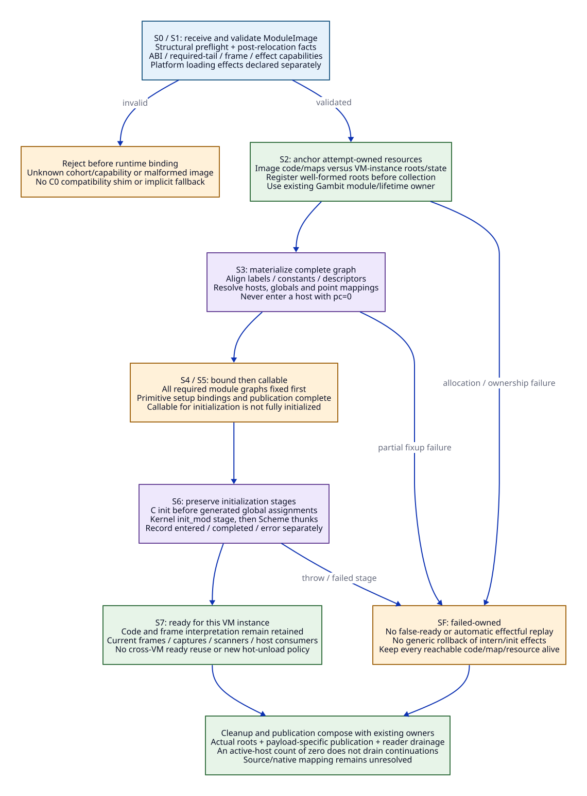

# D1-H: Refactor the C Backend Boundary and Native Module Protocol

Date: 2026-10-20. Architecture only. No implementation, compiler feature probe,
preprocessing, native/model execution or performance validation.
[Independent edge admission](d1h-edge-admission.md) and
[source evidence](d1h-refactor-evidence.md) accompany this design.

**Adoption decision: introducing Zig here means a substantial C backend and
runtime-interface refactor.** The deliverable is a common host/control product
with C and LLVM emitters, explicit module materialization and removal of selected
legacy execution paths. MLIR is compiler infrastructure behind that product.
Scheme objects, proper tail recursion, continuation behavior, runtime effects
and GC correctness are the retained obligations. Old macro structure, module
format, compiler-flag inference and binary interoperation are changeable.

The [D0/D1 study](d0-d1-cross-backend-protocol.md) established a plausible uniform
host ABI. This document selects a **new cohort contract**, provisionally named
`HostContract/1`, and replaces the provisional native-only/module-flag workaround
with explicit host/point records. All names and records below are design names;
none is an implemented or stable public API.

## 1. Selected Scope and Responsibility

| Owner | Selected responsibility | Work it must cease delegating to an old path |
| --- | --- | --- |
| Gambit compiler | Scheme semantics, target negotiation, GVM, primitive/effect classification, logical frame liveness and control-point identity | Managed products cannot rely on C text to communicate the only copy of runtime semantics |
| Zig native subsystem | Common product validation/layout planning; C-host emitter and runtime-aware LLVM/MLIR emitter; native resources, relocations and manifest production | No wrapper around the entire existing C emitter or `cpu.scm` packaging path for a native-selected product |
| Gambit runtime/module owner | Materialization, VM/global bindings, publication, call/run/SFUN entry, collector and interpretation lifetime | No entering a Scheme host with pc=0 to discover metadata in the new contract |
| Configured C compiler | Compile newly emitted C hosts and retained C runtime/FFI resources | Trust flags alone cannot stand in for required tail lowering |
| LLVM provider | Compile native host CFG and required tail edges using the agreed target C ABI | No new Scheme semantics, private GC or implicit calling-convention substitution |

Gambit produces a typed HostGraph after Scheme-owned semantic completion of
GVM, including checks and internal resume points currently created during C
scan. Its FrameSpec supplies semantic and protocol root obligations once;
Zig produces a separate FrameLayout for both emitters. The detailed
[generation contract](hostgraph-generation-contract.md) specifies the freeze
boundary, role-anchor lineage and [retirement order](hostgraph-retirement-plan.md).
Neither provider independently recomputes language liveness or invents a root
policy. Moving rendering/layout engineering into Zig is the selected future
ownership change; extracting the current interleaved C emission and semantic
logic is explicit migration work, not existing separation (R01-R04).


[D2 source](d1h-host-contract.d2).

The rebuilt C host is called **C1** below; a new native host is **N1**. An old
unrebuilt C module is C0. C1 and N1 share HostContract/1. C0 is not an admitted
participant in that cohort. The portable C target remains a Gambit asset and
bootstrap/reference route; preserving that capability does not require a
C0-to-new-runtime compatibility shim. A plain-return compiler is outside D1-H;
an explicitly selected D0 cohort remains a separate target profile.

## 2. The Concrete Host ABI

Both C1 and N1 expose a nonvariadic entry logically equivalent to
`void host(processor_state *ps)` using the **target C calling convention**.
The pointer is runtime-owned and outlives the departing activation. pc is a
Gambit runtime control reference, not a second native argument or an OS return
address. No Scheme result is delivered through the C return type.

| Boundary component | Selected rule |
| --- | --- |
| Incoming state | Existing configured pstate/GVM locations supply pc, arguments/arity, SELF, R0, fp/hp and other required state |
| Destination | A resolved ordinary Gambit label supplies the callable host entry; entry/return/internal point kinds remain distinct |
| Local dispatch | Checked membership in this host's point set, then local ordinal -> local CFG block |
| External dispatch | Transfer-ready writeback, resolve destination host without collecting/reentry, finish caller epilogue, required tail transfer |
| Scheme return | Restore Scheme frame/result protocol and transfer to the saved runtime RA's host |
| Host completion | D1-H host bodies do not normally return to the entry caller; final foreign return/nonlocal control follows the runtime catcher/marker path |

Host identity is a common-product-planner-assigned HostId, constrained by the
Scheme control-unit plan, not equality of function addresses.
Point identity is `(ModuleId, PointId)` before materialization and its admitted
runtime label afterwards. Compiler folding/cloning and a shared helper address
must not merge Scheme identities or grant local-branch membership.

The selected physical starting point keeps ordinary, non-lowlevel Gambit
object/closure/frame representation. We change the host/module protocol now;
we do not require a collector rewrite to do it. A later representation revision
is allowed but must update producer and scanner together. This deliberate reuse
does not freeze the old module ABI or enable old binary mixing.

### Bidirectional entry sequences

**C1 -> N1:** C1 arranges Scheme arguments and, for a non-tail Scheme call,
constructs the Scheme return frame. It sets destination pc and SELF as needed,
writes configured cached state, resolves N1's host pointer and performs the
required tail exit. N1 validates/decodes its admitted incoming point and reloads
GVM state before entering native CFG. It cannot expect GCC to have assigned
GVM values to any particular machine registers.

**N1 -> C1:** N1 performs the same semantic preparation and writeback, then
uses the same C ABI to tail-transfer to C1. C1 decodes its own local ordinal
and loads the configured state. Its local jump table, if used, never leaves
that function. Neither direction creates a returning bridge activation.

For local transfers, a host can keep registers/SSA cached when effects permit.
For external transfers it cannot keep a pending native-local continuation.
Return points after non-tail Scheme calls are separately addressable blocks
with reload/reconstruction rules. Saved Scheme state carries what those blocks
need; a raw native stack frame is not the continuation.

### Required exits in both emitters

The C emitter selects a supported **required-tail** form and rejects a D1-H
product if that capability is unavailable. It does not copy the header's
`__has_attribute`-false plain-return fallback. GCC's required-tail attribute
has storage-lifetime and target constraints; published documentation is not a
local compiler qualification. [GCC specification](https://gcc.gnu.org/onlinedocs/gcc-16.1.0/gcc/Common-Attributes.html).

The LLVM emitter uses the same target C convention and compatible prototype/
ABI attributes for required tail edges. LLVM `tailcc`/`fastcc` do not describe a
GCC C host merely because they permit tail calls. `musttail` form and verifier
rules apply; `tail` alone is insufficient.
[LLVM call specification](https://llvm.org/docs/LangRef.html#call-instruction).

All state stores, lifetime termination and noncollecting host resolution precede
the transfer. There is no cleanup, instrumentation call or result handling
after it. A helper doing an ordinary call to the destination and then returning
is forbidden on a tail cycle. C-side and LLVM-side obligations require separate
evidence plus mixed-cycle composition; see E01-E12 in the edge matrix.

## 3. A Declarative Module Product

The records are logical data structures, not code to be implemented this turn:

```text
ModuleImage {
  schema: HostContract/1, module_id, source_and_overlay_identity,
  object_layout_id, frame_protocol_id, target_c_abi_id,
  host_exit: required_tail, provider_identities, required_capabilities,
  hosts: [HostSpec], points: [PointSpec],
  frame_specs: [FrameSpec], frame_layouts: [FrameLayout],
  runtime_exports: [role, point_id, expected_point_contract, required_effects],
  logical_constants, symbols, keywords, globals, semantic_dependencies,
  fixups, setup_bindings, initializers, resource_plan
}
HostSpec {
  host_id, backend: c | llvm_native, entry_symbol,
  point_membership, local_dispatch: ordinal,
  tail_capability_evidence_ref, required_effects
}
PointSpec {
  point_id, host_id, semantic_purpose, descriptor_requirement,
  local_ordinal, arity_and_closure_shape,
  frame_id_if_return, debug_and_parent_identity
}
FrameSpec {
  frame_id, return_kind, logical_extent, ordered_logical_slots,
  semantic_live_values, closure_environment_dependencies,
  return_var_location, protocol_saved_state, materialize_and_reload_plan
}
FrameLayout {
  frame_spec_ref, profile_id, logical_to_physical_mapping,
  caller_and_actual_size, saved_state_offsets, normalized_ra_link,
  map_chunks, descriptor_form, descriptor_bytes, realization_witness
}
ModuleBinding {
  runtime_owner, image_binding, vm_identity_and_generation, state,
  instance_roots_and_global_bindings,
  point_to_runtime_label_mapping, rooted_materialization_state,
  initialization_progress, retained_failure
}
ImageBinding {
  image_identity, cohort_identity, anchored_code_and_metadata,
  resolved_hosts, runtime_labels_and_frames, interpretation_lifetime_owner
}
```

The common planner verifies distinct point membership/ordinals, all symbol and
frame references, typed counts/offsets/overflow limits and capability closure.
Metadata/intro slots are not callable points. Runtime layout is derived from
the selected source/configuration, not Zig's default struct packing. Native
objects carry ordinary linker relocations for native symbols plus a separate
Gambit materialization/fixup plan for Scheme references.

The producer owns logical identities; runtime materialization owns actual
addresses. Labels can be aligned/copied by setup, so host decoding must use the
resolved table/binding. No compiler heap address or guessed pre-setup label
base is embedded as a live Scheme reference. Rooted constants and global values
remain under Gambit's object/VM protocol.

Runtime exports bind semantic roles such as stack-limit, heap-limit, break,
return-to-C and internal-return to typed PointIds. Replace
`setup_kernel_handlers`' manually synchronized numeric LBL assignments with
these checked bindings. Compiler-private polling points may then be reordered
without changing a public runtime role. The retained patch's stable ordinal
prefix documents why this coupling matters; it is not the new contract (R03/R12).
Missing, duplicate or wrong-kind required roles reject before a host can run.
Gambit's runtime entry/resume definitions need explicit compiler-owned role
annotations before label allocation. GVM transformations must preserve that
role-to-point relation; the common planner checks the final mapping. Neither
comments containing LBL numbers nor Zig-side string matching are authoritative
role declarations.
Opaque C snippets using numeric runtime points need explicit symbolic extraction
or a declared unsupported capability; forwarding them unchanged is not migration.

### Replace pc=0 setup queries and module-wide backend inference

New C1 hosts consume a local ordinal. A switch or function-local computed-goto
table may realize that dispatch, under its own admitted C-provider capability.
The selected public protocol exports neither C goto addresses nor a goto-table
query operation. N1 realizes the same ordinals as native CFG blocks.

GCC's labels-as-values facility is function-local; it does not permit jumping
into another function. The new C emitter must keep any such table private and
respect its cloning/inlining rules. Those addresses are not module metadata or
native entry symbols. [GCC labels specification](https://gcc.gnu.org/onlinedocs/gcc/Labels-as-Values.html).

Point membership can use producer-defined contiguous ranges plus kind/membership
checks, or a generated table. The planner chooses and records one realization;
the performance delta remains unknown. Execution needs no new process-wide
point registry: each host has its module-owned binding and declared membership;
external transfer uses the resolved label's host entry. A function address alone
never establishes local ownership.

HostSpec makes C1/N1 coexistence explicit even inside one new module product.
Retire the module-wide USES_INDIRECT_GOTO decision for that product. The previous
native-only, flag-clear workaround was an incremental design; HostContract/1
supersedes it with per-host data. Existing physical label fields needed by the
selected root/debug protocol may remain initialized, but setup neither calls a
host with pc=0 nor fills a public table with private C goto addresses.

For native-selected units, retire `_t-cpu.scm`'s `cpu.scm` -> C-backend wrapper.
Emit object, host/point/frame tables and fixups directly. C1 products still
compile C; the managed C renderer and common product now own that work. Embedded
C/FFI islands remain explicit resources with full effects, not an undeclared
fallback to the complete old emitter.

## 4. Module Setup Has Explicit Ownership and Failure States


[D2 source](d1h-module-materialization.d2).

The existing Gambit module owner executes this lifecycle; Zig's compiler
service supplies immutable products and never owns live Scheme initialization.
Runtime materialization may initially be C implementation, with reviewed Zig
resource components introduced under that same owner. There is one loader,
VM binding protocol and interpretation-storage lifetime authority.

ImageBinding holds code/descriptor storage under its process/cohort owner;
ModuleBinding tracks a particular VM generation's instance roots, globals and
initialization progress. Only storage classes actually process-shareable under
the selected Gambit profile can be shared. Mutable VM values and ready/failure
state must not be reused across VMs because an image hash matches. S0-S4 work
is scoped to the appropriate image/instance owner; S5-S7 readiness is never a
process-wide substitute for a VM's initialization. This splits ownership inside
the existing runtime protocol, not into another VM registry.

| State | Allowed work / required invariant | Failure or next transition |
| --- | --- | --- |
| S0 image received | Declarative identity, dependency and structural preflight; no Scheme initialization | Invalid/incomplete image rejects before runtime binding effects |
| S1 image validated | Required exit/ABI/frame/effect capabilities closed; reserve a module-owned attempt | Validation alone grants no callable Scheme entry |
| S2 storage anchored | Pin code/metadata ownership to the attempt; register well-formed roots before collecting materialization | Allocation/error keeps all exposed storage owned; no premature free |
| S3 materializing | Align tables, create/fix constants and global references, resolve symbols/hosts, build actual descriptors and point mapping | Partial work is not FIXUP_DONE or successful setup |
| S4 bound | Complete object/point/frame graph, primitive setup bindings and resource ownership checked; no user initializer effects yet | Publish only through the existing reviewed runtime owner/reader protocol |
| S5 callable | Admitted code/maps/bindings visible; dependency and initializer ordering controls entry | Only initialization-authorized entries may run before successful initialization |
| S6 initializing | Execute C initializers/global assignments and Scheme stages under their declared ordering/effects | Initializers may reenter/throw; record progress, preserve original error semantics |
| S7 ready | Required initialization delivered; normal admitted calls permitted | Retain code/maps through frames, captures and scanner consumers |
| SF failed-owned | Attempt or initialization failed; reject new unauthorized entries; retain resources already reachable from Scheme/native consumers | Cleanup follows reachability/drain ownership; no generic rollback or automatic retry |

This does not promise a global transaction. Interning/global creation can leave
canonical metadata behind; initializers can have user-visible effects. Failure
must preserve error delivery and actual effects, while avoiding false-ready and
unsafe reclamation. Once reentry or a captured continuation can retain code,
an active-host count of zero does not justify unloading it. Retry requires a
separately defined semantic policy; the default design forbids replaying an
effectful failed initialization automatically.

Preserve the source's group ordering: fix all modules before primitive setup;
then retain the kernel's separate init_mod and Scheme-thunk stages. The C
emitter currently places C initializers before generated global-value assignments.
The kernel advances its stage marker before invoking a stage body. New progress
records must distinguish stage entry/reentry from successful completion rather
than moving that marker after the body and changing recursive behavior. U07
owns the full mapping, including exceptions and entry through init callbacks.
Materialization may register only valid initialized root fields; a partially
filled raw buffer is not a scanned Scheme object.

For recursive module initialization, S5 callable is not equivalent to S7 ready.
The init owner records the active attempt/dependency cycle and follows Gambit's
supported module semantics; a new blanket ban or new permissive partial-read
rule is not introduced here. Exact recursive-init/exception mapping is U07.

The source sets SETUP_FIXUP_DONE before version/size checks and mutates tables
while failures remain possible. It also marks a dynamic linkfile as setup after
`setup_modules` returns. These baseline observations motivate replacing the
single-marker protocol, not a claim about the latest repaired runtime (R05).

The image's platform entry is declarative: new generated module registration
must not execute through an OS-load constructor or a linker function that
silently installs runtime state. Preflight and post-relocation validation have
different observation boundaries. Platform dependency loading effects cannot
be undone by this lifecycle; supported generated products/dependencies must
declare them. No sandbox/security or general foreign-library transaction is
claimed. Materialization and Scheme initialization stay explicit.

Memory ordering, collecting boundaries, VM registry participation and teardown
compose with the existing [shared metadata owner](../shared-metadata-package.md)
and [root-map lifetime contract](../root-map-lifetime-contract.md). This design
does not hold a new module lock across callbacks or collect while existing leaf
metadata/registry guards are held. Physical publication and failure drainage
remain concrete source/native obligations, recorded in U07/U08.

## 5. Root and Continuation Compatibility Is a Semantic Requirement

At ordinary transfer, publish transfer-ready GVM state. Only an admitted
collecting/reentrant boundary additionally establishes scanner-ready state.
The module/setup and host prologues cannot insert hidden collecting calls
between incomplete frame preparation and that boundary.

Gambit still supplies the ordinary/task/internal frame meanings, ordered live
slots, inline/out-of-line maps, break frames, dynamic environment and internal
return handlers. Both emitters realize the same FrameSpec and post-relocation
reload epoch. Tail exits remove the host activation without invalidating the
Scheme frame graph. Capture/resume can outlive that activation, including mixed
C1/N1 frames and supported nested foreign entry.

The collector consumes actual rooted locations and RA-selected maps; HostSpec
and PointSpec do not replace those roots. Code/frame interpretation storage is
retained with the existing lifetime owner. The ordinary C helper ABI, SFUN
markers/catchers and processor policy remain distinct from host-to-host Scheme
transfers. Native Scheme code uses the existing runtime throw path; it does not
invent LLVM exception or Zig cleanup semantics for Scheme nonlocal control.
R06-R09 provide the source chain; root/ABI tests remain future work.

## 6. Paths That Must Change or Retire

| ID | Current path | Selected refactor / retirement target | Completion criterion |
| --- | --- | --- | --- |
| T01 | `_t-c-1.scm` target dump, procedure and module macros | Extract typed HostGraph; Zig common planner plus new C/native renderers | No managed native or C1 product delegates its whole rendering back to old targ-dump |
| T02 | `_t-c-2.scm` mixes frame semantics, cache/check logic and C emission | Gambit-owned semantic FrameSpec/effects plus explicit prepare/transfer/resume operations | Every admitted primitive/return/check path has one semantic definition and provider lowering |
| T03 | Header compiler-identity/trust/exit macro inference | One explicit HostContract/1 required-tail mode and generated C ABI declarations | No plain-return fallback, accidental H2 selection or per-unit macro disagreement in D1-H |
| T04 | pc=0 query, public goto labels, pointer-equality dispatch and hand-numbered kernel handlers | Per-host PointSpec, private ordinal dispatch and symbolic runtime-role bindings | Zero setup host queries or manual handler ordinals; local membership uses point ownership |
| T05 | Module-wide USES_INDIRECT_GOTO and positional module construction | Explicit per-host product and versioned image/binding records | A mixed C1/N1 module needs no module-wide backend workaround |
| T06 | Early FIXUP_DONE and linkfile-version setup markers | Validated/materializing/bound/callable/initializing/ready/failed-owned lifecycle | Failed setup cannot be reported ready; reachable resources survive errors |
| T07 | `cpu.scm` C wrapper for native bytes/fixup vectors | Direct native object and declarative Gambit fixup/materialization plan | Zero generated C packaging/compiler invocations for a fully native-admitted unit |
| T08 | `___call`/run/SFUN entry selected indirectly by old host mode | Explicit new host-entry integration with existing foreign return marker/catcher | C1 and N1 entry/exit behavior qualified independently; no returning Scheme host on D1-H |
| T09 | Duplicated primitive/FFI C-body assumptions | Complete effect/capability records and explicit adapter islands | No unknown operation silently classified leaf; no implicit C0 fallback |
| T10 | Loader size/version-only admission and implicit module init effects | Preflight plus post-relocation product validation and explicit init progress | Physical layout, root/control and resource evidence all bound to the loaded cohort |

Replace these paths inside the selected cohort; no permanent old/new dispatch
switch or per-call compatibility wrapper is proposed. Migration can proceed in
source-owned stages, but a product is issued only when its full required closure
is ready. An incomplete domain rejects before product execution. Old controls
and failure records remain evidence; they are not a supported old protocol.

## 7. What Counts as Progress and Leverage

Count actual retirements, not configuration entries: old rendering calls,
pc=0 setup calls, module-wide backend branches, plain-return fallbacks, C
packaging units and independently maintained layout/effect definitions. Targets
are zero for retired managed paths and one authoritative semantic/profile
producer; none is achieved by this document.

Also charge serialization/planning, ordinal decode, C/native writeback, new
metadata memory, failure-retained storage, provider upgrades and maintainer
hours. LLVM register allocation/object emission can replace owned machinery;
it cannot discharge Scheme tail/root/control obligations. Compare the same
contract carried by C tooling versus Zig to isolate Zig's incremental benefit.
Join N01/N03/N04/N05/N08/N09 of the
[benefit matrix](gvm-native-replacement-matrix.md); no speedup estimate is issued.

The [edge matrix](d1h-edge-admission.md) specifies independent future evidence,
negative controls and unresolved work. Engineering decisions are selected;
their correctness and performance remain to be demonstrated later.
