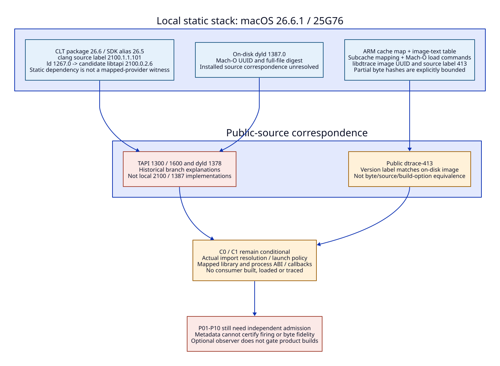

# Local Darwin Stack: Static Identity and Source Correspondence

Date: 2026-10-20. Companion to the [C0/C1 support design](darwin-consumer-support-matrix.md).
Static package, file, Mach-O and cache metadata reads only. No compiler/linker
invocation, consumer build/load, live probe/client, calibration or performance
workload. The bounded binary inspection below is research tooling, not a new
collector implementation or qualified forensic decoder.

## Observed Local Stack

Host SystemVersion.plist reports macOS 26.6.1, build 25G76. The CLTools_Executables
package receipt reports 26.6.0.0.1781586589. The SDK alias MacOSX26.sdk resolves
to MacOSX26.5.sdk. Package, SDK and individual binary versions are distinct.
All paths below are host-local observations, not the historical Darwin patch
environment or a declaration that these tools are selected by every build.

| Component / inspected slice | LC_SOURCE_VERSION | UUID | Other static evidence |
| --- | --- | --- | --- |
| CLT usr/bin/clang, arm64 | 2100.1.1.101 | 777BDC46-ED30-3304-BE16-8999AD75C762 | minOS 14.0, SDK 26.4; universal x86_64/arm64 |
| CLT usr/bin/ld, arm64 | 1267.0 | E310E66B-3781-3A4A-9F37-730B97BF6DE7 | minOS 14.0, SDK 26.4; dependency @rpath/libtapi.dylib, current version 2100.0.2 |
| CLT usr/lib/libtapi.dylib, arm64 | 2100.0.2.6 | 24F5772D-58EC-3ABE-89C3-EE71CE600519 | minOS 14.0, SDK 26.4; LC_ID_DYLIB current version 2100.0.2 |
| /usr/lib/dyld, arm64e | 1387.0 | DF42DD9D-AD11-33A7-8849-9AD5DF30A274 | minOS/SDK 26.6; universal x86_64/arm64e |
| On-disk cache libdtrace image, arm64e | 413.0.0.0.0 | 7C1266F8-C241-3804-98A5-3F1FCF2E2454 | minOS/SDK 26.6; LC_ID_DYLIB /usr/lib/libdtrace.dylib, current/compatibility 1.0.0 |

`CLT` means `/Library/Developer/CommandLineTools`. ld's LC_RPATH is
`@executable_path/../lib/`. This establishes a static dependency candidate for
the observed libtapi, not the library actually mapped during a future linker
process. LC_SOURCE_VERSION is a producer label, not an upstream LLVM commit,
LLVM IR version, SDK version or DTRACE_VERSION.

## Locating the Library Without Loading It

The ARM cache was found under
`/System/Volumes/Preboot/Cryptexes/OS/System/Library/dyld/`.
`/System/Library/dyld` was absent at inspection; that absence is not absence of
the system library or cache. No cache extraction, dlopen or target attachment
was used. The published [cache format](https://github.com/apple-oss-distributions/dyld/blob/main/include/mach-o/dyld_cache_format.h)
describes mappings and image-text entries; it does not prove installed behavior.

Three static records agree:

1. The `.map` entry for `/usr/lib/libdtrace.dylib` gives unslid text address
   `0x1CB1BB000`.
2. The main cache's image-text table contains that path/address and UUID
   `7C1266F8-C241-3804-98A5-3F1FCF2E2454` (text size 386104).
3. Subcache `.01` maps `0x180088000`, file offset zero. The derived image file
   offset is `0x4B133000`. Its Mach-O header/load commands have the same UUID
   and install name, CPU `0x0100000C`, raw subtype `0x80000002`, 18 commands
   and 2088 command bytes.

The main cache magic is `dyld_v1  arm64e`; UUID
`6981B4B9-E090-34CE-862A-41516EFEF2AD`, mapping offset 552, one mapping,
file size 573440, image-text table offset `0x1CAB8`, 3649 entries. The relevant
subcache UUID is `514C014A-D652-366E-9893-73D0451F28DD`, size 1715355648.
Bounds/magic checks and path/UUID agreement support this static identification.
They do not validate all mappings, code signatures, fixups, exports or executable
bytes, nor identify the cache actually mapped by a future consumer.

## Public Source Correspondence

| Local evidence | Public reference recovered | What can be concluded | What remains unresolved |
| --- | --- | --- | --- |
| libtapi label 2100.0.2.6 | Previously inspected TAPI 1300 and 1600 sources; retrieved tag page tops at 1600 | Prior selection algorithms are historical controls | Exact 2100 reader implementation, installed ld's selection path and C0 imports |
| ld label 1267.0 | Earlier public ld64 reader path | Names a dependency and architecture selection seam | Matching source/build configuration; do not assume old ld64 is this linker |
| dyld label 1387.0 | Retrieved public dyld tag page tops at 1378 | 1378/main paths explain candidate interoperability | Installed 1387 mode selection, kernel policy and cache-loading correspondence |
| cached libdtrace label 413 | Public dtrace-413 open/consume sources | Version-label correspondence, stronger than guessing from the SDK | Apple build options/private patches, machine-code correspondence and actual loaded provider |
| SDK DTRACE_VERSION 3 and stub arm64e exports | Local dtrace.h/libdtrace.tbd | Header contract and declared imports | Runtime interface-version acceptance, callback invocation and target probe behavior |

References: [TAPI tags](https://github.com/apple-oss-distributions/tapi/tags),
[dyld tags](https://github.com/apple-oss-distributions/dyld/tags),
[dtrace-413 source](https://github.com/apple-oss-distributions/dtrace/blob/dtrace-413/lib/libdtrace/common/dt_open.c)
and [consume source](https://github.com/apple-oss-distributions/dtrace/blob/dtrace-413/lib/libdtrace/common/dt_consume.c).
The fetched tag pages are limited retrievals, not proof that a newer public
release cannot exist. Guessed 2100/1387/1267 raw source paths failed; no source
absence or binary incompatibility is inferred. No upstream commit was invented.

## C0/C1 Static Decision Boundary

| Condition | Static verdict from this turn | Required later evidence |
| --- | --- | --- |
| Required libdtrace names and header prototypes | Declared in SDK; unchanged previous 15-name inventory | Selected reader's real import resolution |
| C0 arm64 imports from the inspected arm64e-only stub | Unresolved: local TAPI is 2100, not the old fallback implementation | Coherent reader/import evidence; no stub rewrite or forced old reader |
| C0 OS-established mixed-ABI loading | Candidate source explanation only | Installed dyld/kernel/cache correspondence, selected image and effective mode |
| C1 exact arm64e stub declaration | Static architecture/export candidate | arm64e executable launch/signing policy and actual library mapping |
| C1 callback ABI | Matching-width declarations and arm64e image identified | PAC ABI, compiler flags, runtime version and typed call/return/layout controls |
| Any probe / ES join / byte fidelity | Not qualified by metadata | Existing P01-P10 and U04-U06 obligations |

U01/U02 now have concrete local identities; they are not closed. U03 has a
version-label match to investigate, not a callback pass. No E-row or retirement
gate changes. Observer compatibility remains an optional evidence concern and
must not block the modernization architecture or become a product dependency.

## Content Identity

| Inspected file or exact byte extent | SHA-256 |
| --- | --- |
| [/usr/lib/dyld](/usr/lib/dyld), full universal file | `3f4bd9695ac12e12a2a6f31294fd3d2af01960aa06514ffa086491342526724c` |
| [CLT clang](/Library/Developer/CommandLineTools/usr/bin/clang), full file | `f30550eab15fdf5ab8c0dc54c52679711241e5d4b636b027e18c09fef531775d` |
| [CLT ld](/Library/Developer/CommandLineTools/usr/bin/ld), full file | `28d85b9af18c923db12e0b4ce70b80ee217f2b7cade0e872baa9e8ddc396c08d` |
| [CLT libtapi](/Library/Developer/CommandLineTools/usr/lib/libtapi.dylib), full file | `d4fe1afc4fee343de797e5c4f6c3891ffd8b97a18a02011b8d7371a2ac0bf2a2` |
| [ARM cache map](/System/Volumes/Preboot/Cryptexes/OS/System/Library/dyld/dyld_shared_cache_arm64e.map), full file | `0b860f8b2087dc7cb7ce34253462f7145d088bb4234665df4f99d3d85e96cbb6` |
| [ARM main cache](/System/Volumes/Preboot/Cryptexes/OS/System/Library/dyld/dyld_shared_cache_arm64e), full file | `cea1bf2c80038579d561beff031aa4d3195a088538df3daa2dcdf5841fd1ed5e` |
| [ARM subcache .01](/System/Volumes/Preboot/Cryptexes/OS/System/Library/dyld/dyld_shared_cache_arm64e.01), bytes [0,4096) only | `e03765075cc3da0e45a78d79dd54d21c553e6bd64dd6895a3b1056fb5eab39a8` |
| Same subcache, image header/commands [0x4B133000,0x4B133848) only | `35a81125ff1806672f0ac845f4b8e6d4e1ce8bdf96fd6d412d4ed4ecf9e3a02e` |

Partial hashes are deliberately labeled; they are not full subcache/image code
digests. Cache UUIDs and version labels are identities to correlate, not source
equivalence proofs. SDK hashes remain in the [prior ledger](darwin-consumer-support-evidence.md).
