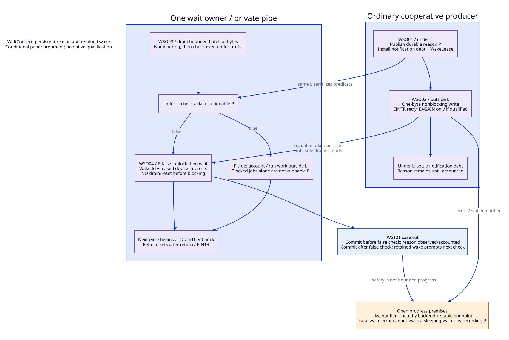
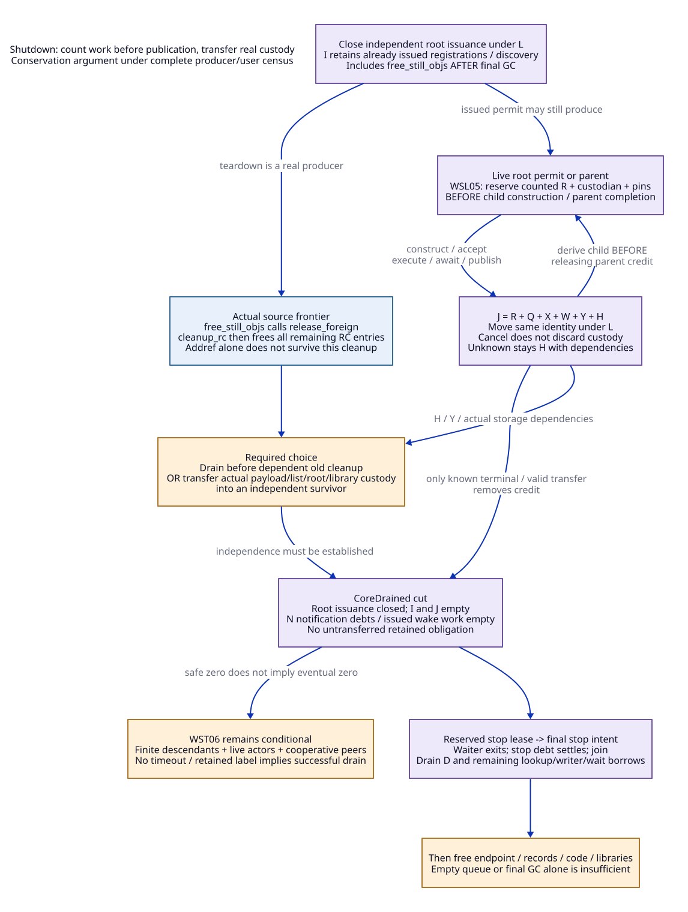

# Device Release Synchronization and Descendant Accounting

Reviewed: 2026-10-20. Architecture research only. These are handwritten,
conditional arguments about a proposed native service, not checked proofs,
implemented synchronization, target qualification or performance evidence.
Read the [source and paper ledger](device-release-sync-evidence.md),
[matched support matrix](device-release-sync-cost-matrix.md), and
[document trace map](device-release-sync-traceability.json).
This refines [WaitContext / accepted custody / drain](device-release-wait-contract.md)
and PA02/PA04--PA08 of the [shared-runtime argument](shared-runtime-proof-argument.md).
Gambit remains the language, managed-root, continuation and GC authority.

The [payload-custody refinement](rc-payload-custody-design.md) follows this
storage warning to actual TLS nested RC strings, server/managed users, rooted C
closures and private still-object discovery cursors. It specifies the ownership
commit, root cut, producer seal and no-internal-wait-cycle premises; a queue,
list splice or addref alone establishes none of those complete obligations.
See the [matched additional support obligations](rc-payload-custody-cost-matrix.md).

## 1. Concrete Scope and Premises

The selected cohort is ordinary cooperative native issuers and one native wait
owner per private nonblocking pipe. It is not the managed scheduler's condvar
queue, a signal-handler bridge, arbitrary release_fn, a distributed service or a
lock-free queue. Every deferred leaf still needs independent effect, thread,
root, payload and library admission. No current foreign profile gains admission
from this paper argument.

| ID | Premise / required construction | Boundary and evidence |
| --- | --- | --- |
| WSP01 | One service mutex L serializes task/resource claims, actionable predicate P, attempts, observer state, producer/task credits and notification intents. | L is separate from runtime metadata gate G. Reserve native record capacity before the commit. No allocation, callback, GC, blocking I/O, managed reentry or leaf execution under L. A target mutex/ordering refinement is still needed [SY-P01]. |
| WSP02 | Exactly one active wait owner drains this context's pipe and checks P. Each native reason persists until consumed or explicitly accounted under L. | P means runnable work or an unprocessed cancel/stop/service reason; a blocked task alone is not permanently runnable. WaitFrames own readiness interests and OS-handle leases [SY-S01/S02]. |
| WSP03 | Every reason-producing commit installs a notification intent and a stable WakeLease under L; its notifier eventually attempts delivery. | No transition-only wake suppression is assumed. Notification runs outside L. Finite-time scheduling and live notifier are progress assumptions, not a result of a queue commit [SY-S03/S04]. |
| WSP04 | Selected wait backend preserves a readable pipe token until the sole drainer reads it, rebuilds mutated fd sets, and admits the endpoint/fd bounds. | A successful one-byte write retains a wake until consumed. Treat EAGAIN as coalesced success only after qualifying that it implies an already retained readable token in this profile. Archived platform manuals alone do not certify the installed kernel [SY-P03--P05]. |
| WSP05 | Endpoint storage/identity remains pinned for all issued writers, pending notifications, active waits and lookup readers; fd reuse follows their drain and executor join. | EINTR is retried or reported without discarding intent. Fatal wake failure, SIGPIPE policy, close/select races and async signal entry require separate handling [SY-S04/S10]. |
| WSP06 | Every creator, accepted task, child reservation, finalizer/discovery source and native payload custodian is represented before publication. | Parent cannot relinquish the last credit before child reservation. IDs/counters cannot silently wrap; bounded admission or checked exhaustion is required [SY-S05--S10, SY-P02]. |
| WSP07 | Claim, stage and outcome reflect actual native effects; raw managed aliases and nonlocal exits cannot bypass the admitted authority. | Foreign wrapper clearing and raw pointer extraction must be migrated; root/reentry work occurs outside L under Gambit contracts [SY-S05/S06/S11]. |
| WSP08 | Root-source closure is complete; disposal progress additionally needs finite descendant work, cooperative leaves/peers and live/fair actors. | Final GC is not final release discovery. Unknown retained state is not drained. Cleanup of native storage must respect actual custody [SY-S07--S10]. |

## 2. WaitContext Ordering

[D2 source](device-release-wake-order.d2).

The abstract cycle has the following operations. These are protocol descriptions,
not executable pseudocode or an implementation proposal authorized for testing.

| ID | Operation | Required order / linearization boundary |
| --- | --- | --- |
| WSO01 | PublishReason | Under L, update durable P and insert notification debt n with an endpoint lease. Unlock. The durable state publication is the linearization point, not write(). |
| WSO02 | Notify | Outside L, attempt a one-byte nonblocking write. Retry EINTR as admitted. On successful write or qualified full-pipe coalescing, settle n under L; never remove the underlying reason merely because a byte was sent. Fatal failure records unresolved notification custody. |
| WSO03 | DrainThenCheck | Sole waiter nonblockingly drains a bounded batch of available wake bytes, then locks L and checks/claims actionable P. If P is true it accounts/claims work and repeats as needed. EOF/backend failure is an error state, not an empty healthy channel. |
| WSO04 | FalseThenWait | After the final false check, unlock L and enter the admitted level-readable OS wait with the wake fd and leased device interests. Do not drain/reset the pipe between this check and blocking. After return, including EINTR, rebuild inputs and repeat WSO03. |
| WSO05 | CloseEndpoint | Revoke new wake issuance only after producers/tasks are closed; settle all notification debts and issued writers, request stop using a reserved valid lease, join the waiter and drain remaining lookup/wake users before destroying the endpoint. |

**WST01 — no missed persistent reason, conditional on WSP01--WSP05.** Consider
an unconsumed reason commit relative to the waiter's final locked false check.
If it precedes that check, mutex serialization makes it visible; a false result
then means another permitted transition has already accounted for that reason.
If it follows the check, the notifier eventually leaves a readable byte while
the waiter is entering or inside the OS wait. The sole drainer cannot remove
that byte in this interval because WSO04 forbids a second drain. In the
qualified EAGAIN case, either an existing byte remains or the waiter has already
drained it before its next locked check, which observes the durable reason.
A delayed extra write after consumption only causes a spurious wake.

This proves neither bounded wake latency nor completion of the requested leaf.
A notifier suspended forever between commit and write violates WSP03: custody
is safe but the waiter can remain asleep. Recording a fatal pipe error in P
cannot itself wake an already sleeping waiter. Without a separately qualified
failure-detection/wake mechanism, endpoint failure leaves progress unresolved.
Do not invent a free watchdog or claim successful graceful shutdown in that case.

The legacy interrupt path already sets a durable interrupt flag before aborting
select [SY-S03]. That is useful source correspondence, not proof that its ignored
write result, PSTATE scratch and async entry satisfy this new service's premises.
An async signal source cannot acquire L under this protocol; retain its admitted
Gambit path until a separate bridge and writer-lifetime law are established.
A bounded drain budget must lead to a predicate check even under continuous
notification traffic; remaining bytes may cause a harmless immediate next wake.
An unbounded drain-until-empty loop has an additional starvation obligation.
A sequence number is useful for diagnostics/identity but is not a substitute for
persistent wake readiness. The serial design does not require a sequence counter
or a lock-free queue just to establish WST01.

## 3. Task Acceptance, Cancellation and Delivery

[D2 source](device-release-accept-cancel.d2).

An **AttemptRecord** is registered and discoverable before cancellation can
address it. It contains AttemptId, valid issuer/custodian, ResourceId/reuse
identity, Prepared/PreacceptCancelled/Accepted(TaskId)/Resolved state and an
outcome-resolution lease. The creator holds private native storage until the
acceptance commit. Capacity, pins and records needed to commit without allocation
are reserved first. A ResourceControl is the cohort's sole release authority.

| ID | Serialized operation under L | Consequence / work outside L |
| --- | --- | --- |
| WSO06 | AbortSubmission wins while Prepared: set PreacceptCancelled. | Later Accept is forbidden. Valid creator keeps payload custody and performs admitted rollback; cancellation itself neither frees native memory nor grants ownership to an invalid issuer. |
| WSO07 | Accept wins while Prepared: atomically claim resource, bind TaskId, move reservation to queue, transfer accepted custody, and install reason/debt/leases. | Response can be interrupted after this point. Resolve the same AttemptId; do not resubmit a new destructive attempt. Duplicate origins converge on the existing task/disposition. |
| WSO08 | Cancel after Accepted: detach an observer and/or record cooperative stop reason. | Accepted release duty remains. Queue claim or native execution may win next; cancellation cannot manufacture caller ownership, rewind a close direction, or free an executing payload. |
| WSO09 | Claim/run/await/publish move the same task credit and preserve stage, status, payload disposition and partial external effects. | A wait interruption/EINTR does not imply cancellation or rollback. Never replay an opaque partially destructive cleanup body [SY-S01/S05]. |
| WSO10 | Observer transitions Attached/Ready -> DeliveryClaimed or Detached, with one winner. | Pre-claim detach prevents a new callback for that observer. A delivery claim holds its own outcome/root/reentry custody; later cancellation follows Gambit's admitted policy, not stack/pin revocation. Callbacks and root materialization occur outside L. |

**WST02 — unique accepted release custody, conditional on WSP01/WSP06/WSP07.**
For one Prepared attempt L orders AbortSubmission and Accept. In the former
case the transition table prohibits acceptance; in the latter it prohibits a
return to creator-owned state. The resource claim under the same lock prevents
a second accepted destructive task for the same identity. Post-accept cancel,
claim and outcome transitions move or retain the existing obligation. This is
an abstract safety argument; opaque aliases, invalid reuse identities or a leaf
that frees storage without recording disposition violate the premises.

**WST03 — observer cancellation cut.** L orders Detach and DeliveryClaim. If
Detach wins there is no newly claimed managed invocation for this observer. If
DeliveryClaim wins, the invoker has separate custody and must complete or abandon
under the admitted managed-control contract. This is not a guarantee that an
already claimed callback will never start after a later cancellation response.
Stronger cancellation semantics require an explicit handshake and costed reentry
protocol. No raw longjmp may cross Zig frames.

The current ABI is a substantive replacement obligation. `release_foreign`
clears pointer/release_fn before calling the callback; `foreign-released?` tests
the pointer, while device operations extract raw `FOREIGN_PTR_FIELD` [SY-S05/S06].
An added native queue cannot make those observations atomic with WSO07 by fiat.
Migrated wrappers, conversion rollback, explicit release, group teardown and raw
users must resolve ResourceControl or pass a proven alias-invalidation frontier.
Managed field updates require Gambit's root/owner contract outside L; holding L
while writing a movable wrapper is not a solution. The old raw cohort retains
its original authority until separately migrated and cannot share conflicting
release ownership with the new cohort.

## 4. Shutdown with Root Producers and Derived Work

[D2 source](device-release-credit-drain.d2).

Use identity sets first; scalar counters are only a later checked refinement.
The ledger is local and centralized, not Dijkstra--Scholten's distributed cornet
algorithm. The paper motivates accounting for work committed but not yet sent
[SY-P02]; our construction and premises require their own argument.

| ID / set | Meaning and discharge rule |
| --- | --- |
| WSL01 / I | Issued root-producer, registration and discovery permits, including remaining foreign still-object teardown. Close independent issuance under L; already issued sources keep I until they can never create another task/reservation. Registration alone is not evidence that all actual release origins were enumerated. |
| WSL02 / J = R ⊎ Q ⊎ X ⊎ W ⊎ Y ⊎ H | Disjoint task obligations: reserved/private preparation, accepted queue, executing, waiting, pending result/publication/delivery, retained unknown. One identity has one ledger state. State movement is atomic under L; terminal removal requires known disposition and no untransferred task-owned dependency. |
| WSL03 / N | Notification debts and issued wake work. A task can finish before its delayed notifier; N still prevents endpoint teardown. A failed notifier cannot silently decrement to success. |
| WSL04 / D | Attempt/outcome/control readers, wait borrows, actual payload/library/code users and join frontier needed for physical teardown. Known native disposal can precede observer disposal, but their storage dependencies must remain represented. |
| WSL05 / ChildReserve | A live parent or issued root permit reserves a counted R token, custodian and dependency pins under L **before** constructing/publishing a child and before parent completion. Construction failure discharges R only after actual rollback. Accepted child moves R->Q without a zero-credit gap. |
| WSL06 / FinishOrRetain | A parent can finish after child custody has transferred to its counted R/J entry. Unknown/partial disposal stays H with actual dependencies; transfer to a survivor must move real storage/root/library custody, not merely a diagnostic label. |

**WST04 — descendant accounting safety, conditional on WSP01/WSP06--WSP08.**
Initially every producer and live obligation has a token. Root issuance/child
reservation inserts a token before work escapes its custodian. Acceptance and
claim/wait/publication move that token between disjoint states. Cancel-before-
accept retains R until creator rollback; cancel-after-accept retains J. Child
reservation adds its token before parent removal. Known terminal disposal removes
only the disposed obligation; unknown state moves to H. By induction on these
operations no permitted live/publishable obligation lies outside I/J/N/D.
With independent root issuance closed and all issued I discharged, empty J/N
therefore excludes pending or future service work within this census. Empty Q
alone does not. Overflow or an omitted producer invalidates the induction.

**WST05 — physical teardown frontier.** CoreDrained requires closed independent
root issuance, empty I/J/N, and no retained service-dependent obligation. Then a
reserved stop lease can publish the final stop intent, the waiter exits, that
intent/debt settles, and join completes. Only after D and all remaining
lookup/writer/wait borrows are drained may endpoint, control storage, code and
libraries be freed. A result or retainer can survive only in an explicitly
independent custodian with transferred actual dependencies. A still-dependent
H entry prevents teardown; calling it a leak does not make the dependency safe.

### The teardown producer omitted by a final-GC-only boundary

`free_still_objs` invokes `release_foreign` for remaining foreign objects;
`cleanup_mem_pstate` then immediately runs `cleanup_rc`, which frees every
remaining RC list entry without consulting its refcount [SY-S07/S08]. Per-processor
cleanup proceeds from memory cleanup to OS cleanup [SY-S09]. Thus a synchronous
path cannot simply enqueue release, add an RC ref and return into unchanged
pstate cleanup. The proposal would expose queued payload storage to reclamation.
This is a source-derived countermodel for naive deferral, not a reproduced bug
in the existing synchronous implementation.

A migrated design must cover remaining foreign registrations/discovery with I
through still-object teardown and choose a real custody path:

- Drain each affected native task before the old RC/OS cleanup can destroy its
  dependencies, with no circular dependency on an already stopped executor.
- Or transfer the payload's actual list/storage and all required dependencies
  into a survivor custodian before that cleanup. Wrapper memory cannot remain
  a borrowed task payload when `free_still_objs` frees it. Extract/copy the
  admitted native task data under the managed/root contract first.

The joined-donor candidate already transfers still/RC lists under constrained
borrower/GC drain conditions [SY-S10]. Credit that work to modern C. Its joined
owner precondition is not blanket permission for asynchronous destructor work.
A generic RC addref or a Zig allocator does not establish this custody transfer.
Pending Y delivery that needs a live VM must settle, be explicitly detached by
its observer, or transfer to a valid custodian before managed teardown; inventing
an observer cancellation during shutdown would change the API semantics.

**WST06 — termination remains conditional.** Accounting proves that zero is a
sound cut under a complete census, not that zero is reached. An unbounded chain
of children, blocked peer, reentrant finalizer, dead notifier, retained unknown
payload or callback needing the stopped VM can prevent drain indefinitely.
Finite generated work and cooperative dependencies are explicit progress
premises; a timeout reports unresolved custody, not successful disposal.

## 5. Logical Counterexamples

These are short, hand-authored interleavings which refute weaker rules. They are
not model-checker witnesses, native reproductions or measured failures.

| ID | Invalid rule and interleaving | Consequence / necessary correction |
| --- | --- | --- |
| WSX01 | Check P=false -> producer commits/writes -> waiter drains -> blocks. | Lost wake. Drain **before** final locked check, never between false check and wait. |
| WSX02 | Producer writes -> waiter drains/checks false -> producer commits without another wake. | Work can remain asleep. State commit precedes notification. |
| WSX03 | A second consumer drains the shared pipe after owner's false check. | Token no longer guarantees the intended owner wakes. Private one-owner channel or a separately proved multi-owner protocol. |
| WSX04 | Producer commits then never resumes; or write fails fatally and only records error in P. | Safety of custody does not imply wake progress. Keep notification failure/liveness unresolved. |
| WSX05 | Close fd with an issued writer; kernel reuses integer; late writer writes another resource. | Stable identity plus writer/notification/wait drain before close, not a ready-bit-only guard. |
| WSX06 | Accept commits; reply lost; cancel returns payload to caller; executor also runs release. | Double authority. Resolve same AttemptId; cancellation cannot undo accepted custody. |
| WSX07 | Cancel sees Prepared; Accept checks another flag/lock and still enqueues. | Cancel-before-accept promise is false. One transition table and lock/atomic refinement. |
| WSX08 | Ready callback read outside L; cancellation frees observer roots; invocation then begins. | Use DeliveryClaim custody; do not equate detach with revocation of an already claimed invocation. |
| WSX09 | Parent decrements last credit -> drainer sees zero -> child is enqueued. | Count child reservation before parent credit release. Private preparation is work. |
| WSX10 | Final GC ends/queue empty -> stop executor -> free_still_objs discovers release work. | Final GC is not producer closure. Still-object teardown and registrations hold I. |
| WSX11 | Deferred task adds RC ref -> returns -> cleanup_rc frees its header anyway. | Actual native storage custody must move or task must drain first. Pin terminology alone is insufficient. |
| WSX12 | Unknown payload is marked done; library unloaded; retained cleanup later calls into it. | Retention preserves H/dependencies; transfer closure before discharging. |
| WSX13 | Root closure ignores an issued registration permit, or outstanding counter wraps to zero. | Zero is unsound. Track issued permits/checked admission and forbid silent wrap. |
| WSX14 | All counters are correct but each task spawns another forever. | No finite drain conclusion without a well-founded/finite-work premise. |

## 6. Replacement and Remaining Gates

The reconstruction order is semantic ownership first, then synchronization and
teardown—not insertion of a Zig wrapper around unchanged cleanup:

1. Inventory release origins/raw consumers and give each admitted resource an
   issuer/custodian and registration/discovery permit. Keep arbitrary callbacks
   outside the native-only cohort.
2. Define resource/attempt/observer states and migrate alias observations, close
   stages and payload disposition. Preserve explicit Scheme error/reentry law.
3. Replace implicit PSTATE wait in the migrated release runner with owned
   WaitContext; qualify WSO01--05 including endpoint failure and signal policy.
4. Replace root/child/teardown ownership accounting and arrange payload drain or
   real survivor transfer before `cleanup_rc` and OS/module teardown.
5. Retire the old opaque cleanup/group-free paths only after all affected
   callers, readers and teardown users are routed through the new authority.
   Known leaves and modern C helpers can remain if their independent contracts hold.

WSO/WSL/WST/WSX/WSP identifiers are document-side trace units. No engine relation,
registered claim, witness, execution authority, retired path or positive
incremental economic bound is added. Remaining gates include complete caller and
producer census; weak-memory/mutex/OS refinement; managed alias/root/reentry law;
actual payload transfer; leaf effects/affinity; finite progress; and bounded
post-reuse C/Zig construction and maintenance costs. See the [matrix](device-release-sync-cost-matrix.md).
