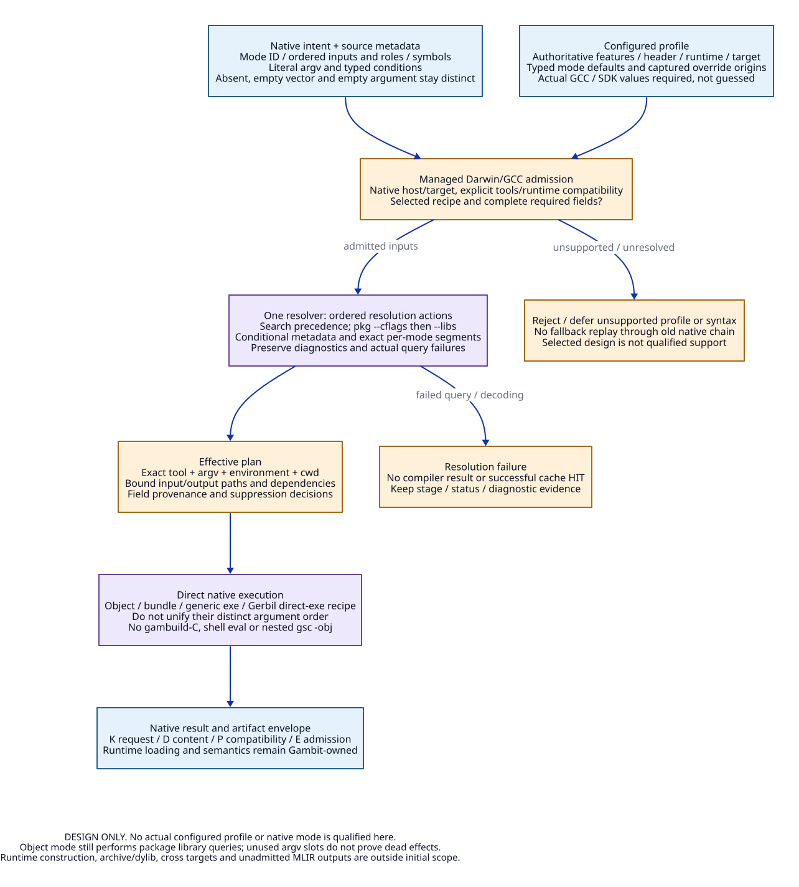
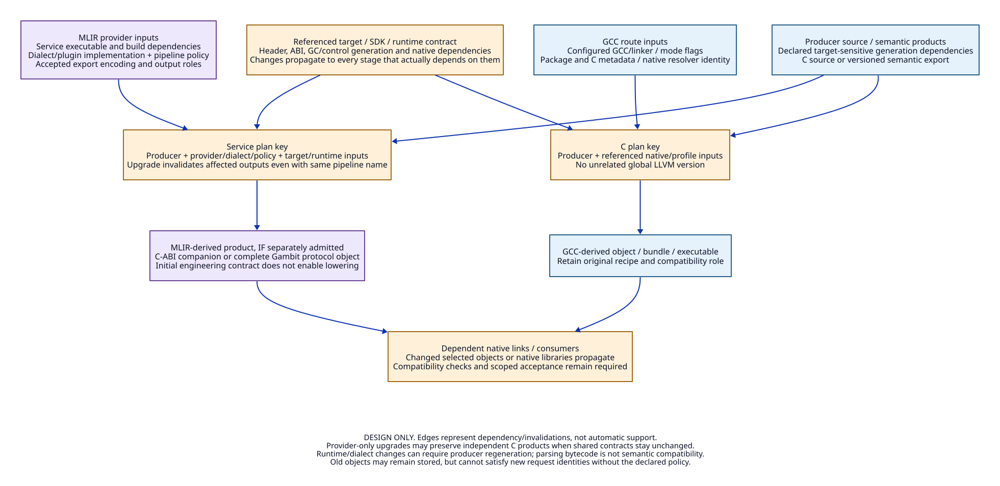

# Effective Configuration and Managed Darwin/GCC Profile

Date: 2026-10-20. Design/source review only. No implementation, configure run,
compiler probe, native/model test or performance validation. Refines the
[request and M1-M12 migration design](native-request-configuration-migration.md).
Evidence IDs D1-D8 resolve in the [source ledger](effective-configuration-evidence.md).

## 1. Baseline and Support Vocabulary

The baseline includes inspected GNU/non-MSVC templates and patched Gerbil
Darwin routes. The subsequent [configured-input audit](darwin-configured-input-design.md)
recovered materialized `bin/gambuild-C.unix`, config.status, config.log and
header bytes. Earlier three-path searches missed the .unix filename.
Its [ledger](darwin-configured-input-evidence.md) records concrete GCC 16.2.0,
Darwin flags and header defaults, while separating that profile from vendor
source and historical frozen-driver identities. The parameter algebra below
remains general; concrete values do not qualify a managed installation.

`managed-darwin-gcc-v1` below is a design name, not an installed profile. Use
these statuses consistently:

| Status | Meaning |
| --- | --- |
| Selected | Within the proposed first implementation scope, subject to all field and compatibility obligations |
| Mapped only | Source behavior is described, but not enabled in the selected scope |
| Deferred | Needs a distinct provider/target/semantic contract |
| Rejected | Managed ingress must refuse this form before native execution |
| Qualified | Requires actual implementation and acceptance evidence; **no mode is qualified by this study** |

The selected profile is native-host Darwin, GNU GCC C, one explicit host/target
architecture per configured profile, with exact runtime/header/tool/SDK identity.
It preserves the configured runtime's VM/SMP/GC choices rather than changing
them. It covers project-generated C objects, Darwin module bundles and the
specified executable routes. It does not build the Gambit runtime itself.
Gerbil's `static:` selection of source/object material is distinct from a fully
static Mach-O executable; it does not grant support for a native `-static` request.

## 2. Effective Configuration Data Model

Records and field names below are conceptual required meanings, not a JSON
schema, Zig type declaration or new API. Control metadata remains bounded JSON;
large artifacts remain separately identified. Fields with unresolved required
values cannot form an executable effective plan.

| Record / fields | Representation and invariant | Authority / M mapping |
| --- | --- | --- |
| `ProfileIdentity`: schema, profile ID, configuration producer/revision, configuration input/output digests | Versioned identities; a profile name is not sufficient compatibility evidence | Gambit configuration producer; M8, M11 |
| `HostTools`: compiler, linker-driver, package resolver, generation compiler | Each selected tool has executable identity, optional literal prefix argv, implementation/version evidence and declared supporting files/environment | Resolver chooses compatible tools; language compiler selection remains producer-owned; M1, M3 |
| `TargetRuntime`: target/CPU/features, word size/endianness/alignment, ABI, deployment target, SDK/sysroot, generated header and runtime-protocol generation | Exact producer-supplied/validated values, separate from host executable platform; no inference from the string “gcc” | Configuration/backend authority; M8, M11 |
| `ModeDefinitions`: mode ID, origin path, ordered segment recipe, required output roles and required capabilities | Distinguish gambuild object/bundle/exe from Gerbil direct executable recipes; no universal link template | Shared authoritative mode producer, consumed by resolver; M2-M4, M7-M8 |
| `DefaultSegments`: optimization, per-mode flags/definitions, runtime include/location/link, configured libraries | Ordered argument vectors or references to typed fields; duplicates are significant | Configure-derived values; M8 |
| `OverrideInputs`: configured C/LD override state, compiler selection policy, explicit per-request options | Distinguish absent, present-empty vector, and vector containing an empty argument; preserve source and suppression reason | Ingress captures once; resolver applies selected policy; M1-M2, M5 |
| `Metadata`: file order, package/path requests, CC/link-prelude/link-tail expressions, build-feature selection | Typed literal/conditional records, bound to generated source; preserve original per-file evaluation ordering | Gambit metadata producer, resolver interprets once; M5-M6 |
| `PackageResolution`: search environment, ordered requests, query actions, outputs/diagnostics/status and actual dependencies | Both query calls and returned argument slots are retained; a result is not only a list of libraries | Resolver-owned child operations; M6, M10 |
| `InputOutput`: semantic units/products, ordered artifact roles/paths, module/linker/alias names, output paths, debug/path identity | Content digest does not replace observable name/path or module meaning | Gerbil/Gambit produces names/membership; M3-M4, M9, M11 |
| `ResolutionTrace`: per-field origin, selected default/override, condition outcome, discarded/suppressed segments, ordered query/diagnostic events | Explain effective decisions without executing raw Scheme/shell text; trace is separate from output qualification | Resolver; M1-M8 |
| `EffectivePlan`: mode, exact argv/environment/cwd, required tools/profile, dependency record, outputs/limits and plan identity | Closed native request, produced after required resolution actions; executor does not remerge metadata/environment | Resolver/executor; M3-M7, M10 |
| `ProviderContract`, when referenced: export encoding/meaning, dialect semantics, provider/pipeline IDs, accepted runtime/target/output roles and provider dependencies | Required for a service operation, not a global LLVM epoch added to every C request | Backend/provider owner and system adapter; M11-M12 |

`Argument` means one exact native argument, not an unparsed string containing
several arguments. A typed mode recipe can contain literal arguments, ordered
field references and artifact-path references; conditional selection is limited
to the declared feature/metadata language. It cannot contain arbitrary shell
substitution, globbing, environment interpolation or executable fragments.
The initial profile uses UTF-8 strings without NUL, preserves spelling and
argument boundaries, and performs no implicit Unicode normalization. Other
path/argument encodings require a separate declared transport capability.

For every resolved field retain its configured source, ingress override state,
normalizer identity and final ordered value. `absent`, `[]` and `[""]` are
different states: absent may select a default; present `[]` suppresses it where
the rule permits; `[""]` is a real empty argument. Raw strings can be retained
as evidence, but cannot become executable argv through whitespace splitting.

### 2.1 Captured Defaults and Compiler Changes

D1 defines configure-time defaults and gambuild-time override references.
D2 uses those defaults when `CORCXXFLAGS_GAMBUILD`/`LDFLAGS_GAMBUILD` are unset.
The managed resolver captures their admitted ingress equivalents once. It does
not read them again from the environment during native execution.
Present-empty C/LD overrides replace only the captured C/LD contribution; they
do not erase all mode defaults. An empty explicit `Ucc` vector adds no arguments
and does not clear configured flags. D2 treats absent or empty CC override as
no compiler override. Thus presence states are recorded generally, but their
effect is defined per field rather than by a universal “empty means clear” rule.

A nonempty legacy CC override replaces the compiler and empties mode `FLAGS_*`
in D2 while leaving optimization/definitions and other recipe segments. It is
not equivalent to selecting a new configured compiler. The initial profile
**rejects legacy raw CC command overrides**; another compiler must select a
matching configured profile. The legacy behavior is mapped for a possible
later compatibility capability, not silently approximated.

The configuration producer must generate both legacy shell output and managed
data from one mode/default model while both profiles exist. A second table of
GCC flags handwritten in Zig fails M8 even if current commands match. Retain
the configure probes and generated feature/header authority.

## 3. Parameter Algebra and Resolution Actions

The notation `++` means ordered vector concatenation. It is descriptive and
nonexecutable. Symbols below denote **resolved vectors**, not shell variables.

| Symbol | Meaning / source |
| --- | --- |
| `C` | Selected configured C compiler executable followed by admitted literal prefix arguments |
| `O`, `OR` | Configured `FLAGS_OPT`, runtime-only `FLAGS_OPT_RTS` |
| `FO`, `FD`, `FE` | Effective `FLAGS_OBJ`, `FLAGS_DYN`, `FLAGS_EXE`, including admitted configured-override expansion |
| `DO`, `DD`, `DE` | Ordered mode definitions `DEFS_OBJ`, `DEFS_DYN`, `DEFS_EXE` |
| `I` | The single configured include argument equivalent to `-I` joined to `GAMBITDIR_INCLUDE`; preserve spelling/argument boundaries |
| `Qcc`, `Qld` | Package query results in actual request order, mapped through the admitted result decoder |
| `Mcc`, `Mp`, `Mt` | Metadata CC, link-prelude and link-tail results, preserving file and field evaluation order |
| `Ucc`, `Up`, `Ut` | Explicit request arguments in those respective domains |
| `CC`, `LP`, `LT` | `Qcc ++ Mcc ++ Ucc`; `Mp ++ Up`; `Qld ++ Mt ++ Ut` |
| `In`, `Out` | Ordered mode input paths and one output argument; path/cwd identity retained |
| `RL`, `RK`, `Lib` | Configured `GAMBITLIB_LOC`, `GAMBITLIB_LINK`, `LIBS` segments |

D4 runs the native tool in the output directory, supplies the output basename
and makes source inputs relative to that directory. Those spellings belong in
the effective plan. Replacing them with absolute content-store paths is not
automatically equivalent for debug information, metadata or `__FILE__`.

Do not flatten `FO/FD/FE` back into unordered option sets. D1 builds these from
other segments, and `FE` can contain repeated contributions. `O` is **not** a
standalone segment in the generic executable template. `OR` is not selected by
the installed `obj` dispatcher merely because the variable exists [D1, D2].

### 3.1 Actions That Are Observable Even Without an Argv Slot

D2's `obj` branch calls the common metadata/package resolver. D3 queries each
package with `--cflags` and then `--libs`; an unavailable resolver or failed
query can stop the request. Although object argv does not consume `LP` or `LT`,
the corresponding resolution work/diagnostics are not proved dead. The plan
model therefore includes ordered resolution actions and their actual outcomes.
Do not remove `--libs`, ignore its failure or skip unsupported LD metadata
diagnostics merely because no link is performed.

Search-path construction retains the declared ambient baseline plus metadata
then explicit paths, prepending each addition: the last added path takes
priority [D3]. Preserve separators/empty baseline semantics and original path
spelling until a normalization rule is proved. Package requests retain metadata
order before explicit request order; file metadata precedes explicit options.
No package sorting or independent host-only lookup is permitted.

The initial profile does not assume that package queries are safely cacheable
or side-effect-free. Reusing their results needs its own dependency/diagnostic
contract. Resolution failures are reported as resolution failures, before tool
execution; they do not become “successful object cache hits”. Declared resolver
work counts toward cost even when no native compiler runs.

## 4. Exact Mode Mappings

All rows map source behavior; status determines selected scope. Preserve the
listed order and path/role distinctions. **No row is an executed command.**
An ordinary object request has exactly one C source and one output. A GSC
invocation naming multiple source files must expand to the corresponding
object requests, not one GCC `-c -o` command with several C inputs. Preserve
the existing semantic grouping and native job dependency/barrier rules.

| Mode / status | Ordered native argument mapping | Source / M mapping |
| --- | --- | --- |
| Gambit ordinary `obj` / Selected | `C ++ O ++ FO ++ DO ++ I ++ ["-c", "-o", Out] ++ CC ++ In` | D1/D2/D4; M3, M5-M8 |
| Gambit `dyn`, Darwin module bundle / Selected | `C ++ O ++ FD ++ DD ++ I ++ ["-o", Out] ++ CC ++ LP ++ In ++ LT` | D1/D2; Darwin config selects bundle flags; M4-M8 |
| Gambit `exe` / Selected as a distinct recipe | `C ++ FE ++ DE ++ I ++ RL ++ ["-o", Out] ++ CC ++ LP ++ In ++ RK ++ Lib ++ LT` | D1/D2/D4; M3, M5-M8; no inserted standalone `O` |
| Gambit runtime object template / Mapped only | `C ++ OR ++ FO ++ DO ++ I ++ ["-c", "-o", Out] ++ CC ++ In` | D1's `BUILD_OBJ_RTS`; runtime construction is outside the selected project profile; M8/M11 retained |
| Gambit `lib` / Deferred | No usable mapped invocation: inspected configured `BUILD_LIB` is a placeholder | D1/D2; neither archive nor dylib is inferred from this name |

Darwin `FLAGS_DYN` selects `-bundle` where configure's detected option permits
it. `FLAGS_LIB` has separate `-dynamiclib`/install-name logic, but this does not
implement `BUILD_LIB` [D1]. Thus the abstract `link-shared` request must carry a
concrete `darwin-module-bundle` role. A `.dylib`, module bundle and executable
cannot be selected by a common suffix or treated as interchangeable.

The inspected `configure.ac:3246-3271` unconditionally selects its absolute
runtime-library branch (`if test "yes" = yes`): `RL` is empty and `RK` names the
configured runtime-library path. Its alternative `-L`/`-l` branch is not the
selected branch in these source bytes. Do not rewrite generic Gambit executable
linking to match Gerbil's direct `-L gerbilLibDir -lgambit` recipe. Actual path,
library suffix and version still require the missing configured profile.

### 4.1 Patched Gerbil Darwin Static-Path Module Branch

For D5 `driver.ss:1054-1113`, keep these separate producer/native stages:

| Stage | Required behavior | Managed mapping |
| --- | --- | --- |
| Scheme generation | GSC `-c`, output runtime C, producer module-ref/linker-name and semantic GSC options | Retained language producer; native executor does not reinvent symbol encoding |
| Static-path source | Copy runtime C to original static-C path | Retain by default under M9; source bytes alone do not erase path-sensitive behavior |
| Object build | Existing `gsc -obj`, filtered Gerbil CC options and appended `-D___DYNAMIC -fPIC` | Emit ordinary object intent; appended arguments stay in that order in `Ucc`, after earlier producer-filtered options; no nested `gsc -obj` below native boundary |
| Module bundle link | Dynamic output, static object input, runtime C metadata source, direct `gcc-ld-options` results and producer alias argument | Emit `dyn` intent with metadata source distinct from object input; alias remains after prior requested LD tail |
| Completion | Missing dynamic bundle raises the existing build failure | A produced object is not a successful bundle; retain expected output and error roles |

`-fPIC`/definitions may already occur in configured or metadata arguments; do
not remove repeated occurrences. The alias is generated from semantic module
and dynamic-linker names by Gerbil's `c-linker-id`. Native resolution may render
the platform option only after receiving those producer-defined symbols [D5].

### 4.2 Gerbil Direct Executable Links Are Different Recipes

D6's two direct GCC routes do not invoke the Gambit `BUILD_EXE` template:

| Recipe / status | Exact source-order native segments after the selected GCC executable | Source / M mapping |
| --- | --- | --- |
| Gerbil dependency executable / Selected | `["-w", "-o", Out] ++ dependencyObjects ++ binaryObject ++ stubObject ++ linkObject ++ libgerbilObjects ++ outputLdOptions ++ sharedRpathIfSelected ++ ["-L", gerbilLibDir, "-lgambit"] ++ libgerbilLdOptions` | D6 `:372-383`; M3, M11 |
| Gerbil stub executable / Selected | `["-w", "-o", Out] ++ stubObject ++ linkObject ++ outputLdOptions ++ sharedRpathIfSelected ++ ["-L", gerbilLibDir, "-lgambit"] ++ defaultLdOptions` | D6 `:533-587`; M3, M11 |

On the inspected stub path Darwin takes the source's `else` default library
list `[-ldl, -lm]`; this is a source-order observation, not a claim that a fresh
Darwin SDK probe confirms it. Preserve the selected configuration and actual
link behavior before changing platform policy. Rpath is an ordered producer
segment, not an automatically appended library-search option.
The Gerbil-selected link driver is a separately identified tool role; do not
silently replace it by the generic Gambit C compiler merely to share a prefix.
Any distinct tools still need the same requested target/runtime compatibility.

Do not inject `FE`, `O`, `RL`, `RK` or a new metadata/package scan into these
direct routes merely to unify their implementation. Those segments/actions
are absent from the inspected final direct invocation. Their object-generation
jobs still use the appropriate object recipe. Gambit semantic module composition
and the existing object/link barrier remain upstream [D6].

## 5. Managed Profile Support Matrix

These are proposed admission rules, not measured support. Required mode records,
dependency closure and role compatibility must be complete for every request.

| Input / capability | Initial design status | Boundary and retirement consequence |
| --- | --- | --- |
| Darwin host and same-architecture Darwin target, configured GNU GCC C/runtime/header/SDK | Selected | Exact values required; no acceptance from a compiler basename or vendor source HEAD alone; M1/M8/M11 |
| The selected object, bundle, generic exe and two direct Gerbil exe recipes above | Selected | Each mode keeps its own segment/action mapping; migrate only covered callers; M2-M7 |
| Producer-issued literal argv, typed metadata conditions and complete native input/output roles | Selected | One metadata/option interpreter; preserve source diagnostics/call order; M2/M5-M7 |
| Configured C/LD override states admitted as literal vectors | Selected | Preserve unset/empty/value semantics; same runtime/tool profile still required; M1/M8 |
| Legacy CC command strings, shell wrappers/expansion/globbing or unvalidated flags strings | Rejected | No whitespace splitting, shell evaluation or fallback delegation. Public ingress must have a separately qualified decoder before those forms enter managed scope |
| Unsupported conditional metadata | Rejected in this named profile | Explicit restriction: legacy warns/ignores such syntax, so managed rejection is not transparent compatibility; M6 cannot claim legacy-wide retirement |
| Arbitrary package-result strings without an admitted decoder/dependency model | Rejected | Typed package requests do not prove result tokenization; record actual query behavior/failure; M6 remains incomplete for those inputs |
| Runtime bootstrap/rebuild, `BUILD_OBJ_RTS`, install-name library construction | Mapped only / Deferred | Existing runtime/configuration build remains; M8/M11 are not whole-file retirement |
| Archive and Darwin dylib output | Deferred | Need real archive/library recipes and contracts; placeholder `lib` cannot stand in for them |
| C++, alternate compiler family, cross compilation, universal/multi-architecture image or fully static native executable | Deferred | Separate configured profile/provider support and target qualification; never substitute automatically |
| LLVM IR/LTO inputs, MLIR general Scheme objects, device images or JIT | Deferred | Need explicit output-role/runtime/capability admission; generic envelope does not enable them |
| Separate MLIR service capability/version negotiation | Selected as an engineering contract only | No lowering pipeline is qualified. Actual compile operations remain unsupported until their backend contract and output roles are admitted |

This matrix deliberately preserves unsupported legacy callers as a separately
selected route, not a hidden managed fallback. Report actual coverage as well as
zero delegation counts. If metadata only reveals an unsupported feature after
language generation, return that native admission outcome; do not rerun prior
expansion/initialization or quietly retry through `gambuild-C`.

Raw option/package/configure strings are a real remaining migration cost. The
data model specifies exact vectors as the desired boundary; it does not pretend
that every historical shell spelling already has a lossless decoder. This is
why selected mode mappings are not qualified compatibility claims.

## 6. M1-M12 Retirement Conditions for This Profile

| Migration item | Concrete completion condition | Must remain |
| --- | --- | --- |
| M1 tool ingress | Literal configured tool records and override provenance selected once | GSC semantic selection and unsupported legacy profiles |
| M2 option splitting | Exact phase/debug/static intent emitted as data; direct-exe and generic mode options stay distinct | Language options and their meaning |
| M3 native object/exe dispatch | Covered calls execute resolved GCC argv directly; no native `gsc -obj` hop | Semantic generation/link and object/link dependency barrier |
| M4 patched Darwin bundle route | Separate C metadata/object inputs, dynamic/PIC segments and producer alias parity | Producer naming, expected bundle output and failure behavior |
| M5 GAMBUILD transport | No GAMBUILD/BUILD_* protocol below any covered managed call | Explicit request schema and unrelated portable driver |
| M6 metadata/packages | Supported conditions, search order, both package queries, decoder, diagnostics and dependency closure mapped | Actual required package resolution; rejected subset not claimed retired |
| M7 shell template evaluation | Mode recipes expand to exact argv without shell eval or nested legacy command | Required compile/link work and argument ordering |
| M8 configuration encoding | One authoritative default/mode model emits both formats; runtime profile fields supplied, no copied Zig flag table | Configure probes, header/features and nonmigrated runtime build |
| M9 source copies | Retain until path/debug/module/metadata behavior is proven equivalent | Current distinct runtime/static C paths by default |
| M10 process plumbing | Gambit owns executor child; executor owns tool/service children and actual statuses | Scheme process API, unwind/error delivery and lifecycle protocol |
| M11 semantic/runtime protocol | Exact module/link/GC/control/ABI role checks; no output accepted on filename alone | Gambit module composition, setup, roots/control and runtime admission |
| M12 outer ownership | Required native groups/products/budgets declared to existing outer owner | Existing scheduling, full-task gates and independently supported builds |

Native request traces must demonstrate these conditions on representative covered
work; shrinking the support set to make retirement counters zero is insufficient.
None of these conditions is asserted to have passed in this documentation study.

## 7. LLVM Service Upgrade and Invalidation

Bind each stage to its **referenced** inputs. Do not put an arbitrary global LLVM
version in every configured C profile. Conversely, a stable project protocol
does not authorize old output reuse after its provider changed. Use per-stage
dependency records under the existing `K/D/P/E` envelope:

| Change | Recompute / invalidate | May remain reusable, subject to its own complete dependencies |
| --- | --- | --- |
| MLIR service executable/build dependencies or native C API bindings change | Service capability/admission, service plan key and its derived native products; relink consumers if selected products/dependencies change | Independent GCC-only plans/objects and unchanged producer semantic exports |
| Pipeline implementation/options or loaded dialect/plugin implementation changes | Service plan and affected outputs even if textual pipeline name is unchanged | Earlier semantic products with unchanged declared dependencies |
| Dialect semantics/export version or input encoding is no longer accepted | Re-emit/re-encode affected exports and rebuild their service outputs; reject unsupported capability match | Unaffected C route; unrelated semantic products |
| SDK/sysroot/native library or native target/CPU/deployment changes | Affected effective native plans, objects and links; repeat compatibility checks | Target-independent earlier products only where their producer dependency record proves independence |
| Runtime/header/GC/control/calling convention or target-sensitive semantic representation changes | Affected producer generation, C and MLIR code, adapters and link products; requalify runtime compatibility | Only explicitly independent earlier source/semantic products, not old native code merely because its size matches |
| GCC/linker or common native resolver changes | Plans/products referencing that tool/resolver and dependent links | Unrelated services only if their own tool/target/resolver dependencies truly do not change |
| Package metadata/search/result or consumed generated-source metadata changes | Resolution actions and affected plans/products, preserving ordering/diagnostic behavior | Independently complete products not depending on those fields |

A provider revision must include the actual implementation and dependencies, not
only a version string. Source maps, compiler support libraries, plugin builds and
output native dependencies are part of the provider/role contract where used.
If a service upgrade adds a new required native library, dependent links change
even though the runtime-facing ABI is otherwise unchanged.

Container parsing is not semantic compatibility: the
[MLIR bytecode contract](https://mlir.llvm.org/docs/BytecodeFormat/) separates
dialect version handling, while the [C API](https://mlir.llvm.org/docs/CAPI/)
has no stability guarantee. Internal service ABI/API changes stay inside the
provider build; project export/output contracts still need explicit compatibility.
Initial profile service negotiation does not make any MLIR output admissible yet.

An old object can remain stored and can remain usable under its old qualified
profile. It cannot satisfy a new producer request merely by matching output
bytes, target triple or structure sizes. Admission evidence is scoped to exact
products/profiles; preserve historical failures and do not copy PASS across keys.

## 8. Design Closure and Remaining Work

Selected now: effective data fields and provenance, mode-specific argument and
resolution-action mappings, finite initial scope, explicit rejected/deferred
forms, M1-M12 completion conditions and stage-specific upgrade propagation.

Still required before implementation admission: a concrete configured Darwin
profile with actual tool/SDK/header values; producer data emission; literal
string/package decoders and supported condition coverage; exact diagnostic/path
parity; dependency/publication mechanics; process cancellation; native acceptance
and whole-task cost evidence. No schema implementation, compatibility fixture,
new performance baseline or upstream path deletion is introduced here.
