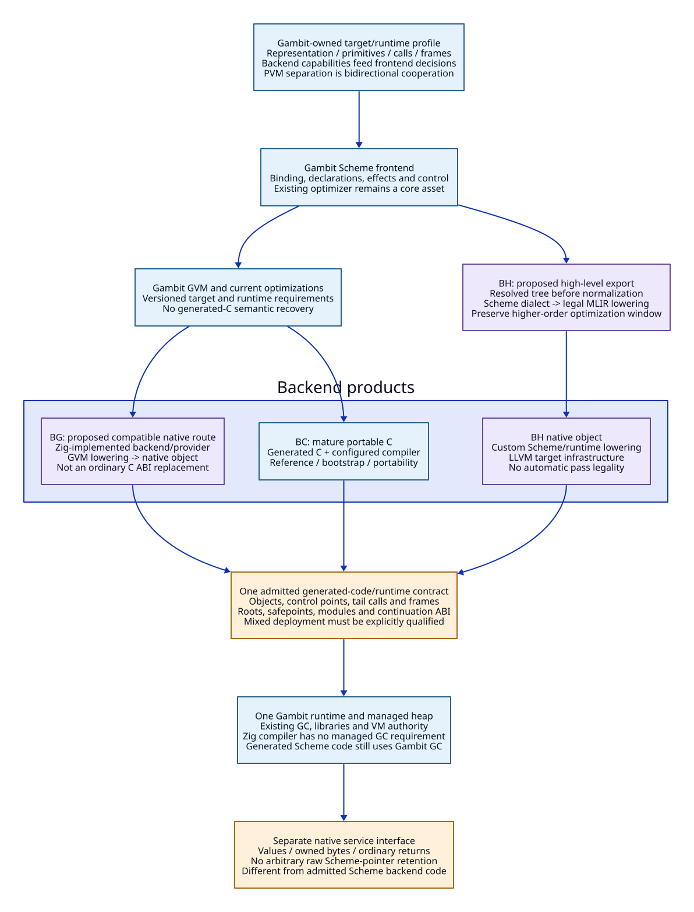

# A Gambit-Centered Backend Redesign With Zig and MLIR

Date: 2026-10-20. Paper/source-driven design; no implementation or performance
validation. Extends the [runtime modernization design](zig-llvm-runtime-modernization.md)
and [benefit ledger](zig-modernization-benefit-ledger.md).

The next design level is the [GVM shared runtime contract](gvm-shared-runtime-contract.md):
typed export, object/control/frame compatibility, continuation and GC boundaries,
with [concrete C replacement accounting](gvm-native-replacement-matrix.md) and
[direct source evidence](gvm-shared-runtime-evidence.md). Its proposed dispatch
profiles are not current backend/platform admission.

Gambit's Scheme compiler and runtime are the core asset. The proposed redesign
should preserve its ability to express Scheme efficiently, bootstrap through C,
reuse its libraries and honor its control/object model. Zig is useful if it
helps expose and modernize that backend contract, not merely if it launches a
C compiler or places a new wrapper around generated C.

## 1. What the Gambit Papers Actually Motivate

The 1990 PVM paper uses the VM as a bidirectional frontend/backend contract:
targets supply register, calling, closure and primitive information while the
frontend performs source-language optimizations. Separation is parameterized
cooperation, not an uninformed text-emitter boundary.
[Feeley and Miller, sections 1-2](https://www.iro.umontreal.ca/~feeley/papers/FeeleyMillerLFP90.pdf).

The 2018 paper treats the mature C backend as a reference implementation and
shares its representation/runtime with native code. Its cross-backend design
preserves tail calls through control-point bridges and compatible stacks/frame
descriptors. This suggests reusing Gambit's GC and libraries while changing code
generation, rather than rebuilding the whole runtime first.
[Huberdeau and Feeley, sections 1-3](https://www.schemeworkshop.org/2018/Huberdeau_Feeley.pdf).

These are historical design evidence, not proof of current arm64/arm64e bridge
support. No old timing or implementation-effort estimate is transferred. The
1997 portable-C tail-recursion report and 2000 C/continuation paper remain
important bibliography, but their primary full texts were access-blocked in
this research. No unread algorithm is reconstructed from their titles.

Current pinned source independently supplies relevant seams:

| Source | Observed contract | Consequence |
| --- | --- | --- |
| gsc/_back.scm:17-145 | Object representation, GVM lowering, c-intf, primitive and label/jump/frame information | A new backend must consume and return explicit target information |
| gsc/_t-c-1.scm:240-261 | C target installs dump/link/primitive/frame/result handlers | The existing C backend is a complete semantic/runtime partner, not just a compiler command |
| gsc/_front.scm:225-250 | Parsing occurs in a target-selected context before normalization | High-level export must retain target/profile assumptions |
| gsc/_t-cpu.scm:142-180 | Native assembly/fixup generation is packaged through the C backend | Existing source already separates native code generation from C-based packaging |
| gsc/_t-cpu-abstract-machine.scm:992-1021 | Primitive encoding distinguishes native implementation and C-runtime dispatch | Reusing runtime behavior and specializing selected primitives are separate decisions |

File existence and comments are source evidence, not qualification of those
backends or a promise that their packaging/calling path meets the new profile.
The latter two paths were read directly; no native backend was run.

## 2. Compiler Implementation Memory Is Not Generated Scheme Memory

A Zig-written backend can manage its own IR/buffers explicitly and still emit
code that allocates Scheme objects through Gambit, publishes Gambit roots and
uses Gambit's moving collector. The compiler implementation language does not
choose the generated program's GC policy.

Distinguish three interfaces:

| Interface | Managed object access | Selected ownership |
| --- | --- | --- |
| External native service written in Zig | Ordinary service code receives copied/native-owned values and bytes | No runtime-private heap access; F0-F5 contract |
| Compiler-service process | Operates on immutable Scheme descriptions/IR, never live Scheme addresses | Its IR memory belongs to the service; emitted code is a separate product |
| Admitted generated Scheme code from a new backend | May share Gambit's heap using the exact generated-code/runtime protocol | Gambit objects, roots, allocation, GC and continuation semantics remain authoritative |

Thus the service boundary's copying rule does **not** require copying the whole
Scheme graph whenever C-generated and new-backend-generated Scheme procedures
call each other. Shared representation is a possible explicit deployment
contract. It requires complete root/frame/control compatibility and does not
authorize arbitrary Zig libraries to retain Scheme pointers.

An R1/R2 runtime component written in Zig is yet another internal owner under
the runtime contract. It must not accidentally become a second Scheme heap or
a collector for the compiler service's own native allocations.

## 3. Two Complementary Backend Entries

| Route | Proposed input/output | Reuses | Hard boundary |
| --- | --- | --- | --- |
| BC: portable C | Existing Gambit frontend/GVM -> generated C -> configured C compiler | Mature reference behavior, bootstrap, libraries and portability | Preserve matched runtime/protocol; GNU GCC remains a valid selected compiler |
| BG: runtime-compatible native backend | Versioned GVM plus target/runtime contract -> Zig-implemented lowering/provider -> object | Existing Scheme optimizations, object model and admitted runtime behavior | Full control points, frame/root/GC, FFI and module compatibility; not an ordinary C ABI call |
| BH: semantic MLIR path | Resolved pre-normalization tree -> high-level Scheme dialect -> runtime-aware lowering -> object | Gambit language authority plus new higher-order/effect optimization window | Custom semantic proofs and complete lowering; not recovering semantics from generated C |

BC stays first-class. BG is the proposed incremental native-backend research
route; it does not replace the selected BH export or claim their optimization
windows are equal. BH and BG eventually meet the same private runtime contract
for general Scheme artifacts. Native computational companions remain a different
artifact class. Every route must be selected explicitly in the request/result.

Before either export, the Gambit target producer supplies the effective
representation, calling/frame constraints, primitive capabilities and semantic
options. The backend service reports capabilities and rejects incompatible
profiles before code generation. No independent Zig copy of target policy may
drift from Gambit's producer. Higher-level IR keeps bindings/control/effects;
lowering introduces layout only at an explicit, versioned boundary.

Zig has three possible roles that must not be conflated: implementing the
backend and native system, compiling existing generated C, or serving as a
generated source language. The first is the central proposal; the second is a
toolchain option; the third is an alternative requiring a complete language
mapping. A `GVM -> Zig source` emitter is not admitted merely because Zig can
call C. Nor does selecting Zig require embedding LLVM APIs in the runtime.

## 4. A Shared Runtime Is the Migration Lever

For an explicitly admitted mixed BC/BG or BC/BH deployment, specify one runtime
generation with one collector and VM registry. A procedure compiled through BC
and one through BG must agree on object/control identity, calling/result
locations, module globals, continuation frames, root maps, safepoints and FFI
delivery. Shared symbol names or a common platform ABI are insufficient.

Initially preserve the current runtime protocol and existing root/frame scheme
where possible. Do not require a new LLVM statepoint strategy merely to begin
researching BG. A later switch to different layouts/maps or a different collector
is an R2 revision with coordinated producers and rebuild/invalidation rules.
It cannot be smuggled in as a compiler-service version upgrade.

Research obligations include dynamic call targets, proper tail recursion without
unbounded native stack growth, non-tail return, closure/self state, arity and
multiple values, continuation capture/reentry, GC during boundary crossing,
exception/unwind, weak/finalization behavior and mixed-module load/retirement.
Darwin adds code-pointer/PAC, executable-memory, fixup and unwind constraints;
the observer's C0/C1 matrix does not qualify these Scheme backend bridges.

Unsupported instructions/effects must reject the selected backend capability.
A declared runtime-call lowering may reuse an admitted C-compiled Scheme/runtime
implementation; that is different from silently rerunning a failed native build
through an old compiler path. No unqualified fallback or duplicate owner is
introduced. Upstream C distribution and an admitted mixed-backend profile are
legitimate products, not evidence that managed script retirement has failed.

## 5. What Would Make This a Fundamental Improvement

The redesign replaces implicit macro/host-function assumptions with generated,
versioned target/runtime definitions consumed by BC, BG and BH. It allows hot
Scheme modules to avoid repeated C emission/preprocessing while retaining
Gambit's semantic libraries and collector. It allows LLVM target/optimization
services to evolve without replacing the Scheme frontend or compiling every
dependency into the runtime process. These are proposed mechanisms, not achieved
savings. They require the work-count and ABI/semantic gates already listed.

Measure bridge frequency, root flush/reload traffic, generated/preprocessed
bytes, host-function size, native code size and C/native compilation work, as
well as execution time. A useful cost model is
`Tcontrol = Nlocal * Clocal + Ncross * Cbridge + state_flush_reload_cost`.
Cold/runtime-library and hot/application costs must stay separate. Eliminating
C text for a module does not eliminate code generation, root metadata or native
linking. A bridge may preserve feature coverage yet dominate a boundary-heavy
program; use actual call-site denominators, not paper speedups.

This extends Q02/Q06/Q07/Q09/Q10/Q17, rather than adding the same saving twice.
The next design closure is a current-source BG protocol map with explicit
unsupported cells, alongside the higher-level BH semantic map. It is not a
request to implement either backend or to rewrite all C code.

