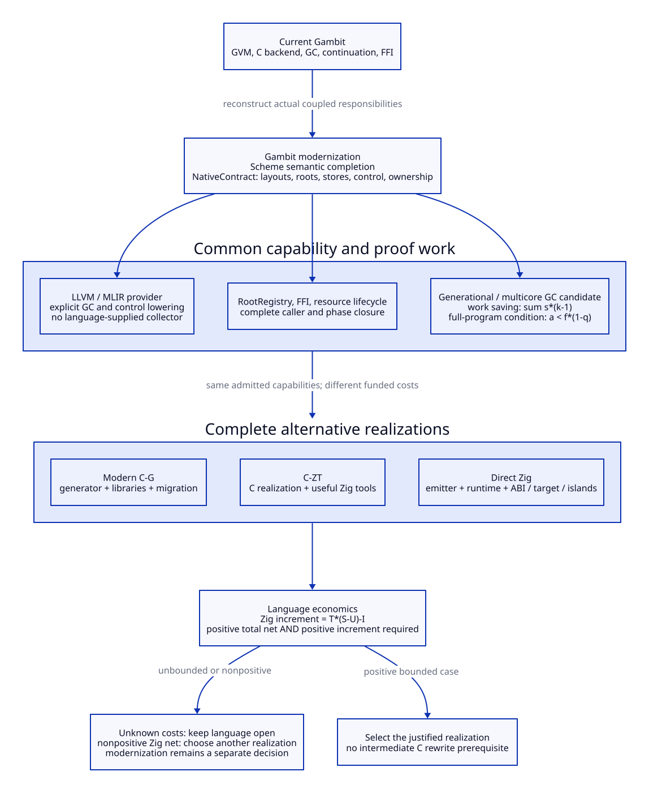

# Gambit Modernization Independent of Implementation-Language Selection

The current [capability-driven map report](map-generated-c-modernization-matrix.md)
sets the decision criterion: runtime/compiler capabilities, semantic proof and
ongoing execution/space/upgrade burdens. Human-day ROI and labor-based language
ranking below are historical planning considerations, superseded as the
criterion for this research phase. AI-assisted implementation does not alter
the required semantics, GC/FFI closure or native qualification.

Design-only direction. No implementation or native test is authorized by this
document. The [quantified assessment](modernization-quantified-benefit.md) gives
conditional copy-work savings, full-program thresholds and language-cost budgets.

MD01. The modernization objective is a Scheme system with explicit, composable
compiler/runtime contracts: correct control and roots, admitted multi-context
execution, predictable resource ownership, independently changeable native
providers and actual removal of obsolete responsibilities. A change from C to
Zig is an implementation choice within this objective, not its definition.

[D2 source](modernization-capability-decision.d2).

MD02. Keep Scheme responsible for language meaning, closure/mutable-cell and
continuation transformations, effects, initialization recipes and semantic
roots/safe points. Complete one NativeContract containing ObjectLayout/TraceSpec,
allocation/store/root operations, CallSpec/FrameSpec/PointId, FFI participation,
module/code lifetime and validated effective tool configuration. Current GVM
and target interfaces provide a real starting point [Q-S04 in the assessment],
but do not already constitute this complete product. This contract is substantive
compiler/runtime work rather than a wrapper around old C macros.

MD03. Native realization implements the collector, root registry, worker/context
separation, FFI/OS/resource services and module products. Compare complete C-G,
C-ZT and direct Zig routes from the same current source. C-G includes generator,
libraries and full migration; direct Zig includes its emitter, native services,
target/ABI/control integration and retained C islands. No intermediate modern-C
implementation is required. Coherent whole-cohort replacement may be designed
and delivered without treating a minimal patch as the architectural endpoint.

MD04. LLVM/MLIR is a provider behind the shared contract, with a high-level
semantic export for lawful closure/effect/control transformations and explicit
GC/FFI/native operations at lowering boundaries. A direct provider can bypass
generated C and its native frontend for converted code; it adds IR construction,
passes and code-generation cost. Zig source emission replaces C emission with a
different native frontend; it does not remove native compilation. LLVM's GC
hooks do not implement root registration, collector algorithms or FFI ownership.
Each provider needs independent control/root/ABI acceptance. No build-speed or
startup-time reduction follows from the mere removal of a stage.

MD05. Use a report that keeps benefits and acceptance dimensions separate:

| Modernization axis | Quantifiable target / falsifier | Is Zig required? |
| --- | --- | --- |
| Repeated mature copying | sum s*(k-1) payload bytes avoided under the stated cuts; zero if weighted survival is one | No; identical collector semantics give the same byte-count result |
| Whole-program cost | a < f*(1-q); rejection if barrier/promotion/root/major cost consumes the saving | No; full implementation cost may differ |
| Multi-context/GC ownership | Every admitted root producer/worker has a complete ownership and phase path; an uncovered writer/callback rejects the profile | No; reconstruct these contracts in the chosen language |
| Continuation/control | Preserve actual saved values, multi-shot invocation and code/map lifetime; a missing restore/root edge rejects the provider | No; native Zig stack behavior is not Scheme semantics |
| LLVM/high-level optimization | Explicit semantic operation eliminated or specialized with justified effects and independent root/control preservation | No; both C and Zig routes can host a direct provider |
| C frontend retirement | No generated C host or associated frontend invocation for a fully converted cohort; charge replacement work | Zig can replace the C route; direct LLVM can also bypass it |
| Maintenance leverage | Positive full-project net and T*(S-U)-I>0 for Zig versus funded modern C | This decides whether Zig is selected |
| Memory and pauses | Actual capacity/fragmentation and phase/foreign response bounds; copying ratios supply neither | No; separately required in either language |

MD06. The next theoretical work is to price a bounded set of complete necessary
support changes across root registry, barrier logs and release coordination,
including their distinct policies, native adapters and upgrades. Produce upper/
lower cost intervals rather than count every semantic duty as a Zig saving.
In parallel, close the collector's writer/root and phase proofs against real
callers, and quantify a declared workload envelope with parameter ranges.
An unknown interval means the language decision stays open; it is not proof
that Zig has no value. A proven nonpositive Zig increment selects the better
native realization without discarding the common modernization architecture.
If no full realization beats a funded retain/repair baseline, reject that
scope's rewrite rather than force it to justify a previously chosen language.

The [earlier GC retirement sequence](gc-native-runtime-cost-matrix.md) still
applies. Retire an old authority only when all real callers in the selected
cohort use its admitted replacement. Keep one semantic source across providers,
and retain independent decoders/root controls; an extra language facade with
all old responsibilities permanently intact is not the intended result.

## Current Native Realization Reference

The [source-informed service study](native-service-support-costs.md) expands MD06
into 25 known work packages and scoped cost intervals. Modern generated C is now
the better-supported reference for these three services; Zig remains revisable
if named support or qualification costs change. This does not require a modern-C
implementation before considering Zig, nor select an unchanged macro/runtime
architecture. Whole-runtime costs and unknown native/target closure stay open.

## Learning, Reflection and a Concrete Collector Case

Study the [captured-map design](map-continuation-gc-design.md) and
[learning/reflection](map-continuation-gc-learning.md) from Gambit's actual
control/object graph. OCaml research contributes mechanisms, constraints and
questions; its control restrictions and results are not transplanted. The
[benefit matrix](map-continuation-gc-benefit-matrix.md) evaluates actual removed
work and added runtime/space obligations without human-day scoring.
