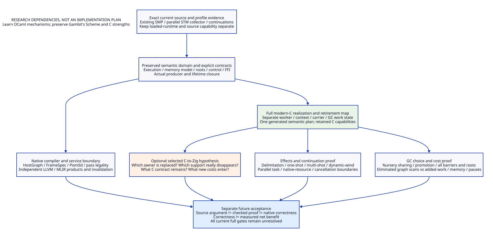

# Gambit Modernization Foundation

Architecture/source/literature research only. No implementation, compiler,
native test, model/prover execution or performance experiment. This is the
current interpretation of the earlier [complete system proposal](modernization-system-architecture.md)
and [shared runtime contract](shared-runtime-contract-design.md), not a new
competing runtime specification. Read the [matrix](gambit-modernization-foundation-matrix.md),
[evidence](gambit-modernization-foundation-evidence.md) and
[trace](gambit-modernization-foundation-traceability.json).

MF01. Modern C is the mandatory foundation; Zig is a possible implementation evolution.

Gambit's C orientation is a core asset. Maintain C backend capability, C ABI,
foreign libraries, embedding and explicit native control boundaries while
reconstructing its internal C architecture. Modern C is not a disposable rival
to Zig. It is the required native contract, generated interfaces, ownership and
memory/concurrency discipline against which a later C-to-Zig change is judged.

The target is one Scheme semantic owner and one implementation owner for each
selected mechanism. A C-facing module can have a Zig implementation if qualified;
that does not remove its C contract or require a second C implementation of the
same mechanism. Conversely, comparing two possible realizations in a research
matrix does not authorize shipping both. A second maintained realization needs
an independent deployment requirement and full cost justification. Temporary
migration overlap must have explicit callers, exit conditions and retirement.
No such Zig adoption is established here. [FS01–FS03, FP04, FO01]

MF02. Define modernization by runtime capabilities, not implementation syntax.

The foundation is a Scheme-owned, explicit compiler/runtime contract covering
execution, object/root updates, control transfer, sharing and actual last use.
Modern C realizes that contract. A later Zig realization must preserve it and
replace a named owner rather than add semantic decisions or duplicate policy.
LLVM/MLIR consume it for lowering and transformations; they do not define Scheme
GC, continuation, effect, VM or foreign-lifetime semantics.

The existing source already contains processor run queues, locking and parallel
STW GC mechanisms. Current configured/installed capability is a different
question. The source-based GC audit finds sectioned copying of movable objects
and still-object mark/sweep, not an active generational young/old collection
policy. Modernization therefore starts from real strengths and specific coupling,
not the false premise that Gambit lacks continuations or parallel GC. [FS02–FS05,
FO01]

MF03. Separate execution rights, storage and collection participation.

Reuse the shared contract's VmDomain, ExecutionContext, RootCarrier,
RequestTicket, InvocationRecord and ImageUseClosure. Distinguish:

| Entity | Owns / means | Must not be conflated with |
|---|---|---|
| VM domain | Object identity domain, heap policy, roots and collective requests | OS thread or a single task |
| Execution worker | Current permission to execute managed code and local fast allocation resources | Permanent owner of every value/root it once touched |
| Suspended context | Managed frames, dynamic environment, continuation/resource state | Live native C stack or active GC participant |
| Root carrier | Published updateable root locations with scan lifetime | Moving object's stable address |
| GC worker/context | Explicit scan/copy work, termination and capacity result | A mutator PSTATE assumed to provide all collector storage |
| Foreign invocation | Owner attachment, roots/borrows, return origin and resources | TLS pointer alone or callback count |
| Image/module instance | Executable code, metadata, binding and last users | Cached object file or compiler session |

Several execution contexts can exist per worker; simultaneous managed execution
requires distinct admitted execution rights. Context retirement does not remove
its still-live roots, and a blocked host does not become safe merely by being
removed from a participant count. This explicitly generalizes the prior root,
worker, capacity and custody studies rather than repeating them. [FS03–FS05,
FO01]

MF04. Give concurrency and parallelism separate contracts.

Effects/fibers can structure cooperative concurrency. True same-VM parallelism
also requires simultaneous managed execution, safe shared allocation/mutation,
root/GC coordination and an explicit memory model. Independent VMs are another
capability and do not by themselves provide shared-heap parallelism.

Specify which immutable values can be shared, how mutable fields and atomics
are published, which races are admitted, and how synchronized programs are
reasoned about. C atomics and acquire/release code are mechanisms, not a complete
Scheme memory model. In particular, a claim of memory-safe racy Scheme access
cannot be implemented by accidentally exposing undefined C data races. A
restricted race-free profile is a proposed capability boundary, not permission
to silently weaken existing Scheme behavior. No OCaml memory-model guarantee
is automatically inherited. [FS04, FP01, FP03]

MF05. Make allocation, writes and roots one auditable GC boundary.

Define young/mature/pinned/permanent categories, allocation/initialization
publication, survivor promotion, remembered-set insertion, weak/finalizer policy,
root scanning and relocation reload as one selected GC profile. Audit every
write producer: generated pair/vector/box/closure/global stores, captured-frame
and denv mutation, serialization reconstruction, primitive bulk/CAS paths and
FFI access. Allocation failure and partial initialization must leave rooted,
accounted storage under a known owner.

A first complete design candidate can combine local nursery allocation with
coordinated parallel minor collection and a separately specified mature heap.
This exploits existing rendezvous/copying expertise while avoiding a default
read barrier on every managed load. It is a candidate, not a commitment to copy
OCaml's implementation. A concurrent mature collector needs its own write/load
barrier, snapshot and termination proof. A different nursery-sharing strategy
may win for Gambit; compare its cross-worker references and FFI costs explicitly.

The current interleaving of Scheme stack allocation and movable heap sections
means this is more than adding an age bit. Separate stack/context lifetime,
allocation regions and worker copy capacity while preserving frame maps and
continuation reachability. Generational GC is valuable only when eliminated
mature-graph work outweighs barriers, remembered sets, promotion and extra root
handling for the actual lifetime distribution. [FS03, FS05, FP01, FO01]

MF06. Preserve general continuations while designing an explicit effects path.

Gambit already has capture/graft, dynamic environments and introspectable/mutable
continuation frames. An effect handler is not obtained just by renaming call/cc:
specify operation identity, handler delimitation, deep/shallow reinstatement,
resumption state, unhandled operation, cancellation/discontinuation and resource
exit. Handler metadata, dynamic-wind/parameterization and roots must travel
consistently with the captured segment.

Investigate a one-shot delimited resumption for common scheduling/I/O effects,
while retaining Scheme's existing general continuation capability. A specialized
one-shot path may avoid copies; multi-shot reuse needs explicit cloning/sharing,
mutable-frame and linear-resource semantics. Do not silently convert existing
continuations into one-shot values or promise safe duplication of sockets/native
ownership. Cost and semantics of each continuation kind remain explicit.

Same-worker resume, cross-worker migration and cross-VM transfer are separate
proof domains. General migration cannot be inferred from captured heap frames.
Foreign return origins, native frames, owner-affine resources and image/root
lifetime can prohibit a transfer. Preserve existing behavior within its actual
admitted domain; any new restriction or extension needs an explicit language
contract and caller analysis. [FS04–FS06, FP02, FP03, FO01]

MF07. Build scheduling and cancellation above the control contract.

An effect operation may suspend a task, register an I/O dependency or enqueue
parallel work. Keep mechanism and scheduling policy distinct: managed worker
pool, work distribution, pinned tasks, task groups, resource limits and event
delivery each need owners. A task must not resume concurrently twice; an
accepted cancellation must have specified delivery and cleanup semantics.

Use structured task/resource ownership as a candidate design: a group closes
new admission, requests cancellation, accounts descendants and joins/drains
before releasing resources. This does not imply arbitrary foreign calls can be
interrupted or user cleanup always terminates. Unknown native returns retain
custody; timeouts do not issue completion. Effects alone do not provide parallel
speedup, cancellation correctness or resource reclamation. [FS04, FS06, FP02,
FP03, FO01]

MF08. Treat C/FFI as a first-class modern interface, not a legacy escape hatch.

Every foreign mode declares may-allocate, may-block, may-callback, may-transfer
control, retained/mutable managed values, VM/owner affinity and native resource
ownership. Publish roots and end unsafe borrows before blocking or GC
participation changes; restore binding/execution rights and reload moved values
before allocating conversions or nested callbacks. No new language allocator
replaces Gambit's GC or roots.

Keep ordinary C stack calls valid. A resumable effect cannot capture arbitrary
native frames by accident. Where needed, redesign selected APIs as result/task
boundaries or contain their native control behavior; rejected crossing must have
explicit semantics. Tcl trace/yield/rewind cases are stress cases for this
contract, not the whole modernization program. Existing C library implementations
must be audited for global mutable state when same-VM workers run in parallel.
[FS06, FP02, FP03, FO01]

MF09. Complete semantic plans before native lowering.

Scheme retains evaluation order, bindings, primitive/foreign effects, tail calls,
closure identity, continuation/dynamic-wind semantics and module initialization.
The proposed HostGraph/FrameSpec/PointId and allocation/root/update descriptions
must expose those facts before backend emission. Physical layout, generated
typed C wrappers and selected native instructions then realize that plan.

This is a substantial C architecture reconstruction: retire duplicated C macro
decisions and implicit PSTATE/root/control assumptions after all real callers
migrate. C output and its ecosystem remain required capabilities; retiring an
old emitter responsibility does not retire the C ABI. Current source target
selection demonstrates an existing separation seam, not a completed neutral
plan exporter. Gambit's original PVM paper motivates this semantic/target
cooperation without prescribing today's physical layout. [FS01–FS03, FS05,
FP06, FO01]

MF10. Leverage LLVM/MLIR at explicit service and artifact boundaries.

Preserve high-level functions, closures, effects and alias/capture facts long
enough for legal specialization/escape/region transformations. A pass that can
move allocation, writes, calls or control needs the common contract's legality
conditions; missing effect/root/continuation evidence rejects the optimization.
LLVM may own target code generation, selected optimizer/LTO/debug mechanics;
runtime code/image/metadata last-use authority stays in Gambit.

Cache semantic plans, runtime-protocol products, compiler IR, objects and binding
programs separately from fresh mutable module/VM instances. Provider identity
and configuration invalidate the appropriate descendants. MLIR has a C API;
neither its availability nor LLVM tooling requires Zig. Zig may later reduce
specific integration work, but that must be demonstrated after equal C access
and residual C++/dialect adapter duties are charged. [FS01, FP04, FP05, FO01]

MF11. Prove modernization and language evolution in different ledgers.

First establish total architectural benefit over current Gambit: redundant root
and mature-graph work removed, shorter waits/pauses, bounded allocation and
copying, real multicore scaling, safe resumable concurrency, fewer independent
semantic owners and actual obsolete-path retirement. Preserve single-worker
cost, peak memory, native interoperability and debugging requirements.

Then compare a named modern-C module with its proposed Zig replacement.
Semantic duties may remain identical while implementation support decreases;
that decrease can count if concrete generated C/library reuse does not already
remove it. Conversely, counting a semantic obligation in both columns is not
evidence of two deployed implementations. Existing 13-family/7-record counts
describe obligations, not duplicated maintenance or a universal lower bound on
Zig utility. The recent coroutine scope proved no exclusive elimination; it did
not prove all possible C-to-Zig evolution is worthless. [FP04, FO01]

MF12. Require a replacement contract before adopting Zig.

| Required answer | Admission requirement |
|---|---|
| What remains C-facing? | C backend, ABI, embedding/FFI and relevant representation/control guarantees retained |
| What implementation changes owner? | Named module/producer/caller boundary, no second semantic schema |
| What necessary support disappears? | Concrete C-specific glue/layout/resource/diagnostic work after generation and mature-library reuse |
| What cost is added? | Zig compiler/library/API upgrades, generated-code provenance, ABI/build/debug and any residual C/C++ crossings |
| Which old implementation retires? | All selected callers move; source owner removed; temporary overlap has exit conditions |
| Why is the change material? | A bounded net capability/resource/maintenance gain beyond the mandatory modern-C architecture |

Using a Zig compiler for C is a toolchain choice. Writing build.zig adds a
maintained build-language surface and is not cost-free. Generating Zig or moving
a runtime service into Zig is an implementation-language decision. None should
silently select another. No permanent duplicate C/Zig realization is the default.
[FS01, FS02, FP04, FO01]

MF13. Establish the foundation in dependency order, not patch size order.

1. Recover current source/profile facts and declare the preserved Scheme/C
   semantic domain, memory model and failure obligations.
2. Complete shared operation/ownership/root/control contracts and the producer
   closure for execution, mutation, FFI and image lifetime.
3. Design the full modern generated-C realization and concrete old-owner
   retirement map, including allocation/GC and worker/context separation.
4. Refine the generational/concurrent collection candidate and one-shot effects
   path together with continuation/FFI semantics and cost counterexamples.
5. Complete compiler/export and LLVM/MLIR legality/artifact contracts; retain
   the C route as a required supported capability.
6. For a selected C-to-Zig candidate, independently discharge MF12; only then
   choose that implementation owner and its replacement boundary.

These are research dependency stages, not an implementation authorization or a
claim that a small isolated test can settle the theory. Source, conditional
arguments, checked models/proofs, native acceptance and performance evidence
remain distinct. [FS01–FS06, FP01–FP05, FO01]

MF14. State what would justify a design beyond the OCaml precedent.

Potential Gambit-specific strengths are general continuations alongside a cheap
one-shot path, backend-independent root/control plans, owner-independent parked
root carriers, resource-specific rather than global reclamation, C-native
embedding and high-level optimizations preserving Scheme identity. Each is a
research target with explicit semantic and cost obligations. They are not a
claim that this unimplemented design is already more advanced than OCaml.
The foundation succeeds only if those capabilities compose without losing
Gambit's language and C strengths. [FS01–FS06, FP01–FP05, FO01]

