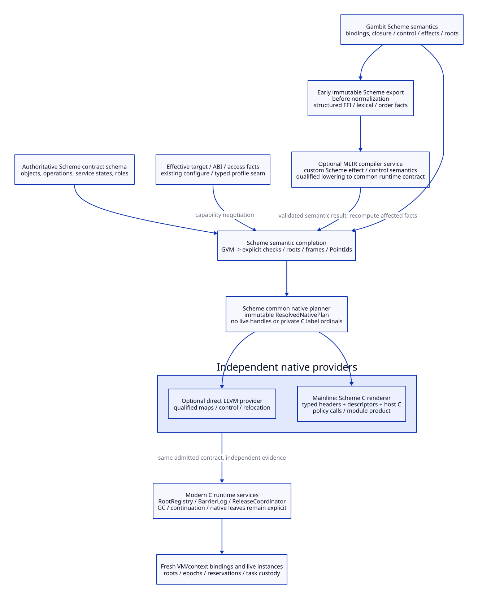
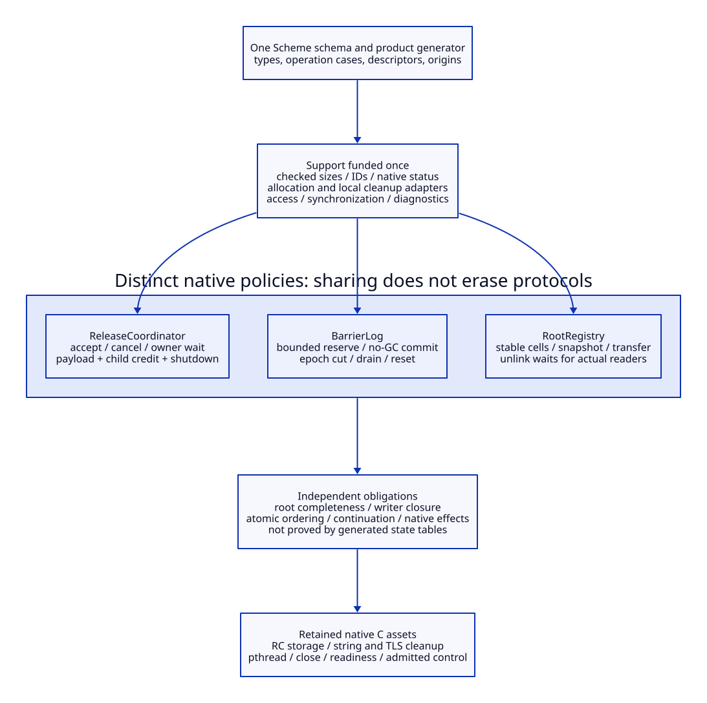

# Unified Native Contract for Modern Generated C

Architecture research only. No generator, runtime implementation, compiler,
native test or model is executed. Proposed data/operation names are descriptive
contracts, not implemented APIs. Read the [Scheme generator](scheme-native-generator-design.md),
[provider and retirement plan](generated-c-provider-retirement.md),
[cost matrix](generated-c-contract-cost-matrix.md) and
[source/primary evidence](generated-c-contract-evidence.md).

**Mainline decision: Gambit Scheme owns semantic completion, the authoritative
contract schema and native product planning. A Scheme generator emits typed C
interfaces, immutable descriptors and selected C host code. Hand-maintained C
implements the actual allocator, synchronization, collection and native service
policies. LLVM/MLIR providers consume the same closed semantic/runtime contract.
Zig is an optional alternative realization, not a required planner or bridge.**

This is a substantial reconstruction of responsibility: semantic root/control/
resource decisions leave the C-rendering routines, while physical C syntax and
native service implementations remain downstream. A generator alone does not
turn the current runtime into the selected modern collector.


[D2 source](generated-c-native-pipeline.d2).

## Contract Products and Ownership

NC01. One authoritative Scheme schema defines public operation meaning and
private product shapes. Use ordinary compiler Scheme constructors/accessors,
lists, vectors and validated records as appropriate; the current GVM already
uses compact operands and explicit frame vectors [CS01/CS02]. Do not add a
second independently maintained C model or a general-purpose schema language.
JSON [samples](generated-c-contract-samples.json) document inert data only.

NC02. Separate these products, which have different lifetimes:

| Product | Owner / contents | Excluded authority |
| --- | --- | --- |
| RuntimeContractSchema | Scheme declarations of value/field classes, operation inputs/results/effects, service transitions and runtime-role requirements | Native scheduling or algorithm correctness is not inferred from record shapes |
| SemanticModule | Scheme-completed HostGraph, CallSpec/FrameSpec/PointIds, InitSpec/allocation checks, ordered effects, FFI and module obligations | No C label ordinals, addresses, live root cells or service handles |
| EffectiveNativeProfile | Configure-derived target/ABI/layout/access facts and declared supported capabilities | No reverse parsing of shell flags as a new policy source, and no claim that configure probes qualify native semantics |
| ResolvedNativePlan | Scheme common planner resolves selected physical layouts, host/control conventions, role bindings and provider requirements from the preceding products | Cannot invent an additional collecting helper or semantic continuation |
| NativeModuleProduct | Selected provider's code/object plus contract/layout/point/import/export/init metadata and coherent manifest | A matching digest is identity evidence, not semantic or native qualification |
| LiveRuntimeInstances | C runtime-owned VM/context, root cells, log reservations, task claims, epochs, scan holds and release resources | Never AOT-reused as if immutable recipes or serialized into compile products |

The earlier configuration design keeps native policy/probe construction before
encoding in configure/M4 [DR04]. Scheme consumes its admitted typed output;
this decision does not require a working GSC to run configure. The earlier
HostGraph/frame/role design remains the semantic starting point [DR01/DR02].
Its mandatory Zig planner placement is replaced by this Scheme/C mainline.

NC03. Descriptive IDL for the central records:

```text
ContractIdentity = {schema_digest, semantic_input_digest, source_overlay_digest,
                    effective_profile_digest, capability_set_digest}
ObjectLayoutSpec = {object_kind, word_representation, mobility_class,
                    size_expression, alignment_fact_ref, fields: [FieldSpec]}
FieldSpec = {name, strong_or_weak_or_nonpointer, mutable,
             slot_recipe, access_class, initialization_rule}
OperationSpec = {operation_id, typed_inputs, typed_results,
                 stages: [EffectStage], required_roots,
                 normal_edges, error_edges, escape_edges, custody_rules}
EffectStage = {order, may_managed_allocate, may_native_allocate,
               may_collect, may_poll, may_block, may_reenter,
               may_capture, may_unwind, managed_read_write_resources,
               native_resources, requires_owner, commit_interval}
FrameSpec = {semantic_frame_id, logical_slots, live_values,
             mandatory_protocol_roots, continuation_link, point_refs,
             activation_rule, code_lifetime_dependencies}
ServicePolicySpec = {service_id, state_variants, allowed_transitions,
                     preconditions, outputs, owned_storage_classes,
                     allowed_effects_by_stage, handoff_and_close_rules}
ModulePlan = {imports, exports, point_and_role_bindings, constants_and_roots,
              initialization_dependencies, provider_requirements,
              code_and_metadata_lifetime, source_origins}
```

Identity names carry digests, not architecture generation numbers. A digest
change invalidates the affected interpretation; content addressing does not
prove that a declaration is true. Opaque handle classes distinguish a root slot,
log reservation and task claim, but C types alone do not make them linear.

## Operation and Runtime Boundary

NC04. Scheme owns effects and the roots/control required at each stage. Native
C owns the implementation that enforces them. Split a potentially slow
managed-store operation into protected preparation, a bounded noncollecting
commit and explicit post-commit outcomes. Preparation may reach only declared
safe points; incoming values must already have valid root homes. Following a
relocation, reload both values and destination recipes before retry. Do not pass
unrooted C arguments to a helper that may collect and expect its typed signature
to protect them [CS03/CS04/CS05].

Root installation itself requires a value protected by an existing admitted
carrier. A new RootRegistry cell is not retroactive protection for allocation
that occurred before registration. Likewise, a generated C wrapper must not
insert a hidden poll while a partial frame or argument area is being assembled.

NC05. Use explicit outcome/custody alternatives instead of one success/error
integer that loses partial effects:

```text
NativeOutcome = Completed(result)
              | RejectedBeforeCommit(reason, retained_by_caller)
              | Pending(task_identity, accepted_custody)
              | FailedAfterEffect(effect_summary, retained_custody)
              | RetainedUnknown(reason, current_custodian)
```

Task acceptance, cancellation of its observer and completion are separate
transitions. A transient C status does not own a payload after the call returns.
The result representation must identify actual custodian/claim state and
permitted cleanup. Retain the previous native release, transfer and drain
contracts rather than deriving asynchronous correctness from an enum [DR03].

NC06. Use qualified access adapters for each mutable field class: private init,
ordinary managed write, atomic CAS, root update, weak operation and collector
relocation. Shared C declarations expose actual size/alignment/access facts;
they do not cast ordinary storage into atomics after publication. Existing
native mutex/OS primitives are reuse assets [CS09]. Exact atomic representation,
memory ordering, aliasing and scanner agreement remain admission obligations.
No particular new C language revision is a prerequisite assumed by this design.

## Shared Support Across the Three Services


[D2 source](generated-c-shared-support.d2).

| ID | Shared mechanism, generated/funded once | RootRegistry policy | BarrierLog policy | ReleaseCoordinator policy |
| --- | --- | --- | --- | --- |
| NS01 | Typed products, IDs, checked size/offset/status conventions | RootSlot/carrier/scan identity | Reservation/owner-slot/epoch identity | Attempt/task/resource/producer identity |
| NS02 | Native allocation and ordinary local cleanup adapters | Stable segmented/slab cells, held until readers finish | Pre-reserved bounded records; no allocation during commit | Task/child storage held until accepted/derived work settles |
| NS03 | Native synchronization/access and diagnostics substrate | Membership/snapshot/transfer serialization | Publication, cut/drain/reset and store visibility | Accept/cancel/claim, notification debt and drain |
| NS04 | Generated structural transition validation and manifests | Legal root/carrier transitions | Legal reserve/commit/cancel/cut transitions | Legal attempt/task/observer transitions |
| NS05 | Source identities, binding/configuration facts and independent-reader hooks | Root oracle and transfer evidence | Writer coverage and overflow/CAS oracle | Native-effect/wake/partial-failure oracle |

NC07. Share mechanisms, not a universal growable container, mutex or lifetime
policy. A reallocating array cannot hold exposed stable root-cell addresses.
A root-table allocator cannot silently allocate inside a store commit. Task
storage cannot be freed by a caller's local cleanup after acceptance. Each
policy's synchronization domain remains explicit; no generated nesting of
registry/log/service locks is inferred from type dependency. Cross-domain work
uses prepared capacity, declared custody and the established cut/handoff order.

NC08. Hand-maintained C policy bodies are small named implementations behind
the generated contracts, not an entirely generated collector. Root membership/
scan/transfer, barrier reserve/visibility/reset and release wait/accept/drain
algorithms remain project-owned native work. Generated transition tables can
check a declared state case; they cannot prove the happens-before relation or
independently establish complete roots. Existing RC/TLS/pipe/close leaves and
the retained per-processor RC scan/join-transfer patch are credited [CS05–CS08].

## Physical Layout, Binding and Invalidation

NC09. Scheme's plan resolves physical layouts only from admitted target facts,
not the build host's word size or old emitted label numbers. Prefer symbolic
field/slot recipes until target facts are available. The C renderer can emit
layout assertions and actual compiler-resolved sizeof/offset constants for
private records; a reader compares them with the same declared plan. A direct
LLVM provider independently checks its data layout against the runtime contract.
Unknown alignment/tag/call facts reject planning. A generated assertion has no
qualification value until it is actually compiled in a future authorized run.

NC10. PointIds name semantic entry/resume/check/handler obligations before
physical label assignment. A provider maps them to code/metadata only after
validating frames and incoming states. Fifteen kernel roles from the prior study
are a bounded required manifest, not the complete runtime-entry catalogue [DR02].
Replace ordinal/dummy-call discovery with explicit role declarations for the
converted cohort; preserve actual frame and dynamic-state semantics. Native
tail calls are not guaranteed by ordinary C recursion: use the admitted existing
GVM/trampoline/control strategy until a different edge protocol is qualified.

NC11. Construct NativeModuleProduct privately, check imports/roles/layouts and
code/map dependencies, then activate one coherent binding. A per-VM binding or
root registry is a fresh runtime instance, even if module descriptors are AOT
reused. Generated init/unwind recipes call C policies; they do not run user code
while planning. Module unload must wait for captured frames, callbacks, roots,
workers and accepted tasks holding its code/metadata [CS06/CS08/CS10].

NC12. Invalidation follows dependency edges, not blanket rebuilding or assumed
binary stability:

| Changed input | Required invalidation / retained scope |
| --- | --- |
| Operation/effect or object/root/control schema | Recomplete affected modules, regenerate native descriptors/wrappers and requalify every affected producer/reader |
| Target ABI/layout/access facts | Replan/rebuild all products sharing those facts; old live bindings drain under their original interpretation |
| Pure C syntax renderer change with unchanged semantic plan | Rebuild affected C products and independently requalify correspondence; no new Scheme semantic authority |
| LLVM/MLIR service tool or dialect/pass pipeline | Invalidate that provider's derived code/maps and service evidence; retain C products only if shared runtime/semantic contracts and dependencies truly remain unchanged |
| Native service algorithm/state interpretation | Rebuild/qualify affected runtime and callers; equal exported C symbol spelling is insufficient compatibility |
| Live epoch, reservation or task state | Runtime protocol transition, not a reason to regenerate immutable compiler products |

All provider, lifetime, writer/root completeness and economic gates remain open.
The architecture fixes who must prove each property; generation is not its proof.

## Concrete Map and Modernization Criterion

The [map study](map-generated-c-design.md) connects the existing source and all
22 stored return descriptors through semantic completion, C generation and
module/control lifetime. Its [matrix](map-generated-c-modernization-matrix.md)
uses capability, proof and runtime tradeoffs as the decision criteria. Human
implementation-day estimates are not the rationale for this mainline. The
modern collector and independently qualified LLVM/MLIR providers remain
substantive reconstruction targets, not consequences of a new C renderer.
