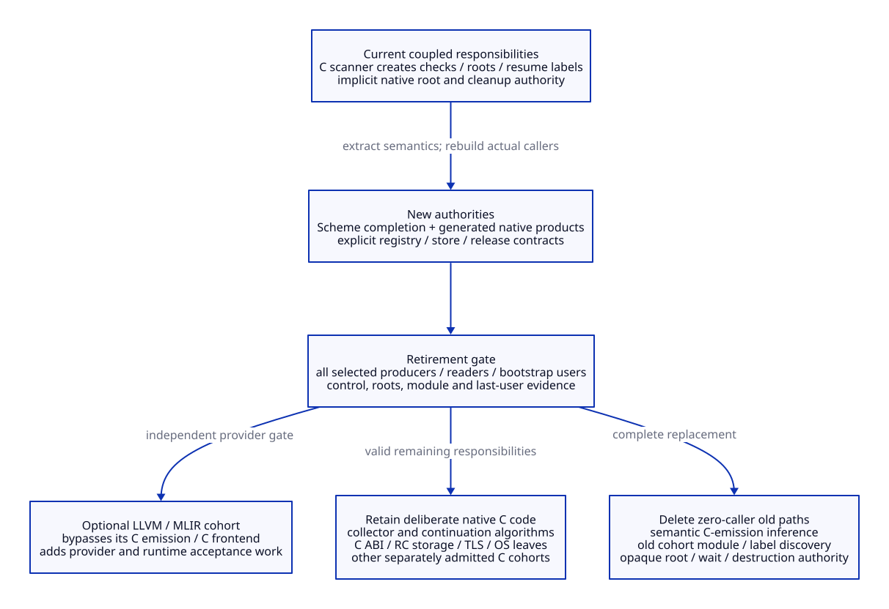

# Decoupled LLVM/MLIR Providers and C Responsibility Retirement

Architecture only. No provider, dialect, pass, generator, compiler or native test
is implemented/executed. Read the [native contract](generated-c-native-contract.md),
[Scheme generator](scheme-native-generator-design.md),
[evidence](generated-c-contract-evidence.md) and
[costs](generated-c-contract-cost-matrix.md).

## Two Exports, One Runtime Contract

NP01. Preserve two distinct export opportunities. For higher-order semantics,
the proposed hook is after lst/env/c-intf are bound in _front.scm and **before
normalize-program**. Its normalization expands primitives, converts assignment
and lambda-lifts; target.dump/GVM cannot recover all that original structure
[CS11/DR05]. Capture structured FFI producer data before it is collapsed into C
declarations/converters. Unknown binding effects and ordering require an explicit
handoff/profile, not an assumption that parse order equals existing scheduling.

For low-level native production, use the Scheme-completed GVM/HostGraph and
ResolvedNativePlan from the new generator. C generation is the main provider.
A direct LLVM provider can consume that native plan. The high-level MLIR service
starts earlier and retains lexical identity/closure/effect/control meaning.
In this mainline it returns a declarative transformed semantic graph, lineage
and obligations for Scheme validation/import, affected analysis and semantic
completion. It does not emit final code against the old, unchanged frame/root
plan. The round-trip importer/validation is additional work, not an existing
hook. A different end-to-end MLIR semantic producer would need its own complete
producer qualification and is not silently substituted here. Neither provider
recovers Scheme meaning by parsing generated C.

NP02. LLVM/MLIR construction, optimization, tool dependencies and temporary IR
ownership belong in a separate compiler-service adapter. It may use C++ where
custom dialect/interface/pass facilities require it, behind a declared request/
result interface; MLIR's C API does not promise stable ABI or high-level Scheme
operations [CP01]. The service owns MLIR contexts/modules/handles, which do not
escape as serialized pointers. Runtime C and its service schemas do not link to
libMLIR simply because a module used that provider. Compiler-side tools may
depend on LLVM libraries; emitted code depends on explicitly declared runtime
symbols and metadata rather than on the compiler service's temporary state.

No mandatory Zig layer is introduced. Same-process C/C++ calls or an isolated
service transport are realizations of the request contract; transport, crash
cleanup and serialization need pricing if selected. Do not fund both transports
as mandatory support, or claim a process boundary is free.

NP03. LLVM stack maps/statepoints can support one admitted root strategy; the
runtime still owns its collector, global roots, type maps and module lifetime
[CP02/CP03]. Choose an explicit per-profile strategy for active frames: the
existing Gambit frame/home protocol, or a separately qualified LLVM native-stack
adapter. Never scan/relocate one slot twice under conflicting interpretations.
Post-safepoint pointer use must consume valid relocated values. A tagged Scheme
word is not automatically an LLVM managed pointer: representation/derived-base
and tag reconstruction need an explicit qualified root strategy. Cross-provider
calls, tail exits, capture/restore and code lifetime require independent edge
evidence; matching a C symbol name or native calling convention is insufficient.

NP04. LLVM/MLIR pass admission is narrower than a generic memory-effect annotation:

| Proposed transformation | Necessary evidence before enabling | Rejection / retained behavior |
| --- | --- | --- |
| Fold/CSE pure arithmetic | Actual primitive, type/overflow/exception and effective binding facts | Unknown dynamic binding or observable exception prevents the rewrite |
| Known higher-order call specialization | Callee/closure identity, rebinding guard lifetime and actual effects | Unknown proc remains a generic Scheme call; closure identity is preserved |
| Move/eliminate allocation or infer a region | Escape/capture/FFI/weak/identity and collector-visible edge safety | Unclosed lifetime stays in managed GC; fewer program reads do not prove scanner safety |
| Hoist/sink across runtime operations | Ordered effects, root/owner/commit/safepoint/control obligations preserved | Do not move a poll, root publication or native effect merely because ordinary memory appears independent |
| Lower continuation/exception transfer | Explicit Scheme control and frame/code lifetime semantics with qualified native exits | Stock func.call/return or an ordinary C return does not implement multi-shot/nonlocal control |

MLIR's official effect rationale limits its treatment to CFG regions and states
that nonlocal control flow is not fully modeled [CP04]. A Scheme dialect must
therefore supply its own control/effect semantics and gated lowering. Generic
MemoryEffects/Speculatable interfaces alone do not qualify call/cc, dynamic-wind,
longjmp or callbacks. An unknown control region remains fenced or unsupported;
it is not labeled pure to make an optimizer run.

## Replacement Order and Real Deletion

[D2 source](generated-c-retirement.d2).

| ID / order | New authority | Eligible old path | Exact retirement condition / retained work |
| --- | --- | --- | --- |
| CR01 | Scheme schema and explicit operation/role declarations | Independently repeated private C shapes and semantic implicit conventions | Every selected producer/reader derives from the same schema; retain an independent semantic/physical oracle |
| CR02 after CR01 | Scheme semantic completion and native plan | Semantic decisions inside targ-check-conditions/targ-update-fr/targ-gen-jump and late C scanner roots/resumes | All checks, materialization, normal/error/escape/role roots are explicit before rendering; C syntax and implementation of runtime algorithms remain |
| CR03 after CR01/02 | RootRegistry operations and actual owner/scan/transfer lifecycle | mark_rc/PSTATE chain as managed-root authority, direct root-bearing set_data_rc and unprotected marker entry | Every root-bearing caller and scan/teardown route migrates; retain useful RC native storage and credit existing per-processor scan/join-transfer patch |
| CR04 after CR01/02/03 | Typed store preparation/commit and BarrierLog | Direct managed-pointer setter paths and inactive SSB as an assumed solution | Complete primitive/native/frame/root/weak/CAS/bulk writer coverage for the new profile; immediate/private writes remain only under their explicit rules |
| CR05 after CR03/04 | ReleaseCoordinator and explicit WaitContext | PSTATE-dependent opaque device_cleanup runner, unaccounted GC destructor/force-free authority | Accept actual payload/code/root custody before wrapper clear; close native producer/child/wait users before cleanup; retain native close/TLS/string/readiness leaves and managed scheduler wait |
| CR06 after CR02–05 | Generated C module product/binder | Converted cohort's old targ-dump/targ-heap-dump macro/count/ordinal construction and dummy-label discovery | Every module/FFI/role/bootstrap/code-lifetime user has an admitted new product; old export-table/layout assumptions no longer have callers in that cohort |
| CR07 independent provider gate | LLVM/MLIR adapter behind same runtime contract | C emission/native C frontend for the fully converted provider cohort | Full native object/control/root/module acceptance; the C runtime, C ABI and other C modules do not disappear |
| CR08 after complete caller closure | Remove zero-caller old implementations and transitional adapters | Old semantic emitters/cleanup authorities no longer used by any supported profile | Preserve historical receipts; do not count a facade, renamed function or permanently duplicated old authority as retirement |

NP05. Modern C means a new generated contract/product path and reconstructed
runtime service authority, not preservation of old macro implementation as the
only possible backend. Retire by responsibility and actual callers, not by
language or file extension. The three services alone cannot retire the complete
C target: module, host/continuation, raw FFI and bootstrap users extend beyond
their previous cost scope. Native C leaves and C-facing ecosystem support remain
deliberate assets even after the old renderer/authority has no callers.

NP06. Provider upgrades invalidate their actual dependent products, access/ABI
evidence and dialect/pass artifacts. If the runtime contract remains unchanged,
the C route can stay usable independently of a failed MLIR service build. If
schema/frame/root interpretation changes, all affected C and LLVM/MLIR producers
and readers must rebuild/requalify. Loading old code is allowed only while its
original metadata/runtime interpretation and last users remain valid; do not
hot-swap a collector layout under live captured frames or accepted tasks.
