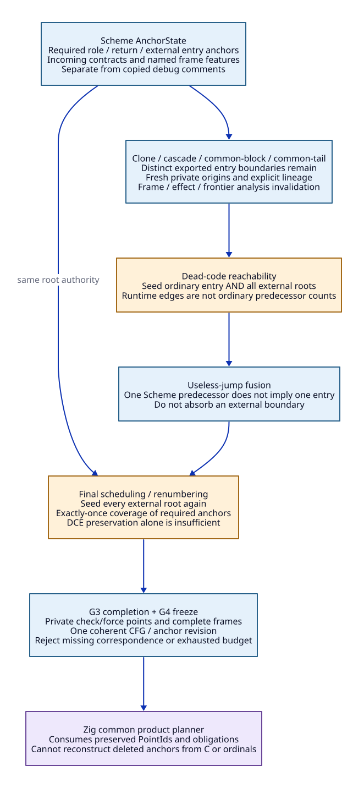

# GVM Anchor Preservation Through Purification and Completion

Date: 2026-10-20. Architecture/source research only. No compiler/backend
implementation or native/performance validation. Refines
[G3 operations](semantic-completion-operations.md) and
[runtime-role anchors](runtime-role-entry-contracts.md).
[Evidence AR01-AR14](completion-admission-evidence.md) and the
[existing ASCENT research chain](zig-research-chains.md) accompany this design.

## 1. Decision and New Source Finding

Preserve externally addressable semantic anchors through **both reachability
and final scheduling**, as well as all intervening rewrites. Changing dead-code
removal alone is insufficient: `bbs-order` also starts from the ordinary entry
and traverses its references. A separately retained runtime handler could still
be omitted from the ordered output (AR01/AR04).

Keep this compiler authority in Scheme. Zig receives an already closed graph;
it cannot restore deleted anchors by matching C strings, debug spans or old
label ordinals. This work changes GVM transformation contracts, rather than
adding a post-C-rendering metadata extractor.


[D2 source](gvm-anchor-preservation.d2).

## 2. Explicit Anchor State

```text
AnchorState {
  graph_epoch, unit_identity,
  declarations: [AnchorDeclaration],
  attachments: [anchor -> instruction_boundary_or_block],
  external_roots: [anchor, incoming_contract, required_role?],
  lineage: [old_anchor, outcome, successors, transform_identity],
  materialization_obligations: [anchor, distinct_entry_required],
  frame_feature_requirements
}
TransformResult {
  cfg_revision, anchor_state_revision,
  rewritten_references, created_private_anchors,
  deleted_nonexported_anchors, preserved_exported_anchors,
  invalidated_analyses, correspondence_witness
}
```

This state is compiler-owned data, not copied instruction comments. CFG and
anchor updates are one logical transformation result: a new CFG paired with
an old side table is invalid. The anchor attaches to an actual operation
boundary, not just to a block that might later absorb or lose that boundary.

For the first extraction, split at each required handler/resume anchor and
retain an addressable entry boundary. A canonical stub can share a body with
another entry only when incoming-state/frame/effect contracts agree; distinct
role/point identities remain materialized. Sharing code does not merge those
identities. An alias requires an explicit manifest declaration.

`external_roots` is an input to ordinary liveness/reachability and scheduling,
not merely metadata saved for later serialization. Runtime handler bodies may
have no Scheme predecessor. The old kernel dummy-call technique must not be
the only reason they remain reachable after control semantics are extracted.

## 3. Source-Bound Transformation Matrix

| Step / current function | Existing behavior | Required new invariant / modification |
| --- | --- | --- |
| AP01: cloning, `_gvm.scm`:488-553 | Rewrites labels/operands; cloned instructions reuse comments | Map anchor attachments explicitly; fresh private clone identities do not copy export authority; retain canonical exported entry |
| AP02: cascade removal, :758-1070 | Threads empty simple blocks while accumulating frame-size/return/poll information; rebuilds labels | An exported/addressable anchor is a boundary unless a typed equivalent canonical entry remains. Preserve check-origin/masking and incoming frame, not only the accumulated poll boolean |
| AP03: dead-code removal, :1072-1102 | Work queue is seeded with `bbs-entry-lbl-num`; references add successors | Seed ordinary entry **and every admitted external root**. Recompute ordinary references/precedents; distinguish runtime incoming edges from Scheme CFG predecessors |
| AP04: common-block equality, :1105-1490 | Can map equal blocks together; return/simple labels can compare equal under frame/operand tests, with debug restrictions | Anchor purpose, required entry identity, named frame features and incoming/effect contracts constrain equality. Debug mode is not an identity-preservation mechanism |
| AP05: common-tail extraction, :1190-1280 | Creates a new simple block, truncates frame and reuses a tail comment | New tail receives a private origin/lineage record; exported source entries remain explicit; recompute frame/root/frontier obligations at the split |
| AP06: useless-jump removal, :1492-1544 | Fuses a simple destination with matching frame and one recorded predecessor | One Scheme predecessor does not exclude runtime entry. Do not absorb an externally addressable boundary unless a separately admitted entry stub remains |
| AP07: ordering/renumbering, :1548-1715 | Schedules from ordinary entry and referenced blocks, then rebuilds a label map | Seed/order every external root deterministically after preserving normal entry requirements. Check every materialized anchor was emitted exactly once; carry explicit lineage through renumbering |
| AP08: linearization/slots-needed, :1733-1866 | Produces code list and computes backward minimum stack-slot frontier | Retain anchor boundaries/entry contracts in the code stream; frontier is not root liveness. Multiple external entries require coherent incoming states, not arbitrary fallthrough |
| AP09: semantic completion, `_t-c-2.scm`:379-408,825-905,2866-2895 | Current C scanner creates private check/force resume labels and internal frames | Scheme creates these anchors/FrameSpecs before freeze; after expansion revalidate frames, roots, effects and frontier, and do not copy a runtime role onto the private point |

These rows are a bounded audit of the current purification/completion seam,
not a census of every frontend inliner or future optimization. Such passes
remain unadmitted until they define the same preservation obligations. The
current common-code pass skips graphs larger than 300 allocated labels; that
heuristic does not establish safety for smaller graphs or future thresholds.

## 4. Preservation Certificate and Rejection

For every transform, the checker must compare the complete declared external
root set with its output attachments, not merely compare the number of labels.
It requires:

1. Each required anchor has exactly one canonical addressable realization, or
   an explicitly admitted alias/redirect with compatible incoming contract.
2. Every new private point has a creation reason and fresh identity. No split,
   clone or shared comment independently issues runtime-role authority.
3. No deleted/redirected anchor is referenced by a role, return edge, frame
   feature, debug identity that requires preservation, or module export.
4. Entry-root obligations participate in reachability, predecessor reasoning,
   scheduling and output coverage; satisfying only one stage is insufficient.
5. Frame/root/frontier and effect analyses are invalidated when affected.
   Equal old map bytes or `frame-eq?` is not proof all new obligations agree.
6. Publication of the frozen graph uses a single CFG/anchor revision. A partial
   result rejects rather than becoming a guessed PointId binding.

These are proposed producer/checker obligations. No checker or proof of the
existing passes is implemented. Distinguish the finite root-set preservation
check from semantic equivalence of the transformed code.

Purification currently iterates based on returned graph identity. Adding side
tables must not silently create an endless "changed" result. Specify change
in both CFG and anchor state, with idempotent normalized lineage, a finite
negotiation/iteration budget and rejection on exhaustion. A budget is a failure
boundary, not a proof of optimizer termination or permission to accept a
partially analyzed graph.

## 5. Source Research Closure Versus Backend Admission

This audit closes a design ambiguity: external roots must survive every
transformation and final output scheduling. It gives exact replacement sites
for H02/H03 and AP01-AP09 obligations. It does not close `Q-anchor`, which still
requires real transformed-anchor/counterexample controls and final product
correspondence. The DSL records a separate source-audit premise; it must not
promote a static audit into that stronger evidence class.

The next source work is a complete producer/caller census for the selected
cohort and independent checks for each AP row. Deleting dummy calls, numeric
runtime bindings or the historical ordinal-prefix workaround remains gated by
that closure and by the unchanged host/frame/runtime admission obligations.
