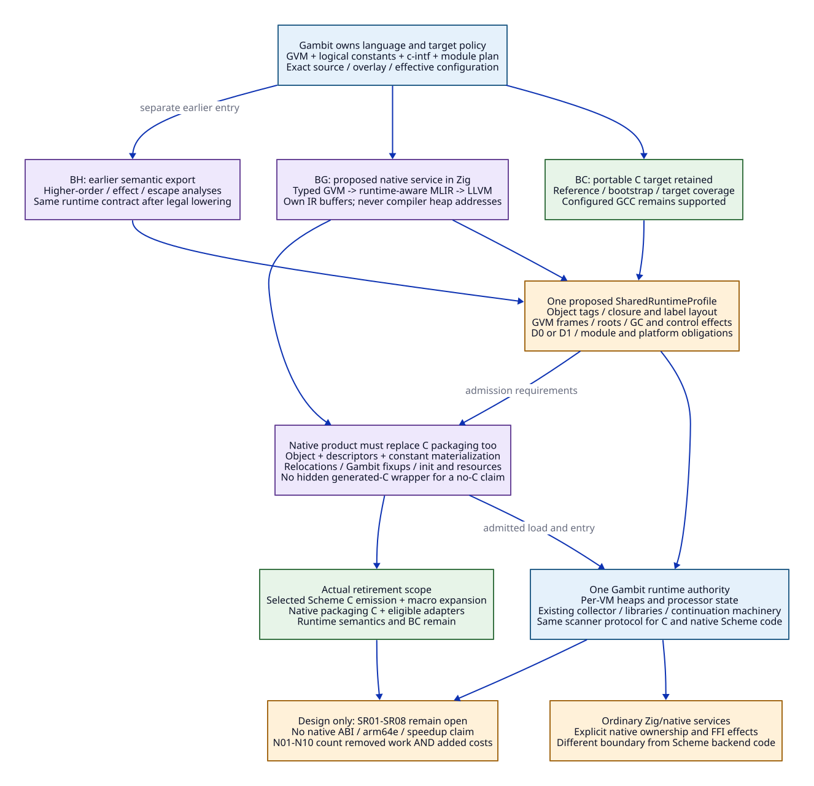

# GVM Native Backends: One Gambit Runtime Contract

Date: 2026-10-20. Proposed architecture, not an implemented ABI or qualified
backend. No implementation, compiler experiment or performance validation.
[Source and paper evidence](gvm-shared-runtime-evidence.md) binds all source
claims below; [replacement and benefit accounting](gvm-native-replacement-matrix.md)
defines what would actually disappear.

The selected direction is **Gambit GVM -> runtime-aware lowering implemented in
Zig -> native object**, sharing Gambit's objects, Scheme stack, control points
and collector. MLIR is an isolated lowering/optimization provider, not the owner
of Scheme semantics or a second runtime. BC, BG and BH retain the meanings in
the [backend redesign](gambit-centered-backend-redesign.md).


[D2 source](gvm-shared-runtime.d2).

## 1. The Unit of Compatibility

Define a proposed **SharedRuntimeProfile** for a complete runtime cohort:
runtime, generated Scheme code, libraries, FFI adapters and extensions. This is
a private generated-code contract, separate from an ordinary native service API.
Matching a target triple, word size or exported C function list is insufficient.

| Profile component | Producer-owned information | Reject when |
| --- | --- | --- |
| Identity | Gambit source plus overlay digests, effective configuration, producer schema, semantic options, runtime protocol revision | A product has an unknown producer or incompatible inline protocol |
| Object layout | Word/tag encodings, header/subtype rules, body/reference offsets, alignment, closure/label layouts, supported constant classes | Backend substitutes its own Zig struct layout or assumes all words are pointers |
| GVM layout | Register count/result/argument locations, SELF/RA, stack direction/reserve/alignment, pstate/VM access policy | Physical offsets or defaults were copied from another configuration |
| Control layout | Entry/return/task/internal kinds; inline/out-of-line frame maps, saved registers, links, host-exit/bridge strategy | A reachable return kind or cross-backend edge has no lowering |
| Runtime operations | Primitive/helper identity and effects, allocation limits, checks/polls, barriers, exception/callback protocol | An unknown operation is treated as a noncollecting leaf |
| Module layout | Logical constants/globals, fixups, descriptors, init ordering, resources and storage lifetime | An OS-linked object lacks Gambit module semantics |
| Platform ABI | Object format, C helper ABI, relocation/code permissions, code/data pointer rules and any authentication requirements | Architecture-name similarity is used as an ABI proof |

Gambit generates this description from the **same effective inputs** as the C
backend; the service cannot independently rediscover policy from headers. Future
layout checks must relate the configured C view, emitted descriptors and scanner
view, not merely compare hashes. LLVM/MLIR/Zig versions belong to the product's
provider identity; a provider-only upgrade invalidates its products and admission
evidence. A changed shared layout/inline protocol invalidates the whole dependent
cohort. Existing [effective configuration](effective-configuration-darwin-gcc.md)
and [artifact invalidation](compilation-unit-artifact-contract.md) remain owners
of construction policy.

The compatible-layout starting point is called **P0** here, not a new supported
runtime release. It adds a producer and backend without first changing the
collector. R2 layout/collector co-design is a later explicit protocol change.
The existing [C compatibility policy](../c-backend-compatibility.md) still requires
one repaired source/configuration and a complete rebuild when inline protocols
change. Keeping the portable C target does not authorize old defective SMP code
inside a new cohort.

## 2. Export Logical GVM, Not Compiler Heap Addresses

The current GVM operand encoding uses integers and a compiler-side operand table.
An `obj` operand can refer to an actual compiler Scheme object; its table index
has meaning only in that compilation. The proposed wire format decodes those
operands at the producer and assigns stable, request-local identities (S02).

The following is a **data model sketch**, not Scheme/Zig implementation:

```text
GvmProduct {
  schema, module_id, semantic_input_digest, shared_runtime_profile_digest,
  required_capabilities,
  constants: Graph<ConstId, LogicalConstant>,
  globals: [GlobalId, binding_kind, module_owner],
  procedures: [ProcId, arity, closure_shape, entry_id, blocks],
  control_points: [PointId, kind, frame_shape, ra_link, live_slots,
                   saved_registers, debug_identity],
  c_interface: {declarations, procedures, initializers, object_bindings},
  module: {dependencies, initialization_plan, semantic_resources}
}
Operand = Register(index) | StackSlot(index) | Point(PointId)
        | Global(GlobalId) | Closed(base, field) | Constant(ConstId)
NativeProduct {
  native_object, entry_symbols, point_and_frame_descriptors,
  logical_constant_materialization, native_relocations, gambit_fixups,
  init_and_resource_plan, profile_and_provider_manifest
}
```

Constants retain cycles, sharing, mutability/identity distinctions and supported
types. They are materialized in the execution process through Gambit's module
machinery. Raw compiler heap addresses, arbitrary serialized closures, native
return addresses and current operand-table indices are forbidden wire values.
Unsupported constants or embedded C interfaces reject or select a declared
adapter product; they do not silently drop fields. The service owns its IR
allocations; Gambit owns materialized Scheme objects. S01-S04 establish the seams,
not completeness of this proposed serialization.

## 3. Shared Values, Closures and Allocation

| Value category | P0 representation / ownership | Optimization boundary |
| --- | --- | --- |
| Scheme value | Exact configured tagged word and object graph owned by its Gambit VM | Boxing/unboxing can occur inside a proved region; observable identity and boundary representation must agree |
| Heap location / derived address | Temporary address derived from a current rooted value | Recompute after relocation; a tagged integer is not a permanent native pointer |
| Closure | Gambit-compatible entry/control reference plus captured environment and configured header | Preserve SELF, environment indexes, arity and mutation/aliasing; do not substitute a Zig closure |
| Control reference | Runtime-recognized label/entry/return descriptor | Distinct from an arbitrary C function pointer or OS-stack return address |
| Native resource | Explicit allocator/resource owner under the F0-F5 interface | Rooting does not pin; still storage does not make movable children stable |

P0 uses Gambit's allocation/slow paths and storage classes, including scanning
rules for mixed raw/object fields and weak/finalization behavior. It must not
allocate Scheme vectors with a Zig arena and hand them to the collector. A
region optimization may eliminate a proved nonescaping allocation, but cannot
change the allocator for escaping objects without a new runtime protocol.

The pinned collector describes movable generation-0, still and permanent
objects; declarations of additional generation tags do not establish a complete
generational policy. Reusing this collector is a specific source/profile claim,
not a claim that Gambit, Chez and OCaml use interchangeable collectors (S09).

## 4. Calls Are GVM Transfers, Not Ordinary Native Recursion

The semantic control model is the GVM state machine over a separate Scheme
stack. Backend registers and LLVM SSA values are caches of that state. The
following transitions must be explicit before choosing a machine convention.

| Transfer | Required state change | Forbidden shortcut |
| --- | --- | --- |
| Local basic-block edge | Apply GVM moves/frame adjustment and branch; preserve point identity when externally observable | Turn every block into a recursive host call |
| Tail procedure transfer | Arrange arguments/SELF/arity, retain caller continuation, reuse/drop the current Scheme frame as required | Add a new native activation on every tail edge |
| Non-tail Scheme call | Construct the caller's Scheme continuation frame, valid return point and complete liveness map, then transfer | Keep the only continuation in the OS stack |
| Scheme return | Obtain the correct return reference and restore its frame/argument/result convention | Use a native `ret` as the Scheme return operation |
| Generic/closure call | Preserve safety options, nonprocedure errors, arity/rest handling and closure environment | Cast a tagged value to an ordinary native function pointer |
| C-generated Scheme / runtime primitive | Materialize state and transfer through an admitted Gambit control bridge | Call a Scheme primitive using an invented C signature |
| Foreign C/Zig call | Use the separately classified FFI adapter, including roots, callbacks and nonlocal exit | Treat all C signatures as noncollecting/noescape |

### Proposed reference dispatch and optimized dispatch

The [D0/D1 protocol refinement](d0-d1-cross-backend-protocol.md) now derives
H0/H1/H2 from the retained Darwin/GCC configuration and selects proposed D0-H0
and uniform-C-ABI D1-H variants. D1-R private-register bridges remain deferred;
neither profile has native admission. Its
[source ledger](d0-d1-cross-backend-evidence.md) preserves configured versus
vendor/runtime identity and the unresolved compiler tail guarantee.

**D0: bounded host-return dispatch** is the reference design to investigate
first. Native object host entries have the selected `___host`-compatible ABI,
decode `pc`, execute local native CFG and return to the runtime dispatcher for
external transfers after canonical writeback. Scheme continuations stay in
Gambit frames; a native host return is only a dispatcher return. This can remove
generated C text even before a direct machine-register bridge is justified.

D0 requires a compatible host-exit strategy throughout the reachable cohort.
The header has ordinary-return, exclusive proper-tail-call and unwind/trip
variants (S07, S10). A host-return implementation cannot be inserted into an
exclusive-tail-only configuration by assumption. Its configured Darwin/GCC
compatibility, entry decoding and module integration remain **unresolved**.
No flag or runtime mode is changed by this design.

**D1: direct native transfers** is a later capability of the same semantic
contract. Local jumps can be direct; inter-entry cycles need a proven bounded
machine-stack strategy and compatible C/native bridges. LLVM `tail` is a hint;
`musttail` has calling/signature/attribute and return-position constraints. These
mechanisms do not themselves define Gambit's ABI. A uniform native signature
is a possible design input, not proof for mixed C/native cycles.
[LLVM call specification](https://llvm.org/docs/LangRef.html#call-instruction).

Neither profile is implemented or admitted. A request names D0 or D1 and all
required bridges. Missing capability rejects; it never silently emits recursive
ordinary calls or switches back to C compilation. The current CPU backend's
`___lowlevel_exec` assembly and fixups are source evidence for bridges, not a
ready-made arm64/arm64e implementation. The inspected ARM path uses 32-bit
registers/THUMB2 conventions (S10).

## 5. Continuations Preserve Scheme Control and Dynamic State

Reuse the existing capture/graft/return runtime paths initially. The header's
capture protocol preserves a frame chain and current thread dynamic environment,
handles the stack-break boundary and creates a continuation object. The collector
can move captured stack frames to heap frames using the RA-selected frame size,
link and map; internal returns require their distinct interpretation (S06-S09).

Consequently the native backend must emit the same frame contract, including
task/internal kinds, saved GVM registers, break frames and descriptor chunks.
It cannot use `setjmp`, LLVM coroutine frames, Zig error returns or native stack
snapshots as an equivalent definition of Scheme continuations.

Required semantic cases include repeated invocation after the original host
entry returns; alternating C/native frames; capture during supported nested
FFI; multiple values; dynamic binding/exception handler state; and dynamic-wind
entry/exit ordering. Preserve existing restrictions on returning to an expired
C invocation: `___call` uses a stack marker for that lifetime (S10). Zig cleanup
must not depend on `defer` running across Scheme nonlocal control; native resource
release belongs to the explicit adapter/owner protocol.

Descriptors and code must outlive every current frame, captured continuation,
scanner and supported loader/host consumer. P0 adds no hot-unload facility.
The [root-map lifetime contract](../root-map-lifetime-contract.md) and
[shared metadata package](../shared-metadata-package.md) remain authoritative;
the new backend is another producer to qualify against them, not a parallel
metadata registry. Cross-process serialization and new continuation/FFI cases
remain separate unqualified capabilities.

## 6. Roots, GC and the Canonical-State Boundary


[D2 source](gvm-control-gc-state.d2).

P0 preserves Gambit's existing register/saved-slot/frame-map root mechanism.
It does not require LLVM statepoints or a new collector to start. Existing
`mark_registers`, `mark_saved`, frame scanners and captured-continuation scanners
must see all the roots produced by native code, under their actual configured
return-kind and GC participation protocol (S06-S09).

The state table below describes a **collecting/reentrant boundary**. The
[control protocol](d0-d1-cross-backend-protocol.md#2-separate-three-kinds-of-return-and-two-readiness-conditions)
additionally distinguishes transfer-ready host writeback from scanner-ready
state. A noncollecting host transfer does not itself become a safepoint, and
pc/W_ALL alone does not construct the internal frame required by a GC handler.

| State | Invariant and permitted next step |
| --- | --- |
| Cached | Native registers/SSA may hold newer values. Only operations proved unable to collect/reenter/relocate may remain here; configured polling obligations still apply |
| Preparing | Publish live object slots, correct frame/RA/map, GVM registers, SELF and required allocation/control state. No collecting/reentrant call may observe a partially prepared frame |
| Canonical | The selected scanner and runtime entry can interpret complete state. This is a compiler/runtime boundary, not a new atomic flag or generic global lock |
| Runtime-owned | Existing runtime handles allocation slow paths, polls/interrupts, GC, continuation control or FFI participation. A valid alternate continuation can leave the current native activation permanently |
| Reload | Only the actual resumed point may reload relocated values and allocator/control state; derive fresh interior addresses, then enter Cached with a new value epoch |

All potentially collecting, blocking, reentrant or control-transferring operations
have explicit effects and resume behavior. Unknown primitives conservatively
take this boundary. Ordinary polls and stack-only checks are distinct in the
retained repair patch; interrupt masking cannot justify deleting stack/root
requirements (S11). Preparation must follow existing participation/interrupt
rules, not invent a stop-the-world protocol.

Every live movable value needs an actual scanned location. A native register,
unmapped alloca, compiler liveness bit, or hash of a descriptor is insufficient.
The producer must relate live values -> slot ordering -> bits/chunks -> label
descriptor -> scanner -> resumed reload. Do not mark arbitrary raw/padding words
as Scheme roots. S06 and the root-map lifetime audit give the existing chain.

Lowering uses a conservative memory/control effect boundary: root stores cannot
be optimized away, reused heap reads cannot cross relocation, and pre-boundary
managed SSA values/derived pointers cannot feed resumed code. A later lowering
must demonstrate this property through the complete optimization pipeline;
adding an opaque helper name alone is not a proof. Do not attach `readonly`,
`noalias`, `nocapture`, `nounwind` or arithmetic/pointer flags without the
corresponding source/semantic premise.

LLVM statepoints offer relocation-aware SSA machinery; using them would need a
mapping to Gambit's scanner and base/derived-reference rules. P0's explicit
writeback/reload route and a future statepoint route are separate contracts.
[LLVM statepoint semantics](https://llvm.org/docs/Statepoints.html).

Sharing the collector saves reimplementation; it does not remove proof that the
new root producer is correct. Parallel publication, forwarding payload readiness,
worker termination, VM membership and teardown remain the runtime's existing
obligations. Zig's allocator discipline and LLVM optimization do not repair them
automatically. A runtime component rewrite needs its own R1/R2 evidence.

## 7. Where MLIR Fits and What It May Change

BG exports already lowered GVM semantics into a proposed runtime-aware dialect;
BH retains the earlier high-level Scheme entry for higher-order/region analysis.
Both must reach this contract before general Scheme object emission. BG cannot
recover every higher-order opportunity already erased by GVM lowering.

Suggested logical operations include `scheme.value`, `gvm.point`,
`gvm.frame.prepare`, `gvm.transfer`, `gvm.runtime_call`, `gvm.safepoint` and
`gvm.resume`. These are proposed project operations, not upstream dialects.
Keep control, root and effects information until a verifier can relate each
lowered edge and root epoch to SharedRuntimeProfile. Then lower CFG/arithmetic
and admitted memory operations to LLVM/native infrastructure.

Passes may transform local computation under existing
[pass admission rules](mlir-pass-admission.md). Removing a root, allocation,
poll, closure or control point additionally requires identity, escape, effect,
continuation and progress evidence. A capture can escape an apparently local
region. The safe initial region strategy is elimination of proved nonescaping
temporaries plus promotion/fallback to Gambit allocation at escape, not a second
heap holding arbitrary live Scheme objects. No analysis result is inferred from
Zig's no-GC implementation language.

MLIR's provider API remains behind the project request/product boundary; its C
API does not promise stability. Upgrade isolation is useful only when serialized
semantic inputs, emitted products and admission dependencies are versioned.
[MLIR C API](https://mlir.llvm.org/docs/CAPI/).

## 8. Admission Is a Conjunction, Not a Layout Check

| Gate | Required future evidence / failure condition |
| --- | --- |
| SR01 representation | Every admitted value/closure/constant class matches materialization, sharing/identity and scanner interpretation; missing class rejects |
| SR02 control | Tail and non-tail edges, errors, arity/rest/multiple values and C/native cycles preserve semantics and bounded tail space; an ignored tail hint fails |
| SR03 continuation | Mixed frames, repeated capture/resume, dynamic state and supported nested FFI match BC controls; expired C return stays an error |
| SR04 roots/GC | Actual generated maps include every live movable value, all frame kinds/chunks and post-GC reloads; stale SSA or missing root fails |
| SR05 effects/progress | All primitive/FFI sites classified, masking/check/poll semantics retained, no hidden collecting/reentry path |
| SR06 module/lifetime | Constants/fixups/globals/init/errors/resources match; descriptors/code remain usable for all admitted consumers |
| SR07 platform/provider | Exact configured C ABI and chosen D0/D1 bridges work on the claimed target; architecture aliases and old paper code are insufficient |
| SR08 replacement/cost | Count removed C work and added costs against matched BC and B1; retain failures and regressions, never claim gains from semantic failures |

All eight gates remain open. Source inspection establishes a plausible shared
runtime architecture and specific replacement obligations. It establishes no
native equivalence, Darwin support, speedup or collector modernization result.


## Full Modernization Research Priority

The [full native-system architecture](modernization-system-architecture.md) and
[LLVM leverage matrix](modernization-leverage-matrix.md) place these contracts
inside the primary complete Experimental candidate. Runtime root/context/member/
control and internal cohort ABIs can be redesigned with explicit semantics and
costs. Bmin repair studies remain controls; provider access remains independent
of implementation language. This scope correction does not qualify any existing
runtime/profile or rewrite historical source/native receipts.
