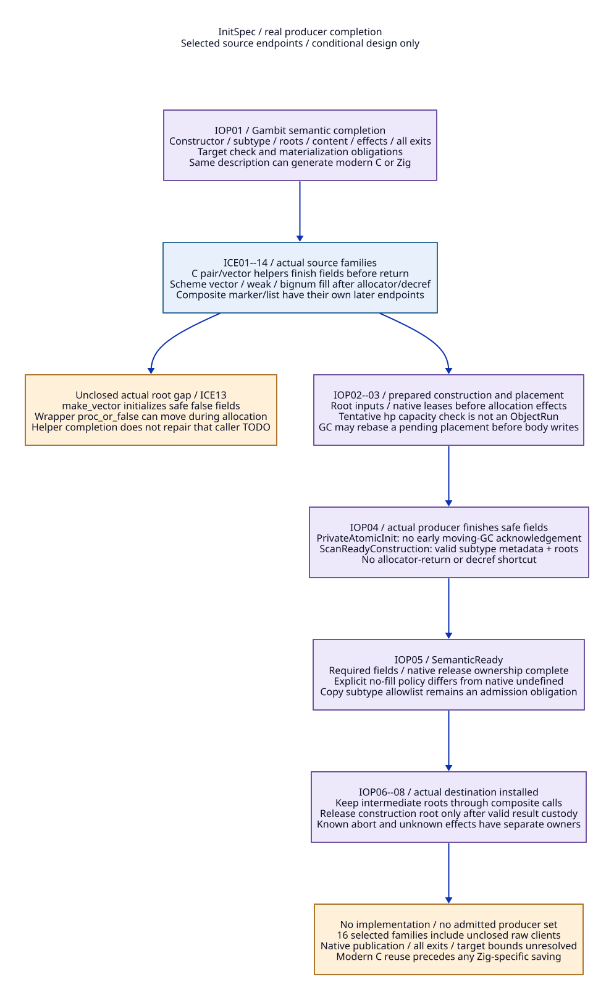
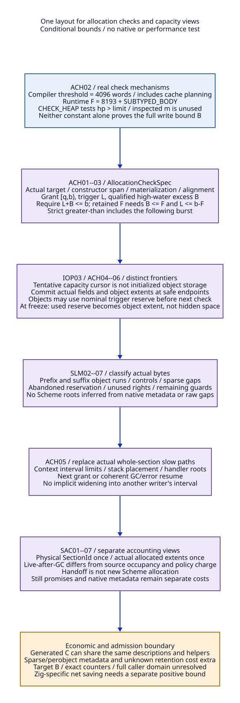

# InitSpec Completion and SegmentLayout at the Next Collection

Reviewed: 2026-10-20. SharedRuntimeContract design research only. No implementation,
native test, model/solver/engine execution, checked proof or accepted net-benefit
bound. This refines SCR03/04/06, SCI01--04 and STL04/06/07 in the
[still/tail study](still-construction-tail-design.md). Read the
[evidence ledger](init-spec-segment-layout-evidence.md),
[constructor inventory](init-spec-constructor-inventory.json),
[modern C/Zig matrix](init-spec-segment-layout-cost-matrix.md) and
[document trace map](init-spec-segment-layout-traceability.json).

The [actual bound and metadata study](allocation-check-bound-design.md) expands
ACH01--07 into ordered write/address footprints, guard-sensitive excess,
pending/post-return work and sparse completion authority. It supplies conditional
selected cases while leaving a universal B unqualified. Its
[Scheme-to-Zig position](scheme-to-zig-architecture.md) explicitly recommends a
real backend/system-service candidate, distinguishing semantic plausibility,
host/control profiles and economic acceptance.

The architectural decision is to export constructor meaning and allocation-check
obligations from Gambit's Scheme/compiler layer, then replace the native layout,
publication and service realization. C emission is replaceable; its late-added
root/check/initialization semantics are not disposable. This follows the PVM
front/backend separation principle, without claiming the old paper specifies
today's GC ABI [IS-P01].

## 1. Actual Builders and Their Completion Endpoints

An endpoint below is a selected source position where the relevant writes finish,
not an existing InitSpec API or native receipt. Every endpoint is conditional on
success, actual argument/subtype/build profile and all exits. The public allocator
return, hp increment and refcount decrement are not universal completion events.

| ID | Real producer / source evidence | Actual successful endpoint and required change |
| --- | --- | --- |
| ICE01 | ___make_pair [IS-S01]. | After CAR and CDR writes, before return. Preserve nonmovable-input/still-reference preconditions; attach completion there, not inside alloc_scmobj. |
| ICE02 | ___make_vector [IS-S01]. | After the fill loop, before return. Zero-length success also completes. Its arbitrary caller may subsequently configure this safe vector for another purpose; that is a separate semantic operation. |
| ICE03 | ##make-vector plus ALLOC/INIT_SCMOBJ_INLINE [IS-S02]. | After GC_RESTORE1 reload, absent-fill normalization and INIT loop/memset, before RESULT. The allocation macro can decrement the still construction reference before initialization. Both small movable and large still branches need the same constructor description with different storage authority. |
| ICE04 | ##make-string / ##make-u8vector [IS-S02]. | With fill: after INIT. Without fill: the source intentionally omits payload initialization before RESULT. Scan skips those payloads; InitSpec must record the primitive's no-fill content policy separately from scan readiness. Do not equate this with publishable Zig undefined values, or silently add a universal zero-fill requirement [IS-P06]. Exact language-visible no-fill refinement remains an admission question. |
| ICE05 | ##gc-hash-table-make [IS-S03]. | After NEXT/FLAGS/COUNT/MIN_COUNT/FREE and every UNUSED slot, before RESULT. Decref in the large branch is earlier. Describe weak metadata and actual fixnum/slot preconditions; a zeroed vector placeholder is not a valid substitute. |
| ICE06 | ##bignum.make [IS-S04]. | After width/complement-dependent copy/sign-extension loops, before RESULT. Reload saved k/x/complement after possible GC; clear saved slots only after transferring responsibility to valid locals/no-GC execution. Pointer-free digits are not Scheme root cells. |
| ICE07 | ##still-copy [IS-S05]. | After full body copy from reloaded ARG1, before decref/RESULT. This is a byte/word copy endpoint only: subtype-specific weak/frame/foreign ownership/copy validity needs an admitted allowlist/profile, not a blanket safe generic-copy claim. |
| ICE08 | ___POINTER_to_SCMOBJ [IS-S06]. | After tags/release-function/pointer stores, before *obj publication; null x has no allocated-object endpoint. Native release arming needs one actual owner. FOREIGN scan currently skips payload; preserve that profile rather than infer that tags are traced. |
| ICE09 | ___S64_to_SCMOBJ / allocated ___F64_to_SCMOBJ branch [IS-S07]. | After all digits or flonum payload stores, before *obj. Immediate fixnum/self-tagged results have no allocation grant. Failure maps to existing conversion error. Width/configuration branches remain distinct. |
| ICE10 | ___NONNULLSTRING_to_SCMOBJ, with composed ___NONNULLSTRINGLIST_to_SCMOBJ [IS-S08]. | String success: after selected encoding loop, before *obj. Each postallocation encoding-error exit has an abort endpoint; decref is not free. List assembly: make_pair must complete before releasing str/previous lst; final *obj completes the composite result, not all intermediate nodes at once. |
| ICE11 | UDP read absent-buffer branch [IS-S09]. | After memmove and before construction-reference release; language result is delivered at return. Datagram input precedes allocation and cannot be undone by refund. Existing-buffer branch is a mutation/result-count operation, not a new object constructor. |
| ICE12 | ##process-statistics [IS-S05]. | After all 20 F64 fields, before decref/RESULT. Scan-safe pointer-free storage may precede semantic completion; native metric queries cannot be declared bounded/no-effect merely because they fill a numeric vector. |
| ICE13 | ___make_sfun_stack_marker wrapping make_vector [IS-S10]. | make_vector establishes safe #f fields; marker meaning completes only after proc/data and processor identity writes, before *marker. Source explicitly warns proc_or_false may have moved across allocation. Protect/reload that input and qualify RC/TLS closure access; a safe vector endpoint does not repair the wrapper's root gap. |
| ICE14 | GVM C target cons/vector emission [IS-S11/S12]. | Pair macros write header and fields before END/GET; vector emitter reserves/checks, emits BEGIN, all ADDs, END then GET. Export a constructor/check boundary before native emission, preserving operand liveness/evaluation. END alone cannot cover arbitrary handwritten/no-fill paths. |
| ICE15 | Collector's mark_array copy producer [IS-S14]. | A destination becomes copy-complete only after full body/padding writes and before eligible chunk publication. Existing forwarding CAS can expose an address before the body copy; retain Active/root-ready/chunk-ready discipline, not a claim that seeing a forwarding word proves initialization. |
| ICE16 | Raw alloc_scmobj return / external or generated callers outside this slice [IS-S13]. | No completion is established. Require an explicit InitSpec endpoint, a qualified old participation island, or rejection from the new independent-worker profile. Do not synthesize completion by wrapping the allocator. |

The inventory contains these 16 producer families, including one explicitly
unclosed raw-client family; it is not an exhaustive call graph. Permanent ps=NULL,
all external clients, other specialized macros, generic still-copy subtypes,
language no-fill behavior and complete exceptional exits stay unresolved.

## 2. InitSpec Is a Semantic Contract with Native Completion

[D2 source](init-spec-completion.d2).

| ID | Proposed operation / record | Responsibility and admission |
| --- | --- | --- |
| IOP01 | ConstructorIdentity + InitSpec reference | Scheme/compiler supplies primitive, subtype/representation, input roots, size/alignment, scan fields, special metadata, content policy, native effect owner, storage alternatives and all success/abort/escape endpoints. Handwritten C constructors need authored descriptors tied to selected source; their semantics are not inferred from a C signature. |
| IOP02 | PreparedConstruction / storage admission | Native service reserves metadata, inputs/VM/provider leases and appropriate still grant or interval allocation permit before effects. Still uses the preceding consumption/refund protocol; movable construction uses its actual interval and pending allocation identity. Same InitSpec does not imply identical allocator accounting. |
| IOP03 | AllocationCheckPending versus BodyWriting | A tentative hp increase used to request/check capacity is not an initialized object extent. Weak/bignum small paths can reach GC before writing a header/body [IS-S03/S04]. Expose a pending request with rooted inputs; abort/rebase its tentative placement at the next actual resume binding rather than publishing garbage as an object. |
| IOP04 | ScanReady completion | Producer reports actual safe header/length, roots/metadata/effect state and exact storage disposition after qualified stores. PrivateAtomicInit cannot acknowledge moving GC early; ScanReadyConstruction keeps construction rooting and later writes within admitted nonmoving mutator phases. Publication gaps remain held. |
| IOP05 | SemanticReady / content policy | Report all fields required by that primitive, including explicitly admitted no-fill policy. Scan-safe uninitialized scalar bytes do not justify early Scheme visibility; conversely, an admitted no-fill primitive need not perform a fabricated full payload fill. Native undefined semantics and confidentiality/content policy need separate qualification. |
| IOP06 | ResultInstalled and construction-root release | Known rooted destination/consumer acquisition precedes releasing a construction root or still reference. Caller can construct another object only after its live intermediates remain protected. Distinct physical root cells containing equal values each need relocation; aliases of the same cell have one writer. |
| IOP07 | Known abort versus unknown disposition | Every size/allocation/encoding/native-effect failure resolves pending placement, actual storage, roots and armed effect separately. No Consumed still grant becomes an unused refund. A movable abort cannot rewind hp over later allocations; close as typed abandoned space or reclaim only the proved private top suffix. Unknown membership/writes retain owner/VM/layout. |
| IOP08 | Completion ownership and retirement | A trusted actual producer issues completion under one qualified native authority; descriptor/data copies do not issue it. Prebuild reports outside gates, serialize state once, retain the record while scanners/installers/resolvers use it. No locks across fill loops/native calls and no C nonlocal jump across Zig frames. |

Completion describes both **what** is true and **who** owns the obligation. It
does not require a separately heap-allocated object record for every successful
cons. Generated noncollecting constructor spans can fold completion into a
qualified run frontier/grammar. Explicit metadata remains necessary for partial,
sparse, escaped or unknown constructions. The optimization must preserve the
same coverage and is a cost/admission condition, not an implemented fast path.

## 3. What the Next GC Actually Scans

The selected collector flips processor tospace offsets, resets copy cursors and
queues, obtains roots and follows them through mark_array. That operation reads
the referenced old object's header, forwards/copies it and repairs the actual
root/field cell. scan_complete_heap_chunk and partial scanning then traverse
**new destination work**, not every allocation in old source sections
[IS-S14--16]. Old and newly allocated objects both have the source movable
representation; physical prefix/suffix position creates no generational policy.

Consequently, the previous requirement that next GC understand the composite
layout must not be implemented as “enqueue the entire copied prefix and every
context run as roots”. SegmentLayout governs valid storage, pointer/extent
classification, output work grammar, placement, statistics and lifetime. It
does not manufacture reachability. The present design retains stop-the-world
mutator/root synchronization; it does not require a read barrier or invent a
generational remembered set merely because suffix objects are newer [IS-P02/03].

[D2 source](segment-next-collection.d2).

| ID | Next-epoch operation | Required root/layout contract |
| --- | --- | --- |
| NGC01 | Close interval admission, settle constructors and acquire final owner roots for epoch E+1. | Freeze actual context frontiers and pending placement dispositions. Include stopped contexts, saved registers/frames, RC/still/global roots and qualified deferred/native carriers. Existing source P0-only mark_rc is not a new full root-domain guarantee [IS-S16]. |
| NGC02 | Seal SourceLayout(E) and root bindings; pin actual source segments and their borrowers. | Source includes retained copied prefix and only actual context objects, not unused grant/fudge or tentative hp reservations. Close/describe alignment gaps and abandoned extents. All mutator/body writers are paused or participate through admitted stable carriers before moving. |
| NGC03 | Prepare DestLayout(E+1), actual sections, stacks, W copy arenas and root-writer tasks. | Source halves remain readable/writable for forwarding. Opposite halves are destinations only after any earlier-epoch borrowers using them drain. One SectionId can back source/destination halves, but old live borrowers cannot be wished away by flipping a bit. |
| NGC04 | Publish one VM-authoritative half/layout epoch and admitted role bindings, then perform qualified setup/root work. | Replace the perprocessor-only orientation/cursor authority for migrated storage. Context setup/reentry/resize cannot independently flip or restore the old orientation. Root-ready/worker phase laws still apply; missing setup keeps the epoch held. |
| NGC05 | Trace actual roots/fields into either source cohort and relocate each writable cell. | Prefix->suffix, suffix->prefix and cross-context references are ordinary edges. An unreferenced prefix object is collectible. Root addresses must be valid object bases through their producer contract; coarse interval membership alone does not validate an arbitrary interior pointer. |
| NGC06 | Allocate/copy in new destination arenas; publish only actual copy-complete work with its parser grammar. | Existing chunk-link/filler/body-copy rules are reusable where qualified. Copied destination chunks use new epoch identity, never old queued prefix addresses. Root/forwarding address visibility alone cannot publish an unfinished body to another scanner [ICE15]. |
| NGC07 | Complete strong/weak/will/continuation/cleanup phases and every actual root/layout writer and borrower. | Preserve actual weak/will semantics and continuation/frame metadata. Physical source ownership lasts through these phases and subsequent readers. A queue-empty/Active=0 snapshot is insufficient to retire the old layout or source half. |
| NGC08 | Adopt actual occupancy, placements, carried still accounting and context ResumeBindings; publish common outcome. | New roots/fields and segment registry precede mutator resume. Reapply tail placement to new actual tails only. Layout publication, allocation authority and native users remain held across H/C/T/G gaps without nested gates. |
| NGC09 | Retire old layout/half users, then allow reuse/shrink under SectionId authority. | Keep native references and diagnostic/queued users if they remain real borrowers. Source-only extents can be released only after dead/moved storage and user closure; the current adjust_msections frees list-tail sections and needs actual ownership-aware selection [IS-S18]. |
| NGC10 | Resolve failure according to actual moving state. | Before any destructive effect, a known complete abort may preserve the old layout. Once forwarding/root/frame writes begin, do not restore old hp/headers/epoch by timeout. Hold the VM/roots/sections and actual writer; no general bounded recovery is established. |

### Segment grammar and roots have different jobs

| ID | SegmentLayout component | Concrete meaning / excluded shortcut |
| --- | --- | --- |
| SLM01 | VM/epoch + SectionId/reuse + native extent/half | Authoritative actual bounds and source/destination roles. Layout history is retained only for real users; no architecture generation naming is needed. |
| SLM02 | CopiedObjectRun + GCChunkControl | Describe actual copied object portions and old control links separately. Historical copied status is not a root, generation tag, object immutability or permanent liveness. |
| SLM03 | ContextObjectRun + committed frontier | Only completed objects, with actual fields after later admitted mutation. Distinguish committed object extent, speculative check cursor and high-water storage. A final hp value alone cannot identify initialized object bytes. |
| SLM04 | Padding, alignment gap, abandoned reservation, unused grant, overrun reserve and end guards | Never infer Scheme references from their raw words. Actual initialized objects may extend into the nominal overrun reserve after the trigger; at freeze their extents become ObjectRun portions, not invisible “reserve bytes”. Unused reserve remains nonobject space. |
| SLM05 | Qualified DenseRun grammar versus explicit sparse extent recipe | A dense run needs valid header/filler grammar. Some source inline alignment adjusts hp without writing filler [IS-S02], unlike copy padding [IS-S14]. Either normalize emitted padding or describe sparse boundaries explicitly. Do not impose a full perobject hash index unless actually needed; its cost is separate. |
| SLM06 | Native descriptor fields versus Scheme object fields | Native layout addresses/IDs are pins/classification, not newly discovered Scheme root cells. Actual constructor handles/root carriers are enumerated separately. Collector frame/weak structural pointers keep their specific rules; raw interior addresses need an explicit derived/base profile [IS-P05]. |
| SLM07 | Enumerators and users | Core next-GC tracing is root-driven. Destination-work scanner, locator, diagnostic/object walker, occupancy and placement each consume a stated grammar/bounds interface. A diagnostic linear walk cannot silently interpret sparse old gaps; retain/reject its old profile until adapted. |

For source-object admission, a valid rooted tagged object base plus its qualified
producer and source epoch authorizes the existing header-directed trace. If an
adapter claims to validate arbitrary native pointers as object starts, it needs
an actual object-start proof/index, not a section-membership test. This stricter
validation is a separate capability/cost; it is not silently supplied by slices.

## 4. Allocation Checks and Capacity Must Use the Same Layout

[D2 source](segment-check-accounting.d2).

| ID | Allocation admission / check contract | Exact replacement boundary |
| --- | --- | --- |
| ACH01 | AllocationCheckSpec references target representation, constructor/CFG span, root/check endpoints and maximum writable high-water excess B. | Scheme completion must export the actual span bound including headers, perobject alignment, float-cache materialization and writes before/after the check. This is not a guessed count of objects or a Zig slice length. |
| ACH02 | Source compiler targ-msection-fudge=4096; runtime F=8193+SUBTYPED_BODY; CHECK_HEAP(n,m) tests hp>heap_limit without using m [IS-S11/S12/S17]. | These are distinct constants/mechanisms, not a proved B=4096 for all paths or a runtime reservation of m words. Dynamic primitives and maximum-arity literal constructors require their own bound. Selected source does not establish whole-program bound qualification. |
| ACH03 | For grant [q,b), trigger L and checked B, require q<=L<=b-B, with all arithmetic/target alignment valid. | If retaining source F as reserve, require B<=F and L<=b-F. Include any closure/guard budget separately. At hp=L, the strict > check can permit a further allocation burst: B must include it. Safe Zig bounds checks can detect an error but do not supply Scheme heap-limit/GC semantics. |
| ACH04 | Begin/commit/abort construction and synchronize frontier at admitted safepoints. | No independent GC acknowledgement during an unsafe body write. A capacity check before body writes can yield with a pending placement (IOP03); preserve roots and acquire a new placement after GC. Complete spans can advance a batched run frontier, not a global percons journal. |
| ACH05 | Heap-limit slow path returns actual next grant or invokes the existing GC/error route with valid roots and continuation. | Replace/qualify msection_free_list, stack-sharing fallback, next_heap_msection, prepare_mem_pstate and handler save/reload for intervals [IS-S17]. Never widen one context's limit into another grant. |
| ACH06 | Account valid overrun objects and actual used allocation bytes at freeze. | Trigger reserve is potential writable storage, not permanently unallocated memory. Pending check reservations, completed object bytes, typed padding/markers and abandoned bytes have separate dispositions; no scalar hp subtraction can classify all of them. |
| ACH07 | Bind the compiled check profile to loaded code and runtime/layout policy. | Replacing compiler, representation, constructor emission or check scheduling invalidates the relevant bound/ABI admission. C and Zig need the same source/target evidence. LLVM statepoints can encode roots/relocations, not prove the span bound automatically. |

| ID | Capacity/statistic view | Definition and obligation |
| --- | --- | --- |
| SAC01 | Physical capacity | Count actual unique SectionIds/native extents once; active halves and guard/layout/native metadata are explicit. Same-section source/destination overlap in time is not two physical section allocations. |
| SAC02 | Allocated source occupancy | Union of owned actual object extents plus actual nonobject overhead retained by allocation policy, including prefix and context suffix only once. Reserve capacity and unconsumed interval rights are not live objects; assigned-section capacity may still be unavailable to other writers. |
| SAC03 | Live-after-GC occupancy | Actual successful copied destination extents and retained still objects, with weak/will/continuation semantics complete. Do not carry every old prefix object forward as live. Define whether a published statistic includes headers/padding/chunk overhead; do not conflate policy words with payload. |
| SAC04 | Managed policy charge | Existing factor-two movable accounting is a policy convention over cursor occupancy [IS-S18]. Preserve or explicitly refine its exact meaning over distinct runs/stacks; replacing U with W or charging each recipient's whole prefix is invalid. |
| SAC05 | Percontext allocation and VM counters | Attribute new allocations to the actual context/producer once; copied prefix handoff is not new Scheme allocation. Existing bytes_allocated_minus_occupied adds old occupancy before GC and subtracts new afterward [IS-S15/S18]. A new ledger needs matched deltas, not just a new live-byte total. |
| SAC06 | Still/native support | Reuse the preceding actual/private/deferred/carried-credit partition; native layout/root/index metadata and foreign payload are separately budgeted. SegmentLayout does not absorb still credit into movable words. |
| SAC07 | Placement and shrink | Feasible aligned contiguous writable grants/stacks with reserves determine resume capacity. Aggregate free words and target N do not prove placement. Shrink/half reuse excludes all real source/prefix/suffix/diagnostic/native users and preserves valid future half orientation. |

No universal cheap object-by-object accounting is assumed. Qualified complete
runs can maintain size/high-water counters at span/region boundaries, while
sparse/failed/escaped constructors need explicit exceptions. Matching existing
public counters and full policy behavior requires a separate refinement; this
study does not silently rename policy occupancy to exact semantic payload bytes.

## 5. Conditional Arguments and Logical Counterexamples

These are handwritten implications, not checked proofs or executed witnesses.

| ID | Conditional claim | Premises / reasoning |
| --- | --- | --- |
| ISP01 | No unsafe object is admitted merely because allocation returned. | Complete producer coverage, IOP01--08 and source-specific ICE endpoints hold. BodyWriting cannot acknowledge GC; ScanReady satisfies actual subtype/root/effect rules. Thus legal independent scanning cannot observe a raw partially initialized body. Unknown clients invalidate the premise and remain excluded. |
| ISP02 | Composite constructors do not lose intermediates across GC. | IOP06 and valid argument/root reload apply at each child call, not just final result. String-list str/lst remain protected through pair completion; marker proc is rooted before vector allocation. Current marker TODO is an unclosed source obligation, not proof of a repaired caller. |
| ISP03 | Prefix/suffix coexistence preserves reachability without over-rooting. | NGC01/02/05 enumerate all actual roots and valid fields with the same subtype semantics. Treat both cohorts as source objects, not roots. Inductively every strong reachable edge is traced/relocated; unreachable prefix nodes are not retained solely by layout. Weak/will effects require NGC07, not strong induction alone. |
| ISP04 | New-work scanning never parses an arbitrary old gap or partial copy. | SLM02--07 classify source space and NGC06 publishes only copy-complete destination grammar under existing Active/root-ready rules. Old prefix work addresses are not reused as new queue items. Full forwarding/publication/native ordering remains a required premise. |
| ISP05 | Checked context allocations stay inside their exclusive grant. | A qualified ACH01 B bounds all writes from the trigger check until the next admitted check/slow path; ACH03 gives L+B<=b, includes strict-> behavior and excludes other writers. ACH04/05 preserve constructor/placement state through GC. Source constants alone do not establish B. |
| ISP06 | Capacity totals neither duplicate prefix nor miss used reserve objects. | SAC01--07 count distinct actual storage and policy roles separately; SLM03/04 and ACH06 freeze actual object extents, including trigger-reserve use and excluding tentative reservations. Adoption after known writers settle preserves these partitions. Public statistic equivalence remains independently required. |
| ISP07 | Layout transition and retirement do not create dangling references. | NGC01--10 and actual source/destination/native borrower pins span all publication gaps; root/weak/frame writes and users settle before half reuse or shrink. Post-forwarding failure retains the VM; safety has no proved finite recovery bound. |
| ISP08 | Only a separately bounded Zig increment can select Zig economically. | Same producer/check/layout/root/semantic obligations apply to generated modern C and Zig. Common compiler/LLVM value cancels in the comparison; SC-like private support savings count only after C helper reuse and actual old-route retirement. No positive increment follows from this design alone. |

| ID | Violated-premise counterexample | Failure |
| --- | --- | --- |
| ISX01 | alloc_scmobj return is reported SemanticReady for all clients. | Vector/weak/string body writes remain unfinished. |
| ISX02 | Large primitive's decref is treated as completion. | Weak flags/slots or vector fill are still unwritten. |
| ISX03 | No-fill pointer-free payload is replaced by observable Zig undefined. | GC nontracing does not justify native language invalid-value use. |
| ISX04 | make_vector's safe #f fill proves stack-marker proc input is rooted. | Wrapper input may already have moved before it writes the field. |
| ISX05 | Composite string-list releases str/lst before pair is initialized/rooted. | Later child allocation can lose a live intermediate. |
| ISX06 | still-copy admits all subtypes based only on bytes copied. | Weak/frame/native ownership semantics may be omitted. |
| ISX07 | Tentative hp increase before a capacity-triggered GC is published as ObjectRun. | Layout includes uninitialized header/body space. |
| ISX08 | Whole prefix/run enumeration is added as strong roots. | Unreachable copied objects are retained indefinitely. |
| ISX09 | Only new context objects are considered source objects next round. | Roots into the copied prefix become invalid/omitted. |
| ISX10 | Only prefix roots are handled; prefix field points to suffix. | Reachable suffix object is lost or its field is not relocated. |
| ISX11 | Equal-valued root cells are deduplicated by value. | One distinct physical cell retains a stale old address. |
| ISX12 | A half is flipped per new worker/context instead of once per VM epoch. | A valid source half can be treated as free destination. |
| ISX13 | New queue reuses an old copied chunk address. | It may scan source controls, forwarded headers or stale links as new work. |
| ISX14 | Forwarding CAS is treated as proof of destination body completion. | Another scanner can consume unfinished copy bytes. |
| ISX15 | Inline alignment gaps are assumed identical to copy filler objects. | Linear diagnostic/scanner parsing reads nonexistent headers. |
| ISX16 | Only hp<=L is checked; following burst is ignored. | With strict > check, writes beyond L can cross the grant end. |
| ISX17 | Compiler's 4096 or CHECK_HEAP's m is declared the universal B. | Dynamic primitives/cache/materialization/large literal spans lack coverage; m is not used by the inspected macro. |
| ISX18 | Overrun reserve is always excluded from ObjectRun. | Objects legitimately initialized after crossing the trigger disappear from layout/statistics. |
| ISX19 | Old whole-section prepare widens a grant after the slow path. | Context writes overlap another buffer/stack. |
| ISX20 | Every context is charged for prefix+suffix of its shared section. | Prefix is charged repeatedly; heap policy shrinks/denies incorrectly. |
| ISX21 | Tail handoff is recorded as new Scheme allocation. | bytes_allocated and live/allocated deltas change on mere ownership transfer. |
| ISX22 | Strong work ends and source layout/half is immediately reused. | Weak/frame/native/diagnostic users still read it. |
| ISX23 | Forwarding partially succeeded; failed delivery restores old roots/hp. | Old headers and restored pointers describe inconsistent moving state. |
| ISX24 | Sparse object index, completion journal and old C layout remain permanent duplicates. | New metadata/maintenance can exceed avoided support; no positive net value. |

## 6. Retirement and Remaining Admission

First bind actual constructor descriptors/endpoints and root gaps, including
handwritten primitives and external/native exits. Next export complete
AllocationCheckSpec and semantic completion from Scheme; use the same descriptions
to generate modern C controls and a proposed Zig realization. Route storage,
actual roots and one segment authority together, with qualified islands for
unmigrated clients. Replace whole-section prepare/free/statistics and diagnostic
walk assumptions before mixed prefix/suffix interval admission. Only then bind
the next-GC source/destination epoch and retire the old PSTATE ownership paths.

No full constructor/check domain, target B bound, native publication/forwarding
proof, exact public counter refinement, all-exit recovery or positive net benefit
is established. No worker profile is qualified and no runtime path is retired.
The matrix gives the reportable modernization value, common costs and
Zig-specific conditions; these are research conclusions, not native results.
