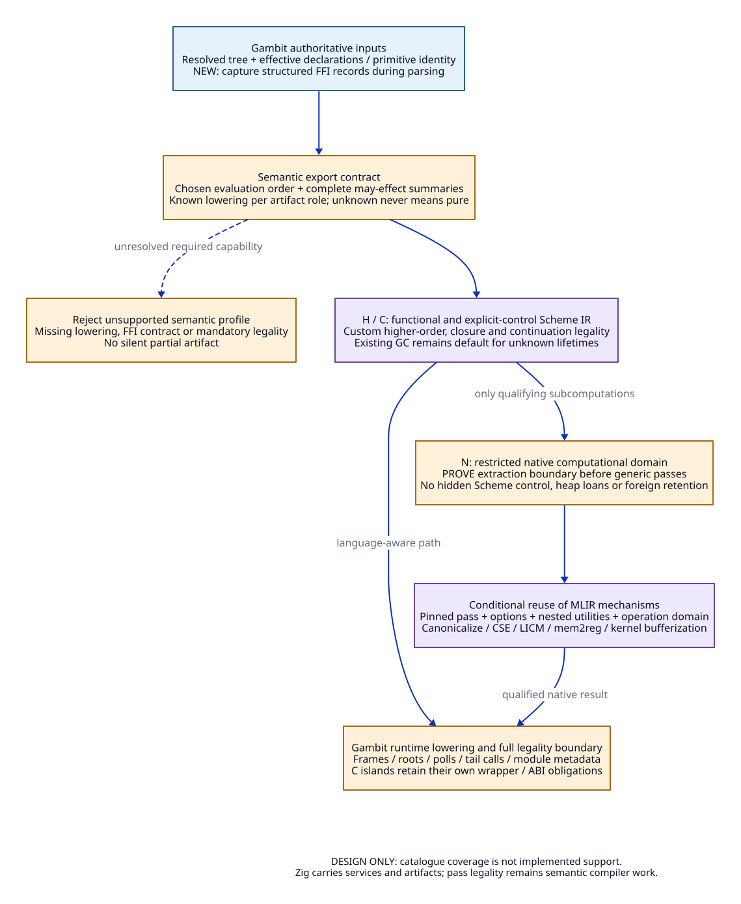

# MLIR Pass Admission for the Proposed Gambit Service

Date: 2026-10-19. Status: design policy, no pass pipeline implemented or run.

This matrix depends on the [coverage contract](primitive-ffi-coverage.md) and
[evaluation/effect contract](evaluation-effects-contract.md). It specifies what
can be reused and what must change; a listed pass is not admitted in an existing
compiler. Upstream documentation/source was read on this date. No MLIR release
or commit is selected for the service yet; implementation admission must pin one
and re-audit its actual transformations, utilities, defaults and nested pipeline.

## 1. Admission Units and Semantic Layers

Admit an exact tuple, not a pass name:

```text
(service version, pass implementation, options, nested pipeline,
 input operation domain, dialect/interface versions, semantic/runtime profile,
 assumptions and invalidation rules, preconditions, postconditions)
```

Define three domains:

- **H**: resolved higher-order Scheme, mutable locations, binding guards and
  implicit nonlocal control represented explicitly as language operations.
- **C**: explicit closure/control representation. Local joins are distinct from
  first-class continuations; this is not automatically a closed CFG for all passes.
- **N**: a restricted native computational domain, extracted only with a proved
  boundary. Its internal operations have specified scalar/tensor/memory behavior;
  no hidden Scheme reentry, borrowed GC pointers or unresolved control effect.

Generic transformations are initially confined to N. The enclosing operation
must prevent their recursive walk from reaching H/C; a comment or an unused
attribute is insufficient. Merely wrapping unsafe Scheme operations inside a
region does not make that region safe. A concrete extraction/verification mechanism
remains required. Scheme transformations in H/C need domain-specific legality.



## 2. Primary Upstream Evidence

The following identifiers are used by each matrix row. Sections/functions named
here, not whole projects, are the read evidence. All constraints in the matrix
are this project's proposed decisions unless described as an upstream behavior.

| ID | Primary evidence and read scope | Relevant fact |
| --- | --- | --- |
| M1 | [MLIR effect rationale](https://mlir.llvm.org/docs/Rationale/SideEffectsAndSpeculation/), categorization/modeling | Memory interfaces do not fully capture nonlocal control |
| M2 | [Canonicalization](https://mlir.llvm.org/docs/Canonicalization/), general design/global rules | Driver can erase unused effect-free ops, fold and unique/hoist constant-like ops |
| M3 | [CSE utility source](https://github.com/llvm/llvm-project/blob/main/mlir/lib/Transforms/Utils/CSE.cpp), `simplifyOperation`, `simplifyBlock`, `hasOtherSideEffectingOpInBetween` | Memory-effect reasoning and trivial-dead elimination occur inside the utility, not only the named pass |
| M4 | [LICM utility source](https://github.com/llvm/llvm-project/blob/main/mlir/lib/Transforms/Utils/LoopInvariantCodeMotionUtils.cpp), `moveLoopInvariantCode(LoopLikeOpInterface)` | The inspected generic loop path queries `isPure` before hoisting |
| M5 | [Interfaces](https://mlir.llvm.org/docs/Interfaces/), dialect inliner example | Inlining supports dialect-specific legality with opt-in hooks |
| M6 | [Pass catalogue](https://mlir.llvm.org/docs/Passes/), general transforms: inline, mem2reg, sroa, sccp, remove-dead-values, symbol-dce, symbol-privatize, control-flow-sink | Each has an input/interface contract; symbol visibility and references affect liveness |
| M7 | [Bufferization](https://mlir.llvm.org/docs/Bufferization/), overview and One-Shot section | Tensor-to-memref analysis is separate from buffer deallocation |
| M8 | [Ownership-based deallocation](https://mlir.llvm.org/docs/OwnershipBasedBufferDeallocation/), supported interfaces/limitations | Requires correct control/region interfaces; documented control-flow restrictions apply |
| M9 | [Dialect conversion](https://mlir.llvm.org/docs/DialectConversion/), modes and conversion target | Partial conversion can leave operations; full conversion requires target legality |
| M10 | [Arith dialect](https://mlir.llvm.org/docs/Dialects/ArithOps/), introductory semantics, addi/addf | Fixed-width/poison/rounding rules require deliberate mapping from Scheme |
| M11 | [Pass infrastructure](https://mlir.llvm.org/docs/PassManagement/), analyses and pipeline infrastructure; [ODS](https://mlir.llvm.org/docs/DefiningDialects/Operations/), verification | Infrastructure supplies analysis/verification mechanisms, not language equivalence |

See the earlier [paper ledger](zig-high-level-semantics-evidence.md#2-primary-literature-what-transfers)
for Aiken/Fähndrich/Levien, capabilities, Elsman and Farvardin/Reppy. Their read
scope/transfer limits remain unchanged. In particular, memory inference is not
collector safety, and LLVM code generation does not supply Gambit's continuation ABI.

## 3. Concrete Pass Matrix

**Conditional reuse** below means reuse the upstream mechanism after the stated
adaptation. **Custom** means new Scheme-specific work. **Excluded** means not
part of the selected general Scheme pipeline. No row claims tested admission.

| Pass / transformation | Selected decision and domain | Required conditions and adaptation | Why the boundary is needed; evidence |
| --- | --- | --- | --- |
| Verification, IR printing and operation statistics | Reuse infrastructure at H/C/N | New Scheme structural/control verifiers; stable source/site identities; no debug stripping before provenance is recorded | Mechanisms exist but cannot verify an unwritten semantic invariant; M11; `_ptreeadt.scm:116-143` |
| `canonicalize`, including `fold` hooks | Conditional reuse only in N initially; custom approved rewrites in H/C | Review global driver behavior as well as every loaded pattern/folder; bound iteration; do not mark identity-bearing allocations constant-like | Disabling selected patterns alone cannot disable global behaviors; M2; `_ptree1.scm:616`; `_t-c-2.scm:2606-2639` |
| `cse` and CSE called by other drivers | Conditional reuse in N; not blanket H/C | Review memory-free annotations and read alias/version facts; deny capture/GC/foreign/identity-sensitive operations; include the utility's DCE behavior in review | A trapping/read-only call or fresh closure cannot be admitted from a single Boolean; M3/M1; `_prims.scm:681,889-892,1574` |
| `trivial-dce`, `remove-dead-values`, unused result/argument cleanup | Conditional reuse in N; custom in H/C | Erase only proved discardable ops; retain errors, divergence, control, polls and initializer actions; update entire call ABI/value-count uses | No-result and unused-result are different from no behavior; M6; `_prims.scm:1459-1471,1766-1768`; `_ptree1.scm:1658-1673` |
| `sccp` and conditional folding | Conditional reuse in N; custom guarded propagation in H/C | Sound constant semantics/branch interfaces; no assumption that unknown branch is unreachable; no fold of checked arithmetic into poison | Value facts must respect Scheme dynamic errors, binding guards and current control; M6/M10; `_ptree2.scm:212-240` |
| `inline` | Custom legality at H/C, reusable driver only after opt-in; conditional N | Known target or maintained guard; arity/default/rest/value semantics; alpha-renaming; captured location sharing; tail/control origin and dynamic-wind; review nested default pipelines | Body substitution alone omits prologue/control obligations; M5/M6; `_ptreeadt.scm:116-143`; `_thread.scm:4621-4706,4794-4819` |
| Higher-order specialization / direct calls | Custom H/C | Conservative call targets, recursive-component widening, guard dominance and invalidation, code-size bound; preserve fallback | No generic MLIR pass defines Scheme callee identity/rebinding; `_ptree1.scm:556-648`; `_ptree2.scm:190-240`; Aiken paper mechanism |
| Closure conversion and environment trimming | Custom H -> C | Preserve procedure identity, shared cells and all live captured fields; prove frame/GC/control-compatible lowering | Not ordinary lambda region flattening; `_ptree1.scm:616`; `_ptree2.scm:481-520,1518-1527`; Farvardin/Reppy and Elsman |
| `mem2reg` | Conditional N; custom eligibility before mapping a Scheme cell into its input domain | Correct promotable interfaces, no escaping/captured/foreign alias, no observation of a location across resumption; reaching-definition facts valid over all control edges | A memory slot interface cannot silently exclude call/cc edges; M6/M1; `_ptree2.scm:481-520`; `_thread.scm:4621-4706` |
| `sroa` | Conditional N after lifetime/alias closure; excluded for runtime-visible frames by default | Correct destructuring interfaces; preserve escape/identity and any GC-visible field; recompute analysis after field changes | Fewer used fields do not justify leaving dangling scanned fields; M6; Elsman sections 1–2; `_gvm.scm:90-139` |
| `loop-invariant-code-motion` / `control-flow-sink` | Conditional N; custom control-aware H/C motion | Total/speculatable operations, valid operands and resource facts, no control/GC/progress boundary crossed; complete region semantics | Generic `isPure`/region interfaces only help if truthfully implemented; M4/M6/M1; `_prims.scm:1591-1622,1766-1768` |
| `symbol-dce` | Conditional after full linkage/retention graph is explicit | Root exports, callbacks, foreign address-taken entries, initializers, reflective/module dependencies and runtime metadata; model references as proper symbol uses | Textual C references are invisible to a Scheme-only call graph; M6; `_ptree1.scm:842-869`; `_t-c-1.scm:340-375` |
| `symbol-privatize` | Excluded by default; scoped N exception | Demonstrably closed native bundle with explicit external root list and no hidden C/runtime reference | Public callback scope is not an optimization hint to discard; M6; `_ptree2.scm:3144-3189` |
| One-Shot Bufferize | Conditional N tensor kernels only; excluded as Scheme region inference | Genuine tensor semantics, compatible bufferization interfaces and separate ownership policy; no arbitrary Scheme heap conversion to memref | One-shot in this name is unrelated to continuation invocation count; M7; multi-shot control evidence |
| Ownership deallocation / promote buffers to stack | Conditional restricted N after input-contract review; excluded on general Scheme objects | Enforce the selected version's CFG/interface restrictions; no retained/captured storage, GC fields or foreign borrower; prove all exits | Region-shaped IR and SSA liveness do not close capture/reentry/GC lifetimes; M8; Elsman; manual `19935-19992` |
| Affine/vector/GPU transformations | Conditional N with explicit kernel/boundary qualification | Prove numeric, alias, dependence, synchronization and target rules; preserve conversion/boundary effects | A Scheme loop is not automatically affine or a tensor kernel; M7/M10; numeric semantics in `_prims.scm` |
| `convert-*`, `convert-to-llvm`, EmitC conversion | Reuse conversion machinery; custom C -> runtime lowering | Declare every remaining Scheme/control op illegal at final boundary; require full target legality plus runtime metadata/root/frame audit; target ABI and module role fixed | Legal LLVM/C syntax does not establish Gambit module compatibility; M9; `_back.scm:17-149`; native contract |
| Generic `-O*`, unrestricted recursive pipeline | Excluded as initial H/C policy | May be considered only as an exact, pinned expanded pipeline over a qualified domain; includes implicit utilities | Named optimization level is not a semantic contract; M1–M11; Farvardin/Reppy evaluation limits |

The N exception is intentionally narrow. A foreign shim that manipulates Scheme
objects is not an N kernel just because its body is C. A Scheme cell does not
become N storage merely by casting it to `memref`. Capture/root/alias obligations
must be discharged before extraction, not asserted after a generic pass has run.

## 4. Pass Receipt Required Before Admission

Every transformation needs a reviewable record containing:

1. Exact input operation set and verified preconditions, with source/paper anchors
   and the supported declaration/runtime profile.
2. Every mutation the implementation can perform, including nested pipelines,
   folders, trivial DCE, constant materialization and analysis invalidation.
3. Preserved observations from the effect contract; proof obligations for the
   changed bindings, allocations, control edges and runtime metadata.
4. Conservative behavior on unknown calls/forms or exhausted analysis budgets.
   Widening can reduce optimization; it cannot turn uncertainty into permission.
5. Named adversarial cases and independent oracle obligations. Future semantic
   equivalence checks, bounded controls and native qualification remain separate.

For future qualification, candidate adversarial cases include shared mutable
captures, rebound primitives across callbacks, untaken checked-error branches,
multiple values, multi-shot reentry, dynamic-wind exit/reentry, hidden C symbol
references, GC between read/address uses and retained foreign pointers. These
cases come from the source/effect ledger; no new tests are created or executed.

Use verifier checks after representation-changing stages and invalidate or
recompute target/effect/alias/liveness summaries after rewrites that affect them.
A pass-manager verifier checks represented invariants; if control edges are
missing from the model, its success does not restore soundness. A pass reaching
an iteration limit must report that outcome. Optional optimization can retain
valid less-optimized IR; incomplete mandatory legalization rejects the artifact.

## 5. Selected Layer Responsibilities

Gambit supplies authoritative primitive/declaration/FFI semantics and runtime
generation. The MLIR service supplies the new dialect/interface implementations,
analyses, legality checks and approved transformations. Zig supplies packaging,
process/resource lifetime, requests, pinned toolchains and artifact identity.
The pass-approval policy itself is semantic compiler work, not a feature provided
by Zig's allocator or build cache.

The contract now selects a conservative executable-design boundary: catalogued
operations are preserved or rejected; selected scalar/native domains can later
reuse generic machinery under explicit preconditions; higher-order, control and
GC integration require language-aware adaptation. No performance or native
correctness result is implied by this design closure.
