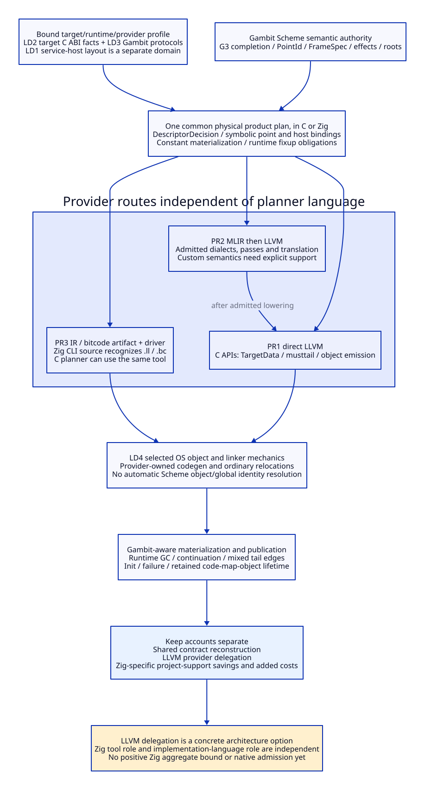

# Native Layout, Object Products and Provider Delegation

Reviewed: 2026-10-20. Architecture research only. No implementation, compiler
invocation, native test, performance measurement or research-engine run.
This continues the [reuse/handoff decision](native-support-reuse-and-handoff.md).
The [evidence ledger](native-layout-provider-evidence.md) separates current
Gambit source, versioned provider interfaces and project deductions.

## 1. Finding and Architectural Choice

After removing duplicate semantic containers and optional private source sums,
physical frame/layout realization, code generation and module products remain
necessary. The useful next boundary is **project-owned runtime realization
versus replaceable provider mechanics**, not “all C code versus all Zig code.”

Select one profile-bound physical product plan. It owns Gambit descriptor
packing, symbolic point/host association and materialization obligations. Its
code adapter may use LLVM directly or admitted MLIR lowering followed by LLVM.
Delegate ordinary machine code and object-file production to the provider for
the selected capability domain. Do not introduce a handwritten Mach-O writer
or access Zig compiler internals merely because the orchestrator is Zig.

Three decisions remain independent:

- **Implementation language:** modern C or Zig for the common native planner.
- **IR provider:** direct LLVM or MLIR plus LLVM, with separate BG/BH semantics.
- **Tool distribution:** linked provider service or an admitted external driver,
  which can include Zig without rewriting the planner in Zig.

LLVM delegation is a concrete common modernization opportunity. These provider
interfaces do not establish a positive Zig-language increment over modern C.
This is a substantive C emission/runtime-interface reconstruction, not an
argument to retain the whole old C dumper behind another command wrapper.

## 2. Four Layout Domains Must Not Be Conflated

| Domain | Authority | Correct use / forbidden shortcut |
| --- | --- | --- |
| LD1 service-host private storage | Compiler building the C/Zig service for its execution target | Private containers and structs; their `sizeof`/alignment are not automatically those of the generated program |
| LD2 generated target's C ABI | Configured runtime headers/options, selected target ABI and qualified compiler/provider realization | Target module/label/pstate field offsets and calling ABI; a host import with different configuration cannot supply them |
| LD3 Gambit object/frame/GC protocol | Scheme semantic contract plus one runtime-profile-bound physical realization | Root slots, RA/link coordinates, RETN/RETI/RETT, bitmap chunking and object tags; ordinary LLVM struct layout does not choose these rules |
| LD4 object/container format | Selected object emitter, linker and loader capabilities | Sections, symbols, ordinary relocations and target encoding; OS relocation does not resolve Scheme global identity or initialize a VM |

Gambit's header makes LD2 configuration-sensitive: `___FAKEHOST` and
`___FAKEWORD` vary with word/pointer-width relationships, and `___label_struct`
changes under label-value support. The current runtime checks several structure
sizes during module setup, explicitly as a simple mismatch check. Equal sizes
are not a complete field-layout, calling-convention or GC-map correspondence.

Zig's `extern struct` describes the C ABI of the target of that Zig compilation.
It can help implement an admitted matching adapter. It does not let a running
service choose an arbitrary output target by applying its own compile-time
layout operators. C has the same service-host/output-target distinction.
For a cross-target service, consume explicit target facts or build an adapter
for that target; do not substitute host `usize`, pointer width or `size_t`.

LLVM TargetData can answer size/alignment/field-offset questions for supplied
LLVM types under a selected DataLayout. It cannot discover a missing Gambit
runtime configuration, C conditional field or semantic root from a target
triple alone. Matching a target DataLayout is necessary for correct provider
optimization, not permission to invent a language runtime layout.

### Proposed Bound Input, Not a New Global Configuration Owner

```text
NativeRealizationProfile {
  effective_configuration_id, runtime_cohort_id,
  target_triple, cpu_and_features, object_format,
  target_machine_options, provider_build_and_capability_id,
  data_layout_identity,
  runtime_abi_manifest_id,
  object_protocol_id, frame_protocol_id, host_call_protocol_id
}
RuntimeABIManifest {
  configured_header_and_options_identity,
  target_word_and_pointer_representations,
  named_type_sizes_alignments_and_field_offsets,
  label_and_module_representation_branches,
  descriptor_widths_and_frame_rules,
  symbol_and_code_pointer_requirements,
  explicit_unsupported_capabilities
}
```

These are logical records. The existing effective-configuration owner supplies
them; this does not add another flag resolver. Manifest production and independent
correspondence evidence remain to be designed/qualified. This study executes
no compiler/SDK queries and does not promote template constants into facts about
the current Darwin/GCC executable. Unsupported arm64e authentication, relocation
or mixed-tail combinations must remain rejected/unresolved.

## 3. Necessary Work and the Exact Delegation Boundary

| ID | Necessary work | Retained project authority / reusable service | C versus Zig result |
| --- | --- | --- | --- |
| NP01 | Complete semantic points, effects and roots | Scheme G3/freeze, shared runtime contract | Same; no second native liveness analysis |
| NP02 | Realize frame coordinates and descriptor form | Common physical planner with bound runtime profile | Same rules; typed units/comptime may aid expression but do not retire the rule set |
| NP03 | Size/align target ABI aggregates | Qualified target facts plus LLVM TargetData for corresponding IR types | Same C-facing query service available to both |
| NP04 | Build target instructions and ordinary machine frames | LLVM target code generator from legal IR | Shared upstream delegation; Scheme continuation frames still NP02 |
| NP05 | Express mandatory host tail edges | Project D1-H edge builder; provider tail-call representation and final target support | LLVM C API has an explicit musttail kind; no Zig-only access advantage |
| NP06 | Produce supported OS objects/relocations | LLVM TargetMachine object emission; ordinary linker | Shared delegation; not a new project Mach-O writer |
| NP07 | Materialize Scheme constants/globals/entries | Gambit-aware fixup/setup adapter with explicit lifetime | Remains necessary; OS symbol resolution is insufficient |
| NP08 | Build/verify/transform MLIR operations | Selected stock dialect services or separately admitted custom extension | C and Zig can construct generic ops; required dialect semantics/passes do not appear automatically |
| NP09 | Lower and translate MLIR to LLVM | Admitted pass pipeline and registered translation support | Shared provider work; C-facing translation exists in reviewed documentation |
| NP10 | Publish/init and retain code/maps/objects | Existing runtime owners plus the new product protocol | Same; no `defer`-based whole-loader retirement |
| NP11 | Surface provider errors/resources | Native facade, owned contexts/modules/buffers/messages | Same logical lifetimes; actual residual support must be compared |
| NP12 | Upgrade/configure/invalidate | Existing profile/request owner plus provider adapter | Shared invalidation plus implementation-language-specific upgrade cost |

This table identifies twelve responsibilities, not twelve equal cost units.
Delegation replaces or avoids a selected implementation of mechanics; it does
not remove the project's responsibility for correct inputs, version support,
failure handling or final artifact admission. Existing native targets are not
retired merely because a new provider can perform their work.

## 4. FrameLayout: One Decision, Two Adapters

The current producer has an explicit chain:

```text
ordered semantic slots + live predicate
  -> targ-build-gc-map
return kind + frame extent
  -> targ-actual-fs / internal-frame expansion
  -> targ-out-of-line-frame? + targ-gc-map-chunks
  -> IFD/OFD and label macros
  -> runtime RA decoder and scanner
```

In `_t-c-3.scm:471-520`, internal-frame expansion and 32-bit bitmap chunking
are explicit. Header decoding applies the matching frame expansion and selects
inline/out-of-line maps. Those algorithms remain locally owned in NP02. The
source contains three static calls to `targ-out-of-line-frame?` in label output,
OFD output and OFD counting. They share one predicate definition; this is not
evidence of three independently maintained algorithms or three runtime calls
for every frame.

The proposed planner computes one `DescriptorDecision` per planned return
point and uses it for count, placement and both output adapters:

```text
DescriptorDecision {
  point_id, frame_spec_id, realization_profile_id,
  actual_scanned_extent, normalized_link_coordinate,
  ordered_map_chunks, inline_or_outline,
  packed_words_or_symbolic_outline_reference,
  alignment_and_storage_requirements
}
```

The C adapter renders this decision; the LLVM adapter builds constants and
symbolic references from it. Neither decides again whether a descriptor is
inline, infers roots from machine register liveness, or recomputes a semantic
link. Independent decoder/root correspondence remains necessary; sharing a
producer hash does not make a wrong producer correct.

**Paired mechanism:** modern C can use explicit-width integers, checked arithmetic
and data records; Zig can use typed integers, explicit checks and specialization.
Neither plain C struct layout nor Zig packed structs replace the declared
runtime encoding. A fixed compile-time profile may be specialized in either
implementation; an arbitrary cross-target profile still needs explicit inputs.
No source establishes a helper family that Zig necessarily eliminates here.

## 5. Object Emission Does Not Eliminate Semantic Fixups

Partition product references before choosing their realization:

| Reference class | Candidate realization | Retained obligation |
| --- | --- | --- |
| Static native symbol/address relation representable by selected IR/object format | LLVM global/constant reference and object relocation | Symbol retention, address representation, ABI and loader support |
| Scheme object/global/primitive identity | Constant/materialization plan or runtime slot populated by an admitted adapter | VM/cohort ownership, roots, initialization order and relocation-safe access |
| Runtime helper/host role | Explicit exported symbol or typed role-to-point binding | Correct entry state and admitted calling/tail protocol |
| Late instance-specific state | Instance owner resolves after required setup | No process-global address reuse as a substitute for per-VM state |

`setup.c:4066-4150` distinguishes immediate values, code-relative values,
Scheme objects, global cells, primitive cells and a lowlevel runtime entry in
the old machine-code fixup protocol. It does not establish arm64e support; later
code includes architecture-specific patching. A direct native route may replace
some write-time code fixups with object relocations, but cannot turn all of
those classes into ordinary OS linker symbols without a new runtime contract.

The inspected `_t-cpu` packaging call is a concrete R-old target: native bytes
and fixup vectors are still passed through `compile-file-to-target`. A complete
native product adapter can avoid that C packaging route. This is one direct
call site in the inspected function, not a measured count of downstream compiler
invocations or proof of a complete module replacement.

No blanket linker/runtime shutdown rewrite follows. The existing early
`SETUP_FIXUP_DONE` assignment and subsequent compatibility checks are baseline
source facts; new validation/materialization/failure states must join actual
resource owners rather than infer that a single marker proves readiness.

## 6. Three Provider Routes and a Separate Zig Tool Role

| Route | Construction path | Work removed / retained |
| --- | --- | --- |
| PR1 direct LLVM service | Frozen graph + common plan -> legal LLVM module -> TargetMachine object | Can bypass generated C and a project object writer in selected scope; retains language lowering, layout, roots/control, provider ownership and module semantics |
| PR2 MLIR service | Semantic operations/common plan -> admitted dialect pipeline -> translatable LLVM dialect -> LLVM module -> object | Adds explicit transform/verification opportunities and their cost; does not automatically optimize erased higher-order meaning |
| PR3 IR artifact and external driver | Emit LLVM IR/bitcode -> selected driver -> object | Decouples process/link dependencies; adds serialization/parsing, process/error and identity/compatibility costs |

The reviewed Zig 0.15.1 CLI source explicitly recognizes `.ll` and `.bc` inputs
in both ordinary input and cc-style paths. Therefore Zig can be considered as
a PR3 tool candidate without generating Zig source. This is published source
acceptance logic, not proof that an installed binary, every target or Gambit
module capability works. No command is run here.

A planner written in C can invoke that same Zig tool. Conversely a Zig planner
can call LLVM directly. These options mean that **using Zig as a distributed
toolchain does not require selecting Zig as the planner language**, and selecting
Zig as the planner language does not by itself give a stable compiler-internal
GVM/MLIR backend API. No reviewed interface promises such an API. If generated
Zig source or compiler internals are proposed later, charge the new emission,
parsing or version-coupling duties explicitly rather than declaring them absent.

### MLIR's Custom-Semantic Boundary

Generic C APIs build operations and manage IR, while stock dialects/passes and
registered LLVM translation supply provider behavior. Custom Gambit semantics
require their own laws, verifiers, interfaces and lowering/admission conditions.
ODS can generate C++ declarations/definitions; access to the C API is not a
replacement for every custom pass/extension implementation.

Do not make the reverse overclaim that every dialect definition must be custom
C++. IRDL supports declarative dialect definitions and a dynamic registration
direction; its C++ predicate form explicitly cannot register at runtime. Whether
the selected declaration, effect interface, rewrite and lowering domain fits
IRDL, stock services or a bounded C++ provider island must be decided per
capability. No registration path or new Scheme/IRDL generator is implemented or
admitted here. Unknown/unregistered operations are not evidence that meaningful
optimizations are available for them.

BG's low-level contract and BH's earlier semantic export remain distinct.
No choice of implementation language restores higher-order/region information
already erased before BG export. The existing high-level semantic/GC pass gates
remain prerequisites of those optimization claims.

## 7. Differential Cost Certificate for the Remaining Scope

For equal NP01-NP12 capabilities, transport and profiles, keep three accounts:

```text
Common = semantic completion + runtime layout realization + ABI correspondence
       + selected IR lowering + runtime materialization + provider qualification

Provider delegation delta = avoided/retired mechanics - adapter/integration
                         - recurring provider support

Zig language delta = avoided C-specific project support - residual Zig support
                  - incremental migration/toolchain/control/binding costs
```

The second account is available to a C implementation. It must not be added
again to the third merely because the Zig implementation uses LLVM. The C
baseline may use exactly the same provider, driver and bounded C++ extension.

| Quantitative item | Established structural boundary | What is not established |
| --- | --- | --- |
| C packaging | One direct inspected `_t-cpu` packaging call site is a replacement target | Number/time of executed compiler processes, total cold-start gain, actual retirement |
| Frame descriptor decisions | Three inspected predicate call sites share one existing rule; new plan requires one decision per planned point shared across outputs | Threefold saving or correctness/performance benefit without independent evidence |
| ABI layout service | TargetData exposes target size/alignment/offset operations | Complete Gambit manifest, current Darwin ABI agreement or root/control proof |
| Object service | TargetMachine exposes object emission from legal LLVM IR | All Gambit fixups disappear, linker admission or arm64e support |
| Required tail representation | LLVM 21.1 C API exposes musttail kind | Correct final mixed C/native edges for the selected profile |
| Zig IR driver | Versioned source accepts IR/bitcode inputs | Current installed/target qualification, no-parser route or Zig-language necessity |
| Zig-specific support retirement | No necessary NP02/NP06/NP08 support family is yet shown eliminated beyond the same provider-based C design | Positive incremental engineering-cost lower bound |

Theoretical outcome: the provider boundary is concrete and narrows handwritten
mechanics, while the remaining runtime-semantic rules survive. It supplies no
Zig-specific positive aggregate bound for these three components on current
premises. This is a limiting result, not a claim that Zig is undesirable.

The next legitimate value question is a bounded implementation/review-support
case inside the **necessary planner and provider facade**, with a real C reuse
counterdesign and full residual cost. If the main objective is LLVM service
decoupling, the architecture can proceed in design without predetermining Zig
language adoption. TG5 stays open; neither native testing nor an invented cost
budget is used to force a positive answer.

The [planner/facade support-cost follow-through](planner-facade-support-cost.md)
now pairs concrete arithmetic/results, six provider resource kinds and raw
failure-output normalization. LLVM 21.1's memory emitter assigns an output
buffer independently of its status; both C and Zig adapters must adopt/clean
that output before propagating failure. The support ledger separates conditional
private-mechanism savings from retained protocol work and charges only marginal
Zig tool/language/library costs against the selected C control. It supplies
positive conditions and a small-shim countermodel without accepting TG5.




## Full Modernization Research Priority

The [full native-system architecture](modernization-system-architecture.md) and
[LLVM leverage matrix](modernization-leverage-matrix.md) place these contracts
inside the primary complete Experimental candidate. Runtime root/context/member/
control and internal cohort ABIs can be redesigned with explicit semantics and
costs. Bmin repair studies remain controls; provider access remains independent
of implementation language. This scope correction does not qualify any existing
runtime/profile or rewrite historical source/native receipts.
