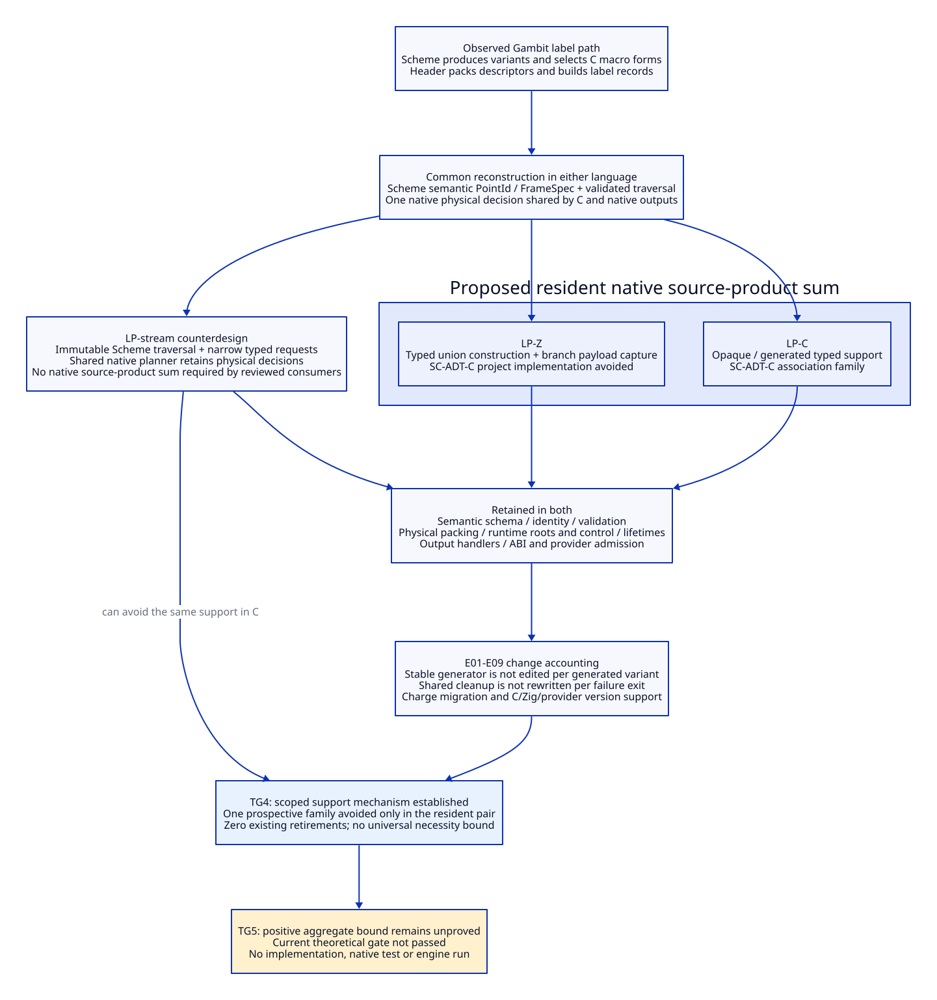

# Native Support Retirement and Change Certificate

Reviewed: 2026-10-20. Design and source reasoning only; no implementation,
native experiment, performance measurement or research-engine execution.
This refines TG4/TG5 in the [paired language comparison](zig-vs-modern-c-net-benefit.md).
Source anchors and primary reading limits are in the
[differential evidence ledger](zig-vs-modern-c-evidence.md#4-source-to-support-follow-through).

## 1. Finding: Separate Three Different Retirement Claims

The current source does not support treating the old backend as a large body of
handwritten C constructors that Zig alone can delete. Much of the selection and
construction already happens in Scheme, followed by generated macro calls and
configured C-header expansion. A new native product path can replace that
coupling; the same replacement is available to the modern-C counterdesign.

| Claim | Concrete subject | Admissible credit |
| --- | --- | --- |
| R-old: replace an existing route | Scheme C-specific label emission, header macro expansion and C packaging on a selected native route | Shared architecture gain; retained legacy/C-output callers still matter |
| R-support: avoid a support implementation | A proposed private C tagged-product constructor/access/visitor support family | Conditional Zig increment for a specified paired design, not existing-code retirement |
| R-work: reduce maintenance effort | Changes, support, migration and review across a selected horizon | Requires a cost domain; neither R-old nor R-support alone proves it |

These claims must have separate records. A proposed support family cannot be
listed as already existing, and a removed generated file is not a removed
semantic rule. There is no deletion receipt in this study.

## 2. A Source-Grounded Label Product Slice

The bounded slice is procedure/return label metadata, not all Gambit objects or
all fifteen runtime roles. Existing producers in `_t-c-2.scm:276-301` construct
`proc` payloads and `return` payloads with `normal`, `task` or `internal` kinds.
The new contract must use semantic PointId/HostId/FrameSpec identities rather
than adopting the current mutable vectors as its ABI.

| Step | Existing source responsibility | Same responsibility after reconstruction |
| --- | --- | --- |
| S01 semantic producer | Scheme selects entry/subprocedure arity/closure data and return kind/frame/link/map | Scheme completion determines entry meaning, logical frame and live roots |
| S02 classification and traversal | Scheme reads class/payload and produces label macros at `_t-c-1.scm:1934-1975` | Validated semantic records feed a native planner; traversal/order is explicit |
| S03 physical descriptor | Header IFD/OFD packing, alignment and GC-map word assembly at `gambit.h.in:9224-9267` | One profile-bound native layout rule set feeds both selected output adapters |
| S04 table and host association | `DEF_LBL_*` macros construct label records at `gambit.h.in:11839-11875` | Explicit label/module product construction and runtime publication protocol |
| S05 auxiliary descriptor emission | Scheme counts OFDs at `_t-c-1.scm:2047-2064` and emits them at 1980-2017 | One planner selects descriptor form and derives auxiliary count/output from the same decision |
| S06 admission | Existing runtime interpretation and module compatibility checks | Preserved decoder/root/control contracts; no type system proves binary compatibility |

The old return-kind emission has an `else` mapping to the normal macro. This is
an observation of the reviewed branches, not proof that arbitrary kinds are
legal or a request to tighten language behavior. The completed producer domain
must be established before the new boundary enumerates accepted values.

S05 exposes a concrete reconstruction target: selection, counts and emission
must share a decision. It does not prove an existing mismatch or a speedup.
Both C and Zig can store that decision once. Keeping independent decisions in
two emitters would squander the architecture gain in either language.

An existing CPU route further illustrates R-old: `_t-cpu.scm:161-180` assembles
code/fixups but packages them through `compile-file-to-target` and the C backend.
Direct native packaging can remove this detour for an admitted route. Zig is
one possible implementation; the detour is not imposed by C as a language.

## 3. Two Equal-Capability Designs, Plus a Topology Counterexample

### LP-C / LP-Z: Retain a Private Resident Sum

For this pair only, require a native planner to retain a heterogeneous sequence
of `ProcLabel` and `ReturnLabel` products for later inspection and output.
This is a proposed capability, not a requirement inferred from old vector syntax.
The sequence keeps stable identities and order; no pointer or union layout is
exported to Scheme, LLVM or the runtime.

LP-C uses opaque storage, typed producer calls, a generated/private visitor and
a strict enum-coverage policy. Its project support family **SC-ADT-C** establishes
three associations: constructor to tag/member, branch to member, and selected
member to typed handler argument. One reusable schema/template can establish
all three. Do not count one generator per variant, call site or generated file.

LP-Z uses a private tagged union, whole-variant construction and payload capture
in exhaustive branches. Its corresponding project **SC-ADT-C implementation is
unnecessary**: the selected language operations supply these associations.
This is a bounded constructive R-support result for LP-C/LP-Z. It does not mean
the compiler has proved a correct handler, correct FrameSpec, correct output,
allocation lifetime, or ABI layout. Unsafe casts and raw foreign imports remain
outside this argument. The compiler/version dependency is retained and charged.

| Support item | LP-C | LP-Z | Result |
| --- | --- | --- | --- |
| Semantic schema, stable identity and ingress validation | Retained | Retained | Zero elimination |
| SC-ADT-C native association support family | One reusable project family, generated or private | No equivalent project association implementation in the selected typed style | One prospective family avoided in this pair |
| Per-kind semantic/output handlers | Retained | Retained | Zero elimination |
| FrameLayout packing and runtime decoder correspondence | Retained | Retained | Zero elimination |
| Resource acquisitions, transfers and releases | Retained | Retained | Zero elimination |
| Language/compiler/profile and provider support | C plus chosen dependencies | C-facing boundaries plus Zig and chosen dependencies | Added/substituted burden, not free delegation |

The shared Scheme-to-native binding generator, if required, stays. Only its
private association-generation clauses could disappear if they have no other
users; the generator as a whole cannot be credited as retired. A handwritten
LP-Z duplicate of the semantic schema would add another synchronization duty.
Prefer one authoritative binding description or explicitly charge that duty.

### LP-stream: Do Not Require a Resident Sum Without Demand

A valid design alternative is a Scheme-owned immutable traversal with narrow
`add-proc-label` and `add-return-label` requests into a shared native planner.
The planner validates IDs/frame inputs, computes physical descriptors and builds
the required output buffer/table. It need not retain a heterogeneous *source*
product family merely to construct a heterogeneous runtime table. C can expose
distinct typed functions; Zig can do the same. Frame/layout authority still
resides in the native planner, so this is not a return to hidden Scheme packing.

LP-stream is available only if replay, revisiting, batching and provider use can
be satisfied from the retained immutable Scheme input plus planner output. It
cannot be substituted if a named requirement demands native-only revisiting,
cross-process retention or a heterogeneous work queue. Those demands are not
yet established for this slice. Streaming is an architectural counterdesign,
not an implementation proven to satisfy every proposed future use.

This supplies an important counterexample: **SC-ADT-C is not a necessary cost
of every capable modern-C architecture.** If LP-stream meets selected demand,
its project sum-support count is zero in both languages. The source proves
that semantic variants exist; it does not prove native resident variants are
necessary. Do not choose topology solely to manufacture a Zig benefit.

The justified result is thus one avoided prospective support family in the
resident pair, and no positive lower bound across the admissible topology
alternatives. It is not a claim that their engineering costs are otherwise equal.

### Consumer-Demand Check for This Slice

| Consumer / requirement | Evidence actually present | Does it require a resident native source-product sum? |
| --- | --- | --- |
| Label table ordering and host association | `targ-dump-prc` iterates `val-lbls` and associates the host with emitted records | No such requirement shown; ordered typed requests can preserve the same association |
| OFD count before emitted body | `targ-heap-dump` obtains `ofd-count`; label/OFD emission later revisits records | Requires repeatable input or retained decisions; does not by itself require native source variants |
| Shared C/native physical plan | HostGraph contract G5 and FrameLayout authority | Requires shared physical decisions; a PointLayout/output buffer can retain them without mirroring every source variant |
| Provider asks for a new collecting boundary | HostGraph contract's bounded AmendmentRequest before a new freeze | Requires revision/amendment discipline; does not establish a resident native label sum |
| Provider independently revisits heterogeneous label work | No selected consumer/protocol established in this slice | Open demand, not permission to charge a mandatory C sum layer |
| Future process-isolated provider | Provider direction is a design goal, not a completed transport contract here | A transport/lifetime contract would be needed under both languages; retaining a private union does not supply it |

This check closes the immediate necessity question conservatively: the reviewed
consumers do not establish the extra residency requirement. It does not qualify
LP-stream for the whole compiler. A final physical buffer may still contain
tagged runtime descriptors and fixups; removing the private source sum removes
none of their format, validation, root or lifetime duties. The architecture
decision therefore leaves residency optional until a consumer needs it.

## 4. Ordinary Cleanup: Close the Overclaim Rather Than Multiply Exits

PC02's three resource relations remain in both languages: two temporary
lifetimes and one output transfer. An LP-C metadata builder can use one shared
cleanup path; an LP-Z builder can use lexical/error cleanup. Adding another
failure return after acquisition need not add another cleanup rule in either
design. Consequently an exit count is not a lower bound on C maintenance.

Changing output ownership or introducing a callback changes the lifetime/control
contract in both languages. The module handle in `os_dyn.c:408-454` outlives a
local helper. Foreign release invalidates fields before invoking its callback
in `c_intf.c:1683-1711`. These protocols survive any surface cleanup change.
No whole resource-state helper is demonstrated unnecessary here. SC-cleanup
retirement credit is **zero established**, with possible local expression/review
benefit retained as a conditional question. Nonlocal escape remains excluded.

## 5. Change Events: What Actually Changes, What Is Regenerated

An owner below is a rule/decision responsibility, not a file, person or unit of
time. E01-E09 are proposed review events grounded in the slice above. They are
not observed development frequencies. A single event can touch several rows;
cost aggregation must deduplicate its common work.

| Event | Shared edits/reviews in LP-C and LP-Z | Differential work and verdict |
| --- | --- | --- |
| E01 add a semantic label kind | Scheme producer/domain, identity and wire validation, semantic handler and runtime meaning | Stable C generator may need no template edit; Zig still needs the variant/binding and handler. Number of kinds gives no saving lower bound |
| E02 change an existing payload field | Authoritative schema/binding and affected semantic/layout handlers | Generated C declarations are regenerated, not separately hand maintained. Zig handwritten mirrors are an added cost if introduced |
| E03 change generic association policy | SC-ADT-C constructor/visitor template or opaque support reviewed | This is the relevant candidate event for LP-Z's avoided support; occurrence and cost remain unjustified, and LP-stream may avoid it too |
| E04 change frame packing/profile | Layout policy, overflow/range rules, C and native adapters, runtime decoder correspondence | Shared architecture change; union typing removes none of these duties |
| E05 add an ordinary failure edge | Error classification and unchanged lifetime contract checked | Shared C cleanup or Zig lexical cleanup can cover it with no new cleanup rule; exit-based multiplier rejected |
| E06 change ownership / introduce callback | Acquisition, transfer, release order and control-containment redesign | Both retain lifetime reasoning; crossing Zig with a nonlocal escape can add a new burden |
| E07 upgrade LLVM/MLIR or SDK | Capability/profile/ABI review and invalidation of affected products | Shared provider work plus any extra Zig import/toolchain work; no blanket LLVM benefit credited twice |
| E08 upgrade native implementation toolchain | C/runtime support remains; managed compiler/profile policy reviewed | Zig version/library/API review is incremental unless a named prior support obligation truly disappears |
| E09 retire the old emission route | Selected callers, module setup, roots, control edges and foreign surface must migrate | R-old shared across C/Zig; no language-specific saving from deleting the same route |

Example E02: add metadata to a return-label record. Editing one schema and
regenerating declarations is one schema change, not one edit per output field
or call site. Each semantically affected handler still needs review in both
languages. A compile-time type error is useful feedback; counting every emitted
diagnostic as a saved defect would invent evidence.

Example E04: change the IFD/OFD selection threshold or frame representation.
Scheme's logical frame contract and native physical rule must remain distinct.
Reuse the planner's selected descriptor in the count and both outputs; do not
recompute it in an output adapter. This removes a decision duplication under
both LP-C and LP-Z. Changing the language without consolidating this decision
does not earn that credit.

## 6. Structural Bound and Economic Boundary

The paired inventory now permits a limited result without tests: LP-Z can avoid
one project association-support family under the resident-sum assumption. That
is a structural statement in a named unit. It is not an hours estimate. The
additional Zig support obligation is a different unit; subtracting `1 - 1` would
be as unjustified as presenting a weighted feature score.

For the admissible alternatives, record a vector rather than a fake scalar:

```text
prospective association families avoided: 1 (resident pair), 0 (LP-stream)
semantic/physical/lifetime obligations eliminated by language alone: 0 shown
whole cleanup support families retired: 0 demonstrated
existing paths already retired: 0
incremental toolchain/provider/control effort: not bounded
```

Let `A_C(H)` be the work of the specific C association support that remains
necessary in the selected architecture, and `A_Z(H)` the residual Zig-specific
association/binding work. Shared semantic, layout and route-retirement work
cancels only after equal capability and actual reuse are established. Then:

```text
Net_Zig(H) = A_C(H) - A_Z(H) + OtherDifferential(H) - Migration(H) - Support(H)
```

If a stable C generator covers E01/E02, charge its initial setup/support once;
do not assign a new template-maintenance cost to each schema change. If a
reusable library or LP-stream satisfies demand, `A_C` may have no project
association-generator component. No reviewed premise establishes a strictly
positive lower bound on `A_C - A_Z`, so there is no robust positive net bound
over the current design alternatives. This refutes an unconditional benefit
argument; it does not prove Zig has negative net value in every selected scope.

The theoretical gap is no longer just “supply a benchmark.” It is:

1. Select the required capabilities that distinguish resident planning from
   streaming; reference the actual downstream consumer for each requirement.
2. Inventory which C support can be reused rather than newly maintained, and
   whether it has users outside this slice. Compare the same bindings in Zig.
3. Establish a defensible change/support domain for E03/E06-E08 and migration,
   or an explicitly accepted bounded-cost policy. E01/E02 volume alone does
   not establish amortization of an avoided generic support family.

These are architecture and decision inputs; running a tiny compiler test would
not supply them. Do not invent demand or seek a budget approval prematurely.

## 7. Gate Disposition and Decision Rules

| Gate | Updated disposition |
| --- | --- |
| TG4 prospective support mechanism | Constructively closed only for SC-ADT-C in the explicitly selected resident LP-C/LP-Z pair; residual duties enumerated |
| TG4 unconditional / actual retirement | Not closed: LP-stream is a counterexample to necessity, and no existing path has retired |
| TG5 robust positive aggregate bound | Not established: no positive lower bound across alternatives; no justified cost domain or accepted budget |
| Theory before experiment | Remains not passed; source reading, diagrams and declaration bookkeeping do not authorize native tests |

Keep LP-Z a candidate if required native resident planning and reusable language
support yield a bounded reduction in project work after E06-E08 and migration.
Prefer the simpler C/streaming design if it meets demand and removes the same
project support with less total burden. Continue substantial contract/C-layer
reconstruction independently: it can consolidate physical decisions and remove
the C packaging detour without presupposing the implementation language.

The next research artifact is the reusable-support and cost-domain closure
for this label/product slice, using these event IDs and the demand check above.
It must be allowed to
conclude that Zig is worthwhile only in a smaller subsystem, or unnecessary
for this slice. The paper's negotiated frontend/backend boundary supports
that freedom; it does not prescribe Zig.

The [reuse/handoff follow-through](native-support-reuse-and-handoff.md) now
identifies existing Scheme support that should remain, a dense-ID refinement
that can avoid duplicate native identity maps, the costs of per-record versus
batch/snapshot handoff, and a version-isolated service boundary. Its current
decision is that this label slice alone does not justify Zig adoption. Compare
another necessary native support component after these shared simplifications,
instead of repeatedly counting optional association machinery as a saving.


