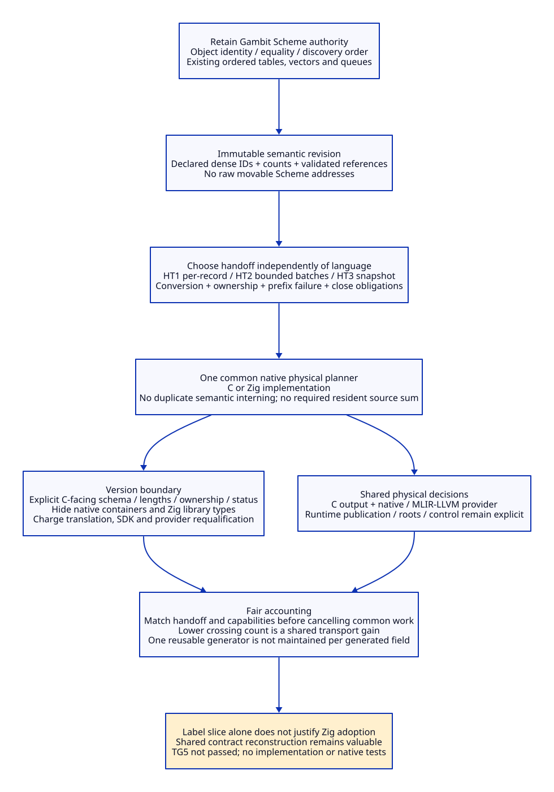

# Native Support Reuse, Handoff and Cost Closure

Reviewed: 2026-10-20. Architecture reasoning only; no implementation, native
test, performance measurement or research-engine execution. This continues the
[support/change certificate](native-support-change-certificate.md) with a
[source and primary-reading ledger](native-support-reuse-evidence.md).

## 1. Decision for the Label/Product Slice

The current slice does not justify selecting Zig solely to avoid C association
support. Existing Scheme collections can remain where semantic identity is
owned; a native private source-product sum is optional; physical planning can
use frozen IDs and common typed operations under either language. Keep Zig as
an implementation candidate, without treating this local mechanism as a
positive aggregate adoption case.

Adopt the following **design direction**, subject to the existing semantic and
native admission gates: preserve Scheme identity/traversal support, hand off
an immutable revision-bound snapshot in bounded batches, retain one common
physical plan, and hide implementation-specific containers behind an explicit
C-facing service envelope. This direction reconstructs the C emission/layout
boundary; it does not require a native mirror of the whole Scheme frontend.

This is a stronger architecture decision than “both languages might work.” It
removes several unnecessary candidate responsibilities before comparing their
implementation cost. No profile or runtime capability has been qualified.

## 2. Reuse Inventory: Existing Code Is Not a Hypothetical C Rewrite

| ID | Support and evidence | Design disposition | Differential language credit |
| --- | --- | --- | --- |
| SR01 | Scheme stretchable vector, `_utils.scm:263-332` | Retain for semantic frontend work; do not port merely to use a native generic container | Zero existing retirement |
| SR02 | Scheme ordered table, `_utils.scm:340-371`; identity-sensitive use in `_t-c-1.scm:648-783` | Retain semantic interning/deduplication and order. Export IDs/references, not native-address equality | Zero automatic HashMap substitution |
| SR03 | Scheme queue, `_utils.scm:854-881`; procedure discovery in `_t-c-1.scm:429-440,755-783` | Preserve semantic discovery/traversal ownership; no duplicate native discovery queue required by this slice | Avoided duplication shared by C and Zig |
| SR04 | GVM/label vectors and accessors, `_gvm.scm:194-239`, `_t-c-2.scm:276-301` | Extract declared boundary records; existing accessors are Scheme facilities, not an existing native C ADT generator | Binding/export work retained in both |
| SR05 | Private SC-ADT-C family from the paired design | Optional if native resident variants are demanded; absent in a suitable streaming topology | One prospective family avoided only in the resident pair |
| SR06 | Native growth/storage machinery | Required only for native-owned bytes/physical tables. Fixed-size allocation or selected reusable containers are alternatives | Zig standard support is concrete; no reviewed existing C container has been shown removable |
| SR07 | Descriptor choice, packing and output construction | One native physical decision shared by C and native products | Substantial common reconstruction, not unique Zig credit |
| SR08 | Schema/wire validation and error provenance | Required across all external/serialized boundaries regardless of native private types | No type-syntax deletion credit |
| SR09 | Conversion, root, nonlocal-control and job lifetime support | Preserve actual runtime rules and reject unsupported service edges | Neither copied bytes nor defer supplies runtime admission |
| SR10 | Toolchain/provider integration | Bound implementation-specific changes behind a service facade; retain C/runtime and provider obligations | Added/substituted Zig support must be charged |

SR04 is deliberately conservative: the reviewed Scheme accessors do not prove
an off-the-shelf C constructor/visitor generator exists. A stable reusable C
generator remains a valid design alternative, but is not an already installed
component to which zero integration cost may be assigned. Likewise “write a
tiny C vector” is prospective support, not free support. No exhaustive repository
census or external-library selection is claimed by this bounded inventory.

SR02 also rules out an unsafe shortcut: a native map keyed by current Scheme
addresses is not a replacement for Scheme `eq?`/`eqv?` semantics. Reuse of a
generic hash table does not establish object identity, numeric equivalence,
cycle handling, mutation policy or GC stability. Resolve that meaning in the
producer and carry validated references across the contract.

## 3. Dense IDs Can Remove Another Duplicate Support Need

The proposed HostGraph freeze already assigns deterministic PointSequence
values within GraphRevision and enumerates FrameSpecs. Refine the selected
snapshot format to declare a dense ordinal range for each table. This is a
new format design requirement, not an observation that every current GVM label
is dense or externally stable.

For each table, validate count, integer representability, ordinal bounds,
uniqueness/completeness and every reference against the owning revision/table.
A missing-entry bitmap or equivalent validity scheme may be needed during
decode. After validation, indexing by an ordinal can replace a second general
object-identity hash map for that table. Keep ModuleId/GraphRevision at the
snapshot/session boundary; a bare ordinal is not a globally meaningful handle.

This is conditional removal of a *duplicate native lookup mechanism*, not
removal of reference validation or Scheme interning. Sparse transport, partial
graphs, cross-module references, externally supplied keys and incremental
patches need their own resolver; do not extend the dense-table argument to them.
Symbol/key lookup and provider-internal maps can still require hash tables.

The deduction applies identically to modern C and Zig. It weakens the argument
that a generic native collection ecosystem must be introduced for every old
Scheme table; it strengthens the shared-contract architecture instead.

## 4. Separate Language, Representation and Deployment

Compare `(implementation language, native representation, handoff/deployment)`
as separate choices. Replacing a per-label Scheme/native call with one snapshot
call is a transport change, not a language property. C and Zig can each use
typed per-record requests, batches or a serialized snapshot.

| Handoff | Work and obligations | Where the language comparison belongs |
| --- | --- | --- |
| HT1 synchronous per-record calls | One request/response path per label, conversion/error delivery each time, session and prefix-failure policy | Compare C/Zig on the same conversions, call count and state policy |
| HT2 bounded batches into a session | Chunk framing, ordinal/offset validation, acknowledgement ownership, bounded decoder and explicit abort | Both pay the framing/session costs; private tagged types do not validate wire bytes |
| HT3 one complete immutable snapshot | Complete encoding/validation, owned or explicitly borrowed input, peak-storage cost, one submission plus lifecycle operations | Both pay encoding/storage; native-only processing may use different internal helpers |
| HT4 process/worker service | Transport, process/job lifecycle, cancellation, errors and retention | Independent optional deployment; no “free isolation” or shared-address borrowing |

HT1 is not cost-free simply because it avoids a native source-product sum.
Existing conversion sources include immediate and allocating result paths;
configured foreign control can use nonlocal exits. A proposed restricted
scalar status or byte-copy envelope needs whole-boundary analysis. No F0
classification follows from a C signature, an integer result or absence of a
callback in the target function alone.

HT2/HT3 need not materialize LP-C/LP-Z source variants: a decoder may deliver
validated typed operations directly to the common planner. Conversely a
serialized stream still has record discriminants/lengths. Its decoder keeps
the tag/payload consistency obligation that private Zig variants cannot erase.
Do not count that obligation as the same retired SC-ADT-C implementation.

### Proposed Handoff Envelope

```text
SnapshotHeader {
  schema_id, module_id, graph_revision, semantic_input_digest,
  effective_profile_id, capability_plan_id,
  object_protocol_id, frame_protocol_id,
  point_count, frame_count, section_lengths, total_length
}
SessionIdentity = (snapshot_identity, native_plan_profile_identity, generation)
AppendInput = (session_identity, section_id, byte_offset, owned_or_borrowed_bytes)
AppendResult = copied_prefix_ack | rejected_with_error_origin
SealResult = immutable_physical_plan | rejected_with_error_origin
```

These are logical fields, not chosen ABI layout, endian spelling, callable
functions or completed schema. Required runtime-role/foreign plans and other
HostGraph sections remain mandatory for a full request; this label slice is not
a complete HostGraph encoding. Plan identity binds actual provider/layout
capabilities and source revision. Never use a buffer address as session identity.

### Ownership and Failure State Machine

1. **Frozen**: Scheme owns the immutable semantic input and its GC references.
   No native client may retain raw pointers into movable Scheme data.
2. **Prepared**: the envelope has admitted identities/counts and a native session
   owner. Input is either native-owned copied storage, or borrowed only for an
   independently admitted nonescaping call extent. Borrow mode is not default.
3. **Receiving**: accepted bytes are owned/copied before acknowledgement. A
   rejected append invalidates the session for further append/seal; retain its
   error provenance until explicit close. No retry on a partially changed session.
4. **Sealed**: all required sections, references, ordinals and semantic/profile
   prerequisites validate. Partial data cannot publish a product. Physical
   planning uses this revision; a semantic amendment creates a new revision.
5. **Planned**: one immutable physical decision set feeds the selected emitters.
   Runtime module publication and callable-code lifetime are separate protocols.
6. **Closed**: the unique service owner frees native resources. Failed sessions
   also require close. If a future worker retains them, close must await a real
   completion/join protocol; this synchronous design supplies none implicitly.

Abort is a cleanup transition, not rollback of arbitrary runtime effects.
Receiving and planning have no Scheme callbacks in the selected scope, and
failure is returned as structured native status before Scheme raises an error.
That rule excludes cross-language nonlocal escape but does not prove collector
participation or latency safety. A long planning operation still needs the
existing F2 wait/GC/control protocol designed and admitted; blocking inside a
Gambit activation is not assumed safe. Keep that native gate unresolved.

Resource errors must preserve which data/resources were accepted; integer
overflow, count/offset mismatch, unknown sections, stale sessions and wrong
revisions reject before output publication. A rejection can allocate native
diagnostic storage and still fail to deliver a Scheme error; define fallback
status and cleanup rather than relying on an allocating error message.

## 5. Quantify Work Counts Without Inventing Timing

For a single successful request with `N` label records and `B` encoded bytes,
let positive integer `c` bound records per batch, `J` be the number of actual
batches, and `h` be that topology's required control/result/close calls. With
exactly `c` records in every batch except the last, `J = ceil(N/c)`;
byte-bounded chunks need their own
framing rule and do not obey that equation automatically. For `N=0`, there
are no record/batch calls but lifecycle calls may remain.

```text
HT1 crossings = N + h1
HT2 crossings = J + h2
HT3 submissions = 1; total crossings = 1 + h3
```

These are proposed successful-protocol counts, not observed Gambit calls and
not counts of transitions hidden inside a converter. Failures, retries/new
sessions, result copying and provider invocations need additional terms. `h1`,
`h2` and `h3` cannot silently be set to the same value. HT3's single submission
does not imply a single total FFI crossing or zero-copy handoff.

The shared lower-level design is at least one inspection of each required
record/reference under the chosen validator; no per-byte timing is asserted.
Owned-copy input adds bytes copied; growing native storage may move elements;
a complete snapshot can increase peak live storage. Existing stretchable-vector
growth and Zig ArrayList invalidation rules both warn against treating a
container pointer as a stable cross-call handle. There is no asymptotic
speedup proof from a lower crossing count when encoding/layout still processes
the same input, and no positive engineering-cost bound from this work model.

**Cost cancellation rule:** only cancel transport/encoding/validation costs
between C and Zig when the same contract, transport, ownership, validation and
support profiles are selected. A comparison of C/HT1 against Zig/HT3 cannot
attribute their crossing difference to Zig. This follows directly from the
independent design choices, without requiring a native experiment.

## 6. Version Work Must Have a Bounded Blast Radius

Zig's reusable allocator/container support is real, but its API use and language
support are recurring project obligations. Published versioned sources provide
specific mechanisms and migration examples, not an upgrade-frequency forecast.
The chosen 0.15.1 library mechanisms and 0.16.0 migration notes are reading
references, not a selection of installed/supported project versions.

| Upgrade / change | Expected affected boundary in this design | What must not be claimed |
| --- | --- | --- |
| Zig container/allocator API | Native implementation and compatibility facade; memory/transfer review | Scheme GC or semantic schema is not automatically changed; API migration is not free |
| Zig C-translation mechanism | Build/import recipe, bound headers/macros/SDK and adapter requalification | A stable C facade does not make translated ABI independent of configuration |
| Zig I/O/process API | Optional orchestration/transport adapter if used | A planner that only consumes bytes need not import the entire process/I/O subsystem |
| MLIR/LLVM version | Provider capability/ABI, construction API use and dependent artifacts | Same C API availability is not stable-ABI proof or a Zig-only benefit |
| Gambit object/frame/control protocol | Semantic producer, facade and native realization as actually affected | Neither private container types nor an unchanged C signature preserve runtime meaning by themselves |

Do not expose Zig standard-library structs, slices, error-set ordinals or
allocator vtables as the public contract. Use explicit length/ownership/status
and schema/version identities. A facade limits source coupling; its own
layout, translation, error and lifetime implementation must be maintained and
qualified. It is not an extra wrapper to keep alongside every legacy path.
The selected callers migrate to the service; the old route retires only at its
existing gates. The Scheme semantic producer and real runtime authority remain.

## 7. Net-Benefit Disposition: Retire This Overbroad Argument

| Claim | Current design result |
| --- | --- |
| Zig replaces existing Scheme containers and therefore saves their upkeep | Rejected for this scope: retain them; native migration would add work |
| Native generic containers are mandatory to preserve old identity tables | Rejected as a universal claim: producer-owned identity and dense-ID tables can avoid duplication |
| Streaming has no cost compared with resident variants | Rejected: choose and account for HT1-HT4, conversion, storage and failure state |
| Fewer crossings establish Zig's own gain | Rejected: shared topology change; compare matching transport |
| SC-ADT-C avoidance alone justifies Zig adoption for label metadata | Insufficient: optional topology, retained decoder/handlers, unbounded incremental support |
| Common semantic/native contract can reduce historical duplication | Concrete design direction: retain semantic collections, consolidate physical decisions, remove selected C packaging detour |

For this label slice, the architecture can avoid native semantic-container
duplication and optional private sum support under either language. Therefore
the defensible theoretical Zig-specific saving lower bound remains **not
positive** on reviewed premises. This means “not established,” not a measured
zero or a proof of negative total value. TG5 is not passed and no test is used
to fill the missing decision input.

Continue the larger Zig value argument only on a named component whose support
is still necessary *after* these simplifications. For example, common native
layout/output machinery or a provider adapter must have a concrete reusable-C
counterdesign, residual Zig support and version burden. Re-counting the eliminated
identity maps or multiplying stable-generator changes cannot revive the label
argument. Aggregate only independently justified component deltas; shared
transport and architecture gains enter the common modernization ledger once.

The [necessary layout/product/provider follow-through](native-layout-provider-design.md)
now specifies the four layout domains, twelve remaining responsibilities,
shared DescriptorDecision and three provider routes. LLVM C services cover
target-layout queries, mandatory-tail representation and object emission;
the Zig tool role is independent of the planner language. These are concrete
delegation mechanisms, with no new positive Zig-language cost bound inferred.


