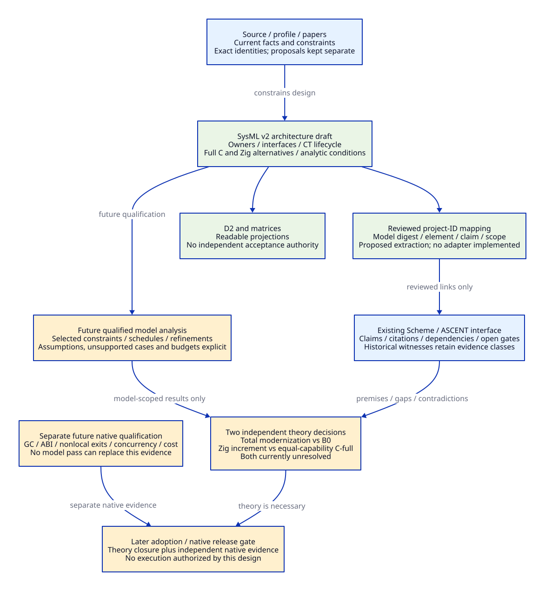

# SysML v2 Architecture Modeling for Gambit Modernization

Reviewed: 2026-10-20. Architecture research only. The accompanying
[SysML text](modernization-architecture.sysml) is an **unvalidated design draft**:
no parser, model interpreter, solver, compiler or native test was run. No tool
was installed. [Primary evidence and tool limits](opensysml-modeling-evidence.md)
separate the standard, implementations and this project's proposals.

## 1. Decision and Purpose

Use SysML v2 as a candidate architecture description language for the **complete**
[modernization design](modernization-system-architecture.md). OpenSysML is the
open implementation ecosystem considered here, not a new Gambit runtime or a
replacement for Scheme/GVM/MLIR. The user's spelling OpenSysML2 is interpreted
as OpenSysML with SysML v2; this study does not establish a separate product of
that exact name [SM01-SM02].

The useful change is from separately maintained prose/diagrams to addressable
architecture elements: owner, input/output, lifecycle, obligation, alternative,
retirement dependency and value question. Model construction must expose holes
in the full design. It must not turn Bmin repairs into its scope ceiling, or
select Zig merely because a diagram contains a Zig box.

Keep B0, Bmin, C-full, C-ZT and Z-full roles from the existing design. C-full and
Z-full must realize the same demanded capabilities. A common SysML part type
expresses intended common structure; it does **not** prove equal behavior,
coverage, performance or support cost.

## 2. What Each Research Surface Owns

| Surface | Authority | Proposed exchange | Limit |
| --- | --- | --- | --- |
| Gambit source and configured/candidate source identities | What exists, under which profile and revision | Anchors/hashes and reviewed observations | A model cannot change observed implementation facts |
| SysML text and architecture review | Proposed structure, typed exchanges, protocol vocabulary and analytic conditions | Stable project element IDs and selected projections | Composition/port typing does not establish C/Zig ownership or GC safety |
| Existing Scheme/ASCENT research interface | Registered claims, citations, dependencies, open requirements and historical witnesses | Reviewed model-to-claim mappings; future adapters only when qualified | Reachability/traceability is not truth or runtime acceptance |
| Existing QNT/Lean models, where an appropriate translation is justified | Explicit transition or mathematical obligations | Source-bound abstraction/refinement contracts and separate results | No automatic faithful SysML translation or proof transfer is assumed |
| D2 | Reviewable explanatory views | Manually reviewed projection now; generated view is future work | Arrow presence is not implementation or acceptance evidence |
| MLIR/LLVM | Compiler semantics, transformations and machine products | Admitted semantic/runtime products | SysML architecture is not executable Scheme IR or a lowering recipe |
| Future native evidence | Actual ABI, GC, unwind, concurrency and cost behavior | Independent receipts bound to source/configuration | Model outcomes cannot satisfy native requirements |

There is no implemented adapter in this update. The
[sidecar trace map](opensysml-model-traceability.json) links to existing IDs
without changing their status. No SysML output is inserted into `witness`, and
the existing Scheme engine is unchanged and not evaluated [SM07].

## 3. Six Related Model Views

| View | Existing design IDs | Concrete question | Draft coverage / remaining work |
| --- | --- | --- | --- |
| MV01 responsibility and deployment | SO01-SO08; MA01/03/05/08 | Who issues semantics, who realizes layout, and where does the compiler process end? | Eight responsibilities and compiler-service ports in SysML; host/target/address-space allocation remains a review rule |
| MV02 runtime ownership and lifecycle | CT0-CT6; MA02; FD05/06/09 | Can a context stop executing while its roots remain scanned and its return/code stay alive? | Event/guard skeleton plus parked/reclamation requirements; no memory-order or complete operation model yet |
| MV03 compiler and provider exchange | MA03-06; LM01-05/08-11; FD01-04/07 | What information survives high export and completed GVM before physical lowering? | Shared typed request/product boundary; HostGraph, ForeignPlan, layouts and pass preconditions need detailed refinement |
| MV04 artifact dependency and replacement | MA06/08; FD01-FD09; M1-M12/E01-E32 | Which real caller stops invoking the old path, and what invalidates which product? | Trace map points to existing retirement/configuration studies; full dependency graph not yet encoded |
| MV05 benefit and cost | MA09; LM01-LM14; AG04-06 | Is total modernization positive, and does Zig add positive value versus the same modern C design? | Two distinct unbound analytic requirements and a cost calculation; no invented numerical inputs |
| MV06 evidence and counterexamples | AG01-AG07; five Q-full requirements | What contradicts the architecture and what still lacks independent evidence? | Existing claim links and negative-case obligations below; no new engine result |

These are views of one candidate, not six independent system specifications.
Only the expressly listed draft coverage exists in the `.sysml` file. LM/FD/AG
row coverage in the sidecar means a **trace to existing documents**, not that all
fourteen mechanisms, nine retirements or seven gates have executable models.

## 4. Runtime Model: State Is Not the Whole Protocol

The draft names the existing CT0-CT6 states and proposed event/guard edges.
Guard inputs are unbound obligations, **not observed runtime facts**. An event
such as `PublicationAcknowledged` represents an obligation already discharged
by a future implementation; emitting that event in a model would not discharge it.

| Operation family to refine | Required inputs / authority | Required result or failure boundary |
| --- | --- | --- |
| Enter / nested callback / leave | VM identity/lifetime, exclusive execution token, dynamic binding, return origin, nesting | Matching restoration on ordinary and admitted nonlocal exits; no competing managed mutation |
| Open / store / publish root extent | Carrier identity/generation, initialized slot range, root representation, collector phase | Scanner-visible initialized extent and update law; incomplete publication cannot park |
| Park / acknowledge membership | Current request epoch, published carrier, no-managed-access commitment, native custody | Reconcile request/member transition; parked roots outlive active processor membership |
| Reenter / reload / resume | Pending collective request, reacquired execution/member authority, live VM/origin/code | Reload relocated values before allocating conversion or Scheme execution |
| Close / retire / retain failure | Entry closure, explicit active/unknown host users, scanner and continuation readers | Failure may retain a carrier without permitting GC progress or reclamation |
| Reclaim / reuse | No execution/scanner/map/continuation/native-return users, drained and closed registry | Actual final-use release then identity invalidation/reuse; generation check is insufficient |

At least five independent dimensions are needed: execution permission, root
publication/enumeration, participation/request acknowledgement, return/code/map
lifetime and knowledge of outstanding host mutation. CT is a review projection
of their product. A single seven-state enum cannot establish all five laws.
The abstract model presently covers event ordering and selected predicates only.
No atomics, fences, safepoint atomicity, ABA prevention, collector barriers,
multi-shot continuation identity or linearizability proof is encoded [SM08-SM10].

Future detailed model changes must include competing transitions, not just the
successful path. Required counterexamples/negative scenarios are:

| ID | Case that must remain rejected or explicitly unresolved | Design failure exposed |
| --- | --- | --- |
| MN01 | Active count shrinks while a retained root has no scanner custodian | Processor retirement is mistaken for root-domain retirement |
| MN02 | Native host may still mutate managed data after nominal park | Memory retention is mistaken for a published safe root carrier |
| MN03 | Reentry uses a pre-GC value before reload / conversion allocates first | Ownership alone is mistaken for value freshness |
| MN04 | Cancellation wins after publication but before acknowledgement | Half-detached member or lost collective request |
| MN05 | Nested callback or exception restores the wrong VM/origin | Flat state or status erases dynamic/control semantics |
| MN06 | Code unload occurs with a suspended continuation or native return | OS/provider release is mistaken for runtime quiescence |
| MN07 | Provider upgrade reuses old incompatible root/layout metadata | Separate process is mistaken for version-independent artifacts |
| MN08 | Optional feature demand is absent; support costs are still allocated away | Artificial shared-support or optional-feature benefit |
| MN09 | Constraint passes because its assumption is false or inputs default to zero | Vacuous success / unknown costs converted into savings |
| MN10 | Model/refinement omits the failing path or exhausts exploration budget | Incomplete model/search reported as full correctness |

These are specified cases, not executed tests or new witnesses.

## 5. LLVM Leverage as an Architecture Relation

Model each proposed leverage edge with six fields: **required capability → old
responsibility → reusable upstream facility → project adapter/semantic obligation
→ actually retired callers → residual and upgrade cost**. Those fields map to
LM/FD rows rather than counting passes or target names.

For example, native product construction links `_t-cpu.scm:162-179` to FD07:
the inspected native assembler path still asks the C backend to produce its
object. A new direct object path may remove that packaging stage, while object
fixups, module setup, constants, roots and code lifetime remain obligations.
Both C-full and Z-full can use that architecture. SysML should make the shared
LLVM mechanism and Zig's private support increment separate relations [SM09].

High semantics is another independent relation: model the pre-normalization
export and completed GVM producer as semantic products, with explicit runtime
profile requirements. The ports in the draft name a boundary; they do not encode
higher-order purity, escape, continuation or collector-visible lifetime legality.
Those remain the detailed MLIR/Gambit obligations in the existing studies.

## 6. Quantitative Modeling Without Made-up Benefits

Two analytic questions are mandatory:

```text
totalLower = modernizationBenefitLower(B0 -> full)
             - replacementCostUpper - migrationCostUpper
             - maintenanceCostUpper - qualificationCostUpper

zigIncrementLower = supportAvoidedLower(C-full -> Z-full)
                    - marginalZigSupportUpper - migrationUpper
                    - maintenanceUpper - qualificationUpper
```

Use one documented unit and horizon within each bound, for example engineering
hours over a selected maintenance horizon. Keep build time, runtime latency,
GC pauses, code/RSS size, capabilities and effort as separate dimensions unless
an explicit decision policy prices them; no automatic sum or modernity score.
The generic SysML calculation handles one scalar account, not that pricing policy.

Every eventual input needs comparator, capability/cohort, horizon, unit, range,
source/assumption, confidence and overlap group. Count common support as a union
after existing Scheme, C libraries, generation and upstream reuse; do not sum the
same executor/storage/cleanup benefit once per consumer. A component qualifies
for amortization only with independent demand. Separate one-time migration,
recurring maintenance, service overhead and release/qualification change events.

All inputs in the draft remain unbound. Algebra can identify a positive region
**if** justified bounds fall within it; an SMT-chosen cheap implementation or
satisfiable parameter assignment is not a cost estimate. Check universal validity
over justified intervals where feasible, plus assumption consistency and reachable
nonvacuous cases. Unknown interval, unsupported expression, exhausted budget or
missing capability parity leaves the relevant gate unresolved [SM03-SM06].

## 7. Model and Evidence Identity Contract

Project element IDs (SO/CT/MA/LM/FD/AG, plus SM/MN/MV here) remain independent
of implementation-generated element UUIDs. A future extraction record needs:

```text
projectId; modelPath; qualifiedElement; sourceSpan; modelSha256;
notationVersion; libraryDigests; toolRepository+commit+binaryDigest;
toolOptions+environment; observationClass; result; completeness+budget;
sourceBindings; projectionVersion; inputAssumptions; producerReceipt
```

This is a proposed exchange record, not a new implemented ASCENT relation.
Use explicit mapping/rename review; a renamed qualified name is not automatically
a new semantic identity or a preserved one. Source line alone is not identity.

One owner per fact avoids a second evidence database: source facts and acceptance
remain in the existing research interface; architecture intent belongs in model
text; economic inputs retain their own provenance; D2 exposes selected views.
Initially the sidecar is a reviewed mapping. A future extractor may publish only
qualified projections into existing relations. Arbitrary user-authored `satisfy`
edges must never mint `witness` rows. Draft files and registered claims can have
different freshness until an explicit reviewed rebinding [SM07].

Current metadata records the read date and rolling URLs; no OpenSysML release,
binary, standard library set, solver or tool interoperability is qualified. Future
selection must pin all of them. Equal diagnostics from two tools corroborate only
their common supported checks, not behavioral equivalence. Neither RDF nor JSON
transport alone guarantees a lossless semantic round trip [SM02-SM06].

## 8. Research Sequence and Adoption Cost

1. Refine MV01/MV02 against actual source callers: full operations, failure exits,
   root carriers, control origin and last users. Preserve broad architecture scope.
2. Refine compiler products and MA/FD retirement dependencies so the model can
   identify redundant owners and still-live C callers, not just draw the new path.
3. Bind two economic analyses to necessary service portfolios and a change-event
   ledger; leave empirical denominators and future native acceptance separate.
4. When a model-evaluation phase is explicitly in scope, qualify parser/resolver,
   selected constraint fragment, negative cases, budget reporting and extraction.
   No such execution is performed or granted by this update.
5. Only then decide whether behavioral exploration, specialized QNT/Lean refinement
   or another analysis adds evidence beyond its maintenance/translation cost.

The cost ledger must include tool/library pinning, standard drift, duplicate
encoding, mapping/refinement review, negative fixtures, generation/view drift and
model/source freshness. The admission condition is improved detection of concrete
architecture contradictions or reduced review/change work after those costs;
more model files, check counts or diagrams alone do not qualify the tooling.

The useful first deliverable is therefore already a **full-system model draft**
with explicit holes, not a native prototype. Root/control theory, LLVM leverage,
real old-path retirement and the two net-benefit gates stay the primary research.


