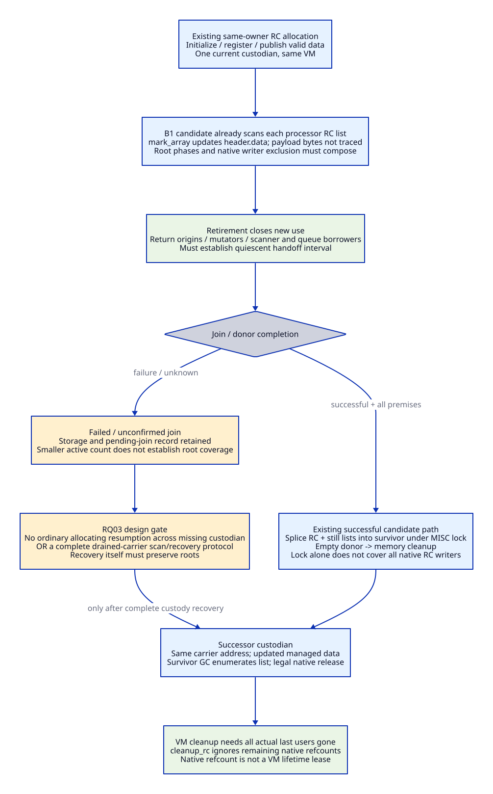

# Nonzero RC Closure and the Pre-Marker Root Window

Research-scope correction: this document specifies the **Bmin repair control**.
The [complete modernization architecture](modernization-system-architecture.md)
is now the primary Experimental candidate. Local saved0/C-shell economics and
storage choices do not constrain that candidate's runtime ABI or portfolio;
they remain a fair cost/capability control and source evidence.

Reviewed: 2026-10-20. Architecture/source research only. No implementation,
compiler/native test, engine/model run or performance validation. Refines the
[owned-entry contract](owned-callback-participating-wait-contract.md), with
[caller/source evidence](rc-marker-caller-evidence.md) and a
[maintenance/migration matrix](rc-marker-maintenance-matrix.md).

## 1. Decision and Source Layers

Retain Gambit's processor-owned RC lists and existing saved-root scanner.
For an admitted short marker-construction window, prefer the existing
GC_SAVE1/RESTORE1 candidate with an explicit scratch/effect/exit contract.
Do not start by introducing a VM-wide RC registry, general native-root stack,
collector replacement or Zig-owned GC protocol. Broader root scopes are separate
options only when an actual caller cannot satisfy the short-window contract.

There are two different starting points. B0 is pinned vendor source: RC lists
are per processor, strong-root RC marking is P0-only, and marker construction
contains the unprotected-target TODO. B1 is the already retained cumulative
candidate: it moves RC marking to every processor, transfers RC/still ownership
on successful retirement, saves/reloads the marker target and contains SFUN
admission/exception cleanup. These are **existing candidate source changes**,
not work done here or current native qualification [RC01-RC08]. Its exact patch
hash is recorded in the evidence ledger. The older root-registry study and
existing retirement fixture are reused; none is rerun or rebranded.

The concrete remaining task is composition: register/scan/update/transfer/release
must select the same live custodian, and root protection must precede every
relocating effect while preserving nesting and nonlocal control. Scheme issues
these meanings/effects; the Gambit C runtime implements collector/control
mechanics. A Zig native consumer must obey that same interface.

## 2. Actual Caller Classes

| ID | Source-backed caller | Root/storage distinction | Selected boundary |
| --- | --- | --- | --- |
| RC-C1 | c_intf function conversion -> os_dyn make_c_closure | Header.data directly holds proc; generated native code is a separate allocation/code-lifetime obligation | Needs matching RC scan coverage and post-GC reload; dynamic generator is architecture guarded, without arm64/x86-64 bodies |
| RC-C2 | String and string-list conversion/release | Native bytes/pointer lists; data defaults to FAL | Preserve list/refcount/storage and legal owner, without pretending payload bytes are managed roots |
| RC-C3 | OpenSSL context allocation/release in os_io | Native option/path pointers/SSL_CTX, nested string RC ownership; data remains FAL in inspected body | Credit current native ownership support; no new collector roots for native-only fields |
| RC-C4 | Win32 event MSG and Windows path allocation | Platform-conditional native payloads | Not demanded Darwin work; still subject to container lifetime and release ownership |
| RC-C5 | Tcl/Tk command ClientData -> tcltk_call, command deletion | RC data contains a still vector (initial refcount 1); vector child is the Scheme proc; static c-define callback | Positive still refs independently enqueue that vector for tracing; does not make deletion/reentry/teardown universally safe |
| RC-C6 | Existing retired_rc_root_survival fixture | Explicit nonzero processor retains movable vector directly in RC data, later P0 reads/releases after successful shrink | Concrete source intent for direct movable RC roots and ownership transfer; not a production call count or a test executed here |
| RC-C7 | Three SFUN result variants and ___run | Shared marker constructor; direct proc/thunk or FAL dynamic target | One constructor-root contract, with caller-specific scratch/input/control premises; run is deliberately not an SFUN lifetime lease |

The Tcl/Tk example's alloc_rc(0) spelling predates/assumes an erased-PSTATE ABI;
it is not independently source-compatible with every explicit-PSTATE profile.
Trace registration through the selected compiled ABI rather than silently
substituting a current signature. Still-vector lifetime must remain valid across
its callback use and deletion. Root coverage is not established merely by the
example existing. Conversely, a missing RC scan is not evidence that every
byte-only or positive-still-vector caller loses a movable value [RC09-RC13].

## 3. Nonzero Processor Registration / Scan / Retirement Closure

Distinguish creation processor, **current registration custodian**, and current
execution owner. They can differ after a legal retirement handoff. The native
carrier address stays stable while its managed data is updated by GC. release_rc
unlinks through prev/next and has no explicit ps parameter; that mechanism can
work after transfer under the successor's legal ownership. It grants no arbitrary
concurrent cross-host access or live-VM lease.

For every RC carrier with a demanded live managed value at a possible GC:

```text
registered carrier -> exactly one admitted custodian list
custodian list -> a scanner in that GC cohort, with updateable header.data
OR an established no-GC interval until a complete handoff to such a custodian
```

This is a selected-protocol invariant, not a claim that every conservative
collector requires unique root visits. A barrier must publish initialized slot
contents before scanning; owner mutation/removal must not overlap that scan.
Ordinary non-atomic RC fields are acceptable only under an actual exclusion
contract, not because refcount or MISC_MEM_LOCK is mentioned elsewhere.

| Phase | Reuse / minimum design obligation | What remains open |
| --- | --- | --- |
| Register | Initialize native allocation/header, select actual ps, link once, initialize valid data before publication/effects | Explicit versus implicit selector agreement; caller's input protection before registration; allowed native allocation effects |
| Active GC | B1 already calls mark_rc on each processor; mark_array updates its data; preserve local queues and phase ordering | Exact configuration, publication/exclusion and candidate root-phase barrier refinement; not a one-line native proof |
| Remove/update | Same-owner supported execution obeys collector phases; release unlinks and frees only at last legal use | External helpers have no matching MISC lock; concurrent release/store/scan is not newly supported |
| Close donor | Stop new use, discharge return origins/borrowers and establish mutator/collector quiescence | Lifetime frame counts do not establish execution exclusion or absence of all RC users |
| Successful retirement | Existing candidate joins donor, splices both RC and still lists under MISC_MEM_LOCK, empties donor and cleans only afterwards | Actual borrower drain, same-VM incarnation, receiver activity/phase and all writers must compose |
| After transfer | Next GC enumerates successor list; carrier pointers survive; old processor storage may retire | Native clients must follow successor's legal access rule, not continue dereferencing an old ps |
| Failed/unconfirmed join | Candidate retains join_pending/storage and offers recovery | Retention alone does not prove roots are in the now-smaller active scan cohort; no ordinary resumed GC guarantee inferred |
| VM cleanup | Existing cleanup_rc frees every remaining carrier regardless of native refcount | Close host/code/readers first; nonzero refs do not authorize use after VM cleanup |

**Failed join is a distinct unresolved closure.** In the inspected candidate,
processor_count can shrink before successful join and transfer. The pending-join
guards found here reject another resize/unsafe cleanup and support recovery;
these reads do not establish pending donors' RC/still enumeration by the next
moving GC. The source comment requiring completed borrower drain is a premise,
not evidence that every path has discharged it [RC07/RC14].

For the minimal successful-retirement cohort, no further GC may cross a missing
custodian interval: transfer completes inside an established quiescent interval
before normal execution resumes. If join fails, design must keep the VM in a
non-admitted quarantine for ordinary allocating Scheme/FFI use until this law is
restored. This is a proposed admission restriction, not a claim the candidate
already enforces it or a drop-in repair. Recovery must itself be proved not to
enter a collecting path with orphaned roots. If recoverable ordinary execution
with pending donors is demanded, independently enumerable drained carriers (or
another complete root-preserving protocol) become necessary new work. Do not
add P0 scanning of an unjoined possibly mutating list as a shortcut.

A complete contract also cannot infer same-VM transfer, scanner drain or mutator
exclusion solely from MISC_MEM_LOCK: baseline release/data stores do not take it.
Initial scope uses already-owned serialized handle operations. Broader concurrent
handle APIs require new writer/collector/lifetime rules, not a mutex around
transfer alone. Same-owner Scheme callbacks are not thereby forbidden.



## 4. Root Strategies and the Selected Minimum

| Strategy | Mechanism / cost | Selection condition |
| --- | --- | --- |
| MP0 existing stable/reachable value | Qualified immutable label or positive-refcount still value under its scanner/lifetime law | Prove actual representation, owner and last use; avoid redundant target roots but keep movable inputs separate |
| MP1 existing saved[0] scratch | GC_SAVE1 -> allocating marker -> GC_RESTORE1; constant storage, no new pstate field or heap allocation | Selected minimum for one target: slot reserved/free by contract; no clobbering/reentrant use until restore; complete error/nonlocal cleanup |
| MP2 retained RC target | Capture native carrier identity before effects; allocation may GC; reload current data from same carrier | Existing registered, scanned, live carrier already owns target; retain only through last carrier read; no global reselection |
| MP3 temporary native RC cell | Existing native allocation/register/data slot plus explicit release; one managed slot per header | Alternative for an actually demanded caller unable to borrow MP1; allocation failure, per-owner scans and nonlocal lifetime cost all counted |
| MP4 native stack root extent | New pstate enumeration/extent/update/exit contract; no intrinsic heap need | Only for genuinely necessary multiple/overlapping roots that existing mapped extents or MP1/MP2 cannot cover; ABI/scanner/unwind work remains common C/Zig work |

saved[3] is already scanned and initialized by the runtime; current macros are
fixed slots, not a stack. RESTORE1 loads slot 0 then writes VOID. Saving the old
slot into an unregistered C local before overwriting it is not a solution if
that old value can move. An apparently unused saved[1]/[2] is not a new private
reservation: SAVE2/SAVE3 are published macros. An empty-looking slot value also
does not prove that nobody owns it. The issuer must establish reservation from
the caller/effect program [RC03/RC04].

The candidate's direct-target MP1 protects the **short allocation window**, not
the entire callback. Normal order is save, make_vector, reload/clear, test error,
then assign marker fields. Reload/clear before the straight-line field write is
valid only while that gap has no relocating/reentrant effect; do not require a
new root framework just to move a clear across a proved no-GC sequence. Logical
handoff is protection -> reload -> marker initialization -> later effects.

Allocation can enter the collective operation loop. That loop may select resize
or propagate an error, not only execute the requested GC. GC completion raises
an interrupt flag; this is not an invocation of a Scheme callback in the marker
body. The full allocator/collective/configuration closure must nevertheless
establish that saved[0] is not clobbered, owner remains valid and every nonlocal
exit closes the scratch extent. Absence of a direct SAVE call in one allocator
body is not the whole argument [RC05/RC08].

For dynamic OC1, saving FAL does not protect its managed target; MP2 depends on
the actual registered data slot. Capture carrier identity at a qualified entry
before allocation, reload data afterwards and initialize marker. On architectures
without the trampoline provider this is an excluded capability, not a reason to
add TLS or claim a runtime speedup. Tcl's explicit ClientData/static c-define
route is different and can demand root/lifetime work without such a provider.

Raw Scheme-object inputs, return values, converter temporaries and error-handler
arguments have independent liveness. MP1 for the target does not cover them.
Tcl's positive-refcount still vector illustrates one already-supported carrier;
CFUN setup still has to preserve its own live inputs across make_vector. Do not
assert that this new target window proves or repairs every such input.

The caller boundary can begin earlier than the constructor. Worker startup
copies self->data_scmobj into a local thunk, joins a collective, then calls run.
Selected Scheme resize sites pass the startup-processor procedure. Their actual
label/descriptor stability must be established. A newly supported movable thunk
would instead need protection and reload **before that earlier collective**;
borrowing saved0 only inside the later marker cannot repair a stale incoming
argument [RC17]. Main-module and external direct-run callers likewise need their
own pre-entry lifetime/effect argument. This is a root-window placement rule,
not a claim that current startup has a reproduced failure.

## 5. Nesting and Exception Ownership

The minimal same-owner nesting is:

```text
A: borrow saved0 -> allocate marker A -> reload/clear saved0
   -> initialize A -> convert/call Scheme
   -> B enters on same owner:
        borrow saved0 -> allocate B -> reload/clear -> initialize B
        -> call/convert/close B -> resume A
   -> close A -> restore activation/catcher -> propagate correct destination
```

Thus arbitrary callback depth does not require one scratch slot per callback
**when the short windows do not overlap**. A marker remains a still object with
its own reference until invalidation/release; its target field carries managed
reachability during subsequent effects. Reentry *inside* an active scratch
window violates MP1 unless a different root strategy is selected. Do not defer
release of saved0 until the whole callback ends or silently overwrite an outer
scratch value.

The existing B1 sfun_frame_marker catches allocation unwind, clears saved0 and
leaves its frame lease. SFUN macros enclose later work in configured TRY and
close marker/frame before propagation. ___run has its own TRY but is deliberately
not this lease wrapper. Therefore the marker-root cleanup obligation must be
owned by a **common constructor-level C extent**, or be proved identically at
all selected SFUN and run call sites. A blind caller-side clear is not general
nesting support. This is a proposed ownership refactor, not new code [RC06/RC08].

The smallest complete MP1 design acquires scratch ownership before the catch
region, catches constructor exits in C, reloads/clears only its own slot on normal
return, clears that owned slot on throw, restores the previous catcher and
rethrows the original condition/destination. It never kills an undefined marker
or reads a marker/result modified across longjmp on the exceptional path.
C setjmp/longjmp automatic-local rules must be respected; qualified nonlocal
modes remain separate profile obligations [RL04]. SFUN frame lease acquisition
and release remain at their proper scope; ___run does not become a lifetime
lease merely because it borrows one root cell.

| ID / exit | Required root/control disposition |
| --- | --- |
| RE01 marker success | Reload from owned root, initialize marker, end scratch extent before converters/target invocation |
| RE02 marker returns allocation error | Reload/clear scratch; no kill of undefined marker; SFUN lease leaves exactly once if acquired |
| RE03 marker throws to existing catcher | Constructor-owned scratch cleanup and previous catcher restoration before rethrow; run path included |
| RE04 argument/result converter error | Keep all live converter/input/result slots valid; close exactly acquired resources and marker under configured control |
| RE05 nested callback returns | Inner marker/lease/catcher closes; outer marker and origin remain live; saved0 already free between windows |
| RE06 nested callback throws to outer origin | Preserve unmatched-marker propagation; each crossed owned extent closes; no conversion to an ordinary unrelated error |
| RE07 wrong processor or repeated return | Preserve existing kernel checks and Scheme error semantics; root guard grants no new return permission |
| RE08 command deletion inside callback | Close future admission; native carrier needed only until last real read, managed active values remain rooted; retain longer only if an actual later native use exists |
| RE09 processor shrink during live callback | Preserve candidate foreign-frame admission gate for return origins; a root is not a retirement lease; run/startup role differs |
| RE10 failed join or VM teardown | Keep unresolved custodian interval closed to ordinary use; do not free refcounted storage before all native/collector/return users are discharged |

In Tcl's inspected scheme_call_cmd the ClientData read occurs when constructing
the tcltk_call argument; its result-delivery tail does not reread the carrier.
That makes last native read an interesting smaller boundary than whole callback
return, but command deletion/event-loop/thread ownership and active Scheme
rooting are still premises. No supported self-delete interleaving or full Tcl
reentrancy is qualified from this example alone [RC11].

For Zig, all configured nonlocal-control operations and cleanup stay in their
admitted C region. A catcher above a Zig-owned frame does not protect defer from
being skipped. No-GC Zig neither roots Gambit objects nor restores the VM binding.
Same-owner selection remains unchanged; activation-local restoration and actual
fp/R0/catcher restoration are distinct from TLS switching.


## 6. Remaining Theory / Admission Gates

RQ01 actual configured caller/ABI and managed-root census; RQ02 active/nonzero
RC scan, publication and same-owner mutation/removal; RQ03 successful and failed
retirement scan-custodian coverage; RQ04 MP1 scratch reservation, transitive
no-clobber/reentry and all-exit cleanup including run; RQ05 target/parameter/
converter/error root census and dynamic-provider last use; RQ06 disjoint support
retirement/cost bounds after crediting B1 and modern C reuse. Future native
safety/progress qualification is a separate later gate. This study closes the
choice of minimal candidate design and lists its proof obligations; it does not
claim those source-composition/ABI premises have all been proved.
