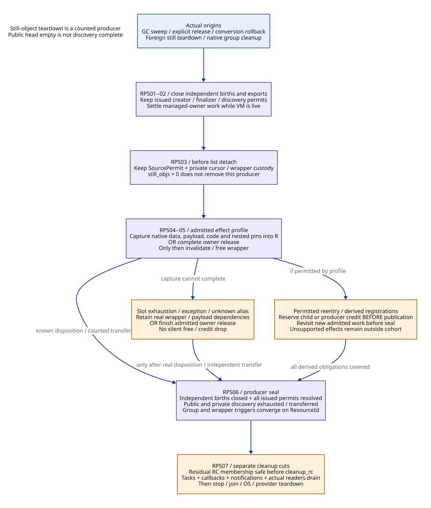

# RC Payload Custody, Still-Object Producers and Shutdown Dependencies

Reviewed: 2026-10-20. Source-backed architecture research only. No implementation,
native test, model/prover/solver/engine execution or positive economic certificate.
See the [evidence ledger](rc-payload-custody-evidence.md),
[modern C / Zig matrix](rc-payload-custody-cost-matrix.md), and
[document trace map](rc-payload-custody-traceability.json). This refines
[the synchronization and descendant argument](device-release-sync-proof.md),
especially WSP06--08 and WST04--06, within SharedRuntimeContract.

The architectural decision is to separate **storage membership**, **release
authority**, **managed-root ownership**, **borrower lifetime**, and **work
production**. A queue record or incremented reference count cannot stand in for
all five. Gambit keeps Scheme/GC/control semantics; C-full and Z-full reconstruct
the same native custody/service boundary. This is a full C-layer redesign,
not a requirement to insert the smallest wrapper around old cleanup.

The [root-transfer receipt refinement](root-transfer-receipt-design.md) now
separates a protected precommit RootTransferPermit from a postcommit
RootTransferReceipt. It specifies the exclusive terminal-epoch boundary,
physical-membership/public-root publication gap, failure custodian, and separate
scan-facility retirement cut. This corrects the earlier precommit use of the
word receipt; no new runtime API or qualification is implied.

## 1. Real Allocations and Users

| ID | Actual family / source | Required custody closure |
| --- | --- | --- |
| RCU01 | RC block: header prev/next/refcount/data; alloc/register/addref/release/cleanup; mark_rc [PC-S01/S02] | Storage is owned by one list, refcount operations are ordinary mutations, and data can be a Scheme root. Refcount, root scan ownership and list membership have different meanings. |
| RCU02 | TLS context allocated by alloc_rc; destructor releases five optional path strings, SSL_CTX and context; failure and foreign-wrapper release share that destructor [PC-S03] | Move or drain context **and every live nested string obligation**, plus provider callbacks/library lifetime. Top-level context custody alone is insufficient. |
| RCU03 | TCP server stores tls_context_p and reads it during accept; Scheme server port retains client-psettings containing tls-context [PC-S04/S05] | Managed retention and native borrows are real users. Close new accept/export issuance and drain existing readers or preserve a valid shared custodian before context disposal. No current-source UAF is asserted. |
| RCU04 | Native raw device uses ALLOC_MEM and device refcount, not the Gambit RC header [PC-S06] | Retain actual device/group/wait/pump users; do not label every foreign payload an RC block or price an RC migration for every device. |
| RCU05 | C string/list conversion allocates RC storage; string-list release checks final ref and recursively releases strings [PC-S07] | Nested/shareable storage needs allocation identities and real reference custody; a shallow copy/list move can leave dangling children. Existing conversion failure cleanup is baseline reuse. |
| RCU06 | C closure allocates RC code, sets data=Scheme proc; callback stack marker reads data_rc [PC-S08] | Same-address code/return users, live VM and relocated managed roots must remain valid. Not eligible for a native-only survivor merely because allocation is in C. |
| RCU07 | Foreign conversion builds still wrapper; explicit release clears fields before callback; sweep/free_still_objs release then free wrappers; group/OS shutdown are further origins [PC-S09--S12] | Capture admitted native task data and code custody before freeing wrapper storage. Enumeration of one list is not closure of all release sources or raw aliases. |

For TLS, the selected destructor has one context RC block and up to five nonnull
RC path-string fields: a concrete nested set of `1 + k`, `0 <= k <= 5`, before
OpenSSL's own allocations or other users. This is an obligation count for this
source shape, not a runtime allocation measurement or a complete provider graph.
An SSL_CTX library reference does not itself retain the enclosing Gambit context.

## 2. Records and Transfer Premises

A proposed **PayloadCustody** record names AllocationId/reuse identity, allocation
base/extent/deallocator provenance, payload view, native owner domain, authoritative
release stage, nested strong/borrow edges, managed root-cell locations, code/provider
users and outstanding borrows. **HandoffRecord** names source/target identities,
pre-reserved work token R, transfer state and stable disposition receipt. **SourcePermit**
names every origin still allowed to discover, register or derive release work.
These are logical design fields, not source structs or generated code.

| ID | Premise | Why it is necessary |
| --- | --- | --- |
| RCP01 | Complete migrated cohort: all pointer/RC operations, release origins, aliases, scanner and teardown users resolve the same authority or are quiescent. | A new lock around only new calls cannot serialize old release_rc, data writes or raw foreign-address clients [PC-S01/S09]. Unknown exported aliases prevent qualification. |
| RCP02 | Source/target storage domains stay pinned throughout prepare/commit/settlement; source cleanup and target cleanup cannot race membership changes. | Old cleanup_rc force-frees remaining list entries; target must not do the same while accepted custody survives [PC-S01/S12]. |
| RCP03 | One short CustodyGate C serializes migrated header/list/ref/data operations and membership commit; service lock L and runtime gate G are not held across C or external waits. | Ordered admission/root receipts are obtained before commit. Revalidate stable identities at C. No allocation, callback, blocking, GC scan or native destructor under C. Weak-memory/native refinement remains open. |
| RCP04 | Required borrowers/scanners/writers have closed admission and drained, or every permitted operation is routed to the new authority with an explicit lifetime law. | Source list rewiring does not revoke a raw pointer or make non-atomic refcount updates safe. Known shared children keep their own custodian. |
| RCP05 | Managed data has a valid continuous root-ownership handoff under Gambit's safepoint/collector contract; a native-only profile proves no managed references and closed data writers. | Removing an RC header from mark_rc discovery can remove its data root [PC-S02/S08]. A type name or observed data=#f is not a proof against later writes. |
| RCP06 | All nested storage, code, provider and callback dependencies are included and actual deallocator/header ABI remains valid. | TLS strings, closures, raw device users and library callback effects differ [PC-S03--S08, PC-P04]. |
| RCP07 | Source permits/private cursors, preallocated extraction slots, accepted/derived work and retained failure are represented before they escape a custodian. | Empty published list/queue must not erase unpublished discovery or child work [PC-S10, PC-P02]. |
| RCP08 | Drain waits preserve the live executors/VM/OS/providers they need and obey an admitted acyclic operational wait relation. Finite work and cooperative peers are separate premises. | A dependency pin preserves storage, not execution capacity; perfect accounting can still deadlock or wait forever [PC-S11--S13]. |

C is a logical synchronization choice for this cohort, not a claim that the old
runtime already has such a gate. A migrated release primitive must decide final
reference/disposition and unlink under C, then perform permitted storage free
outside it after the last actual user is excluded. Destructors invoke such
primitives outside C. Plain old release_rc cannot remain an unsynchronized
concurrent back door. This affects both C-full and Z-full; a Zig atomic increment
alone does not protect the list, data root, payload borrowers or cleanup_rc.

## 3. Concrete Storage Paths and Handoff Cut

[D2 source](rc-payload-handoff.d2).

There are three distinct supported design paths; none is inferred for arbitrary
foreign release_fn:

- **Owner drain before old cleanup:** finish admitted release while all actual
  dependencies remain live, then allow cleanup_rc to reclaim only residual
  owner storage. If drain needs owner callbacks, schedule those before owner/VM
  closure; never block in a GC critical phase waiting for a task that needs GC.
- **Same-address adoption:** remove eligible RC allocations from the source list
  into a genuine longer-lived domain. Reconstruct that domain's operations,
  root discovery and teardown law. Preserve header/deallocator provenance;
  list-splice support in the joined-donor candidate is useful but its receiver
  is another pstate, not an independently qualified service [PC-S13].
- **Independent allocation from birth:** new admitted native-only service
  products can use independent storage/control from creation, avoiding old RC
  membership for that cohort. This is a substantive retirement candidate equally
  available to modern C. Existing escaped pointers, C closures or opaque handles
  cannot be moved by memcpy. A true copy/rebind route needs explicit value-copy,
  alias rewrite and exactly-one-destructor semantics; it is not the default.

The same-address adoption candidate is refined as follows:

| ID | State / operation | Ownership and failure boundary |
| --- | --- | --- |
| RCO01 | OwnerLinked -> Preparing | Register HandoffRecord and R under L; source keeps storage. Reserve target domain lifetime, task/extraction capacity and result/pin records before destructive mutation. Allocation failure leaves counted source custody. |
| RCO02 | Close issuance; census nested/user edges | Freeze affected resource exports/accept readers/ref/data writers or route their complete authority. Preserve actual source/scanner/iterator storage while they drain, outside C/L/G. No general requirement to stop unrelated VMs. |
| RCO03 | Acquire root/provider/dependency readiness | Native-only route proves data/root policy; managed route prepares a protected RootTransferPermit for actual cells/VM/collector ownership; the receipt is issued only after membership and target root publication commit. Admit callback/code/library behavior. Receipts are proposed obligations, not existing APIs. |
| RCO04 | BorrowersQuiescent -> RehomeReady | Revalidate identities, complete nested closure, pre-reserved target admission and source cleanup fence. Source remains custodian until the membership commit. A shared child may remain elsewhere only if its independent custodian survives every task use. |
| RCO05 | MembershipCommit under C | Atomically for permitted observers, unlink each selected header from source, insert in target, change custody and record commit receipt. A protected permit holds the valid collector cut across physical membership and target-root publication; only the final publication issues RootTransferReceipt. No externally observable orphan/double-free authority; old cleanup is excluded from traversal. No fallible allocation/callback in this commit. |
| RCO06 | ServiceLinked -> accepted runnable task | After C unlock, finalize target root publication under runtime authority and issue RootTransferReceipt, then publish accepted task under L using that receipt and existing R. Until publication the transfer record owns pending work/storage. No executor accesses an uncommitted payload. No simultaneous C/L acquisition is assumed. |
| RCO07 | Notify / resolve interrupted response | Reuse WSO01--04; resolve the same HandoffId/AttemptId. Failure after membership commit retains target custody and work credit; it cannot report source ownership or run a source rollback destructor. |
| RCO08 | Execute / free / retain | All nested RC operations use reconstructed authority. Outcome separates payload disposal, partial provider effects and error. Unknown keeps dependency custody; target destruction waits for it or transfers the entire real closure to another valid custodian. |
| RCO09 | OwnerCleanupAllowed | Only after committed root-transfer receipt where required, and all source transfers/cursors and rooted/borrowed obligations are disposed or actually handed off, may old cleanup_rc traverse the residual source list. Resetting its head is not evidence that transferred payload users are gone. |

### Continuous root visibility is a separate cut

For data containing a Scheme value, source membership may be its current discovery
path. A protected permit reserves target root metadata and an exclusive collector
boundary before unlink. All previous collector phases and affected scanner/queue
borrowers must finish; no new collection or managed resume can pass the held cut.
After physical list adoption, publish the target root contributor/manifest before
reopening collector admission and issuing the committed RootTransferReceipt.
Failure in that gap keeps prepared roots, target storage and VM custody held.
Simply listing the cell twice does not establish a relocation-writer law.

The [detailed ordering](root-transfer-receipt-design.md) selects same-heap stable
cells between terminal epochs, with no observer admitted to the intermediate
state. It does not rewrite a sealed ticket or prove a concurrently scanned
spanning-descriptor scheme. Target future discovery, exact cell coverage and
native publication refinement remain unresolved. The owning VM cannot be freed
merely because its RC data cells have moved to another native custodian.

For the native TLS/string candidate, excluding arbitrary set_data_rc writers and
managed/library callback effects is still necessary. The OpenSSL API can run
configured callbacks on SSL_CTX_free [PC-P04]; selected source or a no-GC allocator
does not qualify that provider. Native-only status is a per-profile conclusion,
not a blanket property of this TLS source family.

## 4. Still-Object Discovery and Producer Closure

[D2 source](still-object-producer-closure.d2).

The current free_still_objs moves the published list head to a local cursor,
sets still_objs=0, then calls release_foreign and frees each wrapper. A concurrent
observer can see an empty head while that private cursor can still issue releases.
A reentrant callback which is permitted to allocate could populate a new still
list [PC-S10]. This is a countermodel for a proposed queue/list-empty shutdown
rule, not an assertion that arbitrary reentry is valid in the old teardown path.
The redesign must define allowed effects before relying on closure.

| ID | Producer stage | Required accounting and source replacement |
| --- | --- | --- |
| RPS01 | Open registrations | Every admitted resource/wrapper birth and permitted raw export has an issuer/custodian and SourcePermit. Include normal GC release, explicit release, conversion rollback and group/shutdown discovery. Unknown external exports stay outside the qualified cohort. |
| RPS02 | Close independent births | Close new independent registrations/entries, but retain already issued creator/rollback/finalizer/transfer permits. Drain normal mutators and VM callbacks while they can still execute. Last tracing GC is one discovery source, not the seal. |
| RPS03 | StillDrainInProgress | Before detaching a list, retain a discovery permit and native cursor/wrapper lifetime. Extract admitted native data/code/dependency custody into pre-reserved R or complete owner release; then invalidate/free the wrapper. Do not enqueue a pointer into wrapper storage being freed. |
| RPS04 | Effect-directed continuation | Native-only release cannot allocate managed wrappers or reenter Scheme. An owner-affine/managed destructor runs in an earlier admitted live-owner phase with counted derived registrations. If it can recursively produce work, reserve child/producer credit before that work and revisit new admitted registrations. No unqualified arbitrary destructor is rescued by endlessly rescanning. |
| RPS05 | Per-wrapper disposition | A wrapper identity goes to owner-completed, transferred/accepted, already-issued task, or retained with actual wrapper/native dependencies. Do not consume its last discovery credit on enqueue failure, unavailable slot, exception or unknown alias. Source cursor/link storage stays valid until its own traversal no longer needs it. |
| RPS06 | Seal release producers | Under the service authority, require independent births closed, all issued permits and private cursors resolved, all affected registration/worklists exhausted or transferred, and no remaining permitted origin capable of uncounted issue. Group cleanup must resolve the same ResourceId as wrapper cleanup. Foreign fields being null are not a complete native group ledger. |
| RPS07 | RC/OS teardown frontier | Before each cleanup_rc, verify actual residual membership and custody/root/borrow disposition. Then keep task wait/code/library/owner dependencies live until their separate drain, stop/join and physical-user cuts. A still-dependent retained record prevents dependent teardown. |

Extraction under GC/heap critical conditions must not synchronously wait for a
leaf needing the same collector/owner. Split capture from execution and make
capacity available before entering the critical phase. Exhaustion is an explicit
retained/failure outcome which blocks unsafe teardown; it is not permission to
free captured payload or wrappers with surviving task borrows. The native service
uses WSL01--06; RPS adds source-specific meaning to those credits, not a duplicate
termination subsystem.

## 5. Shutdown Wait Dependencies and Circularity

[D2 source](rc-shutdown-dependencies.d2).

Distinguish a **keep-live edge** (A may still use B's memory/code) from an actual
**wait edge** (A cannot progress until B executes an action). A cycle of stored
references alone is not a proof of deadlock; an acyclic drawing which omits an
actual callback/executor dependency is not a proof of progress.

| ID | Actual dependency / potential circular wait | Required design treatment |
| --- | --- | --- |
| RDD01 | Teardown owner waits for native release; release synchronously requests a callback on that blocked owner [PC-S08/S11, PC-P04]. | Run owner-dependent release while owner servicing is admitted and roots valid, or use a separately proved cooperative owner loop. Native-only drain must exclude this reverse wait. No generic callback pump is assumed. |
| RDD02 | GC/RC scanner waits for worker task; task waits for GC/root materialization blocked by that scanner [PC-S02/S08/S10]. | Capture under GC contract, execute after the critical phase; obtain managed-root handoff before removing scanner discovery. Never hold G/C/L while waiting on tasks/scans or callbacks. |
| RDD03 | Parent task blocks sole executor waiting for child; child is queued on the same executor [PC-P02]. | Parent yields as a counted continuation/waiting state so executor can run child, or require a different admitted executor. No recursive blocking join on the sole execution lane. |
| RDD04 | TLS context waits for server borrows to drain; server drain is deferred until after context destructor [PC-S03--S05]. | Close accept/export admission first; finish server readers while context is live. Preserved managed settings are a dependency, not permission to free the native context. |
| RDD05 | Task needs wait endpoint/time/provider code; owner closes those before waiting for task [PC-S11/S12]. | Keep dependencies live through actual work and late notifier drain. Service stop/join precedes endpoint free; module/provider unload follows all code/callback/return users. |
| RDD06 | Transfer waits for source scanner/borrower while holding the gate it needs to exit; failed donor join is treated as quiescence [PC-S01/S13]. | Revoke admission, release locks, drain/verify join, then commit at an admitted root/membership cut. Failed or self join cannot issue a custody receipt. |
| RDD07 | Producer seal waits for a destructor that cannot publish because all descendant admission was closed. | Close independent roots, preserve already counted derivative permits and reserved capacity until disposition. Retain explicitly if unsupported; never call that state drained. |
| RDD08 | Non-single-VM global cleanup holds vm_list_mut while invoking VM cleanup; a release/callback needs registry participation [PC-S12]. | Pin the selected VM/resource identities under registry authority, close relevant admission, then perform task/callback/user drains outside the registry lock. Revalidate before physical removal. Existing locked teardown cannot become an opaque asynchronous authority. |

For an admitted native-only profile, define a finite operational rank:
coordinator phase (3) -> capture/transfer orchestration (2) -> runnable native
executor continuation (1) -> readiness/leaf dependency (0). Every **blocking**
internal wait must strictly decrease rank and leave the required actor runnable.
Same-rank waits, owner callbacks, reentrant provider work and children on the same
lane are rejected or transformed into counted nonblocking continuations before
admission. Leaf external peer/kernel completion is an explicit environment
premise, not guaranteed by rank. This is a candidate dependency discipline,
not a classification already established for all source leaves. Transferring
lifetime pins to a record without an available executor does not satisfy it.

The source placement matters. `cleanup_mem_vmstate` destroys scan termination
synchronization before calling residual processor-0 memory cleanup [PC-S12].
Any handoff needing GC/scan participation must therefore be prepared **before
that VM cleanup entry**, not inserted immediately before cleanup_rc. Likewise,
owner-dependent callbacks needing interrupt/managed servicing must settle before
the source cleanup_pstate/global cleanup disables that support. Non-single-VM global
cleanup also holds vm_list_mut around VM cleanup: new waits/callbacks needing that
registry must be moved outside the lock with stable VM/resource pins. Reordering these
frontiers is required for the reconstructed contract; preserving the old call
order is not itself a compatibility requirement.

VM cleanup explicitly calls processor-0 memory cleanup, which can revisit a
previously cleaned pstate. New producer/transfer state must identify this as the
same closed epoch/disposition, not create another destructive task. Keep source
metadata until all such teardown callers finish; a reset list head cannot be the
only replay guard.

The phase partial order is: settle managed/owner-dependent obligations while
VM is live -> close/enumerate remaining independent and still-object producers
-> establish per-payload drain/adoption -> allow residual owner RC cleanup only
where its dependencies permit -> finish native tasks and actual retained/user
closure -> stop/join service -> free service OS storage -> unload dependent
providers/modules. Some independent resources may close earlier by their own
user cut. Managed-root tasks cannot be put after VM destruction; unsupported
cyclic cohorts leave that teardown frontier open rather than forcing a global
order which silently drops work.

## 6. Conditional Arguments

These arguments use the preceding abstract operations and complete-census
premises. They are not model-checked, native-refined or proofs that the premises
hold in this checkout.

**RCT01 — storage partition and handoff conservation (RCP01--04/06/07).**
During preparation each allocation remains SourceOwned and R covers unpublished
work. At RCO05 the excluded source traversal and serialized operation set observe
one membership transition to TargetOwned, with a pinned receipt. The source no
longer contains the moved header; target cleanup cannot race it. A failure before
commit leaves source authority; a failure afterwards leaves target authority.
RCO06 moves existing R into accepted work. By induction no permitted operation
observes an allocation absent from all custodians or owned by both destructors.
This argument fails if any old raw operation bypasses the gate/census.

**RCT02 — no dangling nested payload edge (RCP01/04/06).** For every edge the
post-transfer consumer may dereference, its target is either adopted at the same
cut, copied/rebound under a separately admitted value contract, or kept live by a
surviving independent custodian. Include all edges transitively and all active
borrows. Preserve deallocator provenance and release count. Then RCO09 cannot
free a target needed by the transferred task. Moving only the TLS parent does
not satisfy the premise; an opaque provider's unenumerated callback edge keeps
this result unresolved for that profile.

**RCT03 — managed-root continuity (RCP01--05).** If a protected safe cut excludes
old traversal and all new collection/resume, preserves actual cells through
membership adoption, and publishes their target root contributor before reopening
admission, every permitted collection sees a valid discovery path. Relocation
has an admitted cell writer and callbacks retain the live VM. The precommit
permit is not a postcommit receipt. This is conditional on PA03/PA04 and the
[detailed receipt protocol](root-transfer-receipt-design.md), not a proof of
complete root-map coverage. Without that cut, retain/drain rooted RC blocks under
the old live VM.

**RCT04 — still-object producer closure (RCP01/07).** A list detach moves the
same discovery token to its private cursor. Each cursor step either terminates
an obligation with known disposition or transfers it to a counted task/retainer;
permitted derived births reserve credit first. Sealing requires both private
and published work and all issued origins to be resolved after independent
issuance closes. Induction therefore rules out a later uncounted release within
this census. List-head=0 and final-GC completion alone imply none of these facts.

**RCT05 — wrapper lifetime (RCP01/04/06/07).** Capture all required native task
values, code identities and payload custody before wrapper disposal, and prove
no queued borrow of wrapper/link storage survives. Then free_still_objs may free
that wrapper without invalidating the task. Exceptions/capacity failure which
prevent capture must preserve the wrapper or finish admitted release before
freeing it; unchanged unconditional free cannot be retained under that branch.

**RCT06 — no admitted internal circular blocking wait (RCP03/08).** In the
selected complete wait graph, a cycle would require a strictly decreasing finite
rank to return to its starting rank, a contradiction. Locks are not retained
across waits, all required actors remain runnable, and same-lane child work
uses continuations. Thus no cycle admitted by that discipline remains. It does
not prove completion of external I/O, unbounded child production or an omitted
provider callback. Retained/unsupported cases cannot be declared successful drain.

**RCT07 — safe dependent cleanup (RCP01--08).** At each resource's cleanup cut,
all users are finished or have transferred actual independent dependency custody;
source membership excludes adopted allocations; the producer/work/notification
and reader/join ledgers are sound. Consequently no admitted later action can
access the freed source allocation, endpoint, VM or provider. This is resource-
indexed and conditional, not a universal shutdown order or native correctness
certificate. Finite drain additionally requires the progress premises of WST06.

## 7. Logical Counterexamples and Retirement Gates

These are hand-authored countermodels, not executed witnesses or existing-runtime
bug reports.

| ID | Weaker rule / interleaving | Why it fails |
| --- | --- | --- |
| RCX01 | Addref TLS context; queue it; old cleanup_rc traverses source. | Header is force-freed despite refcount. |
| RCX02 | Adopt context only; old cleanup frees its RC path strings; destructor reads fields/releases strings later. | Parent address survives but nested storage is dangling. |
| RCX03 | Unlink rooted C closure; collector scans only old rc_head; proc moves; later callback reads data. | Native bytes survive with a stale or missing managed root. |
| RCX04 | Copy C closure bytes to new allocator; keep old escaped function pointer / embedded self identity. | Copying bytes is not rebinding external code/return/closure identity. |
| RCX05 | Source and target both register one header; old release/cleanup and target destructor run. | One intrusive node cannot have two independent list owners or destructor authorities. |
| RCX06 | New code uses C gate; old addref/release/data writer remains concurrent. | Gate excludes none of the unmodified operations; ordinary count/list/data mutation races remain. |
| RCX07 | Set still_objs=0; drainer declares no producers while local base cursor still invokes release. | Published head omits private discovery work. |
| RCX08 | Permitted reentrant destructor creates a new wrapper after list snapshot; seal ignores its descendant permit. | Snapshot completion misses newly derived work. Unsupported reentry must be excluded, not assumed safe. |
| RCX09 | Enqueue address of wrapper field; wrapper is immediately freed. | Stable queue/RC payload does not preserve wrapper storage. |
| RCX10 | Membership commit succeeds; task publication fails; caller treats it as precommit rollback and releases payload. | Target custodian already owns it; duplicate release or dangling target work follows. |
| RCX11 | Teardown blocks owner waiting for task; SSL_CTX_free invokes a callback requiring that owner. | Perfect reference accounting does not remove execution deadlock. |
| RCX12 | Parent blocks sole executor on child queued there; or transfer waits for scan while holding its exit gate. | Same-lane or gate wait cycle; split capture/execution and use counted continuations. |
| RCX13 | Retainer keeps a label but VM, strings, allocator/list sentinel or provider is destroyed. | Diagnostic retention is not actual independent custody. |
| RCX14 | Server native accept still holds tls_context_p; wrapper/settings observation alone is used to decide disposal. | Native readers must drain or share surviving custody; no complete user cut exists. |
| RCX15 | Pre-reserved extraction slots run out; fallback silently drops task/permit and calls old free. | Capacity failure invalidates conservation unless owner release or real retention preserves custody. |
| RCX16 | Pstate cleanup issues a release; later VM cleanup revisits processor-0 memory cleanup and creates a fresh task for the same disposition. | Close/replay identity must survive all teardown callers; list reset alone is not an accepted-task replay protocol. |
| RCX17 | Global cleanup holds vm_list_mut and waits for a release whose callback tries to enter the VM registry. | Registry lifetime pins must replace lock-held waiting; no admitted wait can depend on reacquiring its held registry lock. |

Retirement requires all affected RCU users and origins to use one authority,
complete nested/root/provider admission, source-specific producer seal, actual
membership/custody receipts and dependent cleanup cuts. Retire the old force-free
ownership of the migrated RC cohort, opaque deferred cleanup wrappers and
queue-empty/final-GC-only stop assumptions only after those conditions hold.
Keep qualified allocator/deallocator/leaf C functions and constrained donor
transfer where they meet their contracts. This study retires zero paths and
qualifies zero independent worker profiles. The five full architecture/runtime/
provider/retirement/cost questions remain open; see the [matrix](rc-payload-custody-cost-matrix.md).
