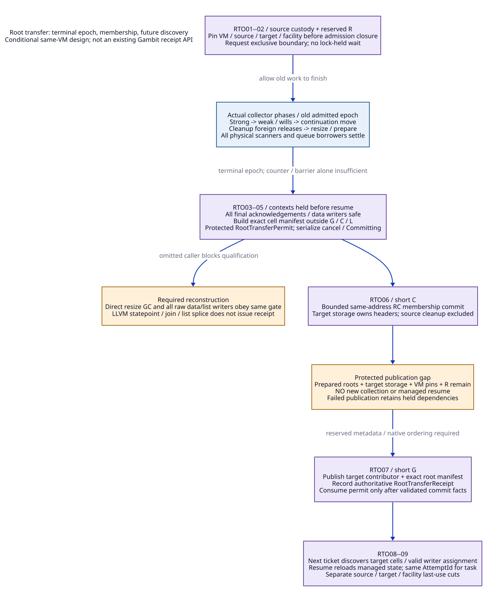

# Root Transfer Receipts and Scan-Facility Retirement

Reviewed: 2026-10-20. Conditional architecture research only. No implementation,
native test, model/prover/solver/engine execution or positive economic bound.
Read the [source/paper ledger](root-transfer-receipt-evidence.md),
[modern C / Zig cost matrix](root-transfer-receipt-cost-matrix.md), and
[document trace map](root-transfer-receipt-traceability.json).
This refines [RC payload custody](rc-payload-custody-design.md), RCO03--09,
RCT03/06/07 and PA02--PA08 of [SharedRuntimeContract](shared-runtime-proof-argument.md).

## 1. Correcting the Preparation / Receipt Boundary

The previous sketch used RootTransferReceipt during precommit readiness. That
conflated permission to attempt a transfer with evidence that it happened.
The refined design uses a protected **RootTransferPermit** before membership
mutation and issues **RootTransferReceipt** only after both RC membership and
future root discovery are committed. Neither record is an existing Gambit API,
a Boolean proof flag, or a certificate created by this documentation study.

The selected protocol transfers stable RC data cells between contributors of
**the same live VM/heap** at an exclusive collector boundary. It does not
relocate managed objects into another VM, copy C closure code, rewrite an active
RC traversal or stop unrelated VMs. More concurrent root transfer would need a
separate spanning-descriptor/collector proof; it is not established here.
The full native-layer reconstruction remains the scope, not a minimal patch.

| ID | Real caller / phase | Why a receipt cannot be inferred |
| --- | --- | --- |
| RTU01 | Kernel allocation/explicit GC saves RA/register state, calls garbage_collect, then reloads [RF-S01]. | A parsable call site and correct reload are part of safety; interrupts disabled does not imply no synchronous GC. The frame-map/hidden-alias proof remains PA03. |
| RTU02 | alloc_scmobj_still can trigger GC; VM resize directly calls garbage_collect_pstate; sync dispatch also calls it [RF-S02/S03]. | Guarding only the exported garbage_collect entry misses actual collection paths. All entrants must obey the new admission boundary. |
| RTU03 | mark_rc saves next and passes &h->data to mark_array; mark_array rewrites relocated cells [RF-S04]. | Read-only list membership protection is insufficient; cached next, current header and relocation writers need a valid lifetime and drain law. |
| RTU04 | Strong -> weak/wills -> continuation move -> cleanup -> resize/prepare with barriers [RF-S05/S06]. | Strong-scan worker count zero is not terminal collection, borrower drain or permission to rewire roots. free_unmarked_still_objs can invoke foreign release during cleanup. |
| RTU05 | Candidate moves mark_rc out of processor-0 branch, rechecks scan queues, joins donor and splices still/RC lists [RF-S07/S08]. | Useful modern C support, but join/list splice alone does not prove target root registration, hidden host quiescence or all VM/collector users. No candidate native qualification is adopted. |
| RTU06 | C closure sets RC data=proc; callback marker may allocate before using data/proc [RF-S09]. | Stable native header does not make copied Scheme values stable. Existing root/TLS/marker concerns remain admission blockers. |
| RTU07 | VM cleanup destroys allocation and scan synchronization, then pstate memory/heap; global cleanup also closes interrupts and registry paths [RF-S10/S11]. | Root transfer must resolve before dependent facilities disappear. A root receipt is neither a heap-release receipt nor blanket shutdown authority. |

A proved native-only closure with no managed references or permitted future
managed-data writes can report root transfer NotRequired and use the separate
storage-custody protocol. It does not receive a fictitious root receipt. This
still requires actual scanner/list/cleanup borrower exclusion: even an immediate
RC data value does not make mark_rc's cached header/next pointers disappear.
No blanket promise of a pause-free native-only migration follows.

## 2. Exact Issuance Conditions

[D2 source](root-transfer-safepoint-order.d2).

| ID | Required condition for this protocol | Evidence / limit |
| --- | --- | --- |
| RTP01 | Trusted shared-runtime coordinator owns the handoff and validates source/target/VM identities, reuse identities and current authoritative records. | C or Zig may implement that coordinator. An unaudited caller/planner cannot fabricate custody by constructing a struct [RF-P01]. |
| RTP02 | Complete participating contexts, root domains and workers are enrolled; every relevant mutator/root writer/foreign borrower is safe or represented by a stable admitted carrier. | M/K/W freeze does not freeze final locations; materialize final descriptors after acknowledgement. Unknown raw writers block the cut; delayed release tasks which may access these cells remain real writers/users [RF-S01--S04]. |
| RTP03 | Previous moving collection is terminal through every required phase and physical scanner/queue/waiter borrower, not just a counter or barrier observation. | Includes weak/wills, continuation movement, cleanup, heap adjustments and published writes. Worker/phase correctness remains PA04/PA07 [RF-S05--S08]. |
| RTP04 | An exclusive VM boundary is held: no new collection, mutator resume, root data mutation, contributor replacement, competing transfer or affected cleanup can pass until resolution. | This is a protocol reservation, not holding G/C/L/registry locks throughout the operation. Every direct/resize/GC-origin entrant must be reconstructed [RF-S02/S03]. |
| RTP05 | Exact stable cell manifest, root kinds and lifetime dependencies are prepared; for each RC header the location is its actual data cell, not its current object value. | Canonicalize physical cells and relocation writer ownership. Distinct cells with equal values both need updates. Strong/weak roles cannot be silently interchanged [RF-S04, RF-P02]. |
| RTP06 | Source/target lists and deallocator/storage stay pinned; nested/raw/callback/code users obey the custody cohort; target root adapter and future collector route are valid for the same heap. | Native storage adoption does not transfer the managed heap. Unsafe C closure/provider profiles remain excluded [RF-S08/S09]. |
| RTP07 | Capacity and identity for permit, bounded list mutation, manifest publication, authoritative receipt and response resolution are reserved before commit. | No allocation/callback/safepoint inside the short commit gates. An interrupted reply resolves the same transaction; a receipt copy does not create another authority. |
| RTP08 | Facility lifetime is enrolled before admission can close. All failure states retain actual source or target storage/root/VM responsibility and outstanding work. | Destruction must wait for issued transfers and real users, including collectors which need the facility to finish [RF-S10/S11]. |

### Permit and receipt fields

**RootTransferPermit** identifies TransferId, source/target/VM generations, source
membership revision, the exclusive boundary ticket, terminal collection epoch,
prepared exact manifest, bounded mutation plan, dependency pins, reserved work R
and its one-shot resolution state. It records Prepared/Held/Committing status;
it does not claim the target is already authoritative. Timeout/cancellation does
not silently release this boundary while a commit might be in progress.

**RootTransferReceipt** binds TransferId and committed handoff record to VM/heap
identity, allocation/location manifest identity and root-kind profile, old and
new contributor/list revisions, terminal epoch, boundary ticket, membership
commit identity, target root-publication identity and dependency-custodian
references. Runtime validates it against that authoritative committed record and
required live leases. It is a historical commit fact with scoped current-use
validation, not a permanent authorization to free, reuse or reenter the VM.
No cryptographic signing or new distributed journal is required by this local
service design; “issuer” means the trusted runtime authority performing the cut.

| ID | Authority / actual responsibility | Receipt use boundary |
| --- | --- | --- |
| RTA01 | Scheme/compiler semantic completion and backend descriptors specify physical root interpretation and effect/return obligations. | Descriptor existence does not prove PA03 completeness or native execution. LLVM maps are another admitted source, not an automatic runtime receipt. |
| RTA02 | Context/host owners establish final safe acknowledgements and discharge raw aliases; collector authority reports epoch/phase and scanner/queue disposition. | Neither a donor join nor an idle worker can attest for unobserved native callers or other phases. |
| RTA03 | Source/target custody adapters attest pinned identity, eligible storage, nested users and no competing force-free path. | Source release ownership remains until membership commit; target cannot claim root discovery merely by owning bytes. |
| RTA04 | Shared-runtime coordinator orders boundary acquisition and final publication, consumes permit and records committed receipt. | Implementation language confers no additional issuing authority; C-full and Z-full need the same evidence. |
| RTA05 | Executor, source cleanup and facility teardown consume only the relevant committed record plus live dependency/user facts. | Root receipt enables admitted transfer consumers; each free/drain/VM/facility action requires its own current cut. |

## 3. Chosen Order: Between Terminal Epochs, Before Resume

The collector barrier functions and current lifecycle do not already implement
this transaction. The following are required reconstruction operations.

| ID | Operation / order | Protected state and permitted observers |
| --- | --- | --- |
| RTO01 | Reserve handoff and work; enroll VM/facility dependency before requesting a cut. | Source owns storage and roots. Preparation can fail without removing the source contributor. Ordinary collecting operations during preparation retain/reload roots normally. |
| RTO02 | Request the exclusive boundary; enroll final contributors and stop future bypass entry. | If an older collection is active, let it finish with its required facilities and derived work live. Existing actors reach their real safe states; no lock-held wait. |
| RTO03 | Establish terminal-epoch and all affected writer/borrower drain; hold contexts before managed resume. | No old mark_rc cursor, relocation writer, continuation move, cleanup action or resize collector can run across the handoff. No barrier ordinal/counter alone substitutes for this condition. |
| RTO04 | Build/validate exact target manifest and bounded membership plan outside G/C/L while the exclusive boundary remains held. | Data cells remain stable and source-pinned. No cached pre-GC Scheme value is published as a root replacement. Slow/capacity-failing construction keeps source custody. |
| RTO05 | Issue protected permit under G after validating the same boundary, revisions and pins. | Permit authorizes only the stated handoff; claim Committing under G before C, serialized against cancellation. Future collector admission and resume remain fenced. |
| RTO06 | Under short C, validate permit/control state; perform prepared membership update and record target storage commit. | All legacy list/ref/data writers and cleanup are excluded. Same addresses preserve actual root cells. Gates G and C need not be nested; the boundary reservation spans them. No external observer is admitted to a partially mutated list. |
| RTO07 | After C unlock, finalize target root contributor/manifest and authoritative receipt under G; consume permit. | Before this publication, the pinned handoff owns prepared root metadata and the VM stays held. Next collector ticket cannot start until future discovery includes the new contributor. Publication uses reserved metadata, not a new allocation. |
| RTO08 | Release boundary; admit next collector/resume through normal SharedRuntimeContract; publish task using same R/AttemptId. | Resume reloads any relocated state. The receipt consumer revalidates current identity/leases; response loss, queue failure or observer cancellation does not restore source ownership. |
| RTO09 | Source residual cleanup and eventual target/user disposal follow their independent cuts. | Source RC list excludes adopted allocations; target keeps root/VM custody until actual last use. Old facilities are withdrawn only under the separate retirement protocol below. |

Manifest construction uses reserved, noncollecting native metadata support. If
it needs a collecting Scheme allocation or an unavailable capacity increase,
abort safely with source custody before membership mutation and retry through
normal runtime admission. It cannot invoke a new GC while the same VM boundary
forbids collection. Native-only payload status does not excuse hidden allocator
callbacks or unmanaged root writers.

Cancellation versus the commit claim is ordered under G. A Held permit can be
aborted before the coordinator claims Committing. Once Committing wins, another
actor can request cancellation but cannot reclaim source storage or drop the
boundary; it waits for a validated NotWritten or MembershipCommitted disposition.
The coordinator does not read a concurrently mutated C record through an
unsynchronized G-side flag: a completion adapter or an exclusive resolution
operation publishes the stable C disposition before G consumes it. That native
publication ordering is part of PA02, still unresolved here.

The logical transfer becomes publicly committed at RTO07. Physical list writes
occur at RTO06 under observer exclusion. Between them, **target storage custody
has committed but target scan discovery is not yet published**. The coordinator
must retain the exclusive boundary, prepared root descriptor, VM/storage pins
and work token. There is no admitted collection or managed access in that gap.
This is a concrete exclusion-based argument; it is not concurrent scanning through
an unregistered root, nor a claim that a prepared descriptor is already visible
to the collector. A native failure which prevents completion cannot lift the
boundary or issue a success receipt.

The protocol keeps the target root adapter installed before the next Request/
SealRoots. It does not rewrite a sealed K/R ticket. If any earlier scanner is
still live, defer this transfer or fail with source custody; do not append a new
root “after the scan” and assume the current collection saw it. Within a valid
future ticket, canonical cell assignment enforces the selected relocation writer
law; duplicate object forwarding CAS is not a general same-root-cell write law.

## 4. Failure and Custody Responsibilities

[D2 source](root-transfer-receipt-custody.d2).

| ID | Failure/race boundary | Required storage, root and execution custody |
| --- | --- | --- |
| RTF01 | Before permit: descriptor allocation, pin acquisition, incomplete acknowledgement, active epoch or unsupported alias. | Source retains headers/data-root discovery and managed lifetime. Cancel preparation only after its own readers/work settle. No RootTransferReceipt. |
| RTF02 | Permit held, before any membership write; competing cancel/close request. | Coordinator serializes cancel versus Committing. Confirmed precommit abort leaves source ownership, releases only private target reservations, and removes the boundary through G. No guessed rollback on timeout. |
| RTF03 | Membership committed, before root publication/receipt delivery. | Target owns storage; HandoffRecord owns prepared roots/VM/facility pins and R. Keep VM held. Resolver completes validated publication, or quarantines the actual dependencies; never call source destructor or resume/collect with target absent. No general recovery after process death is promised. |
| RTF04 | Partial or unknown membership mutation / collector failure. | No success receipt and no source/target free. Hold the affected VM/storage/metadata in an explicit unresolved quarantine. A no-fail native commit refinement must exclude ordinary partial completion; arbitrary native faults are not automatically recoverable. |
| RTF05 | Receipt committed, reply lost, task notification/publication fails or observer detaches. | Resolve the same TransferId/AttemptId; target contributor remains authoritative and existing R/accepted work is retained. Private lexical rollback cannot reclaim it. |
| RTF06 | Facility ClosingTransfers races with issuance. | G orders the race: enrolled permit drains under its valid lease, or new independent request is rejected with source custody. Issuance cannot validate a ready bit then borrow an already destroyed mutex. |
| RTF07 | Callback/marker/raw reader cannot reach the claimed safe state, or donor join fails. | Do not sign for that user. Preserve its source/managed dependencies or a valid preexisting carrier. Native header retention alone does not make hidden aliases safe; an unknown managed accessor cannot be granted collection/resume by SourceRetained status. |
| RTF08 | Target root consumer survives old facility withdrawal but no collector replacement/live heap is established. | RootTransferReceipt does not grant teardown. Keep old service/heap live or resolve the rooted use first. Retained data=#f is native-only only under a closed-writer/effect profile. |

The source GC return value reports overflow, and the kernel can raise/retry
heap overflow after collection [RF-S01/S05]. It is not a root-transfer receipt.
A completed collection followed by capacity rejection leaves source roots in
their current relocated state; aborting preparation must not restore cached
pre-GC values. An unknown partial-relocation failure is a different case and
cannot grant normal resume merely because storage remains allocated.

A response can therefore report SourceRetained, TargetCommitted, or
UnresolvedHeld with explicit responsible custodian and live dependencies. The
names describe protocol outcomes, not implementations or qualified native error
APIs. Root custody cannot be transferred by merely serializing one of these words.

## 5. Retirement of Scan Synchronization

[D2 source](scan-facility-retirement.d2).

A live VM/heap lease and a particular scan-facility/epoch lease are distinct.
A receipt keeps root storage and its owning heap alive. It need not pin an old
worker mutex forever if a qualified successor serves future epochs. Actual
in-flight scans/waiters/transfer permits still pin that old facility until drain.
All future resolution must use the admitted route, not a stale mutex address.

| ID | Lifecycle stage | Guard / allowed operations |
| --- | --- | --- |
| RFS01 | Serving | Normal epoch and transfer admission validates facility identity and pins before use. Independent replacement/teardown cannot bypass G. |
| RFS02 | ClosingTransfers | Reject new independent root-transfer permits; finish already enrolled handoffs/issued permits, including counted preparation. **Continue required GC/managed servicing for existing live users.** This stage alone does not forbid collections they still need. |
| RFS03 | Establish future disposition | Either a successor facility/driver/root-discovery route for the same live heap is admitted, or all heap-dependent/future-issue users are actually resolved for VM shutdown. A moved RC header is not migration of the heap into another VM. |
| RFS04 | Seal old collector entry | Prevent new independent tickets/bare queue-user entry to the old facility once RFS03 is true and transfer reservations are settled. Existing admitted epochs must still publish derived scan work and finish every phase; do not close their queue publication early. |
| RFS05 | Drain physical users | Require terminal old epochs, settled partial/failure state, no old scanners/cached cursors/queue publishers or borrowers, no condvar waiters/signallers, no pending transfer/resolve user or stale direct facility user. Queue-empty or workers_count=0 alone is insufficient. |
| RFS06 | Retired | Withdraw resolution and destroy old scan condvar/mutex/queue locks outside G after validated physical drain. Destroy allocation locks/heap storage only after their separate actual-user/VM cuts. Failed drain leaves live retained facilities, not a successful destroy receipt. |

For VM shutdown without a successor, RFS03 must include parked root carriers,
callbacks, future reentry permits, still-object producers and all heap consumers
which could legitimately need another GC. Closing all collector requests first
and then waiting for those users to finish creates a circular wait if they need
GC to finish. The selected protocol closes transfers first, settles managed users
with required service still available, then seals collector entry and drains it.
For replacement, old epochs finish and new tickets resolve to the successor only
through an admitted nonoverlapping publication cut. This study does not qualify
such a successor or invent an independently safe second collector for Gambit.

The actual cleanup_mem_vmstate call destroys misc/alloc locks and scan
condvar/mutex before residual pstate cleanup and heap release [RF-S10]. That
function must become a consumer of these proven preconditions or be split so
root transfer/drain precedes destructive portions. Merely moving one destroy
line below cleanup_rc does not reconstruct admission and all actual users.
The existing joined-donor helper and source processor-0 scan limitation remain
separate evidence; no join receipt implicitly satisfies RFS03--05.

## 6. Conditional Arguments

All conclusions below depend on RTP01--08 plus the referenced PA premises.
They are handwritten implications, not checked proofs that the premises hold.

**RTPR01 — exact safe cut.** With complete final acknowledgements and old epochs
terminal, RTP04 excludes every relevant writer/resume/new collector across the
held boundary. Stable manifests are built from actual cells after those states
are fixed. Consequently the root membership operation is not concurrent with
an admitted scan or mutator. It fails if any direct resize/foreign/cleanup path
bypasses admission. BARRIER alone is not the premise.

**RTPR02 — root discovery continuity.** Before membership commit source discovery
and pins are valid. During the physical-to-publication gap the handoff pins
actual cells and prevents any collection/resume. At RTO07 target discovery is
committed before admission reopens. Every permitted subsequent ticket therefore
discovers the target cells under its canonical writer law. This proves neither
upstream map completeness nor a concurrently scanned handoff; those remain PA03/04.

**RTPR03 — honest postcommit receipt.** The runtime authority issues a receipt
only after matching permit, membership commit and target publication records
are validated for the same generations and boundary. A caller's copied fields
cannot change that authoritative state. Cancellation ordered before Committing
leaves source; after commit it cannot recreate source authority. This is an
abstract linearization specification; native ordering and all-exit refinement
remain PA02/06/07.

**RTPR04 — failures preserve a real custodian.** Cases RTF01--08 partition the
known precommit/committed/unknown frontiers. Each retains source or target/
handoff storage, roots, work and execution dependencies; none grants unsafe
free or resume. Thus a known failure need not create a custody gap. This does
not guarantee recovery from arbitrary corruption, worker death or partial
collector failure; unresolved quarantine can prevent VM progress indefinitely.

**RTPR05 — old facility lifetime.** RFS01--04 closes new old-facility issuance
only after a valid future route or no-future-use condition. RFS05 enumerates and
drains all previously issued physical users before RFS06 destroys storage.
Under the complete-user and synchronization premises, no admitted later access
can target the destroyed facility. A root receipt alone lacks those premises.

**RTPR06 — avoid GC-dependent shutdown circularity.** ClosingTransfers still
serves users which require GC; collector seal occurs only after their resolution
or a valid successor route. No wait holds G/C/L/registry locks required by the
finishing actor, and same-lane work yields under the previous wait discipline.
The specific “disable GC -> wait for user which needs GC” cycle is excluded.
Finite work, cooperative raw hosts and external progress remain independent.

**RTPR07 — backend independence.** If a C, Zig or LLVM-assisted backend obeys
the same root-location/effect/resume and native authority laws, receipt semantics
depend on those laws rather than the implementation language. LLVM can supply
admitted map/relocation artifacts but does not perform runtime registration or
facility retirement [RF-P02/P03]. No performance or economic theorem follows.

## 7. Logical Counterexamples

These are hand-authored countermodels, not native failures or executed witnesses.

| ID | Weaker rule / interleaving | Failure |
| --- | --- | --- |
| RTX01 | Ack says “at safepoint”; another raw host still writes data. | No complete cut; the descriptor is stale or races relocation. |
| RTX02 | workers_count for strong phase reaches zero; transfer rewires RC list before weak/continuation/cleanup finishes. | Phase-local idleness is not terminal collector/writer drain. |
| RTX03 | Intercept exported garbage_collect only; resize calls garbage_collect_pstate directly during transfer. | An actual entry bypasses the exclusive boundary. |
| RTX04 | mark_rc has cached next/header; unlink/free after another barrier observation. | Cached native borrow outlives list membership; iterator is dangling. |
| RTX05 | Receipt issued before list update; source cleanup frees header; consumer trusts target ownership. | Preparation was falsely presented as a committed transfer. |
| RTX06 | List update commits; root publication fails; coordinator releases boundary anyway. | Next GC cannot discover the moved data cells. |
| RTX07 | Target added to an already sealed contributor ticket after its root scan. | Registry visibility does not retroactively scan the new root. |
| RTX08 | Canonicalization merges two cells holding equal objects, or duplicates writers for the same cell. | Missing relocation copy or an unproved same-cell race. |
| RTX09 | Descriptor copies proc before a collecting allocation; callback uses copied value afterward. | Native descriptor/header survival does not reload stale managed aliases. |
| RTX10 | Reply lost after receipt commit; caller retries new transfer or runs precommit errdefer. | Duplicate authority or target storage reclaimed while authoritative. |
| RTX11 | Issuer checks ready, teardown destroys scan mutex, issuer then acquires it. | Admission must pin identity/lifetime under closure authority, not sample a flag. |
| RTX12 | ClosingTransfers also disables GC; teardown waits for callback that must allocate/collect to exit. | Circular shutdown dependency. Preserve servicing until actual user cut. |
| RTX13 | Root receipt is used to free old VM/heap while a callback holds data into that heap. | RC contributor transfer is not heap ownership transfer. |
| RTX14 | Queue empty and count zero; a late signaller/borrower still uses scan condvar or queue lock. | Physical user drain missing. |
| RTX15 | Same-address donor splice and successful join are treated as complete root receipt. | Target scan adapter, other users and pending epochs are unproved. |
| RTX16 | Quarantined transaction drops pins because a timeout expires. | Failure label no longer preserves actual roots/storage; timeout is not disposition. |

## 8. Replacement / Qualification Frontier

The required reconstruction is one shared runtime admission/epoch/custody
protocol with backend root adapters, not another unconnected permit wrapper.
Replace precommit “receipt” wording; route all GC/resize/foreign-root mutation
entry paths through the held-boundary law; supply target root discovery; make
cleanup consume actual retirement facts; and preserve old qualified primitives
where their contracts suffice. Zero old paths are retired by this document.

Unresolved: complete physical descriptor and raw-caller census; native gate/order
refinement; real terminal collector/queue and partial-failure law; target
contributor/worker route; callback marker/all-exit proof; shutdown future-use
closure; support cost bounds. All full runtime/provider/retirement/total/increment
requirements remain open. The [cost matrix](root-transfer-receipt-cost-matrix.md)
separates common modernization value from a still-unproved Zig-only increment.

## Target Adapter and Entrant Refinement

The [target-root adapter study](target-root-adapter-design.md) refines RTO06--08
and RFS02--05 with an explicit same-heap carrier, strong-cell seed adapter,
GC/resize body scopes and a one-writer completion-to-G publication edge.
Its [source census](target-root-caller-inventory.json) additionally identifies
_system/_num allocation and ABI import routes; the selected references above
were not an exhaustive caller closure. ClosingTransfers permits previously
enrolled commit publication and preserves required GC until final entry seal.
These are further conditional contracts, not qualified implementation evidence.
