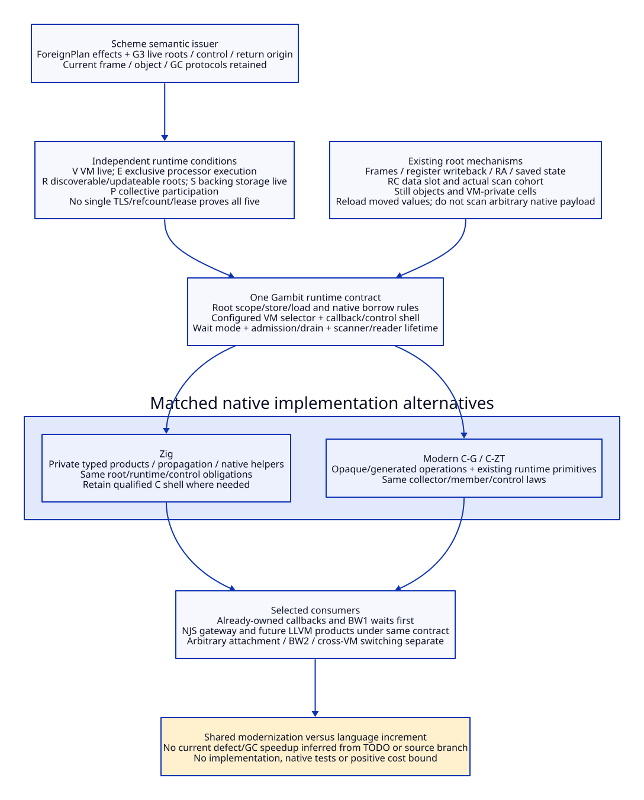

# Gambit Core: Roots, Blocking Participation and VM Ownership

Reviewed: 2026-10-20. Architecture/source research only. No implementation,
native/compiler test, performance experiment or ASCENT/model run. Continues
MG03-MG07 in the [modernization matrix](njs-support-cost-modernization-matrix.md).
[Evidence](runtime-root-participation-evidence.md) binds the source premises;
[benefit/cost and migration matrices](runtime-modernization-cost-matrix.md)
separate common reconstruction from the Zig increment.

## 1. Core Design Decision

Design a **shared Gambit runtime boundary**, usable from generated C, a future
Zig native subsystem and admitted LLVM products. Scheme owns language semantics,
root/control obligations and logical foreign effects. The runtime owns managed
representation, collector discovery/update, processor execution, collective
participation and VM lifetime. Native adapters express those duties; neither
their language nor their allocator grants them runtime authority.

The substantive modernization is to replace implicit, duplicated decisions at
generated-C/FFI/host-entry seams with one explicit effect/ownership contract.
It does not require replacing the collector now. Current Gambit already has
moving/still storage, registered RC carriers, root writeback/reload, synchronous
operations and configured parallel scanning [RG01-RG09]. Those are assets to
retain and refine. Their presence does not qualify every host/VM/FFI combination.

Keep baseline vendor source, cumulative repair candidates and historical native
receipts separate. In particular, prior host-root/retirement models and scoped
GC/FFI successes do not establish this new boundary or a currently supported
arbitrary host attachment API [RG12].

## 2. Five Independent Conditions, Not One Runtime Lease

| Condition | Required meaning | Does not imply |
| --- | --- | --- |
| V: VM lifetime | Selected runtime/VM incarnation remains live and accepts this operation | Correct processor selection, arbitrary thread attachment or permission after terminal close |
| E: execution ownership | This host has exclusive execution authority over the selected mutable processor state and a valid return binding | Collector-visible roots or arbitrary concurrent execution on that processor |
| R: root discovery/update | Every live managed value is in a collector-discovered, updateable slot under the admitted scan protocol | Slot backing lifetime, exclusive mutation or GC progress during a wait |
| S: storage lifetime | Root slots, frames, descriptors, markers and native backing storage outlive every admitted use/scan/return | Values remain at their old addresses or can be accessed while execution is suspended |
| P: participation | The host/processor follows the selected collective request/wakeup/acknowledgement protocol | E, R or V; a live count or TLS pointer is not a membership proof |

The first cohort is **already-owned supported entry**, including nested callbacks
whose original processor/control owner remains valid. Do not demand a new foreign
attachment system merely to preserve such callers. Unregistered foreign threads,
same-processor competing hosts, cross-VM nested switching and restartable global
runtime generations are separately designed capabilities and initially unresolved.

Logical records may expose `RuntimeIdentity`, `VmIdentity`, `ExecutionBinding`,
`RootScope`, `ManagedRoot`, `NativeBorrow`, `WaitParticipation` and `ReturnOrigin`.
These are proposed meanings, not public struct layouts or existing callable APIs.
Incarnation/freshness must be represented or proved by the selected lifetime
discipline; no mandatory new generation-field ABI or unforgeable capability is
claimed. A `ManagedRoot` is an identity for an admitted mutable slot, not a copy
of a raw `___SCMOBJ` disguised as a handle.

## 3. Root Contract and Existing Reuse

| ID / root obligation | Existing mechanism to reuse | Required reconstruction / boundary |
| --- | --- | --- |
| RT01 generated frame/register roots | Frame maps, return-address slot, `W_ALL/R_ALL`, register/saved scanning | Scheme G3/FrameSpec declares all live values and physical adapters agree with scanner; keep stack-break and capture branches |
| RT02 native retained managed value | RC header data slot is explicitly marked; registered storage exists | Bind storage owner, registration list and actual scanning cohort; arbitrary RC payload bytes are not automatically Scheme roots |
| RT03 still/permanent objects | Stable-address classes and still reference-count operations | Preserve children/root reachability and owner lifetime; stable address is not an exclusive-access, cross-VM or immortal-lifetime proof |
| RT04 external stack/heap slot | Existing supported frames/carriers where their extent is established | New escaped root slots need publication, scanner enumeration, last-reader removal and valid backing storage; registry design remains a separate gate |
| RT05 callback target/marker | SFUN marker allocation, return-to-C frame and marker invalidation | Establish target rooting/effects before marker allocation; source TODO records a missing argument, not a reproduced bug |
| RT06 VM value selection | Multiple-VM global cells select `vm->glos[...]`; primitive/shared metadata is distinct | Same VM selection for access, registration and collector observation; no arbitrary movable-value sharing through process-global metadata |
| RT07 relocation and release | `mark_array` updates cells; foreign release can clear fields before callback/error | Reload after any admitted relocating effect; do not use stale aliases or infer rollback from a release error |

**RC applicability is a real open boundary.** `rc_head` is processor-associated
in the inspected source; registration links into that list, while the reviewed
strong-root phase calls `mark_rc` in its processor-zero branch. Root strategy
selection must account for actual callers, configured cohort and any transfer
or alternate scan path. These bounded reads do not prove an all-processor RC
root API or a current collector defect. Do not qualify nonzero-processor RC
retention by assuming malloc/refcount makes it visible. RM00/RM02 require this
closure before selecting an RC-backed implementation [RG03/RG04].

The proposed operation meanings are: create scope on a valid owner; initialize
collector-valid slots before publication; register through the selected adapter;
load/store only under the allowed mutator/collector protocol; close admission;
withdraw registration only after all accepted scans/returns stop using it; then
release storage. Collector update and mutator mutation must agree on slot identity.
If a future generational collector needs a root-update barrier, the adapter owns
that law; copying OCaml's function names does not install it in Gambit.

Holding a root keeps an object discoverable, not all native aliases current.
At a `may-relocate` boundary, discard cached object/interior addresses and reload
from an admitted root after reacquisition. A movement epoch may be a reasoning
device; this design does not invent an implemented global epoch counter. Still
storage may stabilize one object without stabilizing its movable descendants.
Native-only bytes/LLVM handles contain no Scheme value unless explicitly declared
and rooted; they remain ordinary native ownership duties.

## 4. Blocking Participation: Preserve Before Extending

ForeignPlan effects must distinguish allocation/relocation, blocking, callback,
nonlocal control, retention and origin/VM switching. These effects can coexist.
A no-allocation function may still block or call back. A C signature or Zig error
union does not establish the transitive effect set.

| Mode | Selected contract | Required work / support status |
| --- | --- | --- |
| BW0 bounded native leaf | No runtime allocation/relocation, callback, escape or retained managed borrow; declared bounded work | Validate complete converter/helper closure; absence of a GC call in the leaf body alone is insufficient |
| BW1 existing runtime-participating wait | Retain current participant/return owner, publish roots/cached state as required, use admitted abort/wakeup and subsequent service/reload path | Preserve `FRAME_STORE_RA -> W_ALL -> wait -> R_ALL -> FRAME_FETCH_RA`; source call-chain/OS/profile progress still needs closure |
| BW2 detached native phase, future capability | Native copies only while managed access is suspended; roots remain discoverable in independently live storage; membership transition serialized with requests | New collector/member/root-carrier protocol and reentry design required; not achieved by decrementing processor count or releasing a mutex |
| BW3 external service job | NJS worker owns native computation/bytes; Scheme gateway waits through BW1 or another admitted runtime path | Worker isolation does not waive parent GC/control/root/VM lifetime or make worker result delivery legal after VM close |

The current interrupt path requests a stack trip and aborts device select;
the collective service loop includes GC and resize operations [RG06]. This
supports investigating BW1. It does **not** prove that arbitrary native mutexes
or compiler work service GC. `os_condvar_select` builds C arrays and unlocks the
device queue around select; the inspected body has no direct collective-GC call.
Do not infer a current relocated-C-array failure or execute Scheme/GC inside an
arbitrary lock wait on that assumption [RG05/RG06].

For BW2, the proposed state order is:

```text
OwnedActive -> Preparing -> RootsPublished -> TransitionAcknowledged
            -> NativeOnly -> ReentryPending -> OwnedActive -> Completed
```

This is a design target, not a path implemented by current Gambit:

1. Establish V/E/R/S and return origin; copy native inputs and materialize roots
   while legal runtime access still exists. Failure leaves the original owner
   and membership coherent; no partial detached success is reported.
2. Serialize transition against participant snapshots and pending operations.
   Complete/acknowledge requests that already enlisted this processor. A mere
   OS sleep/TLS store/root registration is not that acknowledgement.
3. Keep all detached roots discoverable even if active-participant enumeration
   no longer includes the processor. This requires a new root-carrier enumeration
   path or another independently admitted mechanism. Never lose roots by simply
   omitting a processor from GC. Keep frames/markers needed for return alive.
4. Reserve the original processor/return origin in this first design. NativeOnly
   cannot access Scheme data/call back; it does not grant another host authority
   to mutate the suspended processor. Allowing same-processor host reuse would
   require additional saved-context/control machinery, not inherited OCaml rules.
5. On return, reacquire coherent VM/processor/member authority before accessing
   managed slots. Service pending obligations at a legal safepoint, reload root
   values/RA/cached state, then perform allocating result conversion.
6. Preserve native cleanup across failure to reacquire or asynchronous Scheme
   exception. If terminal close has begun, use an explicit failed-reentry/result
   custody path; never continue with a cached VM pointer or retry blindly.

BW2 is justified only if demanded long native work cannot meet BW1 progress or
BW3 offload requirements economically. It adds real runtime complexity. A
blocking backend implemented in Zig does not make the transition valid.

## 5. Entry, Callback and VM Lifetime

| ID / edge | Required contract | Current limit |
| --- | --- | --- |
| VE01 already-owned Scheme to native to Scheme | Preserve processor, roots, effects and original control destination | Initial target; generic converter/callback closure remains open |
| VE02 nested callback on same owner | Root target before fallible setup, preserve marker stack and restore previous binding on exit/unwind | Existing `___call`/marker machinery retained; nesting is not a second independent execution owner |
| VE03 external thread entry | Runtime-known thread plus legal exclusive execution and supported VM association | General attach/detach not established by TLS; separate capability |
| VE04 two hosts one processor | Serialize/reject competing execution under explicit ownership | Two root registrations or lifetime leases are insufficient |
| VE05 parallel processors one VM | Distinct E owners plus shared collector/member and VM-memory protocols | Not inferred from Scheme SMP scheduler or a source branch alone |
| VE06 parallel independent VMs | Correct VM-specific entry, conversions, cells, roots, metadata and teardown | Separate from VE05 and separate runtime images; implicit PSTATE branch can select VM0 |
| VE07 nested cross-VM callback | Preserve both identities, legal switching and restoration of original return target | Future design; not enabled by storing a different TLS pointer |
| VE08 VM drain/retirement | Close new entry, settle active/returning/detached owners and admitted scans, handle pending collective work, then reclaim | Collector completion, join or refcount alone is not complete lifetime proof |

`___GET_REAL_PSTATE`, PSTATE binding and `___PSD` depend on the configured header.
In the single-threaded-VM branch the getter selects VM0/P0 and setter is empty;
other branches use TLS. Do not infer an explicit-VM API from an unconfigured
prototype, or modernize only a bridge with incompatible header flags [RG07].
VM allocation/setup is not admission of arbitrary concurrent eval/load/entry.
The proposed facade carries selected profile identity and rejects unsupported
capabilities while preserving the portable/legacy path explicitly.

Retirement must exclude late root publishers and root-slot/descriptor readers,
not just mutator execution. Removing a participant also removes any protection
assumed from that membership; later shared cleanup needs its own exclusion.
Reusable carriers must not reference ended native activations. Existing host-root,
participant-exit and VM-cell studies supply separate conditional models; this
document does not claim their composed source refinement [RG12].

## 6. Control Containment and C-Layer Replacement

For the first native service envelope, choose native-owned inputs/results and
ordinary native returns, with Scheme raising errors only after runtime authority
and cleanup custody are coherent. Converter/marker allocation can itself change
effects and must be included. If current `setjmp`/nonlocal Scheme unwinding can
cross live Zig resources, `defer` is not the safety argument. Keep a qualified
C/runtime control shell or reconstruct the entire edge with explicit containment
before moving its body. C reimplementation pays the same control law.

Extract semantic root/effect obligations in Scheme before the common product
engine. Runtime-owned operations define root publication/update, wait transition,
owner validation and callback entry. Native C and Zig adapters consume this same
contract. Old marker/frame/register macros can remain an encoding adapter while
their policy decisions migrate. There must not be two independent GC/root or
VM-selector decision trees. A named opaque facade alone does not retire the old
decision path.

The [RM00-RM08 sequence](runtime-modernization-cost-matrix.md#4-migration-order-and-retirement)
starts with supported-owned BW1/VE01-VE02 and keeps BW2/VE03/VE07 as explicit
later capabilities. Changing collector algorithm, barriers, scheduler or general
foreign-thread attachment is not an incidental requirement of introducing Zig.
If those capabilities are selected, their GC/control/lifetime costs are paid
and qualified independently rather than hidden in an FFI wrapper.

## 7. Decision and Remaining Evidence

Required **architectural** reconstruction: explicit effect/root obligations,
scan/storage ownership, wait classification, configured VM selection and control/
retirement composition. Conditional implementation changes depend on selected
cohort and source closure; no new defect is asserted solely from a source TODO
or a bounded missing-call search. Already-correct writeback/reload is reused.

Zig may improve private typed protocol construction, local propagation and
native-buffer/service support. Modern C can use opaque handles, explicit enums,
generated operations, compiler atomics and the same runtime/provider machinery.
Neither language supplies V/E/R/S/P, Scheme GC or a memory model automatically.
Positive incremental cost bounds remain open; the useful shared runtime design
does not depend on choosing a language winner first.



[D2 source](gambit-runtime-authorities.d2).


[D2 source](gambit-blocking-participation.d2).

## 8. Same-Owner Refinement

The [owned callback / wait design](owned-callback-participating-wait-contract.md) follows the actual OC0-OC2 and OW0-OW2 families. Marker allocation is confirmed may-GC via still allocation; RC registration/scanning, invocation capture and binding remain cohort-specific. A no-switch same-owner plan avoids inventing VM attachment, while BW1 service requires a legal cut after cached native aliases/locks are safe. [Evidence](owned-callback-wait-evidence.md) and [paired matrix](owned-callback-wait-matrix.md) retain the unresolved profile/root/control/progress/cost gates; no implementation or current native defect is asserted.
