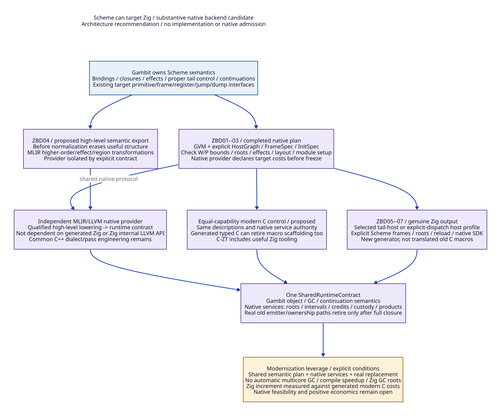

# Scheme to Zig as a Gambit Native Backend

Reviewed: 2026-10-20. Architecture research only: no implementation, native test,
compiler/model execution, checked proof or accepted economic bound. Read with the
[allocation and metadata design](allocation-check-bound-design.md),
[source/paper ledger](allocation-check-bound-evidence.md),
[modern C/Zig report matrix](allocation-check-bound-cost-matrix.md) and
[document trace map](allocation-check-bound-traceability.json).

**Position: compiling Scheme programs to Zig is a credible, worthwhile Gambit
backend design. Zig can carry a substantive modernization of native generation
and shared system services. Source translation alone does not establish a
modern runtime or positive economics.** This is a design recommendation supported
by compiler interfaces and possible control realizations, not native feasibility
qualification for every target or a claim that Zig is uniquely necessary.

## What Compiles, and What Retains Authority

| ID | Decision | Source/theory basis and limit |
| --- | --- | --- |
| ZBD01 | Keep Scheme as the source language and Gambit as the semantic compiler; generate Zig as a native implementation product. | _back supplies target primitive/frame/register/jump/dump interfaces; _front invokes target.dump on module procedures [AB-S01/S02]. A Zig target requires new lowering and native contracts; no such target is implemented in this source slice. |
| ZBD02 | Complete semantic control, roots, constructors and allocation checks before rendering Zig. | Current C target materializes floats, creates checks/resumes and chooses physical products late [AB-S03--05]. Reuse/extend the existing HostGraph/FrameSpec/InitSpec research, including target negotiation; dumping raw GVM is insufficient. PVM's bidirectional target abstraction supports this direction [AB-P01]. |
| ZBD03 | Scheme heap objects still use Gambit's admitted object/root/GC protocol, whether operations are emitted as Zig, C or native IR. | Zig's lack of an automatic GC is no obstacle to calling an explicit runtime allocator/collector. Zig stack locals, slices and native allocator memory are not automatic Scheme roots. Preserve root publication/reload and frame/continuation semantics [AB-S06/S09/S12, AB-P03/P04]. |
| ZBD04 | Treat Zig source emission, a Zig-hosted native product planner, and an MLIR/LLVM provider as different products/services. | A Zig-generated Scheme module can bypass generated C. A Zig system service can still emit C or invoke an isolated compiler provider. MLIR can receive high-level Scheme export and later lower to the shared runtime independently of Zig-source compilation [AB-S02/S14, AB-P05]. |
| ZBD05 | Use an explicit host/control profile; do not depend on incidental native recursion optimization. | Native TailHostProfile preserves required external tail exits and separately addressable Scheme continuation points. Zig always_tail can demand a tail call but rejects impossible cases; each actual edge/target/ABI needs qualification [AB-S13, AB-P02/P03]. |
| ZBD06 | A separate DispatchHostProfile is a constructive semantic alternative when its complete runtime/module/frame profile is selected. | Generated local switch/loop transfers and an external dispatcher can keep Scheme tail transfers from accumulating native frames. This is a profile change from the earlier D1-H nonreturning-tail-host design, not its automatic fallback. Module entry, label decoding, callbacks and frame maps migrate together. Dispatch cost/register traffic remain unmeasured. |
| ZBD07 | Keep arbitrary C snippets and nonlocal control in qualified native islands or redesign them explicitly. | Existing C target consumes c-intf declarations/procedures/inits/objects and has computed-goto, switch and trampoline/unwind routes [AB-S02/S13]. Zig C translation has unsupported-construct/demotion boundaries [AB-P02]. New native emission must author those obligations; translate-c is not a whole Gambit backend. |
| ZBD08 | The Gambit compiler itself can eventually be built through a qualified Zig target without rewriting its Scheme implementation in Zig. | This follows conditionally after the target supports the compiler's complete Scheme/native dependency domain and a bootstrap chain. Macro/phase evaluation still runs Scheme semantics; a new target alone does not remove interface-construction work or prove cold-start/compiler savings. |
| ZBD09 | Select Zig for demonstrated leverage from real replacement and shared support; retain the best equal-capability modern C control. | A unified descriptor/allocator/root/layout/product service can replace duplicate C emission and owner-specific support. Generated modern C can share many of those gains. Zig's local type/error/allocator benefits must exceed migration, tool/ABI/retained-island costs; full positive net benefit remains unproved. |

[D2 source](scheme-zig-native-paths.d2).

The proposed emitted representation keeps a Scheme word/object protocol rather
than mapping every Scheme value to an unconstrained Zig native value:

| Scheme/GVM responsibility | Proposed Zig realization / required contract |
| --- | --- |
| Dynamic values and primitive operations | Tagged Scheme words and admitted primitive/runtime operations; native unboxed values only while their boxing/root/effect contract is explicit. |
| Lambdas and captured variables | Admitted closure/environment objects with shared identity and capture/mutation semantics; native function pointers alone do not represent Scheme closures. |
| Tail application and Scheme return | Explicit argument/arity/SELF/PointId transfer under the chosen host profile, with no unbounded retained native recursion. |
| Non-tail call and continuation | Runtime Scheme frames/return-point metadata and existing control semantics; no assumption that a Zig activation is a capturable Scheme frame. |
| Allocation and GC | Generated check/body/completion operations plus actual interval/still services, complete roots and post-relocation reload. |
| FFI, exceptions and dynamic state | Explicit foreign-origin/effect/root/control edges; qualified C islands where needed, with no arbitrary nonlocal jump across Zig frames. |
| Module constants, labels and setup | Common product/module planner materializes runtime-owned data/code identities, maps and setup functions; rebuild the chosen cohort instead of assuming old label binaries work unchanged. |

This covers the intended responsibilities, not an exhaustive implemented
primitive catalogue. Rewriting Gambit's compiler from Scheme into Zig is a
separate project and is not required for generating Zig from Scheme programs.

## Two Explicit Control Realizations

In TailHostProfile, local control becomes Zig block/switch control and external
transfers are required tail edges through the chosen common host ABI. Scheme
non-tail calls create Scheme frames and saved PointIds/return metadata, not a
long-lived native activation. A collecting/helper/callback edge writes the
proper roots, enters the runtime, and reloads after a completed relocation epoch.
Generated operations cannot retain a raw movable pointer across that edge.
Unsupported tail edges reject this profile; they do not silently become ordinary
recursive calls. The previous [D1-H design](d1h-c-runtime-refactor.md) remains a
distinct, unqualified native-edge design.

In DispatchHostProfile, a host returns an explicit control disposition to an
outer dispatcher; local jumps stay inside a generated switch/loop. Each Scheme
tail transfer updates explicit VM execution state/PointId and returns through
bounded native frames before the next host is called. Non-tail Scheme calls
retain their Scheme frame/return point in runtime storage. Thus native stack
growth need not represent Scheme continuation depth. Exceptions, dynamic-wind,
multiple values, arity, exported native calls and continuation invocation still
require the full Gambit semantics. No C longjmp may cross live Zig frames or
skip required Zig cleanup; returning control dispositions must preserve the
source exceptional edge rather than allow foreign effects to continue.

This is a constructive architectural argument for possible Zig output, not an
implemented interpreter, proof of whole-language lowering or a performance
forecast. No existing C binary automatically understands a new PointId/module
encoding. An entire rebuilt cohort can adopt the selected common profile;
representation/frame/setup/scanner changes must be made together. The decision
does not require retaining every historical C ABI forever.

## Where the Leverage Comes From

The old C generator is more than text output: it currently hosts resource and
control decisions. Extract those decisions into Scheme semantic completion,
then render native products from a single checked plan. Replace repeated
preprocessor allocation/dispatch interfaces with explicit constructors, write
bounds, frame/root maps and one native service boundary. The same service can
serve code generation, still allocation, region/layout custody, callbacks and
compiler-provider artifacts. Reuse collector/control algorithms where sound;
replace their processor/native ownership assumptions where the new worker and
context architecture requires it.

For a fully converted cohort that does not invoke the old C emitter, the number
of generated-C translation units on that route becomes zero. Its former C
preprocessing work is removed from that route. Zig parsing, semantic analysis,
native optimization and retained C FFI/runtime units still cost work. Modern C
with generated typed functions can also remove many macro-expansion costs.
Consequently no total compile-time, startup or runtime speedup follows merely
from changing the generated file extension.

High-order function, effect and region optimization belongs before those
semantics are erased. Retain the proposed pre-normalization export and qualified
MLIR passes from the [high-level semantic study](zig-high-level-semantics-design.md).
A low-level Zig file is not a reliable place to reconstruct lexical identity,
closures or continuation effects. Zig can host the service boundary while the
MLIR provider owns dialect/pass implementation, including necessary C++ code.
Neither Zig nor its compiler's internal LLVM implementation is the stable public
MLIR service contract [AB-P05].

The recommendation is therefore affirmative at the architectural level: promote
Zig from build glue to a real native product/service candidate, with Scheme
meaning and runtime authority explicit. Economic selection remains conditional
on complete domain coverage, actual old-path retirement and a positive increment
against generated modern C/C-ZT. The present study authorizes no implementation
or native experiment and closes no full architecture requirement.

## Worked Source Case and Selection Boundary

The [real public reverse design](scheme-function-zig-design.md) now connects
this backend candidate to semantic completion, post-cons checks, roots and
module binding, with a selected DispatchHostProfile and separate tail-host
alternative. The [matrix](scheme-function-zig-cost-matrix.md) clarifies that
an affirmative research direction is not selection of Zig over equally modern
C. Gambit's contract/runtime/LLVM modernization continues if that incremental
comparison fails; no source or native result has been generated.

## Higher-Order Path and the Actual Baseline

The [map design](map-scheme-zig-design.md) and
[full-delivery cost matrix](map-scheme-zig-cost-matrix.md) connect real unknown
Scheme calls, closure identity, non-tail frames, multi-shot control and GC roots
to this backend direction. Modern C is a proposed alternative that must pay
its own complete reconstruction cost; Zig can be a direct carrier, not only
a layer added after C modernization. No positive net or native gate is accepted.
