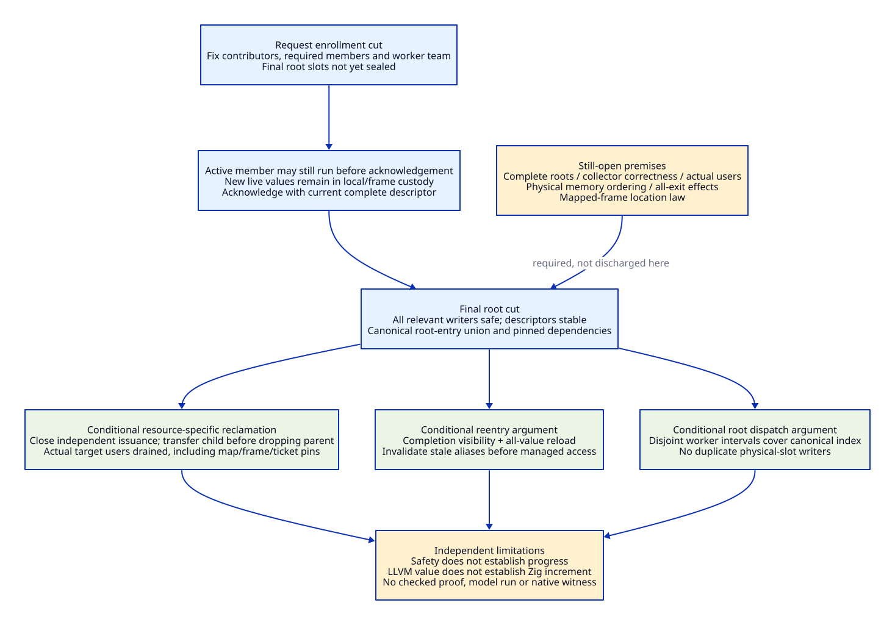

# Shared Runtime Contract: Conditional Proof Argument

Reviewed: 2026-10-20. This is a mathematical architecture argument on paper.
It contains conditional derivations and counterexamples. It is not a checked
Lean proof, a model-checking result, a SysML evaluation, an implemented runtime,
or a measured benefit. No parser, prover, solver, compiler or native test was run.
Read the [source and literature ledger](shared-runtime-proof-evidence.md),
[operation contract](shared-runtime-contract-design.md) and
[cost matrix](shared-runtime-value-matrix.md).

The [root/custody source refinement](shared-runtime-root-custody-design.md)
now traces the PA03 map path and PA05 actual users, including native foreign
release functions invoked by GC. It supplies bounded source-backed subcases and
eight GC-worker reconstruction duties; it does not discharge the full premises.

## 1. Correction Found While Attempting the Proof

The previous contract said RT09 fixed both participants and final root locations.
That is too early for a cooperative moving collector: an active context can
still allocate, move between frames or change live registers before acknowledging
the request. The vendor target explicitly materializes live values at a check,
and the collector scans those runtime locations [PF-S01/S02].

Separate **request admission** from **root-cut closure**:

1. RT09 fixes required contributors/managed acknowledgements and the worker team,
   pins the appropriate contributor/carrier lifetimes, and closes unrelated new
   entry. It does not assert the final set of physical root slots is known.
2. RT10 accepts each active context's exact-epoch safe-point descriptor, then
   freezes its managed mutation until release. Parked carriers already have a
   stable published descriptor. VM/global root domains are also contributors.
3. Only after every required contributor is safe may the RT10/RT11 boundary seal
   the union of actual locations and admit root scanning.

This is a correction of the proposed architecture, not a newly reproduced Gambit
bug. Historical design receipts are retained. The current contract/model/diagram
now express the corrected order.

## 2. Scope, Definitions and Independent Premises

One VM has at most one relocating collection epoch in progress. Other requests
can queue/merge only under an explicit operation/priority policy. Epoch symbols
are logical identities, not claims about machine integer wraparound.

| Symbol | Meaning |
| --- | --- |
| G | Abstract total order of committed metadata operations; physical linearization remains to prove |
| M(e) | Active managed contexts that must acknowledge collection e |
| K(e) | All root contributor domains: active contexts, parked/retained safe carriers, VM/global roots and selected collector-required domains |
| W(e) | Sealed collector worker identities, independent of M(e) |
| D(e,k) | Stable descriptor of contributor k, finalized at its safe acknowledgement or the final domain freeze |
| Slots(D) | Actual tagged/frame/native-map locations described by D, with the selected root-kind law |
| R(e) | Canonical union of collector-required physical locations from all D(e,k), sealed after acknowledgements |
| Users(r) | Outstanding issued uses/dependency edges of resource r, including ticket pins and transitively supported users |
| Close(r) | Admission decision preventing new independent uses of r; derived-use transfers must preserve an existing pin |

A descriptor identity, a root value and a location identity are different. Two
slots containing the same object require two relocation updates. Two descriptions
of one physical slot require canonicalization or another proved single-writer
law. Strong, weak and finalizer locations are not interchangeable.

| Premise | Independent obligation, not a proved result here | Where it must eventually be discharged |
| --- | --- | --- |
| PA01 initial validity | Entering values have a valid existing custodian; initial registry/identities are consistent | Bootstrap, real callers, module setup and source/profile correspondence |
| PA02 metadata refinement | Operations obey the specified G order, issuer validation and memory visibility | Actual C/Zig synchronization, stable admission directory and ABA/reuse handling |
| PA03 local root completeness | At each acknowledgement the descriptor covers every required live local/register/closure/continuation reference for the selected profile | Scheme completion, physical FR/SP maps, all safepoint/FFI/control edges |
| PA04 quiescence and collector | Acknowledged/parked contexts make no unmanaged managed-memory access; selected collector correctly traces/relocates and processes weak/finalizer phases | Native borrower census, collector algorithm and worker/queue refinement |
| PA05 honest custody | Every real user is represented in Users(r), with no hidden raw aliases or unregistered future issuers | Callback/native-return/image/map/continuation and host-library lifecycle contracts |
| PA06 effect boundary | Grant/reload has no hidden allocating callback or nonlocal exit before protection; later checkpoints end and reestablish borrows | Exact helper bodies, compiler effects, conversion and exception/control paths |
| PA07 terminal publication | Completion follows all successful updates; partial collection failure never grants managed access | Collector failure policy and publication/drain implementation |
| PA08 progress premises | Required hosts cooperate, workers remain live, work is finite and admission is sufficiently fair | Separate progress analysis and later scheduling/native evidence |

PA01-PA07 are premises for the safety deductions below. PA08 is needed only for
progress. They must not be discharged by setting similarly named model Booleans
to true. In particular PA03 is a substantial compiler/root-map proof, and PA05
is a substantial last-use proof; the following arguments do not assume those away
as already implemented. Herlihy/Wing supplies a way to relate histories to an
abstract specification, not an implementation proof for this gate [PF-P01].

## 3. Abstract Transition Rules

These are the transition relation used by the argument, not executable code.
Root-cut closure is an internal protocol event within RT10/RT11, not a new
backend or an arbitrary architecture generation label.

| Event | Guard | State change / retained obligation |
| --- | --- | --- |
| Enter(c) | VM open; no pending collection; issuer/owner valid | Add c to active contributor domain before any managed access |
| Park(c,d) | Owner has prepared d; no pending collection; no managed aliases/mutation or GC-worker borrower | In one G commit replace active c by a published VM carrier with d; no root/storage release |
| Request(e) | Previous moving epoch terminal; metadata reserved | Freeze M(e), K(e) and W(e); pin contributors; mark Requested; final R(e) still unsealed |
| Run(c) | c owns execution and has not acknowledged; ordinary safe-point/effect law | Change local live values/frames; retain active custody and supply the final safe descriptor at Ack |
| Ack(c,e,d) | c in M(e); correct epoch; safe state and complete d | Record d and stop managed mutation; c cannot leave this epoch before completion/failure disposition |
| FreezeDomain(k,e,d) | Domain k is in K(e); every possible writer already stopped or independently excluded | Record stable domain descriptor; source of descriptors need not be a running processor |
| SealRoots(e) | Every active member acknowledged; all contributor descriptors stable; no unknown relevant mutator | Define canonical R(e), pin location/map/code/storage dependencies, then mark RootCutSealed |
| ClaimScan(e,w,L) | Root cut sealed; w in live W(e); L is an assigned partition of R(e) | Grant exclusive location-update custody for L; preserve dependency pins |
| Complete(e) | Successful collector and all root/graph/weak updates complete; writers drained | Publish relocation results before Completed; release member waits without freeing still-used carriers |
| Resume(c) | No pending moving epoch; execution/member admission restored; VM/origin/code live | Register as active, reload all needed roots and invalidate old aliases before managed access |
| Close/TransferUse(r) | Real issuer/custody protocol valid | Close new independent entry; issue child/dependent use before returning its parent use |
| Free(r) | Closed for independent admission; Users(r) empty; no late independent issuer | Withdraw resolvable identity, drain protected readers, then free outside G |
| Fail/Cancel | Explicit precommit or committed-state identity known | Private rollback, safe retained state or quarantine; never fake Ack/Complete/ReturnedUse |

While Requested, an existing active member may continue executing **until its
acknowledgement**, under ordinary safe-point rules. Any roots created meanwhile
must remain in a local/frame custodian included in its final descriptor. New
independently published native roots/entry cannot bypass the cut; they queue or
must be transferred under an explicitly accounted contributor. VM/global-domain
descriptors are finalized after their writers stop, not captured prematurely at
Request(e). Pending operations may therefore block; safety does not imply progress.

## 4. Preservation Arguments

### PT01: Park/request cannot create a custody gap

For an active context c and a competing Request(e), G has two orders.

* Park commits first. Its guard retains a valid initialized descriptor/storage
  and swaps c's active membership for that carrier atomically. Request then sees
  the carrier in K(e), pins it, and need not put c in M(e). No location is freed.
* Request commits first. It includes c in M(e). Park's no-pending-epoch guard
  fails, so c remains an owner required to acknowledge. Ack supplies its current
  descriptor, not the obsolete pre-request slot list. Park can retry only after
  the epoch disposition and reload frontier.

Before either commit PA01/current execution custody holds. After either order,
there is either a required active custodian or an enrolled stable carrier. The
only other removal rule, Free, requires the relevant pins/uses drained. Induction
over Enter, Run, Park, Request, Ack, Close and Fail preserves that **custody relation**.
Together with PA03/PA04 this covers required references at the eventual root cut.
Without PA03 it proves enrollment/custody preservation, not complete Scheme GC
safety. Atomicity/visibility in real code is PA02, not established by case splitting.

### PT02: Final root coverage is possible only after the safe cut

At SealRoots(e), every k in K(e) has a stable D(e,k). PA03 supplies local required
locations; the VM/global contributor contract supplies its own required locations.
No relevant writer remains under PA04. Define:

```text
R(e) = canonicalUnion { Slots(D(e,k)) | k in K(e) }
```

For any required root location l, contributor completeness places l in at least
one Slots(D(e,k)), hence in R(e). Canonicalization changes descriptor overlap, not
the existence of l. Here R(e) denotes admitted stable root-entry locations, not
every movable transitive heap/frame field. A mapped-frame adapter must separately
establish stable coordinates or a correct relocation/accessor law. The current
frame decoder is not assumed to provide a flat immutable vector [PF-S02].
Conversely every location offered to a scanner comes from an
admitted descriptor with pinned storage/map dependencies. Root topology remains
stable through the update interval. Each post-Request/pre-Ack live root belongs
to the contributor's final descriptor; it is not excluded by a stale request-time
list. This is conditional set coverage, not a proof that current FR/SP exporters
produce those descriptors. Cardinalities alone cannot substitute for set inclusion.

### PT03: A sealed root-location partition has no missing or duplicate writer

Let R(e) have an immutable canonical indexing 0..N-1, and W(e) contain W>0 live
workers numbered 0..W-1. Give worker i the half-open interval:

```text
I(i) = [ floor(i*N/W), floor((i+1)*N/W) )
```

The first lower endpoint is 0, the last upper endpoint is N, and every adjacent
upper/lower pair is equal. Thus the intervals are disjoint and their union is
[0,N). Empty intervals when N<W are harmless. Each physical root location has
one update owner; different slots holding the same object remain distinct.

This integer argument assumes overflow-free indexing and established canonical
location identity. It proves neither parallel object forwarding/work queues nor
the construction cost of that indexing. Existing global-root slicing uses
processor id/count; it must use the admitted worker assignment, or an equivalent
proved adapter, when W(e) differs from execution membership [PF-S03]. Blindly
reusing those routines would invalidate the source correspondence.

### PT04: Reentry can avoid pre-collection aliases under an effect frontier

Successful Complete(e) writes relocated locations before release publication.
Resume acquires the corresponding completion and managed execution/member
authority, reloads every needed live value through valid descriptors/handles,
and invalidates pre-collection aliases, including admitted derived pointers.
PA06 excludes hidden checkpoints/callbacks during this raw-reload interval.
By PA04/PA07, no collector can relocate the resumed context's live data without
a subsequent acknowledgement or admitted safepoint protocol for that context.
Therefore a managed use within the resulting no-safepoint borrow interval uses
post-relocation values. The next checkpoint ends that interval and requires
materialization/reload again.

Equality of `loadedRelocationEpoch` and `completedRelocationEpoch` is necessary
bookkeeping, not the proof: it says nothing about a forgotten local/derived alias
or a helper that runs Scheme before reload. LLVM's relocate representation and
base/derived treatment support an adapter; they do not discharge the frontier or
Gambit continuation/control law [PF-P02/P04].

### PT05: Reclamation can be resource-specific without requiring a dead VM

For a resource r, let Users(r) be the set of actual outstanding permissions and
dependency edges. Returning the same permission twice cannot remove a different
permission: this is an identity set, not an unqualified integer count. Close(r)
serializes with independent issuance through G. A derived-use transfer pins its
source until its child use is registered, so it cannot create a zero-use gap.

If Free(r) observes closed independent admission and an empty Users(r), any
subsequent real access would require either an existing user or a newly issued
one. The former contradicts the empty set; the latter contradicts closure or the
source-pin transfer rule. Under PA02/PA05, freeing r cannot race an admitted use.
The stable admission directory/reader protocol still protects validation itself.

The conclusion is indexed by **r's dependency closure**. A context can be reclaimed
while an independently VM-owned retained root carrier survives, if that carrier
has no context-storage/map dependency. If its descriptor points into that
context's frame/native stack, the scan/map pin is a user of the context resource
and prevents reclamation. Likewise live continuation/code-return users block the
associated image, not every unrelated image or context. This is the intended
architectural decoupling. Correct PA05 coverage remains a substantial open proof.

### PT06: These safety rules do not prove progress

An unknown native host that might mutate managed data can indefinitely prevent
Ack/SealRoots. No live worker means no collection completion. An endless stream
of earlier requests can starve Park/Resume. A failed collector can require
permanent quarantine. All obey the safety rules while making no progress.

Conditional progress additionally needs PA08: cooperative bounded safe-point
arrival, available workers, finite collector work, fair request/entry arbitration,
and a supported cancellation/failure policy. No bound or starvation-freedom proof
is established here. In particular a metadata mutex does not imply those properties.

### PT07: No unconditional positive Zig net benefit follows

Let K be the necessary private support work that remains after Scheme/C libraries,
generation and upstream reuse. For the matched C-full/Z-full cohort define:

```text
Z_lower = avoidedEffortLower(union K)
          - marginalToolingUpper - bridgeUpper - migrationUpper
          - maintenanceUpper - qualificationUpper - residualSupportUpper
```

If the lower avoided bound exceeds the sum of upper costs, Z_lower>0 by ordinary
inequality; the hard correctness/capability gates remain necessary. This proves
the acceptance **condition**, not the empirical or engineering premises.
A permitted countermodel has no remaining avoidable C support after reuse,
but positive marginal Zig cost. Then the increment is nonpositive even if LLVM
modernization has large total value. Another countermodel keeps both old and new
policy authorities indefinitely; claimed retirement savings then have no basis.

For total native compilation work, stage removal is attributable only if selected
callers actually stop emitting/preprocessing/parsing C and replacement work is
priced. New semantic export, verification, metadata cuts, worker service and
root-map canonicalization are not free. Common LLVM backend work cancels only
when genuinely matched. No numeric positive bound is asserted by this proof.

## 5. Explicit Counterexamples and Why They Fail

These are handwritten logical traces, not observed native executions or model
checker output. Each is a refutation of an insufficient proposed rule.

| ID | Trace | Missing condition exposed / correction |
| --- | --- | --- |
| PX01 | Request snapshots slots {a}; active c creates live root b; Ack; scan only {a} | Request-time final locations lose b; defer final root cut until acknowledgement |
| PX02 | Request enrolls c; Park removes c without satisfying e; scanner waits for neither c nor a valid descriptor | Epoch-specific member preservation; ServiceThenRetry |
| PX03 | Two slots a,b contain p; dedup by object p; relocate a only | Canonicalize physical locations, not object values |
| PX04 | One physical slot described by frame and carrier; two workers write it | Canonical location identity / single-writer partition required |
| PX05 | Set loadedEpoch=current; keep old derived pointer q; use q | Epoch equality is not alias repair; complete reload/invalidation set required |
| PX06 | Acquire helper invokes Scheme before restoring roots/binding; callback allocates | Callback-free raw reload frontier and all-exit custody required |
| PX07 | Context closed; carrier still points into its native frame; free context | Target-specific dependency closure includes ticket/frame/map pins |
| PX08 | Processor retired; independent VM slot stays live; generic rule demands every VM user disappear | Overly broad reclaim guard destroys intended independence; index by actual resource |
| PX09 | Parent use dropped; resource momentarily zero; child use issued from retained pointer | Register child while source pin is live; no zero-use transfer gap |
| PX10 | All contexts parked; W=0; report GC complete | Worker availability is a separate progress prerequisite |
| PX11 | Root maps accepted as model Booleans; omit a real callback root | Predicate assertions are not source/compiler completeness evidence |
| PX12 | Common LLVM savings counted in both total account and Zig increment | Disjoint attribution and equal-capability modern-C control |

## 6. Proof Status and Next Discharge Work

| Result | Status reached | Still required before stronger claim |
| --- | --- | --- |
| PT01 | Conditional abstract custody preservation by ordered cases/induction | Real registry enrollment, complete roots and physical G refinement |
| PT02 | Conditional final-root set inclusion after corrected cut | All contributor/exporter/descriptor coverage and lifetime law |
| PT03 | Mathematical interval partition argument | Actual canonical locations, overflow-safe implementation and collector worker/queue correctness |
| PT04 | Conditional freshness within an explicit borrow interval | Exact alias set, effects, all checkpoints/continuations and acquire/reload lowering |
| PT05 | Conditional resource-indexed reclamation argument | Complete user/issuer/dependency graph and physical reader withdrawal |
| PT06 | Counterexamples exclude an unconditional progress claim | Separate fairness, safe-point and worker/failure analysis |
| PT07 | Algebraic adoption condition plus countermodels | Justified costs/benefits, actual source retirement and capability parity |

These results sharpen MQ01-MQ06 without marking any whole-system Q-full
requirement satisfied. They are paper deductions under explicit premises;
no machine-checked theorem, native witness or positive cost witness is issued.
The next research step is to discharge local PA03/PA05/PA06 on complete source
cohorts and refine PA02, rather than treating additional Boolean fields as proof.


