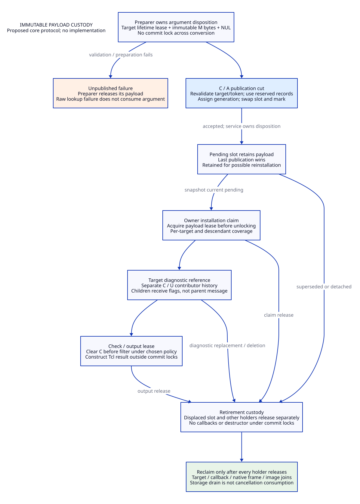
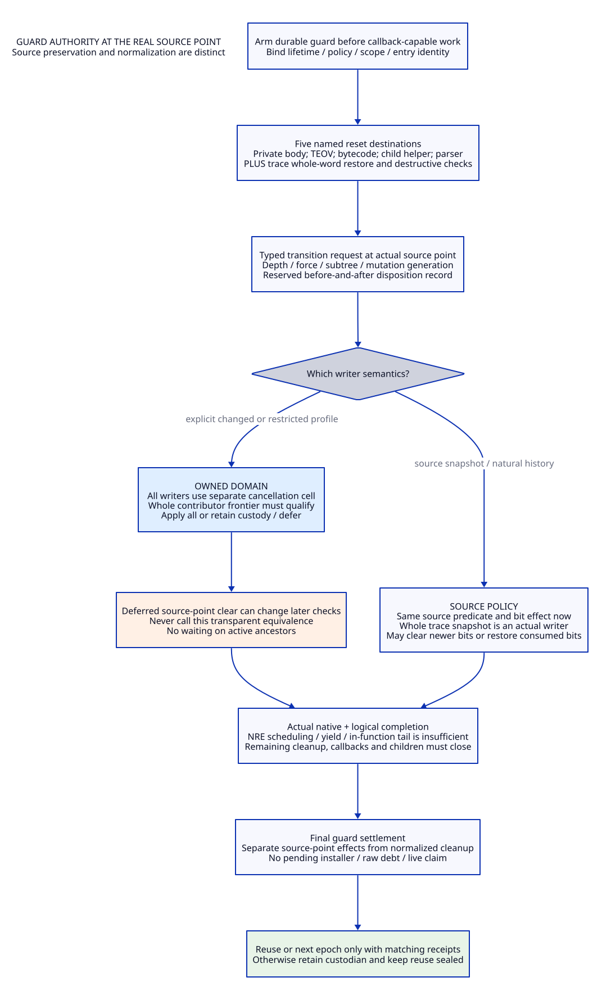

# Cancellation Writers, Immutable Payloads and Guard-Owned Clearing

Design research only. The mainline is Scheme-derived contracts and modern
generated C; Zig remains an optional provider of the same contract. No runtime,
generator, native test, solver, or performance experiment accompanies this study.
The [preceding gate/guard design](tcl-entry-cancel-design.md) remains conditional.
The [evidence ledger](tcl-cancel-writer-evidence.md), [arguments and cases](tcl-cancel-writer-arguments.md),
[value matrix](tcl-cancel-writer-benefit-matrix.md) and [trace](tcl-cancel-writer-traceability.json)
separate current source behavior from proposed behavior and qualification.

WD01. The source search has a declared, reproducible boundary.

The pinned Tcl commit is `cbf86d62348d6b052e1961b4df995960fb21545f`.
This study rereads all 350 committed `.c`, `.h` and `.m` blobs selected by the
earlier untruncated tree; 324 are recaptured and 26 retained captures are reused.
Every byte capture is checked against both its prior SHA-256 and pinned tree Git
blob identity. Negative raw content is now retained. The cancellation-symbol
search finds 10 files, 104 LF lines and 114 lexical occurrences; these include
declarations, comments and fixtures, not 114 calls. An independent broader search
for whole `->flags` assignments, saved flag words, trace entry points and
constructors finds 99 lines. It discovers a writer invisible to a search for
cancel/reset names: `TraceExecutionProc` restores the entire interpreter flag
word after an arbitrary evaluation. The 350-file boundary does not include
generated/preprocessed forms, all `.decls` files, Tk, loaded extensions, aliases
through arbitrary pointers or installed binary correspondence. Retained `.decls`
and manuals are read separately. No whole-program semantic closure is claimed.
See [corpus](tcl-cancel-writer-corpus.json) and [whole-flag audit](tcl-cancel-writer-flag-audit.json). [WX01, WX08]

WD02. Classify writes by semantic operation, not by function name.

| Operation | Current actual source path | Required distinction |
|---|---|---|
| Create | `TclCreateInterp`: flags input, empty message, token/record/table publication | Constructor flags are not universally zero; known public/child callers pass zero or SAFE_INTERP |
| Accept pending | `Tcl_CancelEval`: replace bytes, length, clientData, flags; mark async | Last pending publication, not a queue of every request |
| Install | `CancelEvalProc`: OR C and optionally U; recurse descendants; update only target message | Pending flags replace; installed U is sticky OR; descendants do not receive the target message |
| Consume C | `Tcl_Canceled`: clear C before UNWIND-only filter | A successful filtered return can still mutate state; not a full reset |
| Scope reset | Private reset, TEOV inline, bytecode inline, parser and recursive child reset | Source point, depth/force and subtree semantics differ |
| Restore flags | `TraceExecutionProc`: whole saved word restored after callback eval | Can erase newly set C/U or resurrect previously consumed bits |
| Retire | `DeleteInterpProc`: free record/payload, delete token, decrement message under C | Native callback/clientData and object destructor lifetimes must join |

Here C means CANCELED, U means TCL_CANCEL_UNWIND and lock C means cancelLock;
the contexts disambiguate them. WX02–WX09 bind each row to actual code. The
[operation inventory](tcl-cancel-writer-operations.json) is a typed migration map,
not an implemented API. The public cancellation API and private stub slots are
real inbound surfaces, not removable merely because a managed facade exists.

WD03. Preserve the pending/installed/message asymmetry explicitly.

The raw call replaces pending flags and bytes; the async callback reads the
then-current pending record, not a mark-time snapshot. Repeated marks may
coalesce, and a retained pending payload can be installed again. Installation
ORs U into already installed state. A later normal cancellation may replace the
diagnostic while an older U persists. Recursive propagation sets flags on
descendants but does not copy the parent's diagnostic into each child. Reset
clears bits, not the pending record, async mark, or installed message. A payload
identity therefore is neither a cancellation observation nor the sole owner of
all installed U. Retiring payload storage cannot discharge cancellation debt.
Any new contributor ledger must retain these distinctions or declare changed
semantics. [WX02, WX03, WX04, WX05]

WD04. Separate immutable storage from mutable protocol state.

Proposed data, not a Tcl ABI declaration:

```text
TargetHandle = {slot, lifetimeGeneration, owner, nativeLifetimeLease}
CancelPayload = {payloadId, byteLength, immutableBytes, immutableRequestFlags,
                 messageKind: default | explicit, allocatorIdentity}
PendingSlot = {requestGeneration, payloadRef, acceptanceCut, tokenGeneration}
InstalledCancelCell = {mutationGeneration, cContributors, uContributors,
                       diagnosticRef, descendantPropagationReceipts}
PayloadLease = {payloadId, holderKind, holderId, releaseDisposition}
WriterPolicy = {gateSpecIdentity, entryPolicy, completionPolicy,
                resetSemantics, flagSnapshotSemantics, diagnosticSemantics}
```

Flags in an immutable payload describe that request; they never mutate installed
U. The default case uses an explicit tag rather than an unowned NULL pointer.
Payload storage has no Scheme pointer and no Tcl_Obj ownership. Tcl object
arguments and result objects still need their original thread and reference-count
rules; Gambit roots/marker custody remain governed by the existing callback
contract. Internal cell references are acquired under the protecting lock or an
already held lease; loading a pointer and later incrementing its count is invalid.
Reference-count overflow, allocator identity, lease capacity and image lifetime
are admission obligations, not automatic language guarantees. [WX02–WX07, WL02, WE01]

Native diagnostic storage reserves an extra trailing NUL beyond byteLength, so
the source-style -1 display path can safely select its prefix; embedded NULs
retain the original truncation behavior. Empty explicit input still selects the
source's default diagnostic at display time. Contributor identity need not keep
all historical message bytes alive, but may require O(G) metadata for G uncovered
generations. Any interval compression needs its own coverage proof; bounded
capacity must be reserved or rejection decided before acceptance. Dropping old
U provenance after accepting more work is not a valid overflow policy. [WX04, WX12]

WD05. Preparation owns the request until an explicit disposition.

First obtain a generation-bound target lifetime lease without retaining L/C/A
across callouts. Validate enough to preserve chosen failure precedence, then
convert/copy the message outside commit locks. Freeze explicit/default identity,
length and request flags in independent native storage; reserve the non-failing
publication/retirement bookkeeping before commit. Revalidate the target after
conversion: a callback-capable object operation may have changed its lifecycle.
Preparation completion is not acceptance and cannot reserve last-writer order.

The pinned raw code decrements the input object only on the found-record success
path. NULL target, uninitialized table and missing record return before that
decrement, despite the broader wording in the pinned manual. A raw compatibility
entry needs an explicit success/failure ownership rule, separate from a managed
entry which may take ownership on invocation. Do not silently consume the raw
object on lookup failure or double-decrement it after revalidation failure.
Tcl `ckalloc`/`ckrealloc` failure behavior is not a demonstrated recoverable
TCL_ERROR branch; recoverable managed allocation failure would be a new service
contract. Unknown object-hook recursion legality or missing target lifetime
protection blocks admission, not a reason to hold C across conversion. [WX02, WX07, WX10]

WD06. Publication must be a short, callout-free transaction.

With preinitialized locks, acquire lifecycle/target exclusion as required,
then C and owner async lock A in the admitted hierarchy. Revalidate target and
token generations; assign the next request generation, swap PendingSlot and
mark the attributed token using the active-aware async protocol. This is the
acceptance cut and selects the last pending request. No allocation, Tcl object
conversion/decrement, user destructor or result delivery is allowed in this
commit. Displaced pending references move to a reserved retire list, released
outside all these locks. A late prepared request may publish after an earlier
prepared request: order follows commit, not preparation start.

Moving the original decrement outside C permits legal reentry to publish another
request after acceptance. Never roll the first accepted request back if later
argument cleanup fails/reenters, and never relabel a second publication as part
of the first. If this timing affects an admitted custom hook, equivalence with
the original locked callout is unproved; record the changed boundary or refuse
that hook domain. The raw API's currently ignored/reserved clientData cannot be
repurposed as the managed epoch. [WX02, WX07, WX10, WL01, WL02]

WD07. Installation needs a snapshot lease and an independent lifetime join.

An owner callback claims the selected current PendingSlot and its payload under
C before releasing the lock. The pending slot remains retained for source-style
reinstallation; a claim is not a destructive dequeue. Installation updates the
owned cell's contributors and latest target diagnostic consistently, using
reserved metadata. Descendant traversal requires the admitted owner and a stable
tree/lifetime boundary, and produces separate per-target coverage; do not infer
all descendants completed because the parent cell committed. If traversal can
fail midway, retain a progress record and prevent reuse until every affected
target has an explicit disposition. No partially installed tree is silently
rolled back after checks may have observed it.

The proposed immutable diagnostic reference avoids Tcl_SetStringObj/SetObjLength
inside C. Materialize a Tcl result outside commit locks under a diagnostic lease.
Preserve existing default-message, U-vs-C error choice and output truncation rules
where source equivalence is claimed: the pinned code eventually uses
Tcl_NewStringObj(message, -1), so explicit stored length alone does not prove
lossless observable bytes. Freezing one check outcome at a new atomic cut can
change behavior of reentrant object hooks; it is an explicit normalized policy
unless the old microstep order is independently qualified. [WX03, WX04, WX07, WX09]

WD08. The complete payload ownership graph includes stale diagnostics.

```text
prepared owner -> pending slot -> displaced retire holder
                         |-> installation claim
                         |-> target diagnostic cell -> check/output lease
                         |-> separately frozen delivery/outcome holder
```

Arrows denote independently retained references, not cancellation acknowledgments.
Reference retirement is allowed only when all holders release; there is no
wall-clock grace period. No callback pointer, native record or dylib may disappear
while its associated claim/lease remains live. Pending release after replacement
does not release an installed diagnostic; resetting C/U does not clear that
diagnostic in the pinned code. Removing a stale diagnostic at reset is a semantic
change if a descendant's later flags make that old child message observable.
After a failed preparation the preparer frees only its unpublished storage;
after acceptance the service owns eventual pending/installed retirement even if
the caller disappears. [WX02–WX05, WX09]

WD09. Trace flag restoration is a second cancellation channel.

The broad audit finds two direct whole `iPtr->flags =` destinations in the
selected corpus: constructor assignment and TraceExecutionProc restoration.
The latter saves before Tcl_EvalEx and restores after it. Its actual inbound
routes include TclCheckExecutionTraces and TclCheckInterpTraces, and step-trace
registration supplies the function through a callback pointer. A result-state
save/restore is not the same operation: Tcl_SaveInterpState stores only
ERR_ALREADY_LOGGED from that word and Tcl_RestoreInterpState updates that bit.

There are two explicitly different migration choices:

| Choice | Required behavior | Consequence |
|---|---|---|
| Source snapshot | Restore the original whole word at the original point; log before/after cancellation bits | May erase or resurrect cancellation; cannot issue a normalized generation-owned clear receipt |
| Owned cancellation domain | Separate cancellation state from legacy flags; trace restoration cannot write it; preserve other admitted flag behavior separately | New cancellation behavior for trace histories; requires all checks/writers and private layout users to migrate |

A mask-only restoration of INTERP_TRACE_IN_PROGRESS also changes restoration of
other flags; it is not a proven equivalent fix. Resurrecting U from a saved word
cannot recreate contributor identity after payload/history reclamation. Thus a
source-snapshot path keeps its own custody/history and cannot be admitted to a
profile promising exclusively generation-owned cancellation. [WX08, WX11]

WD10. Guard takeover must preserve source locations or declare normalization.

The guard owns authority and accounting before any callback-capable entry work.
At each old clear site it accepts a typed ScopeClearRequest; it is not merely a
callback appended after every other callback. Two source inline unsets have
different timing: TEOV_Exception runs before NRCommand decrements numLevels and
checks cancellation; the bytecode completion callback clears before frame restore
and object decrement. Moving either to the final API-return frontier can change
later checks, object cleanup and reentry. The final guard additionally closes
early-error paths which never registered a source completion callback, under
NormalizedComplete rather than a fabricated natural-reset witness. [WX04, WX05]

```text
ScopeClearRequest = {writerPolicy, targetGeneration, sourcePoint,
                    scopeId, actualDepth, forcePolicy, subtreeCut,
                    expectedMutationGeneration, contributorCoverage,
                    kind: source-scope | normalized-completion}
ScopeClearDisposition = {applied | source-noop | deferred | invalid,
                        beforeState, afterState, actualCoverage, issuerCut}
```

An inline-point disposition does not prove physical native return, NRE terminal
completion, coroutine exit, or payload drainage. Actual completion remains a
later independent receipt. Metadata needed to record a destructive write must
already be reserved; allocation failure after clearing cannot erase its history.

WD11. Source-compatible clears and owned clears have different conflict rules.

For a source-compatible policy, execute the same depth/force predicate and
clear the same installed bits at the same source point. Bind its before/after
snapshot, including any newer installed contribution actually cleared. It does
not clear PendingSlot or an unserviced async mark. Do not retrospectively claim
that every cleared generation had completed the normalized guard frontier.

For a normalized owned policy, validate the whole contributor set, target/token
generations and all active claims/dependencies under the common commit protocol.
Apply only a wholly covered clear; otherwise defer, retain custody and seal reuse.
Because delaying clear can affect subsequent source checks, a deferred source
point is not source-equivalent. The profile must specify changed continuation/
error behavior, or restrict admitted histories before entry. Discovering a
conflict halfway through a live native call is too late to erase its obligations;
fail-closed here means retain completion custody and deny reuse, not magically
abort that C stack. No partial subtraction of shared U, forced reset, token
deletion, or wait on an active ancestor is a valid fallback. [WX03–WX06, WX08, WL01]

WD12. Preserve the five named reset destinations and their inbound routes.

| Source location or caller | Original predicate and effect | Guard responsibility |
|---|---|---|
| TclResetCancellation private body | NULL -> ERROR; force or depth zero clears; otherwise OK/no-op | Distinguish status OK from applied clear; retain private stub ingress until replaced |
| TEOV_Exception | Scheduled at level one; direct clear before NRCommand | Bind source scope/point; do not substitute the current depth-zero predicate |
| TEOEx_ByteCodeCallback | Clear only at depth zero, before remaining cleanup | Bind callback instance and post-clear cleanup dependencies |
| TclSetChildCancelFlags(flags=0) | Iterate descendants, private depth/force reset, recurse | Cover each real descendant, not the supplied parent; exclude nonzero flag-setting path from reset semantics |
| TclSubstTokens command branch | Increment; readiness/nested eval; decrement; private reset; then result use | Handle both readiness ERROR and actual nested-eval completion; preserve source depth predicate |

ChildEval invokes the recursive helper on childInterp before evaluating it; the
code resets that interpreter's descendants, not the argument interpreter itself.
The helper's compatibility alias TclSetSlaveCancelFlags and private stub slots
237/250 remain reachable surfaces. Unknown private clients are not eliminated by
the committed-source inventory. Public Tcl_Canceled remains an independently
destructive check, not a reset caller. Trace restoration is an additional writer
outside these five named destinations. [WX04–WX06, WX08, WX10]

WD13. Failure and reentry must leave one named custodian for every obligation.

| Boundary | Storage/object owner | State/completion owner |
|---|---|---|
| Target lookup fails before preparation | Raw argument caller under pinned source behavior | No accepted request; no success/decrement receipt |
| Conversion/revalidation fails before commit | Preparer owns unpublished payload; selected API owns argument disposition | No generation accepted; lifetime lease released after local cleanup |
| Publication succeeds; argument destructor reenters | Original request remains service-owned; nested request has separate preparation | Each accepted generation has its own displaced/installed/settlement disposition |
| Installation traverses only part of subtree | Pending/claim/installed holders retain their references | Installer/progress record owns uncovered children; reuse remains sealed |
| Output materialization reenters or fails | Diagnostic/outcome lease remains held until actual cleanup | Frozen decision or source microstep policy remains explicit; no false observation acknowledgement |
| Guard source-point clear is deferred | Payload references remain with their holders | Durable guard retains dependencies; original native path must actually complete |
| Target deletion begins during preparation | Preparer's target lease prevents record/image reclamation | Deletion closes admission; prepared request must fail revalidation without resurrecting target |
| Cleanup cannot complete | Retire/orphan custodian retains resources | Shutdown remains incomplete; no clean epoch publication |

Callbacks and destructors run outside L/C/A, never while a parent waits holding
those locks. An accepted request cannot be reassigned to a disappearing stack
guard; NRE or suspended logical work needs durable storage before native return.
Scheme continuation escape across Tcl native frames still needs the previously
declared result boundary/rejection contract; neither C cleanup nor Zig defer
handles arbitrary longjmp-like escape automatically. [WE01, WX05, WX07, WX09, WL03]

WD14. Deletion is unlink, drain, then reclaim—not free then join.

The pinned deletion block frees CancelInfo, deletes the async token and decrements
asyncCancelMsg while C is held. A proposed core service first marks the lifetime
closing, denies new leases/publications, and detaches attributable pending state
and tokens under admitted owner/C/A exclusion. An unclaimed token can be
unlinked using its actual owner protocol; an already selected callback must keep
its clientData alive through callback return. Drop detached native references
outside locks; join active claims, output leases, native/NRE/coroutine scopes,
subtree progress, Scheme roots/marker/resource obligations and image references.
Only then reclaim the record, cell and code image. Reentrant destruction sees
closing/dead, never a recycled target with the same unqualified pointer.

The existing source's no-active-eval restriction remains evidence, not proof
that every proposed cross-thread lease is safe. Tcl_Preserve alone is not a
demonstrated universal solution for this whole protocol. If the owner is inside
the affected async callback, register deferred retirement; never synchronously
wait for that callback to return to itself. Finite drainage requires actual
return/release and no new admitted work; fairness and eventual user cleanup are
unproved. [WX02, WX09, WX10, WL03, WE01]

WD15. Retire old representations only after actual inbound closure.

| Order | Candidate old responsibility | Replacement and required exit condition |
|---|---|---|
| R1 | Mutable pending bytes/length/flags tuple | Immutable payload + one PendingSlot; all raw/builtin/test/private producers reach common acceptance; repeat-install semantics retained |
| R2 | Conversion/reallocation/object decrement inside C | Prepare/commit/retire protocol; target lifetime and failure ownership qualified, all hook domains explicit |
| R3 | Mutable asyncCancelMsg and C-held message construction | Diagnostic lease/cell; all readers/default/child/stale/output behavior qualified |
| R4 | Direct bit set/clear and untracked contributor loss | Common install/check transitions; filtered check order and descendant coverage preserved or declared changed |
| R5 | Two inline reset bodies and unqualified private clear body | Guard-owned source requests plus separate final completion; every source point, force/depth and early path mapped |
| R6 | Recursive child/parser reset accounting duplication | Shared scope-clear service with real per-target coverage; original callers/semantics remain necessary |
| R7 | Trace's whole-word ownership of cancellation | Chosen source snapshot or separate owned domain; trace histories/native private users qualified; no silent mask substitution |
| R8 | C-held record/message destruction and immediate token/clientData reclamation | Closing/detached/drained state machine; selected callback and image lifetimes joined |

This is a dependency graph, not eight independent deletes. R2/R3 require R1;
R4 requires the new cell; R5/R6/R7 all require writer-policy closure and R4;
R8 depends on all live holders and exits. A private/public ABI facade may remain,
with a single state authority; retaining two authoritative layouts is not
retirement. Documentation retires zero runtime paths. Unknown compiled-in,
loaded or private-layout writers block the corresponding profile. [WD01–WD14]

WD16. The modernization benefit is a shared semantic authority.

Scheme owns operation specifications, evidence obligations, writer-policy choice
and derived layout/state tables. Generated C owns the native callout boundary,
locks, byte leases, roots, callback ABI and teardown. Zig can implement that same
native provider; it does not replace the collector, erase Tcl private ABI or
prove atomic ownership. LLVM/MLIR consume the same qualified native boundary
and cannot reorder effectful install/check/reset/reclaim operations across it.
The [matrix](tcl-cancel-writer-benefit-matrix.md) accounts for all 13 necessary
support families in both languages. The new trace writer increases the required
scope; it does not establish an exclusive Zig saving. [WE01, WO01, WV01–WV08]

WD17. Admission requires a writer-closed profile, not a good final callback.

A profile binds source/image identity, threading/owner/lock domain, all ingress,
flag snapshot and reset policies, object-hook legality, diagnostic compatibility,
every completion frontier, bounded capacity/failure rules and evidence adapters.
Entry decisions, source-point dispositions, mutation/installation coverage,
completion settlement, payload drainage and next-epoch publication reference the
same policy/lifetime/generation cut. No receipt proves its own prerequisite.
NaturalSource, SourceSnapshot and NormalizedComplete evidence remain distinct.
The [conditional arguments](tcl-cancel-writer-arguments.md) are handwritten;
none is a checked proof or native issuer. All full research requirements and
AG05–AG07 retain their prior unresolved/non-promoted status. [WO01, WP01–WP10]

WD18. The remaining gap is now narrower and explicit.

Committed lexical paths, including whole-word restoration, are catalogued. Still
unresolved: full alias/generated/loaded closure; installed Tcl/Tk/image matching;
custom-hook recursion; native callback/token/target lifetime; normalized mixed
trace/reset semantics; actual durable completion; capacity/OOM behavior; qualified
lock mappings; complete retirement; measured total work and positive incremental
Zig value. No language choice resolves these by itself. The architecture can
eliminate redundant mutable representations and untracked cleanup authorities
only when these inbound and lifetime conditions hold; replacing C syntax alone
does not establish that benefit.

## Architecture Diagrams






## Trace Separation Follow-Up

The [trace separation study](tcl-trace-cancel-design.md) expands the whole-flags finding into exact recursion scopes, projection equations, source/modern policy separation and actual dispatcher-to-guard dependencies. Callback readiness limits which resurrection histories have a real source-composed path. See [arguments](tcl-trace-cancel-arguments.md), [matrix](tcl-trace-cancel-benefit-matrix.md), [evidence](tcl-trace-cancel-evidence.md) and [trace](tcl-trace-cancel-traceability.json). The structural argument is not whole-program observer equivalence or a native admission.
