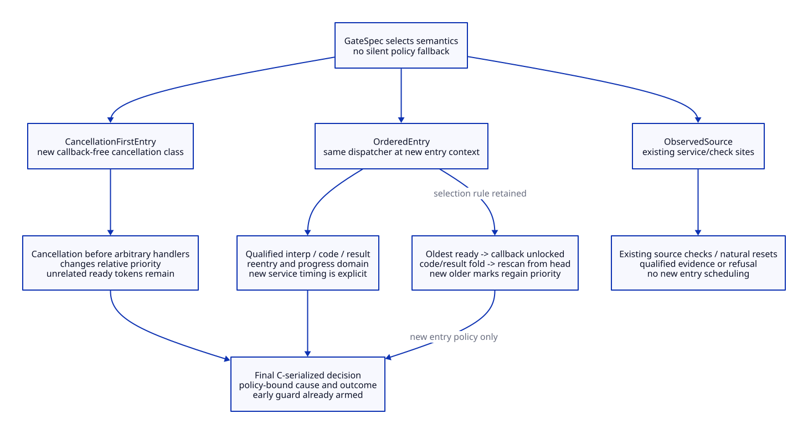
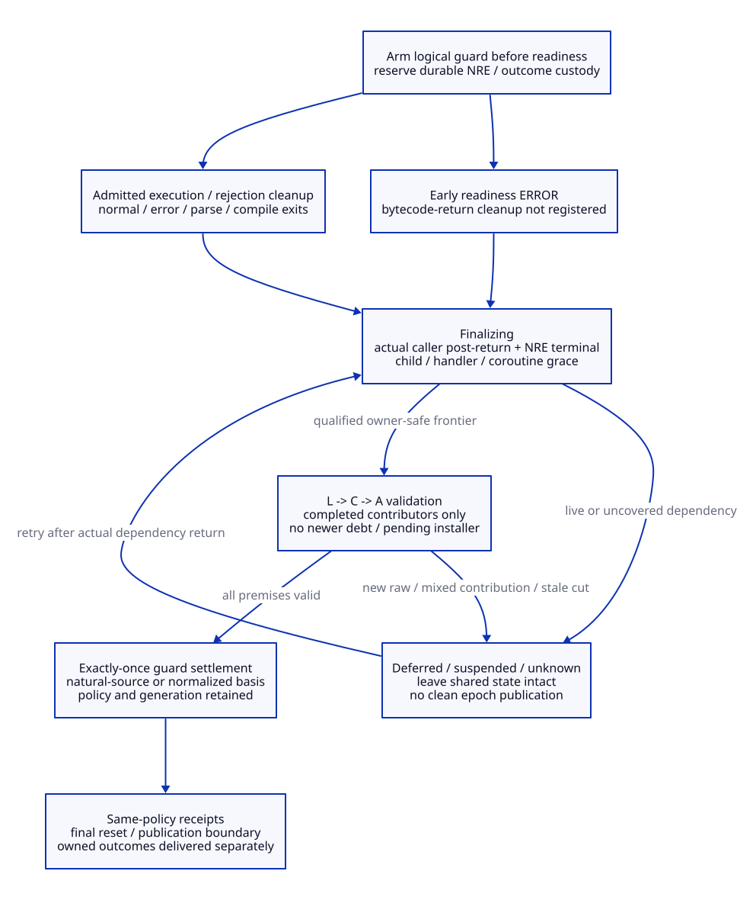

# Unified Entry Cancellation Gate and Completion Guard

A unified gate must declare its scheduling semantics. Preserving the existing async
selection algorithm does not preserve when handlers run, their command-result
context, or the effect of adding a new cancellation check. A completion guard must
also cover every early and suspended path and must never erase a newer raw request.
This refines [next-evaluation identity](tcl-next-evaluation-design.md).
All new structures/operations are design contracts only; no provider, Tcl patch,
implementation or native test is supplied. [Evidence](tcl-entry-cancel-evidence.md),
[arguments](tcl-entry-cancel-arguments.md) and
[value matrix](tcl-entry-cancel-benefit-matrix.md) separate the claims.

## Semantic Profiles Are Part of the Contract

GD01. Retain source preservation as a reference and name the normalized policy:

| Policy | Entry service | Completion | Preservation boundary |
| --- | --- | --- | --- |
| ObservedSource | Existing dispatch/check sites, with qualified evidence only | Existing natural resets; refuse unsupported consumption/neutrality | Reference behavior remains, subject to passive-hook callback/lock qualification |
| OrderedEntry | New entry point invokes the same priority/rescan/code-fold dispatcher under a qualified entry context | Explicit selected guard policy | Retains dispatch selection rules at that invocation; polling time/context and clean-up can change |
| CancellationFirstEntry | New callback-free core cancellation class before arbitrary handlers | Explicit selected guard policy | Deliberately changes cancellation versus other-handler order; not raw source equivalence |

Every receipt binds the immutable GateSpec identity, semantic policy and entry-kind contract. There is no
silent fallback from one policy to another when handlers, races or failures become
inconvenient. A normalized profile must choose its behavior before admission.
No general winner is established without the application's required effects and
qualified native domain; modern generated C can express all three. [GX01–GX05,
GO01, GL01]

GD02. Existing AsyncInvoke is an ordered fold, not a snapshot FIFO. Under owner
asyncMutex A it selects the first ready token, clears ready, releases A, calls the
handler with the current code, reacquires A and rescans from the head. A newly
ready older handler can precede an already ready later one. Handlers may change
code/result; later handlers see those changes. CancelEvalProc returns its incoming
code while installing flags, so cancellation ERROR normally comes from a later
Canceled check. Removing just that callback or forcing ERROR ahead of the fold is
not generally equivalent. Handler creation/deletion/re-marking and result changes
are observable source effects, not bookkeeping that can be discarded. [GX01–GX03]

GD03. An ordered entry service must qualify the handler's entry context separately
from normal after-command service: target interp versus NULL, initial code, result
state, permitted reentry, side effects and progress. Saving/restoring state can
support a declared handler discipline, but it does not undo external effects or
make a different context equivalent. A target-only path can avoid unrelated
callbacks at this gate, but it explicitly promotes cancellation into a new control
class. It preserves unrelated tokens and their relative registration order, not
the original relative ordering between cancellation and those handlers. [GX01,
GX02, GX08, GX11]

## Remove Callouts From New Commit Intervals

GD04. Current CancelEval holds C=cancelLock while converting/copying the message,
decrementing its Tcl_Obj, replacing flags and marking through A. Object types
provide conversion/free hooks; macros take slow paths when needed. Existing
CancelEvalProc also updates a Tcl string under C. Consequently a new entry hook
that takes C is conditional on the admitted callback domain. If a permitted object
callback reenters evaluation while C is held, reacquiring C can deadlock. Merely
making C recursive avoids neither partial-state exposure nor L/C inversion.
Source callback reachability is not proof that arbitrary recursive use is legal.
[GX02, GX03, GX06, GX07]

The same pinned Thread manual explicitly leaves same-thread double locking
undefined, while the Unix implementation uses pthread_mutex_init with NULL
attributes and allocates mutex storage on first use. It establishes no portable
recursive-lock guarantee. Pre-initialize all new commit locks and guard storage
outside no-allocation intervals. Existing cancel/token creation already exercises
C/A, but new locks and actual installed initialization still need qualification.
A non-threaded Tcl build compiles public mutex operations away; it cannot supply
this cross-thread cancellation protocol without a separately proved synchronization
replacement or a restricted single-thread domain. Installed build/default mutex
behavior is not inferred from the source. [GX12]

For a broad normalized domain, a C-free wrapper around the old API is insufficient:
all relevant core producers/installers must support a callout-free publish path,
or the profile must explicitly refuse the unqualified callbacks. Raw native and
builtin script callers cannot be assumed to pass a Zig/Scheme wrapper. [GX02,
GX06, GX09, GO01]

GD05. Proposed normalized ingress uses prepare/publish/retire with explicit custody:

```text
validate target and take native lifetime lease under admitted exclusion
 -> release locks; freeze message/flags into owned immutable payload
 -> publish under C -> A after generation/authority revalidation
 -> release locks; retire displaced payload / consume object ownership
```

Preparation and any allowed conversion/free callback happen before or after the
commit, never under C/A/L. Publish is the acceptance/last-pending-selection ordering
point; preparation order is not acceptance order. Object ownership is an explicit
once-only result: the inspected raw implementation has early NULL/missing-target
ERROR exits before the successful message decrement. Do not infer unconditional
failure ownership from a success-path/manual summary. A new API can define cleaner
ownership, but cannot call changed failure behavior legacy equivalence without proof.

A preparation callback may naturally evaluate before this request is accepted;
that entry must not be retroactively assigned this cancellation. If the target
retires during preparation, release the lease/storage under the declared failure
policy and publish nothing. Current unleased raw pointers still require real
caller lifetime closure. Replacing Tcl objects/string mutation with leased
immutable diagnostic payloads and deferred reclamation is a Tcl core representation
change requiring source/ABI/failure proof, not something Zig supplies automatically.
[GX02, GX03, GX06, GX09–GX11, GO01]

## Gate State and Linearization

GD06. A common GateSpec selects the policy and binds all transitions:

```text
GateSpec = { immutableSpecIdentity, semanticPolicy, eligibleEntryKinds, handlerContextContract,
             completionPolicy, errorPrecedence, rawManagedConflictPolicy, targetFrontier }
GateAttempt = { targetIdentity, evaluationIdentity, ownerIdentity,
                firstEntryBinding, entryRawCut, serviceScope,
                finalDecisionCut, decision, guardIdentity, evidenceComplete }
Decision = allow-body | reject-cancellation | reject-other-error
           | unsupported-domain | suspended-decision
```

Unsupported/busy/error outcomes are never reported as observed cancellation unless
there is actual attributed evidence. The attempt's identity remains the actual
first entry even when the gate cannot decide; it cannot be reassigned to a later
nonempty attempt. All fields are issuer-owned and bound to non-reused target,
provider, owner and interference generations. [GO01, GX04, GL01]

Error precedence is part of the policy. Current readiness resets results, then
checks deleted state, rewind, cancellation and depth in that order; a direct parse
error can precede a later command cancellation poll. The normalized candidate
validates target/deleted/wind-down state before consuming cancellation, then gives
accepted entry cancellation precedence over depth/parse/compile work. That latter
precedence is a declared change for affected source routes. A reject-other-error
outcome does not consume raw debt merely because its code is TCL_ERROR. Cleanup
records its actual cause and preserves any unresolved cancellation. [GX04, GO01]

GD07. Arm the logical completion guard before readiness, parsing, compilation,
result preparation or a new dispatch can fail/reenter. The identity/guard record
and immutable decision slot use reserved storage; exhaustion preserves the real
failure, records unknown/refusal and never fabricates clean completion. A native
stack guard can cover a synchronous scope, but NRE callbacks/suspended activations
must acquire durable custody before that scope returns. No pointer to a dead stack
guard can remain on an NRE chain. Registration before the early readiness check is
necessary because the current bytecode-return callback is registered afterward.
This is a new cross-route source obligation. [GX04, GX05, GX07, GX10, GO01]

GD08. OrderedEntry protocol:

1. Register actual identity/guard and capture entry cut without callbacks under locks.
2. Release L/C/A. Run the existing dispatcher only with a qualified entry context.
3. Preserve its first-ready selection, head rescan and code/result fold; record all
   nested scopes and actual handler returns.
4. Revalidate target/binding/entry cuts and pending coverage under C/A. If a newer
   request remains eligible, service again only according to the same policy.
5. Make the final allow/reject decision at a C-serialized pre-body frontier.

An unbounded stream of re-marks can prevent a stable decision; no finite progress
is proved. Existing asyncReady can be zero while AsyncInvoke is active. A nested
entry from a handler therefore cannot assume another AsyncInvoke will drain the
pending cancellation: it may return immediately. OrderedEntry must qualify a
non-reentrant entry domain or return an explicit unsupported/deferred decision
without claiming raw consumption. Waiting for its own outer handler under a lock
or turning asyncReady/asyncActive into an artificial nested dispatcher is invalid.
[GX01–GX04, GX08, GX11]

GD09. CancellationFirstEntry protocol uses a new callback-free core operation:
validate the target and current immutable pending selection under C/A; install
attributed C/U/message state for the selected frontier; clear only the consumed
attributed target mark; repair readiness; freeze an entry decision. No arbitrary
handler, Tcl result setter, allocator or destructor runs under those locks.
Diagnostic object creation and old payload release are deferred. Exact owned
payload/descendant layout and every writer still need implementation qualification.

Retain the existing token/list identity, leave unrelated ready handlers intact and
repair global readiness with one A-locked scan of H registered handlers, as in the
prior targeted design. A ready count would be a separate hot-path/invariant change.
Readiness repair is active-aware: when asyncActive=0, compute and publish the
remaining-ready disjunction under A. While an outer AsyncInvoke is active, leave
its asyncReady/asyncActive protocol intact; remove only the attributed selected
mark and let that outer loop rescan. Do not set asyncReady merely to enable a
recursive dispatcher. The outer scan/exit and concurrent marks are serialized
under A. This extends the earlier idle-only repair precondition and needs its
own source qualification.

If a target callback has already been claimed or provenance is unknown, return
unsupported/busy rather than waiting for self-completion. Source-integrated marks
must be attributed atomically with serial publication. This mode can handle some
entry contexts that OrderedEntry cannot, but its new control priority and sticky
entry-rejection policy are explicit semantic changes. [GX01–GX03, GX08, GO01]

GD10. Entry versus native cancellation is decided by actual cuts, not wall time:

| Ordering | Required treatment |
| --- | --- |
| Raw publish before actual entry claim | Bind the raw idle coverage to that target's first entry; gate must meet its declared entry contract or refuse qualification |
| Entry claim, then raw publish during preparation/service | Include it in the final pre-body cut if it wins C before decision; its acceptance phase and causal coverage remain recorded |
| Final allow-body decision wins C, then raw publishes | This is active-evaluation cancellation; normal admitted cooperative checks handle it. No promise of stopping before the physical first instruction |
| Raw publish wins C before final decision | No stale allow permit; installed/pending coverage must be accounted by the selected policy |
| Mark/target/tree/binding changes during unlocked handler work | Revalidate or refuse; do not reuse a pre-service cut |

The gate must not hold C through script execution to prevent new cancellation.
The decision point transitions the evaluation to its admitted body phase while
under the same exclusion as raw acceptance. After unlocking, later requests are
legitimate active requests. Bare relaxed flags, host queues or unsynchronized
numLevels cannot establish that ordering. [GX01–GX05, GO01, GL01–GL02]


[D2 source](tcl-gate-order.d2).

## Reentry and Result Materialization

GD11. Reentrant evaluation creates a child identity; it cannot replace an already
claimed first entry. Release locks before qualified handler/preparation callbacks.
A child entered from an active async handler sees that actual service frontier;
if the selected policy cannot decide safely, report that limitation without
consuming raw debt. CancellationFirstEntry must still reject unknown target claims
and locked-callout contexts; it is not permission to recursively take C or A.

A proposed callout-free ingress eliminates one reviewed C-held reentry hazard only
after every actual producer/install path migrates. A legacy direct core caller
that still converts/releases objects under C keeps that profile unresolved. Do not
silently unlock around a callback inside half-updated CancelInfo and reuse the old
pointer afterward. No global deadlock-freedom or signal-safe new API claim follows
from the selected local L -> C -> A hierarchy. [GX01–GX03, GX06–GX09, GO01]

GD12. A normalized rejection freezes cause, coverage, C/U snapshot, message source,
policy, evaluation identity and outcome custodian at decision. Outside the locks,
materialize Tcl diagnostics and perform permitted cleanup. If those steps reenter,
track child scopes and later cancellation separately. The rejected attempt never
starts its script body because a cleanup handler changes the mutable interpreter
result or clears a flag. This sticky per-attempt rejection is declared normalized
behavior, not the original arbitrary handler code fold.

Preserve the original pending-message selection rule within the chosen raw/mixed
policy; do not OR all pending flags, replay overwritten messages or infer identity
from diagnostic text. Snapshot ownership protects outcome attribution; it does not
prove diagnostic callbacks preserve the raw output or complete. Outcome preparation
failure stays typed and sealed, with retained custody rather than a false delivered
acknowledgement. [GX02–GX04, GX07, GX08, GO01]

## Completion Guard and Early ERROR

GD13. Proposed guard state machine:

```text
armed -> running | rejected
      -> finalizing -> suspended-or-dependent | eligible-to-settle
      -> settled
```

Every admitted normal/error/early-readiness/parse/compile/NRE/coroutine exit records
its terminal cause or remaining dependency. Exactly-once settlement consumes the
issuer's guard generation; repeated observation of an error or a retried cleanup
does not repeat reset, payload release or outcome delivery. A suspended guard is
a live obligation, not settled because a native API returned scheduling TCL_OK.
All states preserve separate native scopes and logical completion. [GX04, GX05,
GX10, GE01, GO01]

GD14. The completion policy is also explicit:

| Completion policy | Allowed action | Meaning |
| --- | --- | --- |
| NaturalSource | Observe actual existing reset/check/control transitions | May qualify known source histories; cannot fix early U residue by inventing a reset |
| NormalizedComplete | Once the true relevant frontier completes, use a generation-aware core clearing operation for admitted completed coverage | Adds a cleanup transition on early/error paths, including those without the bytecode-return callback |

The guard cannot prove its own completion from a last callback or numLevels=0.
Tcl_Eval may still mirror a result after Tcl_EvalEx returns. NRE callbacks stop at
a saved root; coroutine yield may leave a live logical evaluation. Actual caller-side
post-return hooks/native scope evidence and logical terminal/grace records must
close those obligations. An in-function tail hook can record return-pending, not
physical return. Arbitrary unmanaged callers without that witness keep reuse
unqualified. No Scheme continuation or Zig lexical defer recreates a returned C
activation or settles suspended work. [GX04, GX05, GX07, GX10, GE01, GL03]

GD15. Generation-aware clearing is conservative and atomic. Under a live owner
frontier and L -> C -> A, require that all live C/U contributors to be cleared belong
to completed admitted coverage, no pending/claimed/re-marked installer remains,
no new raw idle debt is being disposed, and all binding/tree/target cuts still
match. Validate the full affected frontier before mutation. Only then clear the
admitted state and record its neutrality basis.

The gate may decide inside an active outer service under its normalized policy,
but guard settlement requires a separately qualified owner-safe frontier outside
affected active AsyncInvoke/handler scopes. A child evaluation's return within
that service records a deferred obligation; it must not wait for its own parent
or certify owner idleness. asyncActive is only a cross-check of actual scope
closure, not a complete negative-stack witness.

If newer raw C is combined with older U, or a child/claim/source is unresolved,
leave the shared state intact and mark completion deferred. Do not subtract an
origin from an OR-ed bit, force reset, delete a ready token or wait for a future
script while holding locks. The native result may return with an owned deferred
record; clean managed publication remains sealed. This all-or-defer rule is a
safety choice, not a proof of universal cleanup or finite progress. A future
per-bit split requires its own message/control/overlap semantics. [GX01–GX05,
GX09–GX10, GO01]

GD16. A final guard alone cannot protect against an earlier unqualified inline
reset. In the normalized path, every relevant reset writer must either delegate
to a scope/generation-aware clear primitive or independently prove its transition
meets that contract: TEOV_Exception, bytecode return, private reset, descendant
reset and substitution paths are real examples. Existing destructive Canceled
checks are separately classified as consumption or filtered mutation; silently
re-arming their lost C is not permitted.

Thus a coherent normalized runtime requires source-level reset ownership and
complete caller/exit migration, not merely an extra callback at the tail. Unknown
legacy writers keep normalized admission blocked. The raw-preserving path retains
actual source behavior and reports unsupported histories honestly. [GX04–GX06,
GX09–GX11, GO01]


[D2 source](tcl-gate-race.d2).

## Receipts, Custody and Migration

GD17. Proposed issued records:

```text
EntryDecisionReceipt = { gateSpecIdentity, semanticPolicy, entryKindContract, targetIdentity,
  evaluationIdentity, guardIdentity, entryCut, serviceCut, decisionCut,
  handlerContextOrControlClass, decision, causeCoverage, outcomeCustodian }
CompletionSettlementReceipt = { gateSpecIdentity, semanticPolicy, completionPolicy,
  targetFrontier, evaluationAndGuardIdentity, actualNativeAndLogicalClosure,
  completedCoverage, validatedRawAndTokenCut, remainingDependencies,
  neutralityBasis: natural-source-reset | normalized-guard,
  settlementState: settled | deferred | invalid, issuerGeneration }
```

An entry rejection supports consumption only after actual attributed control and
return closure; it is not a delivered result. Normalized guard clearing cannot be
presented as a literal-source reset witness. Bind the later raw-history/pending/
reset/publication receipts to the same semantic policy and neutrality basis; a
normalized receipt does not satisfy a gate that specifically demands natural-source
equivalence. No future reset is evidence authorizing that same reset. [GD01–GD16,
GO01, GL01–GL02]

GD18. Failure and ownership are protocol states. Prepare-failure, target retirement,
handler failure/reentry, incomplete materialization, partial cleanup, evidence
exhaustion, foreign non-local exit, suspension and new raw activity retain explicit
custodians for native bytes, Scheme roots/marker, Tcl outcomes and provider/image
leases. Prior handler side effects cannot be rolled back because a gate later
refuses. Never force shutdown past live native users; derived cleanup remains
charged until its real terminal point. Final reset/publication retains the common
C-locked validation boundary, with no user calls, allocations/destructors or result
setters inside. [GE01, GX01–GX11, GO01, GL03]

GD19. Replacement sequence and actual retirement conditions:

| Stage | Required change | What may retire only after closure |
| --- | --- | --- |
| Semantic policy and source roles | One Scheme-derived gate/guard schema, explicit entry kinds and conflict outcomes | Host-job/return-code guesses and silent policy fallbacks |
| Publish/install boundary | Core lifetime leases, immutable payload ownership, no callouts in new commits | C-held conversion/release paths only in the fully migrated normalized domain |
| Gate and rejection | Explicit ordered context or cancellation-first control class, final decision cut | Per-adapter entry polling and premature body permits |
| Guard and reset ownership | Pre-register all routes, durable NRE guards, migrate all admitted clear writers | Unqualified inline reset macros and cleanup registered only after readiness |
| Actual completion and publication | Caller post-return/logical grace plus policy-bound receipts | Schedule-return/lexical-defer-as-completion and split reset/publication recipes |
| Roots and ABI | Shared Gambit/native custody and one source-bound core facade | Duplicate support owners only; GC, raw APIs, ordinary event service and image qualification remain |

No path retires by documentation. A normalized source fork/integration has real
upgrade and installed-provider qualification obligations. Modern generated C owns
the common native plan and private core boundary; Zig may consume that same facade
or provide an independently qualified emitter. LLVM/MLIR remains decoupled and
cannot certify cancellation, root or native-return authority. [GE01, GO01]

GD20. The fundamental modernization is explicit control scheduling, callout-free
publication, early-armed logical cleanup and generation-owned resets. Some parts
centralize existing obligations; entry polling, cancellation-first priority and
early-error guard cleanup intentionally change behavior. Neither universal native
equivalence nor positive runtime/Zig gain follows yet. Installed source/ABI,
complete handlers/producers/reset writers, callback legality, failure/suspension,
normalized overlap semantics and finite progress remain unresolved. See
[arguments](tcl-entry-cancel-arguments.md), [operations](tcl-entry-cancel-operations.json),
[cases](tcl-entry-cancel-cases.json), [trace](tcl-entry-cancel-traceability.json)
and [matrix](tcl-entry-cancel-benefit-matrix.md).


[D2 source](tcl-gate-completion.d2).

## Writer Closure Follow-Up

The [writer closure study](tcl-cancel-writer-design.md) adds a full declared 350-file lexical reread and a broader whole-flag audit. TraceExecutionProc whole-word restore is an additional cancellation writer. Source-point clear authority cannot be replaced by a final-only reset, and generation-owned deferral is not automatically source-equivalent. See [arguments](tcl-cancel-writer-arguments.md), [matrix](tcl-cancel-writer-benefit-matrix.md) and [trace](tcl-cancel-writer-traceability.json). Earlier arguments remain conditional; no native/full gate is promoted.
