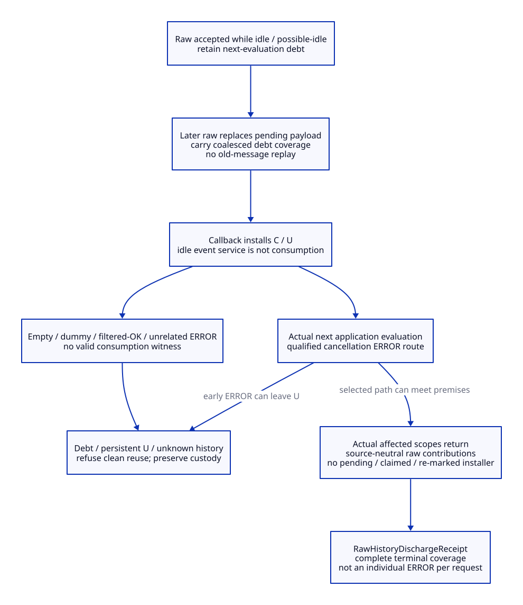

# Mixed Raw and Managed Cancellation Histories

rawInterference can become dischargeable only from a complete source-owned history,
not from a clean-looking interpreter. The decisive distinction is between an
accepted request, a callback installation, a destructive cancellation check, and
the actual return of the affected evaluation. A raw idle obligation requires an
additional next-evaluation witness. This extends the
[targeted settlement design](tcl-targeted-cancel-design.md); no implementation,
API, native qualification or performance result is supplied.
[Evidence](tcl-mixed-cancel-evidence.md), [arguments](tcl-mixed-cancel-arguments.md)
and the [cost/value matrix](tcl-mixed-cancel-benefit-matrix.md) keep the boundary explicit.

## Source Semantics Before a New Policy

MD01. Cancellation has four separate mutable planes in the pinned Tcl source:

| Plane | Existing rule | What it does not prove |
| --- | --- | --- |
| Pending CancelInfo | CancelEval replaces flags and pending message under cancelLock; NULL message selects the empty/default message lane | No FIFO, no per-request observation, no union of all pending flags |
| Async token | ready is coalesced; Invoke clears it before calling back and rescans the handler list | No snapshot of the payload that originally caused the mark; no completion from ready=0 |
| Installed state | Callback sets CANCELED; UNWIND is added if selected flags request it and persists until a reset; message is replaced by that callback's current payload | Installed UNWIND can come from an earlier request than the visible message |
| Check and control result | Canceled clears CANCELED before the UNWIND-only filter, optionally writes result/errorCode, and returns a code that callers may catch, transform or ignore | Zero flags or outer TCL_OK is not a cancellation-delivery receipt |

The callback does not clear CancelInfo's retained raw payload after installation.
Retained payload bytes alone therefore do not mean a pending request, and absence
of a future callback requires mark/claim/scope closure. Message provenance, flag
provenance and terminal outcomes must have different identities. [MX01–MX04]

MD02. The following source-composed histories expose the differences. U means
TCL_CANCEL_UNWIND, C means CANCELED, and R/M identify origin only. M effects are
proposed; their cases are conditional on the admitted mixed policy below.

| Ordered history | Selected / installed result | Consequence |
| --- | --- | --- |
| R(a,U), then R(b,0), before callback reads C | Pending b/0; callback installs C with message b | Earlier pending U was replaced, not installed; never resurrect a or OR pending U back in |
| Install R(a,U), then install R(b,0) without reset | Installed C+U, latest message b | b can be reported as an unwind even though b did not request U |
| Install M(m,U), then raw R(r,0) installs | C+U with message r, U may remain managed-derived | Clearing the managed contribution alone cannot make the raw observation equivalent |
| Install R(a,0), then R(NULL,0) installs | Latest message buffer empty; default chosen on reporting | Stale a is not an owned result or a request identifier |
| Install R(a,0); Canceled(U-only) | C cleared, U absent, return OK | Physical consumption of C without reporting cancellation; idle obligation not discharged by this check |
| Install R(a,U); Canceled(0), then another check | C cleared, U remains; repeated ERROR possible | A single observation does not end persistent unwind state |

Exact native result formatting remains as the pinned source implements it. The
callback stores a counted Tcl string, but Canceled constructs its result with a
NUL-terminated string call; a message is not an injective byte identifier or proof
of lossless diagnostic transport. Do not repair or normalize that behavior as part
of cancellation attribution. [MX01–MX04]

MD03. Define three equivalence questions before comparing providers:

| Contract question | Required preservation | Status |
| --- | --- | --- |
| Raw-only source refinement | Same raw accept order, pending replacement, callback read/install order, destructive checks and normal reset/control effects | Required; passive evidence must not alter them |
| Mixed raw-takeover policy | Earlier managed effects may exist; a raw request freezes further managed token delivery; new managed submissions reject before acceptance; old records retain custody | Selected extension of the prior design, with explicit conflict outcomes |
| Fully general interchangeable raw/managed submission | Arbitrary interleaving, managed successes and raw source behavior across priority/coalescing/reset | Unresolved; not inferred from a two-lane queue |

This study keeps the existing raw-takeover policy rather than quietly switching
to a global FIFO, raw-priority replay queue or OR-of-all-flags model. A previously
accepted managed request can be displaced, never retroactively reported unaccepted
or observed. If its API promised more than request acceptance and these declared
conflict dispositions, that profile must reject this mixed policy. [MD01–MD02,
MO01, MX10]

## A Complete History Has More Than a Request Counter

MD04. New source-owned metadata is required; the following is a data contract only:

```text
Accept = { targetIdentity, origin, sequence, admissionGeneration,
           ownerPhaseWitness, payloadSelection, allowedFlags }
Install = { installSequence, callbackScope, selectedAcceptCoverage,
            CContributors, UContributors, messageSource, descendantFrontier }
Check = { checkSequence, callerSite, evaluationIdentity,
          beforeC, beforeU, clearedCContributors, filterFlags,
          returnedCode, diagnosticAction, controlDisposition }
Reset = { resetSequence, sourceSite, evaluationIdentity,
          previousContributors, levelGuard, actualControlFrontier }
IdleDebt = { rawAcceptCoverage, designatedNextEvaluation,
             installationEvidence, checkEvidence, actualReturnEvidence }
HistoryCut = { rawAcceptCut, tokenMutationCut, installCut, checkCut,
               resetCut, ownerReturnCut, treeGeneration, evidenceComplete }
```

C/U contributors are installations, not just request IDs: a later invocation may
reinstall the same retained raw payload. A check's C-clearing transition retires
those C contributors; U contributors stay until the relevant valid reset. Message
replacement does not remove a sticky flag contributor. Evidence tables retain
coalesced coverage explicitly; they do not promise one ERROR per accepted request.
All identities include the existing provider/target/token/owner generations.
[MX01–MX05, MO01]

MD05. Record raw acceptance at its actual core entry under C, and callback payload
selection/install under C. A callback reads the current record after its earlier
A-locked claim, so the selected coverage is determined at the read. A re-mark can
schedule another invocation of that retained raw payload; it creates another
installation identity, not a second accepted request. A remaining ready bit or
in-flight callback keeps future-installer debt open even after an earlier check.
Generic unattributed marks keep unknown debt until independently accounted; they
cannot become raw coverage by guessing the last message. No new token or handler
reordering is required. [MX01–MX03, MO01]

MD06. Owner-phase classification must be source-owned and conservative. Raw callers
on another thread must not read numLevels as an unsynchronized stack oracle.
The new admitted entry/return protocol publishes an evaluation identity and phase
under the declared lifecycle/core synchronization. It must cover direct, canonical
list, bytecode, nested/NRE/event, coroutine and exceptional paths actually allowed
by the profile. A reservation before entry, ambiguous closing interval, uncovered
extension or coroutine state is possible-idle/unknown, not proven active.

Only a witness that the raw acceptance belongs to an actually live evaluation can
support active-evaluation retirement. Proven idle acceptance creates next-evaluation
debt. Possible-idle is retained as debt or rejected for qualification; it cannot be
retagged old-active just because the host still owns a C wrapper. No claim is made
that these hooks currently exist or that the selected files exhaust all callers.
[MX05–MX10, ME01, ML03]

## Installed, Observed and Returned Are Different

MD07. Use typed outcomes instead of a Boolean observed:

| Outcome | Evidence required | Reuse implication |
| --- | --- | --- |
| Replaced-before-install | Accepted raw request covered by later selected raw request before callback read | No individual message/error promise; any idle obligation is carried by the coalesced coverage, not erased |
| Installed-not-checked | Callback installed an attributed C/U contribution | Cannot discharge raw residue or next-evaluation debt |
| Checked-ERROR-routed | Actual Canceled returned ERROR at a known evaluation/control site; downstream route recorded | Can support consumption, but U, future installers, scope return and custody remain |
| Checked-OK-filtered | C was cleared by UNWIND-only check with no U; return OK | Source transition is real; cannot claim cancellation observation or idle-next-script delivery |
| Active-natural-retirement | Proven active request's source-defined check/reset/control history ended and all affected scopes returned | May discharge residual interference under an explicit no-observation-ack contract; not a guarantee that cancellation was reported |
| Idle-consumed-and-returned | Real designated next evaluation actually took the cancellation ERROR route and returned; flags/producers/installers closed | Candidate discharge with no manufactured probe/dummy evaluation |
| Unknown / lost evidence | Any relevant writer, scope, contributor or outcome is unaccounted | No discharge or clean reuse |

A result snapshot and its delivery are separate owned outcomes. Outer TCL_OK after
catch is compatible with an inner cancellation check returning ERROR; conversely,
outer TCL_ERROR may be an unrelated error. Outcome attribution follows control
history, not return code or text alone. [MX04–MX09, ME01]

MD08. Installed-but-unobserved active cancellation has a limited safe route. If
acceptance was proven active, source-defined reset/check transitions remove every
raw contributor, all affected native/control scopes actually return, and no pending
raw installer remains, a residual-neutral history can be issued without claiming
an observed cancellation. This preserves a documented source-level disposition;
a stronger API requiring confirmed interruption still fails its separate outcome
gate. Do not invoke private reset merely to fabricate this history. If the only
reason bits vanished is an unrecorded write, or acceptance could have been idle,
retain the debt and refuse discharge. [MD06–MD07, MX04–MX08, MX10]

## Idle Cancellation and the Next Real Evaluation

MD09. Raw idle cancellation must be carried to the actual next evaluation under
TIP 285. Callback installation in an event poll is not that evaluation. Nor is
Tcl_Canceled called by a cleanup helper outside evaluation. Reserve/identify the
next real application evaluation before execution and bind all relevant cancellation
checks and its actual return to that identity. Do not run a dummy/empty script to
consume an external caller's request and then call a later user job fresh.
If a canceled job is published to receive that raw request, it must be a distinct
pending-raw handoff mode, not a clean ResetReceipt or a promise of uncanceled entry.
This study does not implement or qualify that handoff mode. [MX07, MX09–MX10]

MD10. Actual source paths differ, so invocation count is insufficient:

| Selected entry path | Source behavior relevant to idle consumption | Required admission rule |
| --- | --- | --- |
| Non-direct non-list object evaluation | TclInterpReady runs before bytecode callback registration; an already installed cancellation can cause early ERROR | For one-shot C, check+actual return may remove residual state; for U, early ERROR leaves U without that callback's reset |
| Canonical list / EvalObjv | NRE increments level and arranges return callbacks; EvalObjvCore schedules exception handling before TclInterpReady | Track check, source reset, later NRCommand async poll and real return; reset before a late reinstall is insufficient |
| Direct Tcl_EvalEx / direct object route | Parses and dispatches commands; direct cleanup has no universal cancellation reset | Each actual check/command/reset path must be recorded; no generic reset assumption |
| Empty/comment-only direct source | No executed command may reach command-level cancellation service | Successful function return is not consumption; pinned-source vs unconditional next-script specification remains unqualified |
| Nested substitution / child / event | Can check/reset or service async while surrounding native scopes remain | Match actual evaluation identity and whole descendant frontier, not numLevels=0 alone |

The first row supplies a concrete reason why even an idle UNWIND that caused ERROR
may still block transparent clean reuse: persistent flags remain in the selected
source route. Clearing them with a new recovery helper can be an explicit semantic
extension, but is not already proved literal-source equivalence. General empty
and special entry-path conformance to the specification remains unresolved; this
design records the mismatch instead of declaring a successful empty evaluation a
valid cancellation receipt. [MX04–MX09]

MD11. A raw idle debt is consumed only with all of the following: a complete
acceptance/coalescing history; a known actual next application evaluation; a
qualified cancellation ERROR check routed in that evaluation; actual return of
that evaluation and all derived relevant scopes; no future raw installer; and
source-conformant neutralization of its persistent flag contributions. The check must be attributed to the corresponding raw installation/coverage; an
unrelated managed-only ERROR cannot consume raw idle debt. Multiple
pending raw requests may coalesce into one cancellation effect when that is the
actual source history; this is not an individual-error acknowledgement for each.

A prior natural reset with no qualified evaluation observation does not satisfy
idle debt. A UNWIND-only OK check can destroy C while leaving the obligation
unproved; additional instrumentation must not silently re-arm it, replay its old
message, or call it consumed. That history is source-visible and blocks this
stronger next-script contract. Repairs would need a separately stated Tcl semantic
change and admission proof. [MD01–MD10, MX04, MX09–MX10]


[D2 source](tcl-mixed-state.d2).

## Discharging rawInterference

MD12. Separate residual neutrality, required raw outcome and clean epoch admission.
The new proposed receipt is:

```text
RawHistoryDischargeReceipt = {
  targetIdentities, providerBinding, ownerIdentity, treeFrontier,
  oldEpoch, interferenceGeneration, HistoryCut,
  producerClosure, ownerIdleTicket,
  rawCoverage: [ replacedCoverage, activeNaturalRetirement,
                 idleConsumedAndReturned ],
  unresolvedRawCoverage: empty,
  liveRawCContributors: empty, liveRawUContributors: empty,
  pendingOrClaimedRawInstallers: empty, unknownDebt: empty,
  requiredOutcomeContract, outcomeCustodians,
  issuer, validityGeneration
}
```

An interference generation may be discharged only when every covered raw request
has an allowed terminal classification, all idle debts have a qualified consumption
witness, and every potential descendant/claimed/re-marked installer is closed.
Proven residual neutrality alone does not satisfy a stronger interruption/delivery
contract. Failure of either predicate leaves rawInterference set. [MD04–MD11]

MD13. Issuance is an owner operation under L -> C -> A, using the same source-bound
binding and whole same-owner frontier as targeted settlement. Join producers and
collect histories before locking; reserve all receipt/storage capacity in advance.
Under the locks, revalidate identity, complete history cut, no future raw installer,
zero raw contributions/idle debt, all terminal and required-outcome predicates,
actual owner idleness and the live exclusive ticket. Only then mark this
interference generation discharged and clear its blocking Boolean. Preserve the
historical generation and raw serial; never reset either to zero or erase records.
No payload replay, flag mutation, raw request deletion or callback execution occurs
merely because the taint is cleared. [MO01, ML01–ML02]

This permits some mixed histories that the prior absorbing-taint rule deliberately
excluded. Unknown history, arbitrary mixed policy and incomplete entry coverage
remain blocked. It is a conditional expansion of admission, not universal reuse.
A receipt from an older interference generation cannot clear a later one.

MD14. Compose receipt authority in this order:

```text
source binding + complete producer closure + actual owner idle
 -> RawHistoryDischargeReceipt (or established no-raw history)
 -> PendingSettlementReceipt for remaining old managed coverage
 -> final L,C,A revalidation of both receipts and all cuts
 -> non-forced reset of only admitted residual managed state; inspect flags
 -> ResetReceipt -> publish complete fresh epoch before releasing C/A/L
```

If raw-installed contributions remain, private reset is not a substitute for
raw-history discharge. If raw and managed installed U/C are inseparable because
provenance was lost, reject admission. A source-defined reset may have cleared both;
record its real effects rather than subtracting contributors from a shared bit.
Old managed requests keep the prior displacement/settlement rules and do not gain
an observation acknowledgement from raw consumption. [MD03–MD13, MO01]

MD15. Concurrent raw acceptance is serialized by C. Before issuance it enters the
cut; after provisional issuance it increments rawSerial/interferenceGeneration
and invalidates dependent receipts. During final validation/reset/publication,
a raw call either precedes C acquisition and blocks the old receipt, or waits
until after publication and remains valid raw cancellation of the next evaluation.
Generic unknown marks serialize on A and invalidate the token cut. No flag clear,
Boolean store or relaxed epoch counter can replace that protocol.

Owner checks/resets modify history in the owner-only plane; they cannot race the
final operation while the true owner ticket is exclusive. Publishing history to
other threads still needs lock or release/acquire synchronization. Raw callers
must not take L while holding C; no callbacks, user logging, result reset, Scheme
allocation, destructor, delivery or producer wait is allowed under the commit
locks. [MO01, MX01–MX05, ML01–ML02]


[D2 source](tcl-mixed-debt.d2).

## Refusal, Migration and Value

MD16. Refuse clean reuse when any raw idle debt has no actual next-evaluation
witness; a check only returned filtered OK; installed U remains; a selected/ready
callback can reinstall old state; message/flags provenance is mixed or unknown;
a child/ancestor or coroutine entry is uncovered; evidence storage overflowed;
raw ingress remains an unjoined old-job authority; or binding/tree/ticket changed.
A fully known source-visible active-natural-retirement outcome can release only
the contracts that allow that disposition. No forced reset, diagnostic string
comparison, elapsed timeout or dummy evaluator removes these conditions.

On failure keep admission sealed and payload/root/marker/image/outcome custody
with the original owners. A completed neutral history can be retried after new
idle verification; a consumed raw obligation cannot be replayed during retry.
Safe shutdown/deletion requires actual grace and its own lifecycle semantics;
it cannot be used as an unreported disposal of a next-script cancellation.
[ME01, MX01–MX10, MO01, ML03]

MD17. Source integration and retirement order:

| Existing responsibility | Proposed shared support | Retirement condition |
| --- | --- | --- |
| Raw payload replacement and callback behavior | Passive accept/select/install provenance at actual core sites | Raw behavior remains; no new replay queue replaces it |
| Canceled checks and inline resets | Common generated event schema and source-owned caller/evaluation identity | Every admitted check/reset/descendant writer and exceptional exit covered; return-code guessing has no callers |
| Owner evaluation lifetime | Actual native entry/return and next-evaluation reservation | Every admitted direct/list/bytecode/NRE/event/coroutine route qualified |
| Permanent raw taint in prior design | RawHistoryDischargeReceipt with terminal coverage and no residual obligations | Only source-complete, permitted mixed histories admitted; unknown histories remain blocked |
| Target settlement/reset/publication recipes | One common Scheme-derived native plan and C core facade | All per-adapter protocols migrated; no independent unlock-before-reset path remains |
| Roots/marker/provider image and result delivery | Existing Gambit/native custody plus shared owned outcomes | Obligations retained; no second GC or revival of returned C frames |

No old path is retired here. Removing the conservative taint for qualified
histories is a new capability, not a measured speedup or proof that Zig is needed.
[ME01, MX01–MX10, MO01]

MD18. The new mechanism can recover reuse opportunities lost by permanent taint,
but charges accept/install/check/reset/return records and their synchronization,
space and upgrade obligations. Modern generated C and optional Zig require the
same histories and native Tcl cooperation. No necessary support family has been
proved eliminated solely by Zig. Fully general mixed-policy refinement, installed
source/ABI correspondence, all real producers/consumers, special entry-path
specification conformance, failure completeness and native qualification remain
unresolved. See [matrix](tcl-mixed-cancel-benefit-matrix.md),
[operations](tcl-mixed-cancel-operations.json), [cases](tcl-mixed-cancel-cases.json)
and [trace](tcl-mixed-cancel-traceability.json).


[D2 source](tcl-mixed-discharge.d2).

## Next Evaluation Identity Follow-up

The [identity study](tcl-next-evaluation-design.md) sharpens MD09–MD14: the actual
next script can be a naturally occurring callback, not necessarily the host's
next application job. It records explicit script/prepared-command entry kinds,
forwarding roles and first-target order, including empty attempts. Observation,
required first-attempt consumption and raw neutrality are separate receipt
predicates; this avoids using a future reset to justify its own admission.
[Arguments](tcl-next-evaluation-arguments.md) and
[matrix](tcl-next-evaluation-benefit-matrix.md) retain unresolved entry-domain,
normalized-semantic and native conditions; no old runtime witness is promoted.
