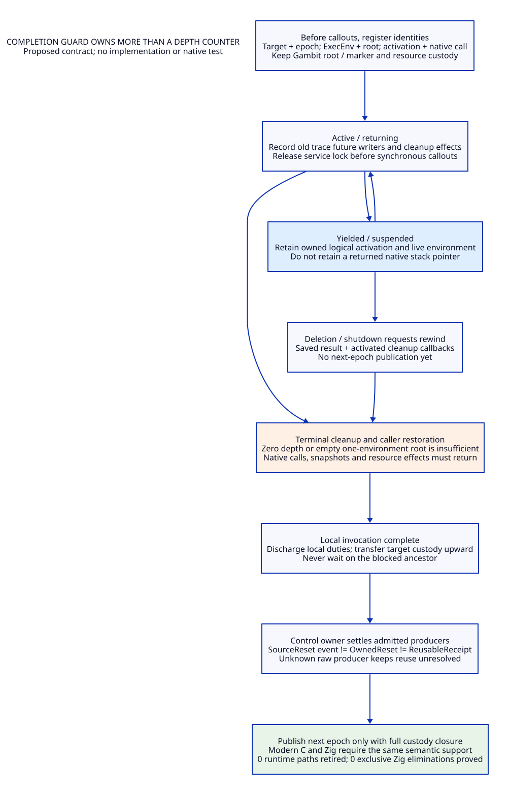

# Private Trace Entry, Reset Hooks and Coroutine Admission

Design and source research only. No implementation, native test, fixture run,
model execution or performance experiment. Modern Scheme-generated C remains
the mainline; Zig must demonstrate an additional benefit against equal modern C.
This study refines the [previous reachability study](tcl-trace-reachability-design.md).
Read the [arguments and cases](tcl-private-coro-arguments.md),
[source evidence](tcl-private-coro-evidence.md), [net-benefit matrix](tcl-private-coro-benefit-matrix.md)
and [traceability ledger](tcl-private-coro-traceability.json) together.

AD01. Separate interface existence, source reachability and admission.

Tcl's private declaration source explicitly labels its exports unsupported.
Tcl_InitStubs can populate private hook pointers, but a populated pointer is
neither a public semantic contract nor an installed-layout qualification.
The official stubs guidance excludes private interfaces from its cross-release
guarantee. A source-defined private adapter can be a deliberate project choice;
it then owns exact source/build/layout/lifetime and effect contracts. There is
no public support guarantee to inherit. [AX01, AX02]

| Route | Actual producer established here | Body conditions | Admission result |
|---|---|---|---|
| Ordinary TEOV enter/leave trace | Four core call sites, two per helper | Command evaluation increments numLevels before these routes | Public-source positive-depth route |
| TclCheckExecutionTraces at depth 0 | No actual caller identified in declared corpus | Supplied valid command, record, frames and U produce the prior bracket/reset path | Private-body construction only; unresolved caller and profile |
| Pre-readiness storage hook | Real freeProc/type-free edges; legacy variable traces | Actual selected implementation and object lifetime matter | Callout exists; arbitrary reentry or force-reset authority unproved |
| Hook calling TclResetCancellation(force!=0) | No concrete admitted producer found | Reset function body clears C and U even at positive depth | Conditional composition; unresolved producer/legality |
| Coroutine terminal cleanup at depth 0 | Public coroutine/NRE composition | Discounted root command, its callback decrement, exit compensation | Genuine source phase under balanced-path premises; not a private trace call |

The fresh lexical inventory searches all 350 retained C/H/M blobs, with
declarations, comments, stubs and executable call expressions classified
separately. The negative result is bounded by those blobs and the selected
names. It does not close function pointers, macros with different names,
unretained generated sources, loaded extensions or installed images. [AX03]

AD02. Keep the actual trace dispatcher callers and their obligations.

The committed callers of TclCheckExecutionTraces and TclCheckInterpTraces are
TEOV_RunEnterTraces and TEOV_RunLeaveTraces. The ordinary TclNREvalObjv route
adds NRCommand and increments numLevels before readiness and trace selection.
Enter order is interpreter then command traces; leave order is command then
interpreter traces. Reference counts, command epoch/error handling, result
state and active-list traversal belong to those callers. Calling the helper
directly bypasses that caller-owned work. [AX03, AX04, AX05]

AD03. A private depth-zero entry needs an explicit contract, not a signature.

An experimental PrivateTraceAdmission record must bind: exact source/build
identity and private table/layout; interpreter owner and live target; command
and trace-record identity and reference protection; object vector and command
bytes lifetime; valid varFrame/command frame; enter/leave flags, result state
and command-epoch policy; busy/suppression and active-list semantics; callback
root together with ExecEnv identity; depth accounting; allowed callouts and
exit behavior; and final result/resource delivery. Preserve Tcl's selected
record semantics rather than adding name-wide suppression. Every field is a
proof obligation for a proposed adapter, not an upstream precondition already
documented or an implemented data type. [AX01, AX04, AX05, AO01]

An unknown or mismatched field rejects managed reuse/admission for that route.
It does not authorize changing legacy raw semantics or freeing the target.
The old function-body path remains useful as a counterexample to an adapter
that assumes private dispatch at zero is harmless, but is not evidence that an
existing Gambit/Tcl application invokes it. [AO01, AP02]

AD04. Forced reset has a real predicate and an unresolved producer.

TclResetCancellation returns ERROR for a null interpreter. Otherwise it clears
C and U when force is nonzero or numLevels is zero, and returns OK even if a
non-force positive-depth request did not clear anything. TclSetChildCancelFlags
forwards a force parameter; the selected child-evaluation use passes zero.
The parser uses zero. Two other core clears are inline and must remain in the
writer closure. No selected executable call supplies a concrete nonzero force
hook. A declaration, stub slot or force parameter is not that producer. [AX03,
AX06]

ResetAdmission must identify the actual hook implementation and registration,
owner/target lifetime, nesting and permitted reentry, release ownership, reset
reason, force value, source-observable clearing event and continuation/exception
exit contract. A proposed new service owns such an adapter; this is a necessary
semantic change if it defers a clear that the old hook observed as immediate.
Preserve reset status and actual effect as separate observations. [AX06, AX07]

AD05. Existing hook edges do not license recursive cleanup.

Tcl_ResetResult can call a selected object-type freeIntRepProc, legacy freeProc,
and legacy error-variable traces. The manuals specify storage/internal-rep
cleanup obligations; they do not promise arbitrary interpreter evaluation and
private forced reset are safe in those hooks. The legacy freeProc pointer is
cleared after the call, so naive recursive Tcl_ResetResult can call the same
cleanup again. A candidate must prove one-time resource handoff, retained target
and object identity, permitted callouts and failure ownership. A hypothetical
force-reset hook can create U:1->0->1 under the old whole-word trace restore;
this remains a conditional counterexample, not a found legal caller. [AX05–AX07]

AD06. Coroutine context switching is not a cancellation-state switch.

SAVE_CONTEXT/RESTORE_CONTEXT carry exactly framePtr, varFramePtr, cmdFramePtr
and lineLABCPtr. ExecEnv switching and numLevels arithmetic are separate.
Cancellation flags and pending CancelInfo are not fields of CorContext.
Do not introduce coroutine-private cancellation cells and call it equivalent
to this interpreter-scoped behavior. Saved trace flags remain future writers
until their actual native trace invocation returns. [AX05, AX08, AX09]

AD07. Derive depth from the actual affine updates.

Let d be the caller's numLevels immediately before activation, a the suspended
coroutine's auxNumLevels, and n_y its active depth at a successful yield.

| Source phase | Update | Required interpretation |
|---|---|---|
| New coroutine root staging | canonical-list Tcl_NREvalObj adds one; explicit decrement removes that one | No arbitrary reset to zero; initial aux is zero |
| Resume | save d in aux; n := d+a | Offset relative to the current caller, not restore the creation depth |
| Successful yield | n := saved d; aux := n_y-d | Suspended work remains live; nonnegative offset requires balanced-path reasoning |
| Root NRCommand return | n := n-1 before async/cancel/limit checks | Discounted root can temporarily expose d-1 |
| Terminal exit | delete command/ExecEnv/line table, restore caller, then n := n+1 | Restores d only after cleanup; yield does not run this exit callback |

For the ordinary balanced root at d=1, the root NRCommand return exposes n=0
before terminal exit compensates it. NRCommand can invoke async/limit processing
there; terminal exit then performs command cleanup. These are real callout
sites, not proof of an existing private depth-zero trace dispatcher or
force-reset hook. A normally dispatched command from a cleanup hook again
takes its own evaluation increment. [AX04, AX08, AX09]

AD08. Extend the positive-depth argument only conditionally.

An older synchronous TraceExecutionProc live at depth h>=1 can invoke an
ordinary nested coroutine command. That command enters at d>=h+1. Assuming
balanced root staging, nonnegative suspended offsets, proper callback pairing,
no private bypass/foreign stack escape and no unclassified writer, resume/yield
preserve the floor, and its terminal discounted root reaches no lower than
d-1>=h. Thus those nested balanced paths do not supply a zero-depth non-force
clear beneath the older trace. This is a handwritten conditional extension;
the offset/pairing invariant for all tailcall, yieldto, alias, deletion and
loaded-extension histories is still unresolved. [AX04, AX08–AX11, AP04]

AD09. C-stack-busy rejection is local to the yield branch.

Activation of a suspended coroutine records the current C stack position.
Yield compares it with the current position; on mismatch it repairs a possible
yield splice reference, restores the coroutine ExecEnv and returns ERROR.
The successful depth swap does not happen. This constrains yielding across
native callbacks, but is not a blanket prohibition on resuming another
suspended coroutine inside a trace callback. Nor may an adapter report
"no effects" for the rejected branch: cleanup and error-result writes occur.
The retained early-trace-yield and time/yieldto fixtures provide actual upstream
coverage intentions, not executed cancellation evidence. [AX09, AX11]

AD10. Deletion and rewind are active work.

DeleteCoroutine saves the current callback root. If suspended it calls
RewindCoroutine and runs callbacks to that root. Rewind saves interpreter result
state, marks the coroutine ExecEnv for rewind, schedules a result-restoration
callback and activates the coroutine. Exit destroys the environment and caller
callback finishes freeing CoroutineData. The public manual says variable
deletion traces fire on deletion or conventional return. Result restoration
is not cancellation-cell restoration. Suspended != released, and command
unlink != all callback/image/frame obligations discharged. [AX08–AX11]

AD11. Completion guard tracks three different identities.

The proposed guard uses (target, epoch), (ExecEnv identity/generation, callback
root) and (logical activation, actual native invocation). Proposed field names
are schema obligations, not current Tcl structures. It records caller/active
environments, depth debt, trace snapshots and pending cleanup callouts before
entering any callout. State progression is:

```text
registered -> active -> yielded/suspended -> active
active -> returning -> terminal-cleanup -> caller-restored -> locally-complete
suspended -> rewind-requested -> active-unwinding -> terminal-cleanup
```

An invocation may finish locally while target custody stays with its ancestor
or suspended activation. No guard waits for an ancestor that cannot proceed
until the guard returns. A suspension record must not store a pointer into a
native stack that is allowed to return. Bind actual retained lifetimes and the
Gambit root/marker token; do not invent another root system. [AE01, AX08–AX10,
AL02, AO01]

AD12. Reset and reusable publication are distinct events.

SourceReset records the old requested force, actual clear predicate and result.
OwnedReset is the redesigned target-owner operation after source-semantic
delivery/settlement, no active native/trace future writer, and closed admitted
producer set. Clear bits or n=0 is insufficient for ReusableReceipt.
Suspended state, rewind callbacks, raw cancellation producers, result/free
hooks, and interpreter/image/resource leases must all be covered. A forced
source clear can occur before that receipt; suppressing it or declaring
completion from it would change semantics. Finish local guards, transfer
custody upward, drain owned asynchronous producers, and let only the control
owner publish the next epoch. [AX03, AX05–AX10, AL01, AO01]

AD13. Reject lock-based reentry deadlocks before admission.

Do not hold a non-reentrant service mutex across trace evaluation, reset-result
cleanup, async invocation, command deletion or coroutine rewind. These edges
can synchronously return to the service. Instead prepare immutable owned data,
publish/account under the narrow ownership protocol, release the lock, call
out, then validate identity and settle effects. This is a proposed protocol
requirement, not proof Tcl's existing raw mutation paths participate in it.
Unknown raw writers keep rawInterference and reuse unresolved. [AX07–AX10,
AL01, AO01]

AD14. Classify new counterexamples by the missing edge.

Depth-zero terminal cleanup is reachable in the stated ordinary root
composition. A hook forcing a reset there still needs its concrete producer
and legal effects. A private dispatcher can execute at zero if supplied by a
new adapter, but the old corpus supplies no such caller. Calling a private
coroutine body without its ordinary command increment can invalidate the depth
floor; that is not an admitted public history. Fixtures on trace/yield do not
include cancellation. Keep these distinctions in every claim and rejection.
The [case ledger](tcl-private-coro-cases.json) is inert; none is a passing test.
[AP01–AP08]

AD15. Retire obligations only after replacing every caller.

First keep the exact source/private binding and complete the writer, hook,
environment-switch and reset-producer inventories. Next generate the common
admission/activation/guard schema from Scheme, including all source-observable
results and resource transfers. Then migrate each caller and inline clear;
split trace-owned suppression from cancellation storage only after all writers
are covered. Retire whole-word trace restore, scattered reset authority or
depth-only completion only when no old producer remains and semantic/termination
acceptance closes. No production path is retired by this study. LLVM/MLIR
consume the same explicit contract and acquire no Tcl ownership authority.
[AE01, AX01–AX10, AO01]

AD16. Language choice cannot discharge caller admission.

Modern C and Zig both need the same private binding, producer closure,
coroutine/ExecEnv accounting, root/marker custody and actual native-return
protocol. Zig can make local ownership/error paths easier to express; C can
generate typed handles/tagged states and uniform cleanup. Neither expression
advantage removes these supports or makes a private hook legal. The matrix
uses operation/record/work counts and algebraic break-even conditions, never
person-days or invented timings. Full-runtime, retirement, semantic-domain,
total-cost and Zig-increment gates remain unresolved. [AV01–AV08]




## Coroutine Debt, Environment Pairing and Reuse

The [coroutine-invariant study](tcl-coro-invariants-design.md) separates credited/deferred depth, root debt, affine aux updates, two yieldto emitters and direct rewind without ordinary command credit. Its [arguments](tcl-coro-invariants-arguments.md), [source evidence](tcl-coro-invariants-evidence.md), [matrix](tcl-coro-invariants-benefit-matrix.md) and [trace](tcl-coro-invariants-traceability.json) define conditional reuse receipts while retaining all-history producer, pairing and liveness gaps. Design/source research only; no implementation or native tests.
