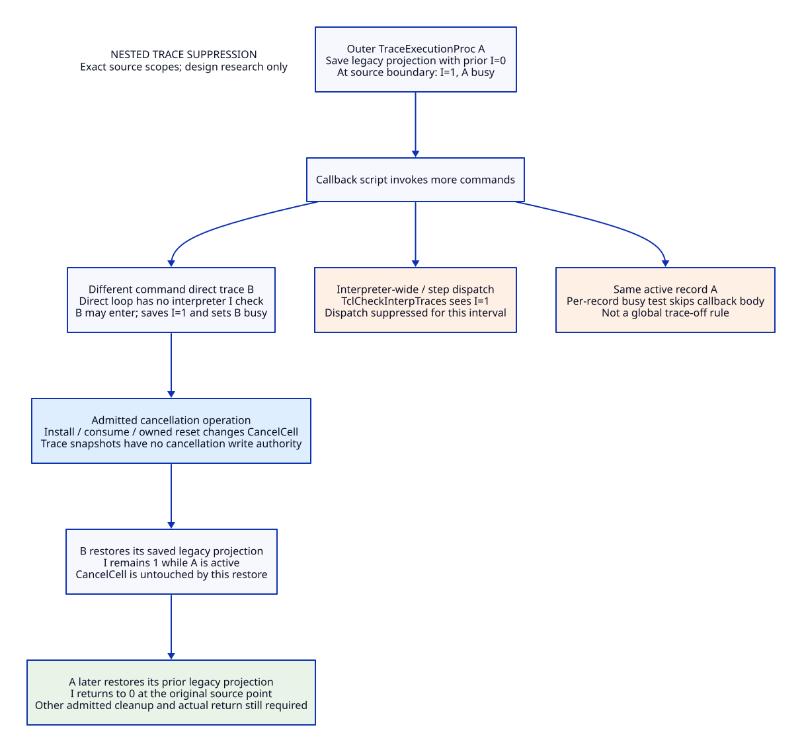

# Trace Flag Restoration and a Separate Cancellation Domain

Research design only. Modern Scheme-generated C is the mainline; Zig is an
optional provider with a separate incremental-value obligation. No source
implementation, native test, model or performance run is included. See the
[writer study](tcl-cancel-writer-design.md), [conditional arguments](tcl-trace-cancel-arguments.md),
[value matrix](tcl-trace-cancel-benefit-matrix.md), [evidence](tcl-trace-cancel-evidence.md)
and [trace](tcl-trace-cancel-traceability.json).

TD01. Use the exact pinned source and distinguish text coverage from semantics.

Tcl commit `cbf86d62348d6b052e1961b4df995960fb21545f` remains the source basis.
All 350 retained committed C/H/M captures are rehashed and searched with a new
trace-specific pattern: 5 matching files, 52 LF lines, 53 lexical occurrences,
including declarations/stubs/comments. The previous broad writer/whole-word
inventory is reused as a bound input, not relabeled as a new alias analysis.
Two additional pinned files, doc/trace.n and tests/trace.test, are captured and
Git-blob reproduced from the pinned-ref API. These two have no independent
tree comparison. Tests are read as source fixtures, never executed. Installed
Tcl/Tk, private clients, generated/aliased writes and loaded extensions remain
unqualified. [TX01, TX10, TX11, TO01]

TD02. Preserve three distinct recursion controls.

| State | Actual source location and control | Scope |
|---|---|---|
| TraceCommandInfo busy bit | TraceExecutionProc checks its own tcmdPtr flags; sets before callback eval and clears afterward | Same execution-trace record |
| Trace busy bit | TclCheckInterpTraces skips an active tracePtr and preserves/releases its record | Same interpreter-trace record |
| Interpreter suppression bit | TclCheckInterpTraces returns if INTERP_TRACE_IN_PROGRESS; TraceExecutionProc sets it around its callback eval | Interpreter-wide trace dispatch while that interval is active |

TclCheckExecutionTraces does not use the interpreter-wide suppression predicate.
Therefore a different command's direct execution trace can nest inside an active
TraceExecutionProc callback, even though interpreter-wide/step dispatch is
suppressed. The same tcmdPtr body is skipped while busy, but a later ordinary
recursive invocation after that callback returned is a different interval.
Different interpreters have different suppression words even on the same owner.
Do not turn all three controls into a single global trace-off switch. [TX02–TX05]

The pinned manual describes temporary disabling of traces on the traced name;
the actual guards here are record- and route-specific. Blanket suppression of
every record on the same command is not established solely by that wording.
Same-name multiple-prefix behavior needs a source/profile-qualified rule; this
study does not resolve the whole manual/code domain by assuming either broader
or narrower behavior. [TX10]

TD03. Original callback ordering and local snapshots remain necessary.

Enter dispatch runs interpreter traces before direct command traces, subject to
traceCode being OK; leave dispatch runs command traces before interpreter traces.
Command enter and leave list scans have different directions, with an additional
step-trace list reversal. Actual trace errors stop the relevant scan, enter errors
return before Dispatch, and a non-OK leave trace replaces the command result.
Do not swallow or normalize these codes while claiming source preservation.

TraceExecutionProc reads curFlags and curCode into local variables before any
callback. A nested dispatch can update shared tcmdPtr fields even when its later
same-record busy check skips the callback; the outer local copies remain its
context. A new TraceFrame must retain local invocation context, not reread those
shared fields during exit. The step-only setup path with call==0 has no callback
eval or whole-word snapshot but can still create/delete a step trace. [TX02–TX06]

TD04. The old restoration overwrites both cancellation bits.

Let K = CANCELED | TCL_CANCEL_UNWIND, I = INTERP_TRACE_IN_PROGRESS, and let
F denote the interpreter flag word. At the callback boundary the pinned code is:

```text
saved = F
F = F | I
mark this tcmdPtr busy; hold its reference
code = actual Tcl_EvalEx(callbackScript)
unmark this tcmdPtr
F = saved
continue DString/step-trace/reference cleanup
```

Thus the cancellation projection after that assignment is saved & K regardless
of the state just before it. The operation can erase bits installed after save,
or restore bits consumed/cleared after save. It restores no pending record,
async mark, contributor identity, message object or result; combining an old bit
with a newer diagnostic is possible. The trace code is not reset to OK by the
assignment, so lost U does not by itself turn an ERROR return into OK. [TX04, TX07]

TD05. Nested restoration is a stack of independent old cancellation writers.

For outer A and inner B on the same interpreter, suppose A saves F0, B later
saves F1, and a legitimate cancellation transition produces F2. B's old exit
restores F1; A's old exit later restores F0. Each is a separate cancellation
write, regardless of whether the inner callback was successful or returned an
error. If A's suppression bit was initially zero, B saves I=1 and restores it
to one; A eventually restores zero. Cancellation replay cannot be removed by
restoring I to zero at every exit: that would wrongly enable interpreter-wide
traces during A's still-active callback. [TX02–TX05]

TD06. Separate three strengths of cancellation histories.

| History class | Evidence | Allowed conclusion |
|---|---|---|
| Bit-level distinguishing history | Save/restore plus a permitted abstract bit mutation | Proves whole-word restore is not cancellation-neutral; not a native/script reachability witness |
| Source-composed call path | Real trace entry, callback Tcl_EvalEx, cancellation installer/check, return/restore and later check/catch | A concrete candidate for changed behavior under stated scheduling/lifetime premises; not an executed result |
| Retained upstream fixture | Exact tests/trace.test body and expected result | Identifies existing behavior to preserve/qualify; no claim it passes this checkout or tests cancellation |

In particular, TclInterpReady can consume C or reject U before a trace callback
script body runs. An example that assumes saved U=1 and then executes an ordinary
script command which clears U must explain how it passed that readiness check.
U resurrection after a private forced reset or a callback-capable pre-readiness
hook is only conditional on that ingress/hook being legal and reachable. Normal
one-shot C consumption during readiness is itself a real destructive check.
[TX04, TX07, TX08, TX11]

TD07. The preservation boundary is a projection, not just a trace-bit mask.

For a separately chosen cancellation policy define the proposed trace exit:

```text
savedLegacy = F_at_save & ~K
legacyRestore(savedLegacy) leaves CancelCell unchanged
readCancellation() uses only CancelCell
```

For reasoning about the old packed word, its projection-equivalent expression is
`(saved & ~K) | (current & K)` at the same restoration point. This is a design
equation, not a source patch or a second writable representation. It preserves
the old non-cancellation projection at that point; it deliberately changes the
cancellation projection when current & K differs from saved & K. Restoring only
I would also change restoration of all other legacy flags and has no such
non-cancellation projection guarantee. [TX04, TX05, TX09]

TD08. Choose one authoritative cancellation cell for the modernized profile.

```text
LegacyFlagProjection = legacy word excluding K
CancelCell = {targetLifetimeGeneration, mutationGeneration,
              cContributors, uContributors, diagnosticRef,
              installationAndConsumptionHistory}
TraceFrame = {invocationId, parentScope, targetHandle, traceRecordGeneration,
              route, localFlags, localCode, savedLegacyProjection?,
              phase, suppressionOwnership, callbackLease, guardDependency}
TracePolicy = {writerPolicyIdentity,
               cancellationRestore: source-snapshot | separated-cell,
               nonCancellationRestore: source-projection,
               recursionDomain, listMutationDomain, resultFoldDomain}
```

The full separated profile migrates TclCanceled/TclSetCancelFlags/
TclUnsetCancelFlags, Tcl_Canceled, private reset and inline reset bodies, recursive
propagation, diagnostics and every private layout/stub producer or writer.
Legacy read views can be generated, but an independently writable flags shadow
is forbidden. A mixed shadow state invalidates the owned-domain profile.
The trace-policy part refines support family 9 from the writer study; it does not
magically remove another runtime component. [TX01, TX07, TO01]

TD09. Two policies can coexist as profiles, never as ambiguous evidence.

| Profile | Trace cancellation effect | Guard consequence |
|---|---|---|
| SourceSnapshot | Perform actual old whole-word restoration, recording its true before/after projection and contributor uncertainty | Any claimed neutrality must include every outstanding snapshot writer; a child return cannot discharge an outer restore |
| SeparatedCancellation | Restore legacy projection at the original point and leave the authoritative CancelCell untouched | Trace exit cannot itself erase/replay cancellation; legitimate check/reset writers still need the full guard contract |

Mixed trace histories where saved and current cancellation projections differ
are an intentional modernization boundary, not transparent equivalence. Matching
bits alone are also insufficient for receipt equivalence: a consume/reinstall
can return to the same bits with different generations and diagnostics. Source
snapshot provenance is not reconstructed merely by copying old bits into a modern
cell. If complete attribution is unavailable, retain opaque source-history
custody and deny owned-domain reuse rather than fabricate old generations.
[TD04–TD08, TX07, TO01]

TD10. Preserve source timing: an early guard must not enable suppression early.

Arm an invocation/lifetime dependency before callback-script construction or
other callback-capable work. Keep the source's same-record skip, deleted/limit
checks, call==0 decision and step removal/registration behavior at their admitted
points. In particular, the original busy/I bits are set only after DString and
argument/result construction, at the snapshot boundary. Arming a guard does not
set these bits early. Such preparation may reach object hooks; legality and
reentry remain explicit profile obligations. Reserve bookkeeping before the
non-failing state transition, without holding L/C/A across arbitrary callbacks.
Set and restore suppression at the original points with a LIFO owner; nested
exit restores its prior I, not a hardcoded zero. [TX04, TX05, TX08, TX09]

TD11. Trace exit has several distinct completion frontiers.

```text
registered dependency -> preparing -> callback-running | setup-only
 -> callback-returned -> source-point restore-recorded
 -> local post-restore cleanup -> TraceExecutionProc actual return
 -> invoker reference/active-list/result-state cleanup
 -> trace-dispatch actual return -> parent completion still pending
```

Tcl_EvalEx returning is not TraceExecutionProc returning: DString cleanup,
step-trace creation/removal and final tcmdPtr reference release remain. Its
invoker then drops references, restores active trace stack pointers and either
restores or discards saved interpreter result state. Those operations can release
objects or records. A trace callback return, list unlink, zero busy bit or zero
CancelCell projection is not a trace-dispatch closure receipt. Actual post-return
witnesses belong to the caller, not an in-function final callback. [TX02–TX06, TX08]

TD12. Completion guard handoff is dependency release, not implicit reset.

Register separate invocation and dispatch dependencies against the relevant
target/evaluation guard. A nested callback's evaluation may become terminal
while its enclosing trace frame and dispatch remain live. Record that local
completion, but do not publish target neutrality, free the outer saved state,
or issue a target-wide normalized clear. Source-point reset requests retain
their actual depth/force/coverage rules; separated trace exit emits no cancellation
reset request. Final guard settlement requires all applicable trace dependencies,
native/NRE/coroutine scopes, pending installers, raw history and resource claims
to close under the same policy/lifetime cut.

```text
TraceRestoreDisposition = {policy, invocation, targetLifetime, sourcePoint,
                          oldLegacy, restoredLegacy,
                          cancelMutation: source-event | none-by-construction,
                          sourceCancelCoverage?}
TraceDispatchClosureReceipt = {policy, targetLifetime, dispatchId,
                               actualInvokerReturn, activeScopeRestoration,
                               resultStateDisposition, recordLeaseDisposition,
                               dependentChildrenClosed, remainingCustodian}
```

The latter closes only that dispatch dependency. It never proves its own parent
evaluation's completion, and a last-dependency release merely schedules an
eligible settlement; it does not bypass the existing C/A generation validation.
Do not add an async poll or Tcl_Canceled call at trace exit without declaring a
new scheduling/consumption point. [TX02–TX08, TO01, TL01, TL02]

The dependency direction is parent guard -> dispatcher -> trace invocation ->
callback evaluation. Callback evaluation can finish locally without waiting for
its ancestors; unresolved target-wide cancellation custody belongs to the target
control ledger/parent, not a backward wait edge. Otherwise the dispatcher would
wait for a child which waits for that same dispatcher. A private trace entry with
no managed evaluation needs an explicit native control owner before callouts or
is outside the profile; do not invent a script identity for setup-only work.

TD13. Trace removal and failure retain real native ownership.

Active trace deletion updates scanning cursors and postpones tcmdPtr deletion by
zeroing flags when busy; refcounts and Tcl_Preserve/Tcl_Release still protect
actual source records. Preserve these behaviors, including call==0 step setup
and cancellation-induced ERROR. A replacement trace with the same name/prefix
needs a new record/lifetime identity; it cannot inherit an old closure receipt.
If a callback deletes its command/interpreter, deletion closes admission and
native/record/image custody persists through actual exit. Do not assume the
source's legacy DELETED flag can be made monotonic by excluding only K: that
other flag is also in the old snapshot domain and needs separate lifecycle
qualification. This study proves no deletion-safety fix for the entire old word.
[TX04–TX06, TX09, TX11, TE01]

On recoverable preparation failure before callback entry, release only reserved
invocation resources; no suppression scope was entered. After callback entry,
every admitted Tcl return code traverses the real source restoration/cleanup
path. Native panic/OOM, illegal foreign nonlocal escape, abandoned coroutine or
unreturning handler cannot produce a clean closure receipt. Either a durable
custodian retains the dependency or shutdown remains incomplete. C cleanup and
Zig defer do not by themselves handle escaping captured native frames. [TX04, TX08, TL02, TO01]

TD14. Existing fixtures are concrete preservation obligations, not fresh passes.

Read-only fixture groups include recursive normal trace invocation (trace-22),
recursive step behavior (trace-23), removal during callback (trace-24), step
remove/readd and pending-scan deletion (trace-34.1–34.3), nested direct/step
interplay (trace-34.6), dynamic additions with explicitly undocumented behavior
(trace-36–38), and trace error becoming command error (trace-40.1).
The trace-34.6 fixture specifically compares step logs before/after adding a
direct dummy-command trace invoked inside a step handler. It supports retaining
the original I scope through nested direct callbacks, not disabling all nested
traces. These fixtures contain no proof of the cancellation histories designed
here and have not been run. [TX11]

TD15. Retire only cancellation replay authority from trace snapshots.

| Replacement order | Old responsibility | What must remain or qualify |
|---|---|---|
| 1 | Cancellation read/write aliases in flags | One CancelCell and all ingress/check/reset/private writer closure |
| 2 | Saved whole flags as a future cancellation writer | Saved non-cancellation projection at the same source point; explicit policy change |
| 3 | Implicit trace completion inferred from busy/list/bit state | Invocation and dispatcher dependencies with actual return witnesses |
| 4 | Ad hoc trace cancellation-history retention | Release only after every source-snapshot writer is gone from that admitted profile |

Do not retire list-order algorithms, per-record recursion guards, active cursors,
record references, step registration/removal, result-state save/restore or error
folding. Thin public/private trace APIs may remain; duplicate authoritative
cancellation state must not. Zero runtime paths retire in this study. [TD01–TD14]

TD16. Modernization improves semantics through ownership, not a language rename.

Scheme owns TracePolicy, transition/receipt schemas and generated layout/effect
metadata. Modern C owns the native trace/Tcl ABI, actual stack and callback
lifetimes, synchronization and collector/FFI roots. Zig may provide the same
service but does not remove those obligations. LLVM/MLIR share the effectful
native contract and may not move cancellation checks, trace suppression,
restoration or reclamation across declared boundaries. The thirteen support
families from the writer study remain necessary in both providers; no exclusive
Zig retirement or total performance improvement has been established. [TE01, TO01, TV01–TV08]

TD17. Qualification has separate structural and semantic gates.

Structural gate: same-source writer closure, authoritative CancelCell, no writable
shadow, exact nested suppression/ordering, reserved failure bookkeeping and
actual native/record/image lifetime. Semantic gate: chosen trace/reset/entry
policy, cancellation-induced changed branches, manual/fixture domains, raw idle
debt and source versus normalized receipts. Value gate: avoided untracked replay
and shared support exceed added lookup/dependency/receipt costs under an explicit
objective. All remain conditional. Text search and handwritten projection proofs
are not native, checked proof or full observer-equivalence evidence. [TO01, TP01–TP10]

TD18. Remaining questions are deliberately retained.

Full same-name multiple-prefix recursion semantics; imported-command undefined
domain; actual reachability of U-resurrection via legal hooks/private resets;
installed/private/alias/generated closure; interaction with non-cancellation
legacy flags such as DELETED; runtime lock/lease/capacity mapping; actual durable
completion and total cost remain unresolved. The design closes the conceptual
trace-to-guard handoff and states conditional proofs; it does not qualify a
running separated cancellation profile or positive incremental Zig value.

## Architecture Diagrams




## Same-Command and UNWIND Reachability Follow-Up

The [focused follow-up](tcl-trace-reachability-design.md) closes fixed stable direct-enter multi-record source reentry and derives callback counts without execution. It separates a positive-depth U invariant from a depth-zero private bracket/reset body path whose actual caller is still unresolved. Hook signatures do not establish private reset legality. [Arguments](tcl-trace-reachability-arguments.md), [matrix](tcl-trace-reachability-benefit-matrix.md), [trace](tcl-trace-reachability-traceability.json). Broad dynamic/imported/context/loaded semantic domains and all full gates remain unresolved.
