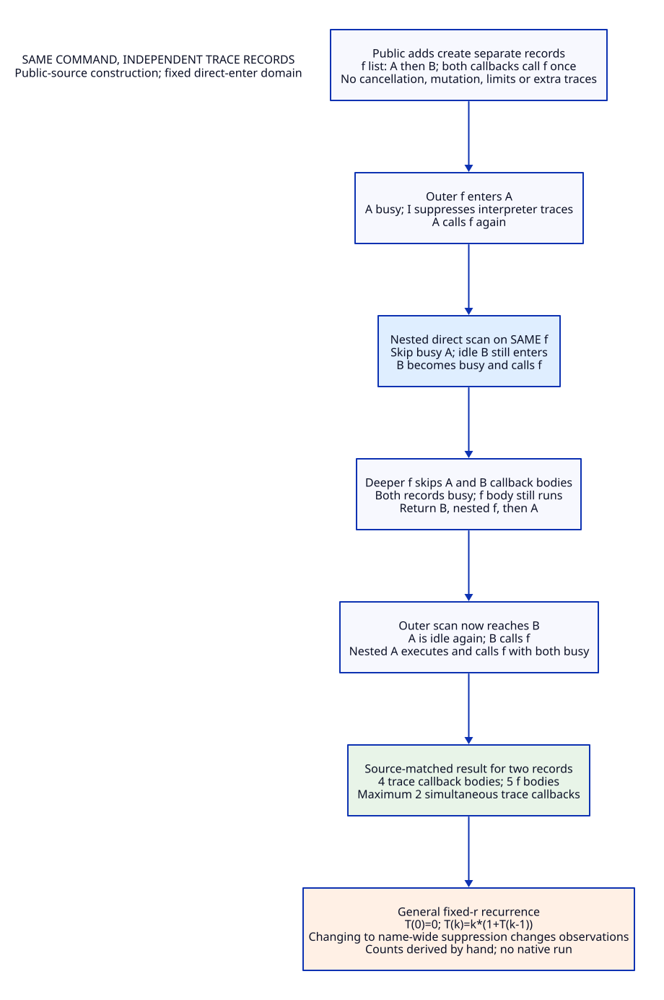
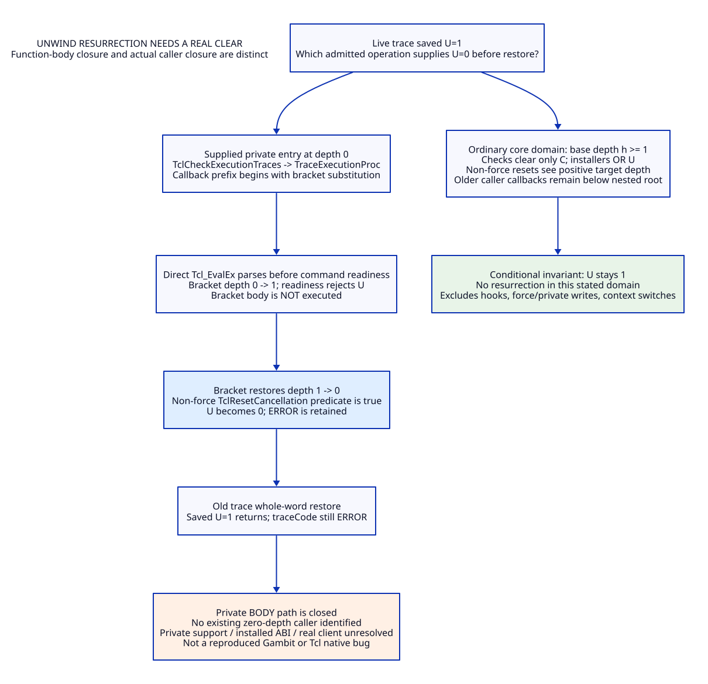

# Same-Command Trace Reentry and UNWIND Reachability

Design/source research only: no implementation, native test, fixture run, model
or performance experiment. Modern Scheme-generated C remains the mainline, with
Zig an optional provider requiring separate incremental value. The preceding
[trace-domain study](tcl-trace-cancel-design.md) is refined by [arguments](tcl-trace-reachability-arguments.md),
[evidence](tcl-trace-reachability-evidence.md), [matrix](tcl-trace-reachability-benefit-matrix.md)
and [trace](tcl-trace-reachability-traceability.json).

RD01. State exactly what kind of reachability is established.

| Evidence class | Meaning in this study | Does not establish |
|---|---|---|
| Public-source construction | Valid public registration and ordinary evaluation composed through actual branches, with explicit finite-resource/no-error premises | Executed native result or all trace configurations |
| Conditional core invariant | All identified writers in a declared positive-depth, well-bracketed domain preserve U | Arbitrary hooks, private entries, coroutines, aliases or loaded extensions |
| Private-body construction | Function bodies and concrete branch predicates form a complete state path once a private entry precondition is supplied | An existing actual caller, supported installed ABI, or legal public API history |
| Hook candidate | A native callback edge exists, but caller behavior/admission has not been established | Permission for arbitrary interpreter reentry/reset |
| Retained fixture | Pinned upstream body and expected result read as evidence | A fresh passing test or cancellation oracle |

The pinned Tcl commit remains `cbf86d62348d6b052e1961b4df995960fb21545f`.
All 350 retained C/H/M blobs are rehashed and searched with the declared new
registration/reset/busy pattern: 7 matching files, 41 LF lines, 42 lexical
occurrences, including comments, declarations and stubs. Three additional pinned
manuals are captured with reproduced API Git blobs, without independent tree
comparison. No complete generated/alias/loaded semantic closure is asserted.
[RX01, RX09–RX11, RO01]

RD02. Public registration creates independent records on one command.

TraceExecutionObjCmd allocates a fresh TraceCommandInfo for each add operation,
even for the same command name. Tcl_TraceCommand creates another CommandTrace,
prepends it to cmdPtr->tracePtr and records the independent clientData. Direct
enter scanning follows that list; leave scanning reverses its traversal. It does
not test interpreter-wide I suppression. TraceExecutionProc then tests only the
selected tcmdPtr's busy bit. The shared command name does not identify one busy
record. This closes the fixed, stable, non-imported, direct-enter multi-record
boundary; dynamic registration, aliases and imported commands remain separate
domains. [RX02, RX03, RX10]

RD03. A two-record cross-reentry has an ordinary public-source path.

Choose an ordinary unaliased command f with two distinct direct enter trace
prefixes A and B; create B first and A last, so the list is A then B. Each prefix
accepts the supplied trace arguments, calls f once, and returns OK; f's body
returns OK and has no additional traced operations. Assume no cancellation,
limits, deletion, hooks or registration changes and sufficient finite capacity.

```text
outer f: enter A
  A calls f: skip busy A; enter B
    B calls f: skip busy A and B; run f body
  return from B; run nested f body; return from A
outer scan: enter B again
  B calls f: enter now-idle A; skip busy B
    A calls f: skip busy A and B; run f body
  return from A; run nested f body; return from B
run outer f body
```

The order inside each nested scan follows the same list. Existing contexts,
readiness and callback-root boundaries permit these finite calls under the
premises. Thus another record on the same command can execute while A is busy;
it is not merely an abstract bit example or a private hook construction. This
trace is a prose input/history specification, not implemented test code. [RX02–RX04]

RD04. The general fixed-record callback count is semantic work.

For r fixed independent direct enter records, each callback calls f exactly
once and returns OK. In a command invocation with k available records, each
selected callback adds one body plus a nested invocation with k-1 available
records; earlier callbacks become idle again before later scan entries. Hence:

```text
T(0)=0; T(k)=k*(1+T(k-1))
T(1)=1; T(2)=4; T(3)=15; T(4)=64
command body executions = 1+T(r)
maximum simultaneous trace callback bodies = r
T(r)=r! * sum(1/j!, j=0..r-1)
```

These are handwritten exact counts for the declared cancellation-free input
family, within configured recursion/space limits, not benchmark timings or a
simulated native run. Global name-level trace suppression would remove observable
callback work and change this behavior; it is not a transparent optimization.
New records added during callbacks invalidate the fixed-r bound, even if their
prefix/name matches an active removed record. [RX02, RX03, RX10, RP02]

RD05. TIP/manual wording is broader than the identified record-level code.

TIP 62 and pinned doc/trace.n describe temporary disabling on the traced name.
The direct stable-record source construction in RD03 does not support interpreting
that as a blanket prohibition on every record for f. Preserve the selected
pinned implementation behavior explicitly; a new name-level suppression policy
would need its own semantic decision. The upstream two-trace order fixtures and
dynamic/deletion fixtures are independent preservation obligations, not an
executed oracle for RD03 or the UNWIND histories. [RX09, RX10]

RD06. A real U resurrection needs a real intervening clear.

For one saved trace frame, resurrection means U_at_save=1, an admitted transition
actually makes U=0 before that frame exits, and its old whole-word restore writes
U=1 again. Tcl_Canceled clears only C before filtering, not U. Pending replacement
changes pending flags, not installed U; an installed normal request ORs into
state and does not remove old U. Merely returning ERROR, consuming C, observing
the cancellation, or changing the diagnostic cannot supply the missing U clear.
If an older enclosing trace saved U=0, its later restore can erase U, but it
cannot return while this inner native frame remains active under well-bracketed
calls. [RX03–RX05, RO01]

RD07. Entry checks differ across actual evaluation paths.

| Entry/path | Actual check and completion behavior | Consequence for U-clear claims |
|---|---|---|
| EvalObjvCore | Schedules eligible exception handling, then TclInterpReady before command dispatch | A normal reset command cannot be assumed to run past installed U |
| Non-list bytecode TclEvalObjEx | TclInterpReady before compilation and before registering TEOEx_ByteCodeCallback | Readiness ERROR does not manufacture a registered completion reset |
| TraceExecutionProc callback | Calls string Tcl_EvalEx, whose direct path parses/substitutes before per-command EvalObjv readiness | Do not substitute bytecode-entry behavior for this route |
| Bracket token in direct parser | Increment depth, TclInterpReady, optionally nested eval; decrement; TclResetCancellation(0) even after readiness ERROR | Reset predicate uses the restored actual depth, not the failed nested depth |
| Direct string command dispatch | Tcl_EvalObjv with TCL_EVAL_NOERR | No newly scheduled TEOV_Exception solely from that internal direct command |

Callback roots are bounded: Tcl_EvalObjv saves TOP_CB and TclNRRunCallbacks stops
before that root. A nested synchronous call cannot simply execute its caller's
older top-level exception callback to obtain a reset. [RX04, RX06, RX08]

RD08. In a declared ordinary positive-depth domain, U does not clear inside the frame.

Assume the same live target, base depth h>=1 throughout the trace interval,
well-bracketed synchronous evaluation with bounded callback roots, fixed records,
no coroutine context switch/nonlocal escape, no force reset/direct private flags
write, and only the catalogued source writers. Then a new nested EvalObjv reaches
depth at least h+1, so no level-one exception handler is created for it. Its
caller’s older exception handler is below its callback root. A bytecode return
sees depth at least h, not zero; parser reset returns to at least h; descendant
non-force reset sees the live target’s positive depth. Tcl_Canceled and installers
do not clear U. Nested trace snapshots capture U=1 and restore U=1. Therefore
U=1 remains invariant in this domain: the missing 1->0 transition does not exist.

This is a conditional exclusion proof, not a theorem over every loaded/native
program. It deliberately excludes coroutine context/numLevels changes and unknown
aliases/hooks. It also does not preclude a trace saved with U=0 from later erasing
a newly installed U. [RX01, RX03–RX08]

RD09. A depth-zero private-entry construction closes the function-body path.

Here is a different domain, not a discovered existing caller. A native owner
retains a valid target/command/trace record at numLevels=0, installs U, then
directly invokes private TclCheckExecutionTraces for that valid command. The
trace prefix begins with a bracket substitution. No foreign hook or force reset
is needed inside the trace:

| Step | Actual body/branch | Depth | Installed state |
|---|---|---|---|
| 1 | Private trace loop -> TraceExecutionProc saves whole flags | 0 | U=1 saved |
| 2 | Callback Tcl_EvalEx starts direct parsing and reaches bracket token | 0 | U=1 |
| 3 | TclSubstTokens increments; TclInterpReady reports cancellation | 1 | C consumed, U=1, code=ERROR |
| 4 | Skip bracket body; decrement; TclResetCancellation(interp,0) | 0 | Predicate true; C=U=0 |
| 5 | Substitution and direct evaluator propagate ERROR through cleanup | 0 | U=0 |
| 6 | TraceExecutionProc restores its saved word | 0 | U=1 again; traceCode still ERROR |

The body path is source-composed and the reset condition is concrete. However,
the selected committed code calls trace checking from ordinary TEOV enter/leave
paths; no depth-zero private trace caller is identified by the 350-file inventory.
Private declarations/stubs establish an ABI surface, not a supported outside-eval
calling contract, installed client or safety guarantee. Thus the complete real
application/native path remains unresolved pending that caller/profile evidence.
This must not be reported as a current Gambit/Tcl native bug reproduced here.
[RX03, RX04, RX06, RX11]

RD10. Hook reachability is not hook legality.

Tcl_ResetResult precedes the readiness test and can call ResetObjResult's type
destructor, legacy result freeProc, or variable writes with trace side effects.
That supplies real pre-check native callback edges. The pinned manuals specify
freeProc as storage release and freeIntRepProc as internal/type-specific cleanup;
the latter must not access bytes. They do not establish unrestricted recursive
evaluation or permission to reset cancellation on a particular interpreter.

A hypothetical owner hook which calls private TclResetCancellation(force=1)
would clear U at positive depth and permit a later old snapshot resurrection.
The helper body supports that bit transition, but the exact hook/target lifetime,
private API contract and actual producer remain unproved. Fresh reset/caller
search identifies the parser non-force call and descendant forwarded-force call;
the known top-level descendant reset uses force=0. No concrete force=1 hook
caller is supplied by these hits. Generic alias/loaded clients are not excluded.
Recursively calling Tcl_ResetResult from a freeProc before its original caller
clears that pointer can also reenter cleanup; it is not a free legality witness.
[RX01, RX05, RX07, RX11]

RD11. Guard admission needs a typed hook and reset boundary.

Proposed design data, not an implemented API:

```text
HookAdmission = {sourceImage, kind, owner, targetLifetime, objectLifetime,
                 allowedEffects, reentryDomain, depthFloor, exitDiscipline,
                 resetAuthority: none | source-event | owned-scope}
ReachabilityBasis = {public-source | private-body | hook-candidate,
                     realCallerEvidence?, exactEntryKind, actualDepth,
                     resetPredicate, beforeAfterU, outstandingTraceFrames}
```

Arm the actual trace/dispatch dependency before result reset or other hook-capable
preparation, while preserving original suppression timing. A supported release
hook may still be forbidden from Scheme/Tcl reentry or cancellation reset by the
managed profile. A source force reset is a true destructive source event, never
an owned-completion witness. Owned reset must validate every live ancestor trace
and generation; if authority is missing, retain custody and deny target reuse.
Returning the old private API's OK while silently changing an applied clear into
a deferred/no-op is not demonstrated equivalence. [RX04–RX08, RO01, RL01, RL02]

RD12. A bad child guard can introduce resurrection even without a legacy core clear.

If an unfinished outer SourceSnapshot frame saved U=1, an inner readiness ERROR
followed by a new guard's premature target-wide clear creates U=0; the outer
restore then revives U. This is a proposed-migration counterexample, not current
implemented behavior. The guard cannot use its own local completion to authorize
the clear that requires its ancestor to have returned. Preserve the acyclic
parent -> dispatcher -> invocation -> callback-evaluation dependency chain.
Callback evaluation may finish locally without waiting backward; unresolved
target custody stays with the control owner. Only the later whole-frontier cut
can authorize the selected reset/neutrality policy. [RO01, RX03, RX08, RL02]

RD13. Classified results replace a single blanket bug claim.

| Case | Current conclusion |
|---|---|
| Fixed same-command multi-record direct-enter reentry | Public-source construction closed under RD03 premises; no native execution |
| Fixed-r count / record-level vs name-level suppression | Exact conditional semantic derivation; blanket suppression changes observations |
| U resurrection inside RD08 ordinary positive-depth domain | Excluded by the stated writer/depth/root invariant |
| Zero-depth private trace + bracket callback | Function-body path closed; actual private caller/support/installed domain unresolved |
| Legal pre-readiness force-reset hook | Native edge and reset body exist; actual admitted hook/caller unresolved |
| New normalized guard clears while an old snapshot is active | Invalid migration schedule exposed; no implementation claim |
| Old snapshot saved zero erases a later installed U | Still a distinct conditional erasure path, not U resurrection |
| Dynamic add/remove, imported names, coroutine depth changes, unknown aliases | Outside fixed-domain proof; retain unresolved |

RD14. Keep the source behavior or change it explicitly.

The full separated CancelCell profile from the prior study removes trace
cancellation writes while retaining per-record/direct/interpreter control, actual
source reset locations and result/error behavior. The new proof does not require
inventing a force hook to justify that architecture: one independent snapshot
authority is a structural concern even where a particular resurrection history
is excluded. Conversely, an excluded bug cannot be counted as an achieved runtime
benefit. Preserve the multi-record callbacks in a source-matched profile; a new
command-wide suppression policy needs a separate semantics/capability decision.
Unknown writers and private-entry/hook contracts block the corresponding profile.
[RO01, RX02–RX11]

RD15. Retirement conditions remain source-and-caller dependent.

Retire cancellation bits from saved trace words only after canonical-cell writer
closure. Retire untracked private force/reset routes only when every real client
is migrated to explicit source-event or owned-scope operations. Retain public
trace registration/list traversal, independent record identities, callback-root
limits, per-target depth checks, source-result cleanup, native record/image
leases and actual dispatcher return witnesses. Removing an unknown producer from
a textual list is not retirement. Scheme derives schemas and policy; generated
C and optional Zig must implement the same native semantics. LLVM/MLIR cannot
erase these effects at their shared native boundary. [RE01, RO01, RX01, RX11]

RD16. Value is structural and conditional; total and Zig increment remain open.

The [matrix](tcl-trace-reachability-benefit-matrix.md) charges the same thirteen
necessary support families to modern C and Zig. It adds exact fixed-input work
counts and separates body-closed from caller-closed paths, without runtime speed,
labor-day or fake probability numbers. No runtime path retires and no full
semantic/native/total-cost/Zig-increment gate is promoted. The remaining research
requires actual private/hook/coroutine/loaded contracts and policy-matched evidence,
not a language switch or an extra unchecked cleanup callback.

## Architecture Diagrams






## Private Entry and Coroutine Admission

The [private-entry/coroutine study](tcl-private-coro-design.md) distinguishes unsupported private table access from actual caller admission, derives coroutine depth/cleanup phases, and refines completion custody. See its [arguments](tcl-private-coro-arguments.md), [evidence](tcl-private-coro-evidence.md), [matrix](tcl-private-coro-benefit-matrix.md) and [trace](tcl-private-coro-traceability.json). Private depth-zero dispatch and legal force-reset-hook producer closure remain unresolved; no implementation or native tests.
