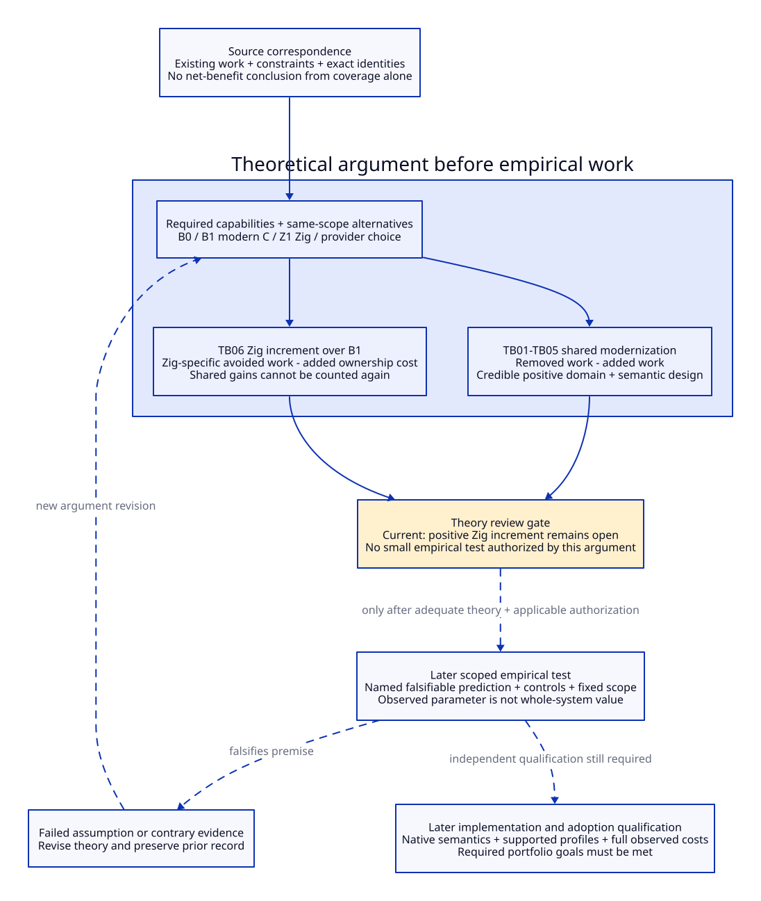

# Theoretical Net Benefit Before Empirical Tests

Date: 2026-10-20. Design argument only. No backend implementation, native small
test, timing experiment or new research-engine evaluation accompanies this
revision. The user requires a theoretical benefit case before deciding whether
small empirical tests are justified. This separates that case from both the
eventual observations and the final adoption decision.

The current architectural mechanisms are concrete, but a positive incremental
net benefit for Zig over the same refactor in modern C has **not** been
established. It is a first-class theoretical obligation, not something a fast
microbenchmark is expected to establish for us.


[D2 source](theoretical-net-benefit.d2).

## 1. Four Different Kinds of Statement

| Layer | What it can establish | What it cannot establish |
| --- | --- | --- |
| Source correspondence | Existing producer, consumer, work and semantic constraint at exact local bytes | Positive benefit merely because the map is complete |
| Theoretical case | Explicit objectives, mechanism, removed/added work, semantic conditions, alternatives and positive domain under justified assumptions | Actual wall time, maintainer hours or native correctness of an unimplemented route |
| Scoped empirical test | A named prediction or uncertain parameter under a fixed context; possible falsification | Whole-system value, untested semantics or adoption authority |
| Implementation/adoption qualification | Required native semantics, supported profiles, observed full costs and selected portfolio value | Retroactive permission to omit the theoretical argument |

The earlier DSL consistency controls only checked declared research records.
They are not tests of this theoretical net-benefit case. A source hash, an
ASCENT result, a working ABI example and a speed measurement remain distinct.

Theoretical reasoning can precede implementation: it uses source-derived
structure and explicit assumptions. It must not demand completed native
qualification as a premise for deciding whether to study a native hypothesis;
that would make the research order circular. A realizable semantic design and
an explicit qualification path are required; actual realization is a later gate.

## 2. Define an Objective Before Assigning Benefits

The selected research objectives are:

- preserve Gambit's Scheme semantic authority, continuations, proper tails,
  managed object/runtime ownership and portable C capability;
- support a common native subsystem serving portable C and a native route,
  with semantic MLIR optional and separately justified;
- reduce repeated generation/translation and duplicate native decisions,
  rather than preserve all old owners beneath an extra wrapper;
- make FFI/resource/control and future provider/runtime changes explicit and
  locally maintainable without hiding their qualification cost.

These are requested design goals, not a measured usage portfolio. An investment
case must name which goals are required in its scope and which remain options.
A future capability can be valuable before it has usage measurements, but its
value must be an explicit project objective, not an invented speedup or price.

Compare equal capability and supported-profile sets. B0 is today's source-bound
architecture; B1 implements the same proposed contracts using modern C/existing
tools; Z1 implements those responsibilities using Zig. If we compare two future
output paths with a design supporting only one, report a capability difference
instead of calling it a free simplification. A hypothetical extension of B0
supporting the same paths is a counterfactual design, not current observed cost.

## 3. Six Benefit Arguments With Their Sign Conditions

The source anchors below were reviewed in the existing
[Gambit-centered design](gambit-centered-backend-redesign.md),
[ForeignPlan ledger](foreign-plan-evidence.md),
[Darwin boundary](darwin-first-compile-boundary.md) and
[retirement plan](hostgraph-retirement-plan.md). They establish mechanisms and
constraints, not the unknown cost coefficients in these arguments.

### TB01 — Remove a Textual Compilation Stage on the Native Route

`_t-cpu.scm:142-180` packages native bytes/fixups through a generated Scheme
expression and the C target. `_t-c-2.scm` emits native-runtime obligations as C
macros. A proposed direct native product route can remove selected C text
generation, preprocessing and C-language reanalysis from that route.

For the same delivered capability, let `Rtext` be that removed work and `Aplan`
be added export, serialization, layout, IR construction, bridge and service
work. Let `DeltaCodegen` be any additional cost from changing the actual
code-generation provider. The theoretical compilation-work gain is:

```text
Gain_native = Rtext - Aplan - DeltaCodegen
positive exactly when Rtext > Aplan + DeltaCodegen
```

Use a common work unit or separate components; bytes are not time. Existing
semantic checks, roots and module obligations moved into the plan are relocated
work, not eliminated work. Shared code-generation cost can be cancelled only
when it really is identical. This is a concrete opportunity shared by B1/Z1;
it is neither a proven speedup nor a Zig-specific dividend.

### TB02 — Share Semantic Decisions Across Multiple Outputs

The C scanner owns check/private-return/root materialization decisions
(`_t-c-2.scm:345-448,825-905`). Foreign signatures and wrapper programs are
partially lost or embedded in generated text (FS01/FS05/FS07-FS11). A frozen
Scheme plan with one common product owner avoids independently recreating
those semantic decisions in each future output path.

Let `k` be the required outputs sharing a rule, `d` the per-change work of
maintaining that rule in one otherwise independent path, `v` the added
contract/verifier/shared-planner work per change, `a` added provider-adapter
work, `M` migration work and `u` relevant changes over the chosen horizon.
Under the explicit counterfactual that the alternative duplicates this rule:

```text
Gain_shared = u * ((k - 1) * d - v - a) - M
positive only if (k - 1) * d > v + a
and u > M / ((k - 1) * d - v - a)
```

For the selected portable-C plus native pair, `k=2`, so the recurring
condition becomes `d > v + a`, with enough relevant changes to amortize `M`.
Whether the actual shared rules meet that bound remains a theoretical task.

This is an exact symbolic threshold under the model, not an estimate of hours.
`k=1` does not earn a multi-output reuse benefit. Do not claim today's single C
path already duplicates every future rule. Physical per-target layout and
semantic qualification still exist. If B1 also shares the plan, this entire
benefit cancels in B1-to-Z1 attribution.

### TB03 — Reuse Construction Programs and Correct Artifacts

The historical Darwin studies distinguish interface construction programs from
fresh lexical/phase/dynamic instances. For `n` equivalent valid reuses, let `g`
be repeated code-generation work removed per reuse, `l` additional lookup and
validation work, `b` added per-instance work and `P` preparation/storage cost:

```text
Gain_reuse = n * (g - l - b) - P
positive only if g > l + b and n > P / (g - l - b)
```

Required fresh instances are not part of `g`. Changed dependencies must miss.
If reuse changes error or initialization semantics, the case is inadmissible
regardless of the inequality. Constructor reuse is available without Zig;
Zig's role must earn a separate increment. The actual prefix's exclusive
removable fraction remains unknown.

### TB04 — Replace Implicit Foreign Decisions With One Typed Program

FS07-FS09 locate three handoff losses: registry reset, procedure-list mutation
and clearing the interface as emission acknowledgement. FS05/FS11/FS14 locate
ordered conversion, cleanup, nonlocal control and release-failure semantics.
KU01-KU03 supply real kernel consumers of the lifetime/field/conversion rules.

The theoretical improvement is explicit information preservation and a single
reviewable semantic authority. It can prevent a class of divergent adapter
decisions by construction, provided every selected consumer uses it and the
plan/verifier is adequate. It does not prove fewer defects or less review time.

For `u` relevant changes, let `D` be removed repeated semantic/adapter decisions,
`V` added schema/verifier work, `E` new envelope/control obligations and `M` the
migration cost in compatible engineering-work units:

```text
Gain_foreign = u * (D - V - E) - M
```

Positive benefit requires both adequate semantic coverage and this expression
positive under defensible bounds. C control envelopes may be necessary; their
construction and upkeep are charged to `E`. Explicitness alone is a useful
design property, but not a numerical net-saving proof. Again B1 can earn it.

### TB05 — Delegate Backend Mechanics Without Delegating Scheme Semantics

The negotiated target interface (`_back.scm:17-145`) is consistent with exposing
the semantic/runtime contract before native construction. Provider services can
carry instruction selection, register allocation or admitted analysis/codegen
mechanics rather than maintaining those mechanics locally. Scheme primitive,
control, effect and GC laws remain local obligations.

For the same capability set, let `L` be local backend maintenance avoided,
`P` provider adapter/upgrade/distribution work, `Q` added qualification work,
and `M` integration/migration cost over a fixed horizon:

```text
Gain_provider = L - P - Q - M
```

Theoretical leverage is positive only when the avoided local responsibilities
exceed the complete service burden. If the comparison starts with no such
capability, its value is an explicit capability objective, not historical
maintenance saved. Direct LLVM, a C/C++ service and semantic MLIR are distinct
alternatives. This is not a gain unique to Zig.

### TB06 — Establish Zig's Own Increment Over the Same Modern-C Design

The ForeignPlan comparison identifies candidate Zig mechanisms in physical
product generation, native allocation/resource ownership, C-unit integration
and reusable service machinery (EC03/EC05/EC06/EC07). Control containment,
provider integration and toolchain ownership add costs (EC04/EC08/EC10).

Let `J` be engineering work avoided specifically by a named Zig mechanism,
`Z` added Zig-specific language/toolchain/control/adapter work, and `Mz` the
incremental migration/training cost against B1, over the same horizon:

```text
Gain_Zig_increment = J - Z - Mz
```

`J` must identify the corresponding B1 mechanism and why the work differs.
“Typed,” “modern,” “no GC,” a direct C import, or the shared gains TB01-TB05
does not supply its magnitude or sign. An equivalent C generator/service is a
real alternative. No source-derived bound currently establishes `J > Z + Mz`.
Therefore TB06 remains theoretically open. A fast Zig ABI microtest cannot
close it; the missing argument concerns maintained responsibilities and costs.

The [paired modern-C/Zig refinement](zig-vs-modern-c-net-benefit.md) now makes
TB06 concrete: BC01-BC08 define an equal-capability C design, ZC01-ZC08 separate
bounded mechanisms from shared/unsupported credit, and PC01/PC02 expose the
actual support and lifetime relations. Its [primary evidence ledger](zig-vs-modern-c-evidence.md)
supports local obligation-transfer reasoning without claiming a global positive
cost bound. The remaining theoretical gate is a justified support-retirement
and cost-domain certificate; no native small test supplies that argument.

## 4. Positive Domain, Uncertainty and Double Counting

For a selected objective expressed in compatible units, use an assumption
domain `Theta` with a rationale for every bound. A robust positive case needs:

```text
lower_bound(Net | Theta) > 0
```

A conditional case may instead identify exactly which inequalities make it
positive and which parameters can reverse the result. Report it as conditional.
Choosing arbitrarily large reuse counts or assuming free adapters merely to
make an inequality positive is not theoretical justification. Bounds can come
from source structure, declared scope, maintained component counts, existing
engineering records or explicit project constraints; none is invented here.

Keep at least these objectives separate: compilation/runtime work, memory,
maintainer effort, reliability constraints and new capabilities. If there is no
agreed conversion between them, use a vector of effects and explicit tradeoffs,
not a single summed score. A correctness constraint cannot be traded for speed.
Record whether a case is dominance, a permitted tradeoff or merely conditional.

Do not add TB01 and TB03 for the same skipped compiler invocation. Do not add
TB02 and TB04 for the same shared semantic rule. TB05 counts only delegated
mechanics not already credited to a common subsystem. TB06 excludes all gains
available equally to B1. One-time preparation/migration is charged once,
recurring upgrades and permanently coexisting old paths are charged repeatedly.

The objective is a defensible positive case in the selected design domain,
not universal superiority over all workloads. A broader scope requires another
argument; a narrower scope must still meet its declared required objectives.

## 5. Three Source-Grounded Exclusions

These exclusions already constrain theory without running a workload:

1. With the compiler/expander and runtime held fixed, merely replacing the
   consumer C compiler invoked after the first compile message removes no
   operations from the preceding interface-construction program. It earns zero
   *removed-prefix-work* credit for that mechanism. This is a causal phase
   boundary, not a statement that all compiler choices have identical timings.
2. If generated code uses the same Gambit collector/protocol, the absence of a
   GC in the Zig implementation does not remove Scheme tracing, moving roots,
   barriers or VM lifecycle work. Claiming that algorithmic saving requires
   another explicit change and proof.
3. If every old resolver/emitter/adapter decision stays authoritative and the
   new layer only forwards, it earns no decision-retirement credit. It may
   provide another named capability, but cannot sell unchanged work as removed.

Thus a build-launcher-only Zig proposal cannot meet the stated prefix-work,
runtime-protocol and semantic-owner modernization goals by that mechanism.
This rejects an inadequate theoretical scope; it does not reject Zig carrying
the substantive subsystem proposed in TB01-TB06.

## 6. Gate From Theory to Small Empirical Tests

Before a proposed test, record all of the following:

| Item | Required theoretical record |
| --- | --- |
| Objective and comparator | Selected required capability/profile, B0/B1/Z1 or provider alternatives, horizon and allowable tradeoffs |
| Positive mechanism | Source-grounded removed and added responsibilities; signed benefit domain and reasons its assumptions are credible |
| Semantic feasibility | Explicit roots/control/layout/lifetime obligations and a realizable route to qualification; no contradictory hidden requirement |
| Zig attribution | For a Zig adoption test, explain TB06 rather than borrowing shared-architecture gains |
| Decisive uncertainty | One named assumption or predicted relationship the test can falsify; what decision changes if it fails |
| Test scope and interpretation | Inputs, context, controls, observation, failure condition and what the result cannot establish |
| Authority | Applicable session authorization and limits, reusing existing authorization where it applies; the theory record itself grants none |

The gate is scope-specific: theory for a constructor architecture can justify a
constructor hypothesis, not an unrelated Zig/GC experiment. Passing the theory
gate means the proposed experiment is worth considering; it does not establish
runtime qualification or final economic adoption. Failure keeps that test
pending and redirects research to the missing argument.

A future prediction record might ask whether a specified native artifact
route truly eliminates its declared C translation stage, or whether a chosen
adapter retains a prohibited control edge. A timing-only check cannot prove
semantic equivalence. No such record is executed or authorized by this file.

## 7. Current Judgment and Research Order

TB01-TB05 have concrete source/design mechanisms and explicit conditional
positive domains. Their end-to-end net signs are not established by those
domains alone. TB06 still lacks a justified positive bound over B1. This
revision does **not** mark the theory gate passed for a Zig adoption test.

Continue by closing theoretical responsibility/assumption bounds for a named
capability, including a real B1 design and the complete added control/provider
burden. Then review whether its net-benefit domain meets the stated objectives.
Only afterward consider a bounded test of its remaining falsifiable premise.
Keep observed parameters in a later empirical record without rewriting this
argument as an observed result.

The research index adds separate `architecture-argument` requirements for
shared-architecture net benefit and Zig's incremental net benefit. Existing
`measured-cost` and native requirements remain independent. No empirical/native
requirement is used to manufacture theoretical positivity, and no theoretical
claim is a witness for native correctness or actual measured cost.
