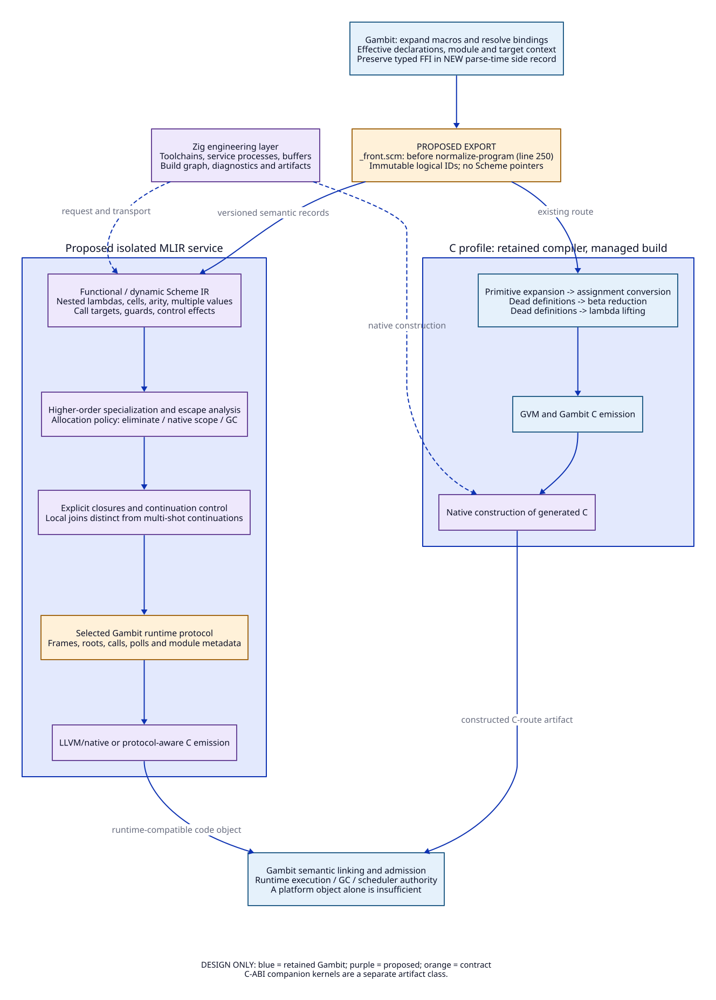
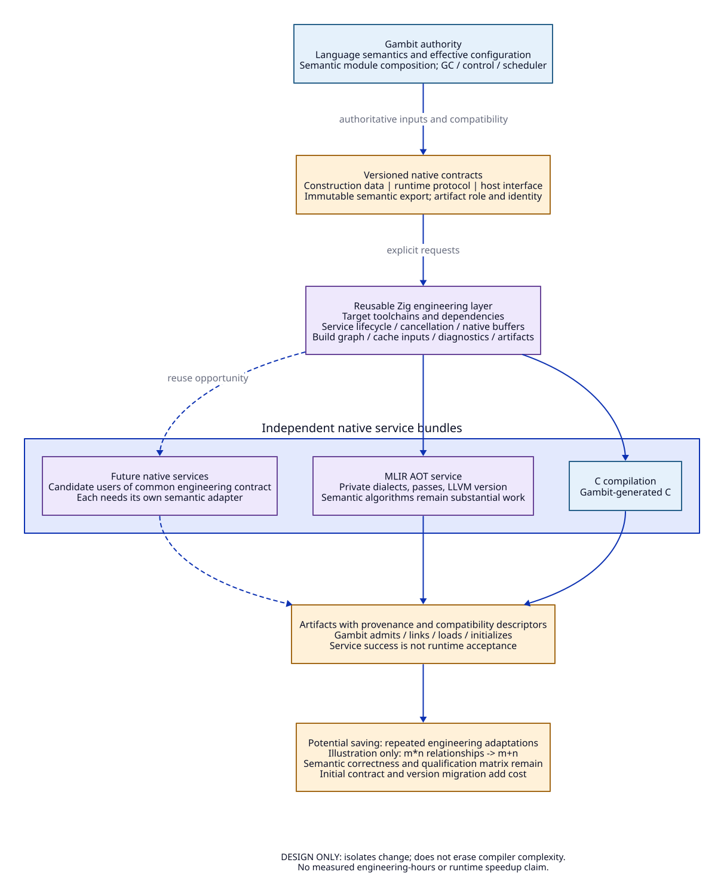

# High-Level Scheme Semantics Through an Isolated MLIR Service

Date: 2026-10-19. Status: selected architecture, design only.

This extends the [native contract](zig-native-contract-design.md), with a
[source/paper evidence ledger and quantitative model](zig-high-level-semantics-evidence.md).
The [primitive/FFI coverage](primitive-ffi-coverage.md),
[evaluation/effect contract](evaluation-effects-contract.md) and
[pass admission matrix](mlir-pass-admission.md) refine the decisions below.
Operation names below are proposed vocabulary, not existing dialects or executable
syntax. No compiler, runtime, model or prototype is implemented by this document.

## 1. Architectural Decision

Select an immutable export of the resolved parse tree immediately before
`normalize-program`, with a versioned semantic envelope. Preserve nested functions
and mutable binding identity in a high-level Scheme dialect. Run higher-order,
effect and escape analysis before choosing closure layouts and storage. Then lower
through explicit control and the selected Gambit runtime protocol.

Zig owns the engineering boundary: native buffers, requests, dependencies,
compiler-service processes, target toolchains and artifacts. Gambit owns the
meaning of bindings, declarations, primitives, control and runtime compatibility.
The MLIR service implements transformations under that meaning. A service may
use C++ internally where dialect/pass facilities require it; Zig's C interoperation
does not remove the need to develop those facilities.

The existing C path remains a separately selectable compilation profile.
A C-ABI companion containing specialized native kernels is a different artifact
class from a general Scheme code object. Only the latter must implement Gambit's
full generated-code protocol. This choice must be made in the request and artifact
descriptor, before loading; a native object alone establishes neither class.

## 2. Exact Export Boundary

Baseline source is vendor commit
`7c490c3ab5b5a4238b26f4a59d8cd9fd4b085882`; the existing native-contract study
separately identifies its audited runtime overlay. This proposal does not apply
that overlay or imply that it implements this semantic export.

In `gsc/_front.scm:225-250`, `parse-program` runs inside the target-selected
compilation context. The returned vector supplies `lst`, `env` and `c-intf`.
After supplying the default module reference, the `let*` binds those three values
and calls `(normalize-program lst)`. Insert the conceptual export **after these
three bindings are available, before that call**. It is a proposed source change,
not an existing public hook. Parse-time target choices still belong in the export;
this is not a claim that the parse tree is target-independent.

`gsc/_ptree2.scm:28-35` executes this six-step schedule:

| Step | Existing transformation | Information/decision affected |
| --- | --- | --- |
| 1 | `expand-primitive-calls` | Primitive identities, specialization, binding guards and expression structure |
| 2 | `assignment-convert` | Mutable lexical bindings become explicit box operations |
| 3 | `remove-dead-definitions` | Unused definitions disappear |
| 4 | `beta-reduce` | Application/function structure changes |
| 5 | `remove-dead-definitions` | Additional definitions disappear |
| 6 | `lambda-lift` | Lexical nesting and captured environments change |

Exporting after step 1 would reuse important primitive machinery, but that step
already consults `target.prim-info`, specializes procedures and can synthesize a
run-time global-binding test (`_ptree2.scm:162-240`). It is therefore too late for
the selected primary representation. Exporting after step 6 or at `target.dump`
has an even narrower optimization window. A normalized dump can be a diagnostic
artifact, but must not become a second, conflicting semantic authority.

The primary export must include:

- Stable logical IDs for bindings, nodes, allocation sites and modules; lexical
  edges; source origins; literal graphs with sharing/cycles where applicable.
- Effective declaration environments and primitive descriptors, including whether
  a binding may be assumed standard or requires a run-time identity guard.
- Parameter order, optional defaults, keyword/default pairs and rest/body modes
  represented by `make-prc` (`_ptreeadt.scm:116-143`), plus multiple-value behavior.
- Mutation/alias identity, global accesses, module dependencies, foreign-interface
  descriptions, target/profile identity and unsupported extension markers.
- A specified evaluation-order policy under Gambit's language/declaration rules.
  `_front.scm:3923` chooses an argument order using triviality/free-variable
  heuristics; array position in the export is not permission to reorder effects.

The selected new semantic profile evaluates the operator first, then operands
in their retained order, while preserving stronger explicit sequencing/scope
constraints and effective dialect rules. The [order contract](evaluation-effects-contract.md)
states the permitted-observation boundary. Exact reproduction of the current
normalized compiler's incidental scheduling is a stronger requirement and would
need an additional ordering handoff. It cannot be inferred from the
pre-normalization tree alone.

There is a separate parse-time preservation requirement for FFI: `parse-program`
already calls `c-interface-end`, which clears the type/converter registry and
returns generated C-oriented records (`_ptree1.scm:894-907`;
`_ptree2.scm:2093-2112,2171-2182`). The hook alone cannot recover typed foreign
signatures. Add a structured FFI side record at parse-time producers, as specified
in the [FFI coverage design](primitive-ffi-coverage.md#31-two-export-surfaces-are-required).
Keep the primary tree export before normalization; do not reverse-parse C.

The parse tree is mutable: `epc` edits children, and reference/assignment conversion
updates node relationships. Materialize immutable, native-owned records before
continuing existing normalization. Scheme addresses and MLIR handles never cross
the process boundary. Serialization of Scheme constants is a compiler contract,
not arbitrary textual printing of runtime objects.

Initially the export is whole-module, with explicit imported summaries. Unknown
imports receive conservative effects and escape facts. Cross-module specialization
requires a closed-world commitment or a guard whose lifetime extends through every
use. Loading, rebinding or foreign entry can invalidate facts. Unknown forms and
unmodeled foreign constructs reject the semantic profile during capability
selection; they do not silently disappear from the IR.

## 3. Three Semantic Levels

### 3.1 Resolved Functional/Dynamic Level

Use nested, control-flow regions whose enclosing Scheme operations define their
language meaning. A structural MLIR region does not constitute a memory arena.
Base values use `!gs.value`; refinements such as known fixnum or exact call target
are analysis facts with explicit assumptions. No machine integer overflow or LLVM
undefined-behavior rule substitutes for Scheme arithmetic/error semantics.

| Proposed operation/type | Meaning and constraints |
| --- | --- |
| `gs.lambda` | A nested procedure body with a complete arity descriptor and explicit capture list; no physical environment layout yet |
| `gs.apply` / `gs.tail_apply` | Dynamic procedure call; distinguishes tail position, multiple values and effect summary |
| `gs.bind` / `gs.cell.read` / `gs.cell.write` | Immutable SSA binding versus shared mutable lexical location; all capturing closures see the same location |
| `gs.global.read/write` | Global identity/rebinding effects and module dependency |
| `gs.primitive` | Versioned Gambit primitive semantics, applicable declaration policy and required guards |
| `gs.values` / `gs.receive` | Zero, one or multiple values, without premature conversion into an ordinary tuple |
| `gs.capture` / `gs.resume` | First-class continuation capture/invocation, distinct from local branch labels |
| `gs.wind` / `gs.raise` / `gs.foreign` | Dynamic context, exceptions and foreign control/retention obligations |

These operations require verifiers for binding scope, arity, capture completeness,
value-count handling and effect propagation. `gs.bind` must cover initialization
and recursive bindings under the source language rules, including illegal early
reads; it is not a license to replace every `letrec` with arbitrary SSA cycles.

Call-target analysis computes conservative sets over function/call-site identities,
with recursive strongly connected components and an unknown target element.
Bound analysis cost by widening to unknown, not by dropping targets. Devirtualization,
inlining and specialization can then expose environment/cell elimination.

The existing assignment conversion shows why mutable cells deserve separate
semantics: `_ptree2.scm:481-520` replaces lexical reads/writes with unbox/set-box
operations. The new path preserves the shared location but delays deciding that
it must be a heap box. Function identity also remains constrained by the effective
`generative-lambda?` declaration (`_ptree1.scm:616`). Identical function bodies
are insufficient evidence that two procedure values may be merged.

### 3.2 Explicit Closure and Control Level

Lower only after high-level specialization/escape decisions. Replace nested
procedures by code identities plus explicit environment fields. Fields retain
tracing kinds, shared cell references, representation policy and layout generation.
Drop unused fields only after proving that their removal preserves behavior and
space properties; retaining fewer instructions does not automatically retain less
heap.

Use an explicit continuation-oriented control representation for analysis, with
two distinct cases:

1. Local, nonescaping joins may become block arguments and CFG branches.
2. User-visible continuations remain first-class resumable values, with captured
   live state and dynamic context. They cannot be converted into a block address,
   linear token or LLVM coroutine merely by choosing a convenient IR shape.

This does not select a new heap-CPS runtime. Lowering must implement the existing
Gambit continuation/frame convention, including liveness maps, relocation,
dynamic-wind transitions, thread/control-origin restrictions and foreign returns.
An alternative physical continuation representation would require a coordinated
runtime generation and separate admission.

The source supports this distinction concretely: `_thread.scm:4621-4706` reifies
call/cc through `##continuation-capture` and a callable wrapper using
`##continuation-return-aux`; `4794-4819` builds a dynamic-wind record containing
before/after procedures and a captured continuation. Treat these definitions as
semantic obligations, not incidental library calls to erase without analysis.

### 3.3 Runtime Protocol Level

Commit remaining values/closures/cells to the selected Gambit object layout and
emit required module, symbol, global, frame, return-label and root information.
Insert allocation/poll operations under the selected runtime policy. Every
remaining GC-capable edge must expose its live references correctly; optimization
must not erase scheduler/interrupt progress merely because it removes allocations.

Only this level selects LLVM/native or a Gambit-protocol-aware C emission route.
EmitC alone does not recreate Gambit's macro/link/frame conventions. Likewise,
LLVM statepoints are an integration mechanism to investigate, not an existing
adapter for this collector. Proper tail calls need a proved calling-convention
strategy on each supported target, including unknown callees and foreign entry.

## 4. Effects and Transformation Admission

Track separate facts for memory reads/writes, allocation, possible GC, exceptions,
divergence, continuation capture/resumption, dynamic-wind, foreign retention,
blocking/yielding and global binding change. Effects are transitive over calls;
unknown calls conservatively receive all applicable effects. `may_gc` and
`may_capture` cannot be inferred false merely from the absence of writes.

Expose memory effects through MLIR's appropriate interfaces, and use custom
control summaries/order dependencies for the Scheme-specific aspects. An effect
token documents dependencies; it does not by itself make an arbitrary generic
pass safe around multi-shot capture. Start with an explicit pass allowlist.
After control is made explicit, admit more passes only against their actual
preconditions. MLIR's own [effect rationale](https://mlir.llvm.org/docs/Rationale/SideEffectsAndSpeculation/)
states that nonlocal control flow is not fully modeled; its rationale addresses
CFG regions. This is a material architectural constraint.

| Transformation | Required evidence before admission |
| --- | --- |
| Direct-call conversion | Complete target set or checked identity guard; matching arity/value convention |
| Closure/cell elimination | No observable identity change, shared mutation loss, capture escape or foreign retention |
| Hoisting/CSE/DCE | Compatible memory/control effects, error/divergence behavior and capture replay semantics |
| Unboxing | Exact numeric/representation rules and valid guarded refinements at every use |
| Region free | No future program access and no collector-visible dangling edge; all control exits covered |
| Tail-call lowering | Runtime frame/root correctness and guaranteed bounded stack on the target |

Guard removal and summary reuse are invalidation decisions. Cache keys include
export schema, primitive semantics, effective declarations, dependency summaries,
target/runtime generation, pass pipeline and service/toolchain identity. A warm
artifact whose assumptions no longer hold is not a usable optimization result.

## 5. Region Inference Coexisting with GC

Use a conservative allocation policy with four outcomes:

| Outcome | Selected scope | Conditions |
| --- | --- | --- |
| Eliminate/scalar replace | Primary optimization opportunity | Preserve identity, effects, aliasing and capture behavior; no remaining address-dependent use |
| Scoped native storage | Narrow additional opportunity | No Scheme references; no escaping alias, capture, retained foreign pointer or asynchronous borrower; all exits have a safe lifetime strategy |
| Existing Gambit GC | Default for ordinary Scheme objects and unknown lifetimes | Existing tracing, barriers, root publication, relocation and continuation contracts remain authoritative |
| Traced/retained region | Deferred runtime extension | Requires new owner reachability, cross-heap scanning/update, barriers, reclamation and control-reentry contracts |

The native-storage case applies to compiler-proven temporary native data, not an
unregistered replacement for Gambit pairs, closures or boxes. It may use a scoped
arena only if its boundary is excluded from capture/reentry and other escaping
control, or an explicit cleanup/lifetime mechanism is proved. Zig `defer` cannot
provide this guarantee across Scheme nonlocal control.

For any future traced-region extension, distinguish program-use liveness from
collector reachability. An apparently unused captured field can still be scanned.
Before a region is freed, every collector-visible incoming edge must be removed
or made safe as well as every future program access. Merely proving that user code
never dereferences the stale field is insufficient.

The required bidirectional protocol would include:

- GC object/continuation -> region: the region's owner remains traced and live
  while any supported reference survives. Cycles cannot be dismissed by naive
  reference counting.
- Region -> GC object: every live reference is traced and updated after moving
  collection, with the collector's publication and write-barrier discipline.
- Reclamation: no live owner/control snapshot, scan, borrower, pending callback or
  foreign retained pointer can still use the storage. Raw/interior pointers need
  a representation rule, not an assumption of address stability.

These are obligations for an unselected extension. The selected architecture keeps
such Scheme-reference-containing allocations in existing GC until those obligations
are discharged. This bounds runtime change while still allowing allocation
elimination and higher-order specialization.

Continuation capture is a lifetime frontier. A reachable multi-shot continuation
may retain storage after the original return and after the first resumption.
Dynamic-wind may execute exit/reentry actions repeatedly; a released arena must
not be resurrected by a saved continuation. No inferred region is freed merely
because its lexical block returned or its continuation was invoked once.

The retained [reader-resumption controls](../reader-resumption-validation.md)
give concrete finite counterexamples to return-site free, untraced retention and
one-shot consumption. They guide these obligations; they do not implement a region
allocator or prove this MLIR design. Literature applicability and exact input hashes
are recorded in the evidence companion.

## 6. Engineering Decoupling and Source Ownership

The reusable asset is a narrow contract that absorbs toolchain, platform, artifact
and process changes. Native compiler dependencies can evolve inside service
bundles while Gambit exports stable language records. Zig does not need to
understand closure capture to own service startup, cancellation, diagnostics or
content-addressed outputs. The semantic service does not need to recreate Gambit's
platform build driver to transform a function.

| Owner/surface | Required design change | Explicit boundary |
| --- | --- | --- |
| Gambit `_front.scm` and new exporter | Pre-normalization immutable export; semantic capability selection; effective context | No pointers into a later-mutated parse tree |
| Gambit primitive/declaration descriptions | Stable serializable semantics/guards; supported-form inventory | Export the authority, not private Scheme pointers |
| MLIR service dialects and verifiers | Functional, explicit-control and runtime operations; conservative analyses and approved passes | Gambit-defined semantics; service-private implementation/version |
| Gambit target/runtime integration | Correct object/module/frame/root/call/continuation emission; any new runtime generation | No Zig-owned GC or scheduler semantics |
| Zig managed engineering layer | Requests, native buffers, build graph, service packaging/lifetime, diagnostics and artifacts | No Scheme heap loan across service wait; loader admission remains Gambit-owned |
| Qualification/evidence owners | Semantic controls, source identity, matched stage costs and target/runtime acceptance | Design, bounded models and native acceptance remain separate |

The cost is real: an exporter, semantic specification, several IR verifiers,
control-aware passes, runtime lowering, target qualification and version policy.
Zig centralizes repeated engineering work; it does not make this a small backend
printer or remove the semantic/runtime compatibility matrix. For one service on
one platform, its initial overhead may exceed the engineering savings.

## 7. Research Closure and Remaining Decisions

This design selects the export position, semantic levels, ownership and conservative
GC coexistence policy. It makes higher-order and region research possible without
recovering Scheme meaning from generated C. It establishes no measured speedup.

The coverage census, family/FFI default policy, order/effect contract and pass
admission matrix are now documented in their linked companions. Before
implementation admission, finish per-name optimized semantic records, the exact
serialization/arity/value-count schema, FFI side-record schema, physical
runtime-lowering strategy and region proof rules. The documented policies do not
claim those implementations or proofs. General LLVM code objects remain a larger
commitment than C-ABI companions.
Use the [quantitative ledger](zig-high-level-semantics-evidence.md) to decide whether
that commitment is justified for the intended workloads. No prototype is required
or authorized by this document.
