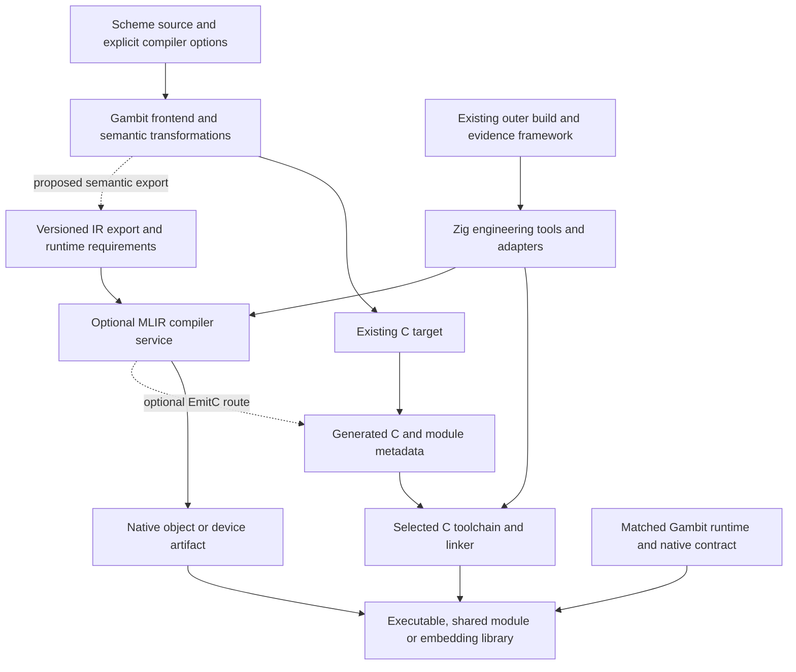

# Zig as Gambit's Future System Engineering Layer

Date: 2026-10-19. Status: architecture research and proposed decisions.

The question is whether Zig can provide a durable engineering foundation around
Gambit's language implementation and C assets. MLIR is one prospective service
on that foundation. This study intentionally stops before implementation,
installation, compilation experiments and performance qualification.

The companion [source and literature review](zig-system-engineering-sources.md)
records primary references, reading coverage, local source identity and limits.
Reference identifiers below resolve there. The earlier
[MLIR feasibility note](zig-mlir-feasibility.md) covers the narrower backend
question and now defers its research direction to this document.

The follow-up [native contract and engineering boundary design](zig-native-contract-design.md)
is extended by the [high-level semantic path](zig-high-level-semantics-design.md)
and its [evidence and quantitative boundaries](zig-high-level-semantics-evidence.md).
See the [collection index](README.md) for D2 architecture sources and renders.

The [compilation-cost and AOT refinement](compilation-cost-and-aot-design.md)
integrates existing Bazel/native reuse successes and rejected coordinators.
Bazel remains the outer action owner; Zig must justify its additional work on
misses, and direct MLIR bypass is distinct from replacing GCC with `zig cc`.

The native-contract design now selects a managed construction interface, Gambit-owned private runtime
protocol, narrow native service boundary and separate MLIR AOT service. It maps
those decisions to current source seams and required changes. Alternatives in
this study remain comparative context; the follow-up owns the concrete design.

## 1. Architectural Conclusion

The [full system value study](zig-system-layer-value.md) now compares this
candidate with the same contracts implemented using existing tools. It gives
the concrete native subsystem, historical-problem mapping, MLIR process topology
and recurring cost model; its [ledger](zig-system-layer-evidence.md) records
the directly read source. The scope includes native resources/providers and
compiler algorithms under semantic contracts, not only building and packaging.

The [adoption refinement](zig-adoption-decision.md) qualifies the recommendation
below: Zig is not required for AOT interface construction. Its incremental case
must come from a coherent native/service engineering subsystem, compared with
the same semantic architecture using existing tools. Command invocation and
packaging alone do not establish a reason to adopt another language/toolchain.

Zig is a credible candidate for the engineering layer that constructs,
distributes, embeds and extends Gambit. Its strongest architectural fit is the
combination of a C toolchain, a programmable build system and a systems language
that can expose C interfaces. That combination can preserve the value of the
existing Scheme-to-C implementation while making future native integrations
less dependent on scattered scripts and platform-specific invocation knowledge.
These capabilities are documented; their combined value for this repository is
an architectural inference, not an observed implementation result. [Z1-Z3]

The recommended direction is a **Gambit semantic core, a defined native contract,
and a Zig engineering layer with replaceable compiler services**. It merits
continued design work. Making Zig the owner of Scheme semantics or replacing the
whole runtime has no justification from the evidence reviewed here.

The long-term rationale has three parts:

1. **Preserve accumulated compiler work.** The C output is an operational asset
   with an existing runtime, FFI, linking and debugging ecosystem. Modernization
   can build around that asset instead of first reimplementing it.
2. **Give integration knowledge an owner.** Effective configuration, host/target
   separation, tool invocation, generated artifacts, external libraries and
   distribution need a coherent engineering contract. Zig could implement that
   contract across more than one integration.
3. **Keep future compiler choices affordable.** A versioned artifact/service
   boundary can contain MLIR/LLVM-specific dependencies and make additional
   backends possible without making every Gambit consumer depend on them.

Zig alone does not provide this separation. A layer that merely calls MLIR while
exposing its internal handles everywhere would preserve most of the coupling
and add another dependency. The project must own the boundary deliberately.

| Proposed decision | Research judgment | What remains open |
| --- | --- | --- |
| Preserve Scheme frontend and C target as first-class assets | Strongly supported by current architecture | Exact supported platform/configuration policy |
| Let Zig implement engineering tools and native adapters | Favorable, with an explicit scope | Maintenance capacity, version policy and ownership of each service |
| Define artifact and runtime contracts independently of Zig internals | Necessary for the stated long-term objective | Detailed schema and API design |
| Keep MLIR an optional compiler service | Favorable | Semantic export level and deployment model |
| Require Zig for every portable Gambit build | Not justified | Whether a future product intentionally narrows its platform promise |
| Rewrite GC, scheduler or frontend in Zig | Separate unselected research direction | Independent correctness and economic case |

## 2. What the Existing System Already Owns

This study reads vendor Gambit at
`7c490c3ab5b5a4238b26f4a59d8cd9fd4b085882`. The research repository HEAD is
`b67da6262a973a0ae898002d5c7f5be2d8b5a90d`, with concurrent local changes.
Current SMP overlays have separate source locks. Baseline source observations
below do not establish the behavior of an overlay or a deployed binary.

| Existing boundary | Inspected source | Architectural implication |
| --- | --- | --- |
| Target representation and GVM generation | `gsc/_back.scm:17-149` | A backend describes representations, primitives, registers, frames, calls and results; it is more than an output printer. |
| C target and embedded C | `gsc/_t-c-1.scm:206-260,337-390` | C declarations, procedures, initialization and object references are integrated into generation. Preserve or explicitly re-express their effects. |
| Scheme compilation versus native construction | `gsc/_gsclib.scm:340-390` | Target generation precedes a `##gambuild` invocation carrying compile/link/package options. There is an existing engineering seam. |
| Native driver configuration | `bin/gambuild-C.unix.in:1-54`; `configure.ac:2990-3040` | Compiler choice, object/dynamic/library/executable modes and captured flags are part of the build contract. |
| VM and threading capabilities | `configure.ac:1244-1315` | Independent VMs, multiple OS threads per VM and the SMP Scheme scheduler are separate configuration dimensions. |
| Generated-code runtime protocol | `include/gambit.h.in:6580-6587,6801-6815`; `lib/_kernel.scm:4505-4526` | Generated code participates in frame/return-address publication and cached-state reload; an ordinary function signature does not describe the full protocol. |
| Module admission | `lib/setup.c:1592-1609` | Version and structure-size checks catch some mismatches. They are not a complete protocol/configuration identity check. |

The frontend also consumes backend information, including register and primitive
descriptions. A future MLIR target cannot be assumed to receive a fully
target-independent frontend product by replacing only `dump`. This agrees with
the historical bidirectional PVM design, without claiming that the 1990 paper
describes all details of the current GVM. [P1]

The existing [C-backend contract](../c-backend-compatibility.md) preserves portable
generated C and supported Scheme/continuation/FFI behavior. It permits coordinated
internal changes with a complete matched rebuild. Preservation does not require
keeping defective old SMP protocols or supporting mixed generations of inline
instructions.

The [compiler-cost diagnostic](../../compiler-cost-boundaries.md) records a previous
152,462-line C output and a timed-out native compilation phase. It establishes a
reason to understand construction cost, not a measured benefit of Zig, Clang,
MLIR or a new driver. Nothing in this study retries that failed route.

## 3. Define the Engineering Layer by Responsibility

The proposed layer owns **how an explicitly specified product is constructed and
connected to native services**. It receives semantic decisions and reports
engineering outcomes. The following is a proposed responsibility allocation,
not an inventory of implemented Zig components.

| Responsibility | Primary owner | Zig's possible role | Boundary to preserve |
| --- | --- | --- | --- |
| Scheme expansion, evaluation and language semantics | Gambit frontend | Invoke compiler; carry declared options | No second Scheme semantic implementation in build scripts |
| Scheme transformations and specialization decisions | Gambit compiler | Transport explicit facts and selected policies | Bridge cannot invent types, purity or overflow rules |
| GVM and backend representation contract | Gambit compiler/backend | Implement an adapter against a documented export | Target decisions remain explicit and source-bound |
| Generated C and runtime inline protocols | C backend plus runtime | Compile unchanged units and enforce matched inputs | C remains C; no wholesale header/body translation to Zig |
| Native tool selection, construction and packaging | Engineering layer | Strong candidate for ownership | Observable effective recipe and replaceable compiler driver |
| External libraries and host service adapters | Explicit service owners | C-facing wrappers, lifetime/error management | Narrow interfaces; ownership and effects specified |
| Heap, root maps, continuation and scheduler semantics | Gambit runtime | Call reviewed entries; perhaps implement selected services later | No implicit replacement by Zig allocation or concurrency facilities |
| Process, VM and processor entry/retirement | Gambit runtime plus embedding contract | Coordinate host-side resources | Runtime remains authority for admitting Scheme execution |
| MLIR dialects, transformations and native lowering | Compiler service | Client/driver; selected implementation code | A separate owner must define and maintain semantic lowering |
| Cache identity and artifact publication | Engineering contract | Implement hashing, staging and diagnostics | Cache presence never grants semantic or runtime admission |
| Source-level debugging and failure attribution | Shared compiler/runtime/tooling contract | Package symbols, maps and phase diagnostics | Preserve the Scheme-to-native correspondence chain |

Build scheduling, the Gambit Scheme scheduler, MLIR's pass scheduling and a host
I/O executor are four different mechanisms. Reusing one systems language does
not give them interchangeable ownership or progress semantics. MLIR's pass
mutation restrictions and analysis invalidation remain its own contracts. [M9]

## 4. Proposed Structural Arrangement



The dashed edges are design candidates. This diagram does not select an IR
export, implement an EmitC conversion or authorize an MLIR-generated module to
load. The direct C construction route remains useful independently of MLIR.

Separate three interfaces:

- **Construction request:** source/artifact identities, target and configuration,
  output kind, selected tools, flags and resource policy. Its result is an
  artifact plus diagnostics and provenance.
- **Compiler-service request:** a versioned semantic representation, declared
  effects, target/runtime requirements and a selected lowering policy. Its
  result states which semantics and ABI it implements.
- **Runtime service interface:** explicit execution owner, value/buffer lifetime,
  allowed effects, result/error behavior and entry/exit protocol.

These interfaces need different versioning. A new build-tool release need not
change the runtime ABI; a changed GC barrier may invalidate generated modules
even when the build request format is unchanged. A single universal version
number would obscure these dependencies.

Serialized IR needs the same care. MLIR's bytecode container has an explicit
compatibility policy, but evolving dialect definitions need their own version
handling. Container readability does not establish unchanged operation semantics
or compatibility with a project's runtime contract. [M4]

## 5. Integrating the C Backend without Discarding It

### 5.1 Distinguish Four Uses of Zig

| Use | What changes | Expected architectural reach |
| --- | --- | --- |
| C compiler distribution/driver | The executable that compiles C | Toolchain delivery and target selection |
| Build orchestrator | Construction graph and artifact handling | Configuration coherence and engineering workflow |
| Host integration implementation language | New native utilities/adapters | Shared resource/error conventions across integrations |
| New code-generation target | Gambit emits Zig or another new IR | A separate backend and runtime representation project |

The first three can be useful together. None requires the fourth. Generated C
should initially stay a native compilation input. Translating the entire
macro-heavy runtime header into Zig would unnecessarily expose private
representation and translation limitations. Bind narrow C declarations and use
reviewed C wrappers where macros encode required execution protocols. [Z3]

### 5.2 Preserve the Effective Recipe

A native construction request must account for generated C, transitive headers,
embedded C, feature macros, the selected runtime generation, compiler/linker
identities, all effective flags, SDK/sysroot/libc, dependent libraries and output
mode. Target CPU features, deployment version and calling convention also matter.
`pkg-config` results and environment-derived choices must become declared inputs
or be excluded by policy; invoking the same command name is insufficient.

The current `gambuild-C` driver is configuration-bearing. Replacing a Makefile
while continuing to invoke a stale installed driver could retain the old
compiler and flags. Conversely, substituting `zig cc` without changing the build
graph is a toolchain change, not a graph redesign. Each must have one explicit
owner to avoid divergent native construction paths.

Features requiring a deliberate compatibility map include compiler extensions,
aliasing and overflow assumptions, atomic/TLS behavior, visibility/export rules,
PIC, shared-module loading, stack/unwind conventions, sanitizers and debug
information. The source audit establishes these as review obligations; it does
not identify a new failure in any specific compiler.

### 5.3 Bootstrap and Cross Compilation

Distinguish the machine performing the build, the machine running `gsc` and
compiler services, and the machine running the final Gambit program. A native
tool used to generate target data must run on the build machine even when its
output describes another target. Existing Scheme bootstrap seeds and generated
C may keep the bootstrap tractable; their provenance remains explicit.

For an AOT MLIR workflow, the MLIR service can be a host-side dependency absent
from the deployed executable. A JIT changes this: the deployed target needs the
compiler service, compatible code-generation support and runtime integration.
Zig cross-target capability does not supply every external target library,
dynamic loader, framework, device driver or legal redistribution right.

The proposed platform set is the intersection of Gambit's selected semantics,
Zig's actual toolchain support, native dependencies and the deployment profile.
Making Zig universally mandatory could narrow Gambit's portable-C reach.
Define profiles instead:

| Profile | Dependency contract | Purpose |
| --- | --- | --- |
| Portable C | Supported host C tools plus matched Gambit sources | Preserve C-target reach and a straightforward bootstrap path |
| Zig engineering | Pinned Zig tools and declared native dependencies | Coherent construction, packaging and optional host integrations |
| MLIR AOT | Engineering profile plus host compiler-service bundle | Offline optimization without compulsory deployment of MLIR |
| MLIR JIT/device | Explicit target compiler/device/runtime bundle | Specialized deployment with a larger support obligation |

These are explicit product configurations using the selected correct runtime,
not a failure fallback between old and repaired SMP protocols. No compiler error
should silently change the requested semantics or product profile.

## 6. Integrating the Runtime: the Hard Boundary

### 6.1 Allocation and Object Identity

Use separate lifetime domains for Gambit's movable/still/permanent objects,
Zig-owned host storage, MLIR contexts/modules and generated machine code.
An allocator parameter helps make a Zig component's allocation explicit; it
does not enroll its pointers as Scheme roots or control MLIR's internal heap.

An interface must distinguish an opaque Scheme handle from a stable native
buffer and from a pointer borrowed only until the next GC-capable operation.
Long-lived compiler state should receive serialized immutable data, stable
owned storage or an explicitly rooted handle with a reviewed lifetime protocol.
Sharing a process address space is not such a protocol.

For a native kernel, specify element types, dimensions, strides, alignment,
aliasing and mutability, allocation owner and release procedure. An MLIR
`memref` is a representation with metadata and calling-convention rules; it is
not automatically interchangeable with a C pointer or Scheme vector. [M5]

### 6.2 Calls, Callbacks and Nonlocal Control

The runtime contract needs to classify each operation by whether it can allocate,
trigger/participate in GC, block, call Scheme, capture a continuation, propagate
an exception or change execution owner. A plain C function type cannot encode
all these effects.

Use ordinary returns across a host adapter's resource-owning region unless its
nonlocal-exit behavior is explicitly implemented and reviewed. Do not assume
Zig `defer`/`errdefer` or C++ destructors run when Scheme control escapes across
foreign frames. Do not assume a Scheme exception can become a Zig error union
without a conversion boundary. A host panic and a Scheme error likewise need
different treatment.

Generated C already contains return-address save, root/state publication and
reload sequences. A Zig call site must preserve the required generated wrapper
or invoke a deliberate runtime entry, rather than copying only its signature.
The [FFI/GC audit](../../ffi-gc-frame-protocol.md) explains the source/model/native
distinction. LLVM statepoints can represent relocation-aware references, but
adopting them would be a backend/runtime integration choice, not an automatic
consequence of choosing LLVM or Zig. [M6]

### 6.3 Threading, Service and Retirement

The [runtime-entry audit](../runtime-entry-contracts.md) and
[transfer-boundary study](../../runtime-transfer-boundary.md) retain several
independent premises: lifetime admission does not confer exclusive processor
execution; roots being visible does not prove GC service; announcements do not
prove worker readiness; and resource retention does not prove safe reclamation.

Consequently, Zig workers may manage independent native compilation data, but
must not borrow arbitrary Scheme processor state or enter a VM because TLS is
available. Host callbacks need a specified owner and supported entry. Zig's
host concurrency facilities must not become a competing Scheme scheduler.

For a long-running compiler call made from Scheme, decide whether a worker uses
copied inputs, whether the Scheme caller remains GC-serviceable while waiting,
and how cancellation and completion return to the original owner. No new
foreign-thread attachment protocol is selected by this study.

Shutdown must order admission closure, outstanding work/callback completion,
worker joins, code retirement, compiler object destruction and VM/runtime
cleanup. The exact partial order depends on ownership: a callable code object
cannot be destroyed while a retained Scheme closure may execute it. A compiler
worker's process exit and a runtime's successful cleanup are different events.

The queried registry and root-signal observations are scoped passes with
explicit non-release/non-terminal limits. They demonstrate why a wrapper must
consume existing lifetime contracts accurately; they do not qualify a Zig
integration. See [local evidence notes](zig-system-engineering-sources.md#local-evidence-and-provenance).

### 6.4 Runtime Code Written in Zig

Selected future leaf services could be implemented in Zig and exposed through C:
artifact I/O, packaging, native library adapters or compiler-service clients.
Each needs a single allocator/error/lifetime owner. Replacing OS services that
already interact with Gambit's event loop can affect polling and cancellation;
it is more intrusive than replacing a standalone build utility.

Moving the collector, stack representation, synchronization primitives or
scheduler into Zig crosses the semantic/runtime boundary. It may be researched
separately, but reuses little of the correctness argument for a host engineering
tool. The OCaml retrofit paper is relevant here: C access semantics can constrain
collector design and force explicit tradeoffs. It does not prescribe Gambit's
collector. [P7]

## 7. Where MLIR Fits in the Long-Term Architecture

There are two independent decisions: **what semantic representation enters
MLIR**, and **how the engineering layer communicates with its implementation**.
Neither decision is answered merely by selecting Zig.

### 7.1 Semantic Entry Choices

| Entry | Information available | Opportunity | Main cost/risk |
| --- | --- | --- | --- |
| Generated C through a C-to-MLIR frontend | C syntax/types plus runtime calls and macros after preprocessing | Reuse existing output; inspect selected low-level regions | Scheme facts and structure may already be lost; another frontend/configuration dependency |
| GVM/procedure target export | Explicit calls, frames, primitive information and target-dependent representation facts | General backend evolution and cross-stage optimization research | Audit bidirectional target dependence and preserve runtime protocol |
| Earlier typed/effect-annotated representation | More source/domain information before flattening | Numeric loops, buffers, shapes and specialization | Establish where facts come from and how unsupported Scheme behavior is represented |
| Explicit domain library/kernel representation | A well-defined sublanguage and boundary | Reusable tensor/array or other domain optimization | It is a language/library design, not transparent acceleration of all Scheme |

Polygeist demonstrates that a C/C++ frontend can generate structured MLIR, so
the generated-C route is a real alternative rather than an impossibility. Its
paper also describes ABI adaptation between pointers and `memref`s. Whether
Gambit's generated control/runtime structure exposes useful optimization is
unanswered; PolyBench results cannot answer it. [P5]

GVM is the strongest source-backed place to study a general new target, while
an earlier or domain-specific export is a better candidate for preserving
high-level numerical structure. Both may ultimately exist for different jobs.
Their semantic overlap must have one definition rather than independently
reimplemented numeric, effect or continuation rules.

### 7.2 Service Placement Choices

| Placement | Advantages | Continuing liabilities |
| --- | --- | --- |
| Separate tool/process, driven by Zig | Contains compiler crashes and LLVM/C++ linkage; host-only AOT is straightforward | Serialization, startup, diagnostics, cancellation and reproducibility protocol |
| In-process MLIR C API | Direct IR construction and lower transport cost | API/version binding, handle ownership, process failure domain and memory/thread accounting |
| Project-owned narrow C facade over MLIR implementation | Concentrates dialect/pipeline-specific interface changes | A maintained facade plus its underlying C++/TableGen/dynamic-dialect implementation |
| Direct Scheme-to-MLIR binding | Fewer host-language components for a narrow integration | Scheme FFI and compiler lifecycle ownership; less independent benefit from an engineering layer |

A process boundary is an attractive default for isolating optional AOT tooling;
an in-process service may be worthwhile for interactive or repeated compilation.
This is a design preference, not a latency result. A custom C facade is a
specific service interface, not a promise of universal MLIR API stability.

The MLIR C API exposes low-level IR and pass facilities without a stability
guarantee. Static dialects commonly use TableGen/C++; extensible/dynamic dialect
mechanisms offer other construction options. Generic operation creation does
not supply verifiers, effect interfaces, optimization legality or lowering.
The exact revision's API coverage must be checked when an implementation is
selected. [M1-M3]

### 7.3 A Semantic Contract for Lowering

Before selecting a general pipeline, describe tagged values and numeric
promotion, closure/environment representation, multiple values, proper tail
calls, continuation capture/return, exception edges, allocation and root
liveness, safepoints, write barriers, synchronization and module initialization.
Annotating an effectful runtime call as pure could make a valid-looking
optimization incorrect. Unregistered operations are not a substitute for these
contracts. IR verification cannot independently prove Scheme equivalence.

MLIR's value is the ability to retain and transform multiple abstraction levels,
not the name of the bridge language. LLVM already provides lower-level
optimization infrastructure; if a use case only needs that level, a direct
LLVM service is a serious lower-complexity alternative. [P3-P4]

Transform scripts could eventually make optimization policy separately
versionable from bridge code, while the service retains legality and failure
handling. They do not remove dialect/lowering engineering or justify applying
arbitrary transformations. [P6]

MLIR can also emit C/C++ through EmitC. This could connect a future structured
optimization route back to the C distribution path. The required conversions
and Gambit protocols are still project work, and some EmitC features require
C++ or extensions. This is an architectural option, not an implemented round
trip or a claim that ordinary C compilation becomes cheaper. [M7]

### 7.4 AOT, JIT and Devices Have Different Costs

| Mode | Required lifecycle | Benefit hypothesis | Main liability |
| --- | --- | --- | --- |
| Offline AOT | Compile, link, publish matched artifacts | Amortize optimization without target-side compiler | Larger build dependency and more artifact identities |
| Interactive/repeated native compilation | Retained compiler contexts and bounded requests | Amortize startup and support rapid specialization | Memory retention, concurrency and invalidation |
| JIT | Code registration, roots/debug/unwind metadata, callable lifetime and retirement | Runtime specialization from observed facts | Compiler in deployment, executable-memory policy and safe code reclamation |
| GPU/accelerator | Device code, transfers, synchronization and device buffer lifetime | Domain parallelism | Data movement, launch overhead and restricted semantics |

Zig can host adapters for these modes. It does not make general continuations,
Scheme heap objects or the CPU scheduler executable on a device. Device
asynchrony requires the host to retain buffers until device completion, including
failure and cancellation paths. [M8]

## 8. Build-System and Dependency Coexistence

Replacing every existing build system would spend substantial effort before
establishing the value of the engineering layer. Let the outer build/evidence
framework own product selection, dependency policy and acceptance; let a Zig
component own the bounded native work delegated to it. Avoid two independent
schedulers claiming the same graph or caches that disagree about inputs.

`build.zig` is a candidate implementation tool, not a semantic format for all
consumers. If a Bazel action delegates construction to Zig, it must declare the
inputs and outputs relevant to that action, provide a controlled cache directory,
and account for nested concurrency. Alternatively, Bazel can invoke Zig as its
C toolchain while retaining its own graph. Uber's historical report and
`hermetic_cc_toolchain` show this division is viable in another system. They do
not establish current Gambit support or recommend a particular toolchain pin.
[E1-E2]

For LLVM/MLIR, retaining its upstream build/package process and consuming a
versioned bundle is a reasonable option. Reimplementing that dependency's whole
build graph in Zig is not a prerequisite for making Zig the integration owner.

Build Systems a la Carte separates scheduling from rebuild strategy. That
distinction suggests comparing dependency completeness, invalidation and reuse
independently of scripting language. Bazel's hermeticity guidance likewise
centers tool and input identity. A Zig cache is not automatically a hermetic,
remote-executable or reproducible build. [P8, E3]

Host LLVM libraries used by MLIR, Clang inside a Zig toolchain and target object
files are different dependency roles. In-process libraries need a compatible
C++ runtime/ABI arrangement; ordinary native objects can often meet at a C ABI,
subject to platform and feature constraints. LLVM bitcode/LTO adds tighter
version and pipeline coupling than an ordinary object boundary. Sharing an LLVM
brand or major version is not sufficient evidence of compatibility.

## 9. Long-Term Benefits, Costs and Alternatives

### 9.1 Benefits Worth Pursuing

| Potential benefit | Mechanism | Condition for real value |
| --- | --- | --- |
| Preserve C investment while modernizing engineering | Build and service layers evolve around existing generation | New layer consumes accurate contracts and avoids duplicating semantics |
| Reduce platform setup variation | Pinned tool distribution and explicit target/native dependency policy | Required SDKs/libraries and supported profiles are covered |
| Improve integration consistency | Shared request, error, lifetime and artifact conventions | Multiple consumers actually reuse them |
| Make compiler services independently replaceable | Versioned semantic and artifact boundaries | Backend-specific handles do not escape into ordinary Gambit APIs |
| Improve debugging and reproducibility | Phase diagnostics, source maps, exact construction identities | Evidence is retained and correlated through every transformation |
| Enable domain optimization over time | Higher-level facts survive to a suitable compiler service | Useful workloads, valid transformations and affordable compilation |

These are architectural hypotheses. Compile-time, execution-time, memory and
distribution-size gains are unknown. Preserving generated C does not preclude
future IR innovation; useful reuse depends on choosing the right boundary.

### 9.2 Costs That Persist after Initial Integration

- Zig language, standard-library and build-API evolution requires a supported
  version policy. The reviewed 0.16.0 notes deprecate `@cImport` in favor of
  build-managed C translation and document continued evolution of the LLVM
  dependency. Treat the C-facing contract as the durable surface. [Z1]
- Zig, C, Scheme and possibly TableGen/C++ increase the skills and tooling a
  maintainer needs. Manual ownership remains a design responsibility; a smaller
  amount of FFI syntax does not make that responsibility disappear.
- Another layer can duplicate configuration and diagnostics. Savings require
  deleting superseded engineering ownership rather than adding permanent
  competing drivers.
- Native support matrices grow across target, libc/SDK, runtime configuration,
  compiler mode, linking mode and backend revision. “Cross-compiles” and “works
  on the target” remain distinct claims.
- MLIR adds dependency build time, pass maintenance and generated-code
  qualification. A modular AOT distribution can keep it off the deployed target,
  but does not remove producer-side cost.
- Embedding additional native code expands the fault domain, symbol/unwind
  interactions and allocator/callback lifetime obligations. Process isolation
  trades some of those costs for transport and coordination.

### 9.3 Compare Real Alternatives

| Architecture | Best fit | Why Zig could still be worthwhile | Reason to choose the alternative |
| --- | --- | --- | --- |
| Existing C tools plus improved explicit recipes | Construction/provenance is the main problem | One language could also implement host adapters | Lowest language/toolchain migration cost |
| CMake/Bazel plus Clang/GCC | Mature native build ecosystem and remote execution | Zig can be a subordinate toolchain or utility implementation | Existing graph already solves most needs |
| Direct C++ MLIR service | Most new work is dialects/passes | Zig can remain the outer engineering owner | Avoid an extra binding layer inside MLIR-heavy code |
| Rust host layer with C bindings | Strong host ownership model and established Rust investment | Zig offers another style of explicit C-oriented integration | Team expertise and existing libraries dominate language preference |
| Scheme orchestration and direct native bindings | Small compiler-only integration | Zig adds broader native tooling reuse | Keep compiler work in the existing language and minimize dependencies |
| Direct LLVM backend/service | Mostly low-level optimization needs | Same engineering boundary can host it | MLIR abstraction levels may not repay their maintenance cost |

No evidence supports a universal ranking of Zig over C or Rust. Arena ownership,
opaque handles and narrow interfaces are available in several languages. Zig's
specific case is the combined toolchain/build/native-adapter role; assess that
combination rather than an anecdote about pointer syntax.

### 9.4 Economic and Performance Reasoning

Use an unmeasured decision model:

```text
long-term value = repeated integration/platform work avoided
                + new capabilities actually used
                - migration and contract-design cost
                - recurring toolchain/backend maintenance
                - additional qualification and operational cost

build time = Scheme processing + C/IR production + native optimization/codegen
           + linking + orchestration + unavoidable input validation

accelerated execution pays off when
N * (baseline work time - accelerated work time)
  > extra compilation + marshaling/transfers + initialization + coordination
```

`N` is the reuse count and all costs depend on the workload. The formulas are
decision aids, not forecasts. Faster host utilities may have little effect when
native compilation dominates. A retained compiler can reduce repeated startup
but consume memory; cached reuse may reduce rebuild work but still require
identity validation. Domain speedups need end-to-end accounting.

The proposal is weakest if Zig remains only a permanent wrapper around one
MLIR call, a small team cannot support its upgrades, or declared platform reach
shrinks without a product reason. It is strongest when several native services
reuse the engineering contract while Gambit's semantic/runtime core stays clear.

## 10. Research Decisions before Any Implementation

The present deliverable is a reasoned architecture and a defined set of open
decisions. The following sequence is research work, not a minimal prototype plan.

| Research subject | Concrete decision artifact | Completion condition |
| --- | --- | --- |
| Product and portability policy | Supported host/target/dependency profiles | Explain which users require Zig and which retain a portable-C path |
| Responsibility and lifecycle | Interface ownership and effect tables | Every allocation, callback, cancellation and teardown has an owner |
| Native construction integration | Mapping from current Gambit driver inputs to construction requests | No hidden second source of compiler/configuration truth |
| Compiler representation | Comparison of C, GVM and earlier/domain exports | Identify available facts, lost facts, legal transformations and runtime obligations |
| MLIR deployment | AOT/process versus in-process/JIT decision | Dependency, fault, transport and maintenance costs are explicit |
| Version and artifact policy | Separate request, semantic, runtime and compiler-service identities | Invalidation rules explain which changes require regeneration/rebuild |
| Debug and operational support | Source-to-artifact-to-runtime diagnostic design | Failures can be assigned to the actual stage and producer |
| Maintenance economics | Comparison with existing tools, direct MLIR and LLVM alternatives | State which recurring work Zig removes and who maintains the new surface |

Further literature can refine these decisions, particularly continuation-aware
FFI, multi-stage IR design, build correctness, cross-language ownership and JIT
code retirement. Each new reference should state the mechanism being borrowed
and the assumption that does not transfer to Gambit.

After those decisions are settled, a separate implementation proposal can select
validation obligations. This study does not schedule experiments, install Zig,
introduce a build file, change runtime flags, add a backend, or claim native SMP
progress. Documentation consistency and reference checks are the only checks
performed for this architecture deliverable.
