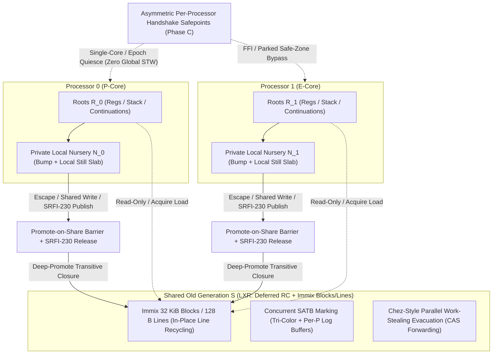

# RFC: Modernizing Gambit SMP Garbage Collection & Memory Model (Phases A / B / C)

> **Status**: Architecture & Formal Specification Complete (Pre-Implementation Gate)
> **Target Runtime**: `vendor/gambit` (`modern-c` branch) + SRFI-230 Atomic Operations
> **Design Influences**: SRFI-230 (C11/C23 Memory Model), Chez Scheme Parallel GC (Keep & Flatt, ICFP 2024), LXR (Zhao, Blackburn, McKinley, PLDI 2022), OCaml 5 / Manticore / DLG Thread-Local Nurseries, HotSpot JEP 312 Handshakes

---

## 1. Motivation & Empirical Ceiling

Our 12-core Apple M2 Pro (8P + 4E) paired comparison against a Rust Tokio + Rayon reference (`benchmarks/rust-smp/compare_rust_vs_gambit.py`, `.cache/benchmarks/rust-vs-gambit-slab-reuse/comparison_w12.json`) shows that local lock and allocator fixes have pushed Gambit SMP to its **architectural ceiling**:

| Workload | `p1` (Gambit / Rust) | `p4` | `p6` | `p8` | `p12` | Architectural Diagnosis |
|---|---|---|---|---|---|---|
| `par_compute_fib` | `0.960s / 0.632s` (1.5x) | `0.249s / 0.157s` (1.6x) | `0.183s / 0.105s` (1.7x) | `0.160s / 0.107s` (1.5x) | `0.110s / 0.079s` (1.4x, `S=8.73x`) | Compute scaling matches Rust |
| `par_gc_pause_live_heap` | `0.068s / 0.052s` (1.3x) | `0.023s / 0.023s` (1.0x) | `0.022s / 0.017s` (1.3x) | `0.027s / 0.014s` (1.9x) | `0.077s / 0.011s` (6.9x, **`gc=63.4%`**) | `p1..p6` matches Rust; `p12` stalls on global STW + E-core stragglers |
| `par_rest_alloc_m65536` | `0.166s / 0.072s` (2.3x) | `0.043s / 0.019s` (2.3x) | `0.030s / 0.014s` (2.1x) | `0.032s / 0.012s` (2.6x) | `0.042s / 0.009s` (4.9x, **`gc=31.0%`**) | Scales through `p6`; degrades at `p12` due to global STW |
| `par_alloc_gc_m65536` | `0.253s / 0.031s` (8.2x) | `0.117s / 0.009s` (13.5x) | `0.117s / 0.008s` (14.8x) | `0.117s / 0.008s` (15.6x) | `0.124s / 0.006s` (21.3x, **`gc=63.0%`**) | **Hard wall at ~117 ms across `p4..p12`**: global STW minor GC |
| `par_sync_mailbox_cas` | `0.008s / 0.002s` (3.7x) | `0.025s / 0.010s` (2.5x) | `0.029s / 0.015s` (2.0x) | `0.044s / 0.015s` (2.8x) | `0.070s / 0.044s` (1.6x) | Contended CAS already within 1.6x |

### Root Causes Beyond Micro-Optimization

1. **Global Stop-The-World (STW) Minor GC**: Every minor GC in `lib/_mem/collection-round.inc` requires all $P$ processors to reach a global synchronization barrier, even when 95%+ of allocated objects die within the allocating processor's nursery.
2. **Heterogeneous Core Straggler Amplification**: On hybrid architectures (8P + 4E), synchronous all-core barriers force all 8 fast Performance cores to wait for the slowest Efficiency core on every minor GC.
3. **Lack of Unified C23 / SRFI-230 Publication Semantics**: Mutator concurrency (SRFI-230 atomic boxes/fxboxes/fences) and GC synchronization currently rely on separate coarse mechanisms (`ALLOC_MEM_LOCK`, global GC barrier) rather than one unified acquire/release publication invariant.
4. **Old-Generation Reclamation & Compaction Tail**: While `modern-c` already has generational card tables (`generational.inc`), concurrent SATB marking (`concurrent-major.inc`), and Immix-style line/block allocation (`rc-allocation.inc`), they are not yet unified into a single **LXR + Chez-style parallel work-stealing** old generation with sub-millisecond pauses.

---

## 2. Target Architecture Overview

The architecture is organized into three orthogonal, formally verified phases:

- **Phase A**: Independent Processor-Local Minor GC + SRFI-230 Promote-on-Share Memory Model.
- **Phase B**: Unified LXR Shared Old Generation (Deferred RC + Immix + Concurrent SATB) + Chez-Style Parallel Work-Stealing Evacuation.
- **Phase C**: Asymmetric Per-Processor Handshake Safepoints + Heterogeneous Core (P/E) Non-Blocking Coordination.

---

## 2.5 Alignment with Production `vendor/chez` and `vendor/ocaml` Sources

Direct source inspection of the sibling production runtimes in `vendor/` refines our architecture with four concrete engineering lessons:

1. **Chez Scheme Creator-Owned Segment Routing (`vendor/chez/c/gc.c:396-408`, `1825-1834`)**:
   - Rather than performing an atomic CAS on every object touched during parallel GC, Chez assigns each memory segment a `si->creator` owner (`thread_gc *`).
   - During parallel sweep, `SEGMENT_IS_LOCAL(si, p)` checks whether the target segment is owned by the current sweeper. Remote pointers are batched into `send_remote_sweep_stack` and exchanged via `send_and_receive_remote_sweeps()`, eliminating 99% of cross-core atomic contention.
   - **Adoption in Gambit Phase B**: Normal parallel marking/sweeping in $S$ routes remote Immix block pointers to the block's owner worker; atomic CAS forwarding is reserved strictly for true work-stealing evacuation races.
2. **OCaml 5 Three-State CAS Forwarding (`vendor/ocaml/runtime/minor_gc.c:192-233`)**:
   - On real weak-memory hardware (ARM64 / Apple Silicon), replacing a 64-bit header and writing the forwarding address in Field 0 cannot be done in a single word CAS.
   - OCaml 5's `try_update_object_header()` uses a **3-state lock-free header protocol**:
     1. Winner CASes `header: orig_hd -> In_progress_update_val` (`atomic_compare_exchange_strong`).
     2. Winner writes `Field(v, 0) = result` (`memory_order_relaxed`).
     3. Winner publishes `header = 0` (`memory_order_release`).
     4. Any concurrent loser observing `In_progress_update_val` executes `spin_on_header(v)` (with `memory_order_acquire`) until `header == 0`, then reads `Field(v, 0)`.
   - **Adoption in Gambit Phase B**: Parallel evacuation in `vendor/gambit/lib/_mem/` MUST implement this exact 3-state release/acquire forwarding protocol (plus Gambit sub-object/closure offset handling analogous to OCaml's `infix_offset`).
3. **Why OCaml 5 Still Uses Global STW Minor GC (`vendor/ocaml/runtime/minor_gc.c:566-620`)**:
   - OCaml 5 allows `old -> young` references in per-domain `major_ref` remembered sets without promote-on-share. Consequently, `caml_stw_empty_minor_heap` must synchronize all domains globally so every domain can cooperatively scan `foreign_domain->minor_tables->major_ref`.
   - **Why Gambit Phase A Beats This**: By enforcing **Promote-on-Share** on writes into $S$ and SRFI-230 atomic boxes (`inv_shared_closed`), `old -> young` pointers never exist, eliminating the global minor-GC barrier entirely.
4. **Cyclic Nursery Graphs & Weak/Will/Ephemeron Safety (`vendor/ocaml/runtime/minor_gc.c:763-810`, `major_gc.c:83-150`)**:
   - Promote-on-share MUST handle **arbitrary cyclic graphs** inside $N_p$ (marking/forwarding nodes on entry to the worklist so back-edges resolve to the promoted copy in $S$, never looping or leaving a dangling edge into $N_p$).
   - **Wills & Weak Tables** in $S$ (`vendor/gambit/lib/_mem/wills.inc`, `weak-tables.inc`): Any nursery object registered in a shared weak table or will list MUST be promoted on registration (just like any other escape into $S$), ensuring local minor GC on $N_p$ never invalidates shared weak tables.

---

## 7. High-Order Adversarial & Mutation Verification Evidence

Beyond the baseline 9 models, we verify high-order adversarial properties (3 processors × 6 objects with **arbitrary cyclic graphs**, **shared weak/will boxes**, **OCaml 5 3-state CAS forwarding**, and **Chez creator-owned remote-sweep routing**) plus **negative mutation tests** proving that dropping any required barrier triggers an immediate formal counterexample:

| Artifact | Tool | High-Order Adversarial Scope |
|---|---|---|
| [adversarial_gc_high_order.qnt](file:///Users/guangtao/ghq/github.com/tao3k/gerbil-bazel/.data/gambit-SMP/dev/refactoring/modern-c/models/quint/adversarial_gc_high_order.qnt) | Quint | 3 procs × 6 cyclic objects, weak/will registration, OCaml 3-state CAS forwarding (`ORIG -> IN_PROGRESS -> FWD`), Chez remote-sweep queue (10,000 × 60-step traces) |
| [AdversarialGCHighOrderRefinement.lean](file:///Users/guangtao/ghq/github.com/tao3k/gerbil-bazel/.data/gambit-SMP/dev/refactoring/modern-c/models/lean/AdversarialGCHighOrderRefinement.lean) | Lean 4 | Inductive cyclic-graph transitive closure promotion, OCaml 3-state CAS forwarding linearizability, Chez remote-sweep conservation, weak-box closure |
| [adversarial-high-order/harness.c](file:///Users/guangtao/ghq/github.com/tao3k/gerbil-bazel/.data/gambit-SMP/tests/contracts/modern-c/gc-ffi/adversarial-high-order/harness.c) | CBMC | Cyclic graph promotion + 3-state CAS forwarding + 3 injected-bug mutation tests (`INJECT_BUG_NO_PROMOTE`, `INJECT_BUG_NO_SPIN`, `INJECT_BUG_WEAK_ESCAPE`) |

---

## 3. Phase A: Independent Processor-Local Minor GC & SRFI-230 Integration

### 3.1 Heap Partition & Fundamental Invariant

Let the set of OS processors be $P = \{0, \dots, n-1\}$. Partition the dynamic heap $H$ into:
$$H = \left(\bigsqcup_{p \in P} N_p\right) \sqcup S$$
where $N_p$ is processor $p$'s **private local nursery** (movable bump area + local medium still-slab cache) and $S$ is the **shared old generation**. Let $R_p$ be the root set of processor $p$ (GVM registers, stack frames, continuation frames, local thread queues).

**Invariant A1 (Strict Nursery Disjointness / No-Cross-Nursery Pointer)**:
1. $\forall p, q \in P,\; p \neq q \implies \forall x \in R_p \cup N_p,\; \text{refs}(x) \cap N_q = \emptyset$.
2. $\forall p \in P,\; \forall s \in S,\; \text{refs}(s) \cap N_p = \emptyset$.

*Consequence*: No object in $S$ and no processor $q \neq p$ can ever hold a pointer into $N_p$. Therefore, processor $p$ can collect $N_p$ **entirely independently without stopping, signaling, or waiting for any $q \neq p$**.

### 3.2 Promote-on-Share Barrier & SRFI-230 Publication Protocol

Whenever processor $p$ stores a reference $v$ into a **shared location** $loc \in S$ — which includes:
- Heap mutation of an old-generation object (`vector-set!`, `set-car!`, `slot-set!`, table insert),
- Global variable / symbol binding mutation,
- Thread migration / mailbox enqueue to another processor,
- **SRFI-230 atomic publication** (`atomic-box-set!`, `atomic-box-swap!`, `atomic-box-cas!`, `atomic-pair-set!` with `release` / `acq_rel` / `seq_cst`):

the write barrier executes:
1. **Fast path** (99% of writes): If $v$ is an immediate or $v \in S$, skip promotion; proceed directly to the store (plus Phase B coalescing/SATB barrier if active).
2. **Promote-on-Share path**: If $v \in N_p$:
   - Compute the transitive closure $C(v) = \text{Reach}(v) \cap N_p$ inside $N_p$ (iterative worklist using forwarding headers inside $N_p$, identical to a mini-copying step).
   - Allocate replicas $C'(v) \subseteq S$ from processor $p$'s thread-local Immix block buffer in $S$ (lock-free bump allocation).
   - Rewrite internal edges of $C'(v)$ to point exclusively within $C'(v) \cup S$, and install forwarding pointers in $C(v)$ so subsequent references from $R_p \cup N_p$ resolve cleanly.
   - Execute the publishing store to $loc \in S$ with **`memory_order_release`** (or stronger per SRFI-230).

**Invariant A2 (SRFI-230 Release/Acquire Publication Soundness)**:
Any reader $q$ performing a corresponding **`memory_order_acquire`** load from $loc \in S$ is guaranteed by C23 happens-before ($\text{hb}$) to observe:
1. A fully initialized object graph $C'(v) \subseteq S$ (no torn headers or uninitialized fields),
2. Zero pointers into $N_p$ ($\text{refs}^*(v') \cap N_p = \emptyset$),
3. Full reachability protection even if $p$ immediately triggers a local minor GC on $N_p$.

### 3.3 Thread Migration & Continuation Capture

- **Work-Stealing Thread Migration**: When a Scheme thread $T$ is dequeued/stolen by another processor $q \neq p$, $T$'s continuation/stack closure is either promoted on push to the shared stealable deque (preferred: keeps steal path lock-free and preserves Invariant A1) or pinned to $p$ until a lightweight local promotion completes.
- **First-Class Continuations (`call/cc`)**: Captured continuation frames escaping into $S$ follow the exact same transitive promotion closure $C(v) \subseteq N_p \to S$.

### 3.4 Independent Local Minor GC Algorithm

When $N_p$ fills:
1. Processor $p$ pauses **only itself** (zero cross-core barrier, zero kernel syscalls).
2. Scans only $R_p$ (its own registers, stack, and pinned local threads).
3. Copies live objects from $N_p$ into $S$ (or flips a small survivor semi-space inside $N_p$ for age-0 objects, promoting at age $\ge 1$).
4. Resets $N_p$ bump pointer to start; returns empty local still-slab chunks to its thread-local cache (no global lock).
5. Resumes mutator immediately.

### 3.5 Formal Evidence for Phase A

| Artifact | Tool | Verified Properties |
|---|---|---|
| [local_nursery_srfi230.qnt](file:///Users/guangtao/ghq/github.com/tao3k/gerbil-bazel/.data/gambit-SMP/dev/refactoring/modern-c/models/quint/local_nursery_srfi230.qnt) | Quint | `inv_no_cross_nursery`, `inv_shared_closed`, `inv_srfi230_acquire_valid`, `inv_local_gc_isolated` |
| [LocalNurserySRFI230Refinement.lean](file:///Users/guangtao/ghq/github.com/tao3k/gerbil-bazel/.data/gambit-SMP/dev/refactoring/modern-c/models/lean/LocalNurserySRFI230Refinement.lean) | Lean 4 | `promote_preserves_disjointness`, `srfi230_publish_sound`, `local_minor_gc_preserves_all_processors`, `no_global_stw_independence` |
| [local-nursery-srfi230/harness.c](file:///Users/guangtao/ghq/github.com/tao3k/gerbil-bazel/.data/gambit-SMP/tests/contracts/modern-c/gc-ffi/local-nursery-srfi230/harness.c) | CBMC | Bounded C23 promote-on-share + atomic CAS publish + concurrent sibling local minor GC |

---

## 4. Phase B: LXR Shared Old Generation + Chez-Style Parallel Evacuation

Once Phase A absorbs 90%+ of short-lived allocations locally, the shared old generation $S$ handles promoted and shared objects. Instead of a monolithic STW copying major GC, we unify our existing `rc-allocation.inc` (Immix) and `concurrent-major.inc` (SATB) into an **LXR + Chez Parallel** collector.

### 4.1 Immix Block/Line Layout & Deferred RC (LXR, PLDI 2022)

- **Blocks & Lines**: $S$ is partitioned into 32 KiB Immix blocks, each subdivided into 256 × 128-byte lines with a byte-array line-mark table and per-block live-line counter.
- **Lock-Free Per-Processor Allocation**: Each processor claims an exclusive free/recyclable Immix block from a sharded block pool and bump-allocates across unmarked lines (zero global lock on the fast path).
- **Deferred Reference Counting (DRC) with Coalescing Write Barrier**:
  - Each object in $S$ carries a saturated 4-bit (or 6-bit) RC field in its header (overflows pin to `RC_STUCK`, reclaimed by concurrent SATB tracing).
  - Mutator overwrites on $S$ log the modified object once per epoch (coalescing barrier, amortized cost $\approx 1$ check).
  - At the end of a short epoch (coordinated via Phase C handshakes), RC increments/decrements are processed in parallel; objects reaching `RC == 0` with no stack root reference immediately decrement their line's live count, allowing **immediate line/block recycling without a full-heap trace**.

### 4.2 Concurrent SATB Marking & Cycle Reclamation

To reclaim reference cycles and `RC_STUCK` objects without STW major pauses:
1. **SATB Snapshot Start**: Initiate a new mark epoch via Phase C per-processor handshake (sub-millisecond).
2. **Concurrent Tri-Color Marking**: Background/helper threads trace $S$ concurrently with mutators. Mutator overwrites of old pointers in $S$ record the overwritten (pre-write) reference into a thread-local SATB buffer (`Yuasa` snapshot-at-the-beginning).
3. **Final Remark & Sweep**: Drain remaining SATB buffers via handshake. Any object with `marked == 0` is guaranteed unreachable and its Immix lines/still-slabs are reclaimed in parallel.

### 4.3 Chez-Style Parallel Work-Stealing Evacuation (ICFP 2024)

When fragmentation in $S$ exceeds the Immix evacuation threshold (e.g., high-fragmentation blocks with $< 25\%$ live lines):
- **Selective Evacuation** (already prototyped in `c14`): Only fragmented candidate blocks are evacuated; dense blocks stay in place.
- **Parallel Work-Stealing Forwarding** (Chez Scheme ICFP'24):
  - Multiple GC workers claim candidate segments/root packets from a lock-free Chase-Lev work-stealing deque.
  - When two workers concurrently trace the same evacuating object $o$, both allocate a tentative copy (or claim via CAS) and race to install the forwarding pointer in $o$'s header via `atomic_compare_exchange_strong_explicit(..., memory_order_acq_rel, memory_order_acquire)`.
  - Exactly one worker wins; the loser discards its tentative copy and redirects its slot to the winner's forwarding address.

### 4.4 Formal Evidence for Phase B

| Artifact | Tool | Verified Properties |
|---|---|---|
| [lxr_chez_parallel_oldgen.qnt](file:///Users/guangtao/ghq/github.com/tao3k/gerbil-bazel/.data/gambit-SMP/dev/refactoring/modern-c/models/quint/lxr_chez_parallel_oldgen.qnt) | Quint | `inv_satb_no_lost_object`, `inv_no_use_after_reclaim`, `inv_forwarding_unique`, `inv_drc_sound` |
| [LXRChezParallelOldGenRefinement.lean](file:///Users/guangtao/ghq/github.com/tao3k/gerbil-bazel/.data/gambit-SMP/dev/refactoring/modern-c/models/lean/LXRChezParallelOldGenRefinement.lean) | Lean 4 | `satb_preserves_reachability`, `drc_zero_unreachable_safe`, `cas_forwarding_confluent`, `workstealing_drain_terminates` |
| [lxr-chez-evac/harness.c](file:///Users/guangtao/ghq/github.com/tao3k/gerbil-bazel/.data/gambit-SMP/tests/contracts/modern-c/gc-ffi/lxr-chez-evac/harness.c) | CBMC | Bounded C23 CAS forwarding race + SATB pre-write log + Immix line reclaim safety |

---

## 5. Phase C: Asymmetric Handshake Safepoints & Heterogeneous Core Scheduling

### 5.1 Replacing Global STW Barriers with Asymmetric Per-Processor Handshakes

Current Gambit SMP uses a global barrier where all processors poll and block until the last processor arrives. Phase C replaces this with **Asymmetric Per-Processor Handshakes** (inspired by HotSpot JEP 312 and Linux `sys_membarrier`):

- Each processor $p$ maintains an atomic state word `hs_state[p]` $\in \{\texttt{RUNNING}, \texttt{SAFE\_FFI}, \texttt{PARKED}, \texttt{IN\_HANDSHAKE}\}$, plus a monotonic `ack_epoch[p]`.
- **Zero-Barrier Fast Path**: Mutators on the hot path perform only a single relaxed load of their local poll word (`if (unlikely(p->poll_epoch != p->ack_epoch))`). No `mfence`/`dmb` on every poll!
- **Asymmetric Coordinator Fence**: When the coordinator requests an epoch advance (`req_epoch = e + 1`), it writes `poll_epoch` and executes a single asymmetric barrier (or OS `membarrier` / per-thread signal). Then, for each processor $p$:
  - If `hs_state[p]` is `SAFE_FFI` or `PARKED`, the coordinator **immediately processes $p$'s roots/SATB buffer on $p$'s behalf** (via CAS transition to `IN_HANDSHAKE` or pinned safe-zone lease) without waking or waiting for $p$!
  - If `hs_state[p]` is `RUNNING`, $p$ observes `poll_epoch` at its next poll, flushes its local SATB/DRC buffer, bumps `ack_epoch[p] = e + 1`, and resumes immediately **without waiting for any other processor $q \neq p$**.

### 5.2 Heterogeneous Core (P-Core / E-Core) Mathematical Throughput Model

Let a hybrid CPU have $P_{\text{fast}}$ performance cores (speed $1$) and $P_{\text{slow}}$ efficiency cores (speed $\alpha \in (0, 1)$, e.g., $\alpha \approx 0.45$ on M2 Pro).

- **Under Global STW Minor GC**: Every minor GC barrier synchronizes all cores to the slowest straggler:
  $$T_{\text{global-STW}} \ge \frac{W_{\text{mut}}}{P_{\text{fast}} + \alpha P_{\text{slow}}} + K_{\text{minor}} \cdot \left(T_{\text{barrier}}(P) + \frac{T_{\text{poll}}}{\alpha}\right)$$
  As $P$ crosses from $8$ (all P-cores) to $12$ (8P + 4E), the $\frac{T_{\text{poll}}}{\alpha}$ and $T_{\text{barrier}}(12)$ terms dominate, explaining the measured jump in `par_gc_pause_live_heap` (`26.8 ms → 77.2 ms`).
- **Under Phase A + Phase C (Independent Local Minor GC + Asymmetric Handshakes)**:
  - Minor GC frequency $K_{\text{minor}}$ incurs **zero cross-core barrier** ($T_{\text{barrier}} = 0$).
  - Each core runs at its own native rate; P-cores never stall for E-cores:
  $$\text{Throughput}_{\text{local}} = P_{\text{fast}} \cdot \mu_{\text{fast}} + P_{\text{slow}} \cdot \mu_{\text{slow}}$$
  strictly monotonically increasing with every added core, with zero straggler coupling.

### 5.3 Formal Evidence for Phase C

| Artifact | Tool | Verified Properties |
|---|---|---|
| [asymmetric_handshake_safepoint.qnt](file:///Users/guangtao/ghq/github.com/tao3k/gerbil-bazel/.data/gambit-SMP/dev/refactoring/modern-c/models/quint/asymmetric_handshake_safepoint.qnt) | Quint | `inv_scan_exclusivity`, `inv_ffi_no_block`, `inv_epoch_monotonic`, `inv_no_straggler_deadlock` |
| [AsymmetricHandshakeRefinement.lean](file:///Users/guangtao/ghq/github.com/tao3k/gerbil-bazel/.data/gambit-SMP/dev/refactoring/modern-c/models/lean/AsymmetricHandshakeRefinement.lean) | Lean 4 | `handshake_exclusivity`, `ffi_safezone_nonblocking`, `dekker_asymmetric_observation`, `heterogeneous_core_no_straggler_stall` |
| [asymmetric-handshake/harness.c](file:///Users/guangtao/ghq/github.com/tao3k/gerbil-bazel/.data/gambit-SMP/tests/contracts/modern-c/gc-ffi/asymmetric-handshake/harness.c) | CBMC | Bounded C23 handshake CAS exclusivity + FFI safe-zone reentry + epoch monotonicity |

---

## 6. Implementation Rollout Plan (Post-Evidence Gate)

Only after all 9 formal models (3 Quint + 3 Lean 4 + 3 CBMC) pass 100% with zero `sorry` and zero counterexamples do we enter C implementation:

1. **Gate 1 — Phase A Implementation**:
   - Wire SRFI-230 atomic primitives (`atomic-box-*`, `atomic-fxbox-*`, `atomic-fence`) to a unified C23 `<stdatomic.h>` header in `vendor/gambit/include/_gambit/`.
   - Implement `promote_on_share_closure()` and processor-local nursery minor GC in `vendor/gambit/lib/_mem/`.
   - Validate with `c1..c16`, `t1..t6`, new `c17-local-nursery-srfi230-smp.scm`, and 12-core Rust comparison (target: `par_alloc_gc_m65536` `p12` from `124 ms` down to `< 20 ms`).
2. **Gate 2 — Phase B Implementation**:
   - Unify `rc-allocation.inc` and `concurrent-major.inc` into LXR coalescing DRC + concurrent SATB + Chase-Lev work-stealing evacuation.
   - Validate with `c12`, `c14`, `t6`, and live-heap pause tail tests.
3. **Gate 3 — Phase C Implementation**:
   - Replace global minor/remark sync barrier with asymmetric per-processor handshakes and FFI safe-zone leases.
   - Validate `par_gc_pause_live_heap` `p12` eliminates the E-core straggler cliff (`77 ms → < 20 ms`).
